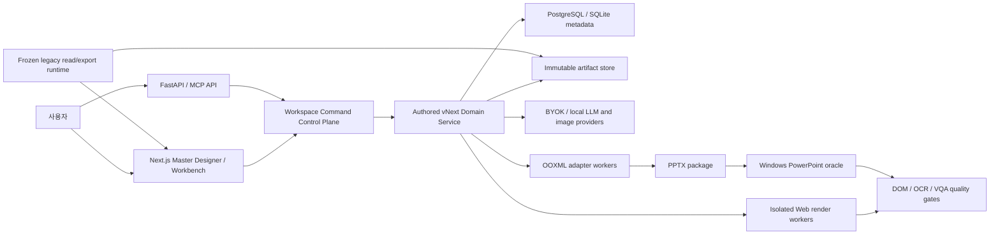

# Authored-only vNext 전체 아키텍처 설계

- 상태: Proposed
- 작성일: 2026-08-13
- 적용 대상: Presenton fork의 신규 프레젠테이션 생성·편집·검수·PPTX import/export
- 결정 수준: 제품 아키텍처 및 단계적 전환 기준
- 구현 원칙: 신규 생성은 authored-only, 기존 형식은 동결 호환 계층을 거쳐 제거
- 제외된 선택지: Presenton 운영 기반까지 폐기하는 전체 greenfield 재작성

## 1. 결정

신규 프레젠테이션의 유일한 write path를 authored vNext로 통일한다.

`legacy`, `adaptive`, `smart`, `template_v2`는 다음 순서로 제거한다.

1. 신규 생성과 신규 편집 admission을 닫는다.
2. 기존 deck의 read, preview, restore, download, export만 제공하는 동결 호환 계층으로 격리한다.
3. authored vNext가 편집, 실제 PowerPoint master/layout, 기존 PPTX 보존형 저장을 인수한다.
4. 운영 데이터 변환과 rollback 보존 기간이 끝난 뒤 제품 코드와 DB schema에서 물리 삭제한다.

현재 authored HTML 구현을 그대로 최종 canonical model로 지정하지 않는다. 전환기에는 authored HTML을 시각 원본으로 보존하지만, 최종 canonical model은 다음 세 객체다.

- `DeckDocument v1`: deck aggregate와 ordered slide revision 참조
- `DeckMasterContract v1`: 고정 frame, design token, semantic style, PowerPoint mapping
- `SlideSpec v2`: renderer 독립적인 slide content·visual·constraint 표현

`SlideVisualPlan`은 AI가 제출하는 검증 전 candidate이며 canonical이 아니다. HTML, PNG, DOM metric, OCR, VQA, PPTX는 canonical revision에서 파생되는 artifact다. 기존 authored HTML과 기존 PPTX 원본은 immutable source attachment로 보존할 수 있다.

## 2. 이 설계가 해결해야 하는 문제

현재 presentation은 `content`, `html_content`, `ui`라는 서로 다른 slide payload와 mode별 renderer/editor/export를 가진다. `SlideModel`은 `ui`와 `html_content`의 공존만 금지하고 하나의 canonical schema를 제공하지 않는다. `servers/fastapi/models/sql/slide.py`가 이 경계를 정의한다.

authored의 시각 품질은 가장 높지만 현재 capability는 `authored-readonly`다. 텍스트, geometry, chart, theme inline edit가 모두 꺼져 있고 page remake와 template apply에 의존한다. `servers/fastapi/services/presentation_profiles.py`와 `servers/nextjs/app/(presentation-generator)/presentation/components/PresentationPage.tsx`가 이 사실을 명시한다.

또한 현재 authored generation은 page number와 footer safe zone까지 모델 prompt에 지시하고, 초기 PPTX는 full-slide PNG이며 hybrid export가 변환 가능한 요소만 native object로 승격한다. 따라서 authored-only 전환만으로 다음 요구가 자동 충족되지는 않는다.

- 생성 전 Master Designer
- 공통 frame의 모델 자유 영역 분리
- 실제 PowerPoint slide master와 slide layout
- 안정적인 요소 편집
- 기존 PPTX no-op round-trip
- 50~100장 deck-level consistency
- CJK/Windows PowerPoint title-fit

## 3. 범위와 비범위

### 3.1 범위

- authored-only 신규 생성 admission
- deck/master/slide canonical model
- Master Designer와 authored-native Workbench
- typed command, immutable revision, CAS publish, rollback
- Web renderer, PNG/PDF, editable PPTX adapter
- 실제 PowerPoint master/layout compiler
- 기존 PPTX preservation envelope와 targeted edit
- DOM/OCR/source/PPTX round-trip quality gate
- legacy/adaptive/template-v2 동결 호환과 단계적 제거
- self-host/BYOK, 보안 격리, 관측, 비용 통제

### 3.2 비범위

- Presenton의 account, provider, workspace, document ingestion을 greenfield로 다시 작성하는 작업
- 첫 릴리스의 실시간 다중 사용자 CRDT 편집
- 모든 SmartArt, OLE, animation을 canonical node로 완전 모델링하는 작업
- PPTist 또는 GenOffice 전체 애플리케이션 채택
- browser preview와 PowerPoint의 pixel identity를 근거 없이 선언하는 것

## 4. 핵심 설계 원칙

1. **새 write path는 하나다.** 신규 mutation은 authored vNext command만 사용한다.
2. **mutable canonical은 하나다.** HTML, SlideSpec, OOXML을 병렬 진실로 유지하지 않는다.
3. **전환기 품질을 보존한다.** SlideSpec v2가 충분한 표현력을 갖기 전에는 기존 authored HTML을 immutable visual source로 보존한다.
4. **master frame은 AI body와 분리한다.** logo, header/footer, divider, page number는 body plan에 존재하지 않는다.
5. **candidate와 publication을 분리한다.** AI와 editor 결과는 detached candidate이며 quality gate와 CAS 후에만 active revision이 된다.
6. **import는 원본을 보존한다.** 지원하지 않는 OOXML을 flatten하거나 삭제하지 않고 immutable package와 untouched part로 보존한다.
7. **renderer가 둘임을 인정한다.** Web과 PowerPoint는 별도 renderer이며 shared compiler와 differential test로 drift를 관리한다.
8. **실패는 기존 active revision을 손상시키지 않는다.** 모든 artifact는 staging 후 pointer swap으로 공개한다.
9. **기존 deck은 overwrite하지 않는다.** authored vNext 변환은 새 revision 또는 새 presentation copy를 만든다.
10. **보안 격리가 기능보다 선행한다.** LLM 출력 HTML은 항상 신뢰할 수 없는 입력이다.

## 5. 시스템 컨텍스트



## 6. 컨테이너 경계

| 컨테이너 | 소유 책임 | 소유하지 않는 책임 |
|---|---|---|
| Next.js application | Master Designer, Workbench, candidate diff, operation timeline | canonical mutation, raw OOXML patch |
| Workspace control plane | command admission, idempotency, revision fence, durable events, approval | layout 결정, PPTX serialization |
| Authored domain service | deck aggregate, generation orchestration, candidate lifecycle, publication | browser/PowerPoint 실제 렌더 |
| Canonical compiler | `SlideVisualPlan → SlideSpec v2`, master/body composition | LLM 호출, DB commit |
| Isolated render worker | HTML/PNG, DOM metrics, font observation | credential 접근, canonical DB write |
| Quality service | slide/deck gates, evidence aggregation, publication verdict | candidate mutation |
| OOXML adapter | import inventory, master/layout compile, targeted patch, package validation | product master semantics 결정 |
| Artifact store | content-addressed immutable artifact와 retention | active revision 선택 |
| Frozen legacy runtime | 기존 deck read/preview/export | 신규 write, 신규 generation |

## 7. Component, Context, Container 모델

- `Component`: title block, text block, card, metric, table, chart, timeline, quote, source block, image와 같은 body primitive다.
- `Context`: master digest, layout, locale, section, density, target renderer, font environment와 source provenance다.
- `Container`: master가 정의한 title/body/right-note 영역과 flow·bounds·safe area다.
- `Furniture`: logo, eyebrow frame, header/footer, divider, page number다. slide body component tree에 복사하지 않는다.

AI는 semantic content를 component와 container slot에 배정한다. renderer는 immutable master furniture와 body를 합성한다.

## 8. Canonical model의 단계적 전환

### 8.1 전환 단계 T0

```text
Authored HTML                  active visual source
SlideSpec v1 bundle           quality/repair projection
PNG                           preview cache
Hybrid PPTX                   export artifact
```

기존 authored deck과 초기 cutover deck은 이 형식을 읽을 수 있다. 모든 신규 operation은 stable QID와 source/spec hash를 사용하며 raw HTML 전체 replace를 금지한다.

### 8.2 전환 단계 T1

```text
DeckDocument v1               deck aggregate
DeckMasterContract v1         immutable published master
SlideVisualPlan v1            candidate
SlideSpec v2                  canonical slide revision
LegacyAuthoredSource          optional immutable attachment
```

새 slide는 SlideSpec v2에서 HTML과 PPTX를 생성한다. 기존 HTML slide는 source attachment와 projection binding을 가진다.

### 8.3 최종 단계 T2

모든 active authored vNext slide가 SlideSpec v2 단독으로 Web과 PPTX artifact를 재생성할 수 있다. HTML source attachment는 감사와 원형 보존에만 사용되고 mutation source가 아니다.

T2 승격은 다음이 충족되어야 한다.

- golden authored corpus의 Web visual diff 통과
- editable coverage와 raster fallback gate 통과
- master/body 분리 검증
- title-fit/CJK PowerPoint 실기 통과
- legacy HTML 없이 render 재현 가능

상세 field와 command 계약은 `docs/authored-only-vnext-domain-contracts-20260813.md`를 따른다.

## 9. DeckMasterContract

`DeckMasterContract`는 저장 가능한 UI 설정이 아니라 generation, regeneration, editor, export가 함께 참조하는 immutable contract다.

필수 구성:

- identity: master id, semantic version, revision, digest, status
- canvas: ratio, logical size, safe area, locale
- brand assets: logo/wordmark variants, asset digest, usage and hide rules
- typography: Latin/East Asian/complex-script font, fallback, size ladder, line height, embedding policy
- colors: background/text/accent와 semantic role tokens
- furniture: header/footer/divider/page number geometry와 visibility rule
- semantic styles: eyebrow, title, body, note, right callout, warning, caption, source
- layout registry: cover, section, standard, long-title와 optional approved variants
- fit policy: max lines, preferred/minimum font, long-title promotion rule
- PowerPoint mapping: master part, layout part, placeholder type/index, custom metadata role

published contract는 수정하지 않는다. 변경은 draft revision을 만든 뒤 50~100장 impact dry-run, diff, quality gate, publish pointer swap을 거친다.

## 10. 생성 workflow

```text
자료/프롬프트
  → source snapshot 및 outline
  → PPT 마스터 설정 또는 published master 선택
  → master stress test
  → outline별 layout/semantic budget 할당
  → SlideVisualPlan candidate 생성
  → SlideSpec v2 compile
  → HTML/PNG/PPTX preflight
  → slide quality gate
  → deck consistency gate
  → immutable DeckRevision 생성
  → active revision CAS publish
```

generation batch마다 동일한 `masterDigest`, `layoutRegistryDigest`, `fontManifestDigest`, `qualityPolicyVersion`을 사용한다. 하나라도 바뀌면 operation을 재시작하거나 명시적으로 새 candidate를 만든다.

모델 입력에서 furniture를 제거하고 body slot만 제공한다. 현재 authored prompt의 page-number/footer 생성 규칙은 master compiler가 준비된 시점에 제거한다.

## 11. 단일 페이지 재생성과 편집

기본 재생성 scope는 `body_only`다.

1. command가 deck/slide/spec/master expected revision과 digest를 제출한다.
2. 현재 semantic content, source binding, layout을 고정한다.
3. candidate visual plan과 typed diff를 생성한다.
4. master frame을 합성해 preview하되 candidate가 furniture를 소유할 수 없게 한다.
5. slide gate와 영향을 받는 deck aggregate gate를 실행한다.
6. 사용자 승인 후 새 slide revision과 새 deck revision을 만든다.
7. active deck pointer를 한 번의 CAS로 교체한다.

지원 scope:

- body만 다시 구성
- 현재 layout을 유지한 재생성
- 같은 published master의 다른 layout 사용
- content rewrite
- node move/resize
- image replace/crop
- chart/table data update

master 변경은 slide command가 아니라 별도 `master.publish` operation이다.

## 12. 영속성과 publication

metadata DB에는 mutable working document blob을 반복 덮어쓰지 않는다.

- `deck_documents`: stable deck identity와 active revision pointer
- `deck_revisions`: parent revision과 ordered slide revision refs
- `slide_revisions`: immutable SlideSpec v2와 digest refs
- `master_contracts`: master identity
- `master_contract_revisions`: immutable published/draft payload
- `derived_artifacts`: renderer/version/source digest에 묶인 HTML, PNG, PPTX, evidence
- `source_packages`: 기존 PPTX와 legacy authored HTML의 immutable source manifest

publication은 다음 논리와 같다.

```sql
UPDATE deck_documents
SET active_revision_id = :candidate_revision,
    revision = revision + 1
WHERE id = :deck_id
  AND revision = :expected_deck_revision
  AND active_revision_id = :expected_parent_revision;
```

rollback은 과거 revision 번호로 시간을 되돌리는 것이 아니라 과거 slide refs를 가리키는 새 rollback revision을 publish한다. audit trail을 삭제하지 않는다.

현재 workspace operation의 idempotency key, expected/result revision, event cursor, lease와 outbox를 그대로 사용한다. 기존 whole-deck snapshot restore는 legacy compatibility용으로 남기고 vNext에서는 immutable revision pointer restore로 교체한다.

## 13. Rendering과 export

### 13.1 Web renderer

- canonical master layer와 slide body layer를 합성한다.
- editor canvas, thumbnail, presentation, PNG capture가 같은 scene contract를 사용한다.
- HTML은 sanitizer와 CSP를 통과한 derived artifact다.
- measurement는 실제 배포 font bytes와 동일 renderer에서 수행한다.
- render worker는 DB credential, filesystem, network에 접근하지 못한다.

### 13.2 PPTX adapter

- `DeckMasterContract`를 실제 `slideMaster`, `slideLayout`, `theme` part로 compile한다.
- slide는 layout relationship와 placeholder `type/idx`를 사용한다.
- furniture는 master/layout part에만 쓴다.
- body node는 native text/image/shape/chart/table로 materialize하고 지원하지 못한 부분만 raster fallback한다.
- imported deck은 원본 package와 untouched part digest를 유지한다.
- save는 expected package hash, temp write, validation, fsync/atomic rename 또는 immutable object publish를 사용한다.

단기에는 Template V2의 retained-source/native-clone 경계를 bridge로 보존한다. 중기 adapter 후보는 SHA가 고정된 GenOffice `packages/pptx-engine`이며 `ee/**`는 금지한다. 상세 설계는 `docs/authored-only-vnext-render-ooxml-design-20260813.md`를 따른다.

## 14. Title-fit과 CJK

1. Unicode NFC, grapheme와 script run을 분석한다.
2. master의 Latin/EA/CS font slot에서 실제 font file을 resolve한다.
3. 한국어는 word boundary를 우선하고 overflow 때만 grapheme fallback을 허용한다.
4. CJK 시작/끝 금칙과 explicit line break를 적용한다.
5. standard layout에서 preferred/minimum size와 max line을 만족하는 최대 size를 찾는다.
6. 실패하면 먼저 long-title layout으로 승격한다.
7. 제목 rewrite가 필요하면 publication 전에 사용자에게 후보를 제시한다.
8. title은 기본적으로 검증된 line break와 explicit font size를 사용한다.
9. Web과 OOXML text metric 중 더 보수적인 결과를 선택한다.
10. Windows PowerPoint render와 line count/bbox가 다르면 export를 차단한다.

결과에는 font digest, metric/shaping engine version, line breaks, chosen font size, layout id를 봉인한다.

## 15. UI 정보 구조

```text
생성
  자료·프롬프트
    → PPT 마스터 설정
      → 개요와 layout assignment
        → 생성 진행
          → Slides Workbench

Master Designer
  Brand assets
  Typography / colors
  Global frame
  Semantic styles
  Cover / Section / Standard / Long title
  Fit and PowerPoint compatibility
  Draft / Impact preview / Publish / Rollback

Workbench
  Slide and section navigator
  Locked MasterFrameLayer
  Editable AuthoredBodyLayer
  Content / Layout / Design / Quality / Source / History
  AI operation timeline and candidate approval
```

기존 authored style은 master가 아니라 `Visual Direction`으로 유지한다. 회사 고정 규칙과 이번 deck의 표현 방향을 분리한다.

상세 component와 interaction은 `docs/authored-only-vnext-ux-application-design-20260813.md`를 따른다.

## 16. 기존 형식 호환과 제거

### 16.1 LegacyDeckViewer

기존 형식은 동결된 별도 runtime에서 다음만 제공한다.

- read/preview
- 원본 download
- PDF/PPTX export
- version restore
- vNext 변환 가능성 검사
- `새 authored 편집기로 변환` CTA

신규 mutation과 신규 generation은 금지한다.

### 16.2 변환 정책

- 기존 authored: HTML/PNG 보존, master와 SlideSpec backfill, 최초 편집 시 새 revision
- legacy/adaptive: frozen render를 source attachment로 보존하고 변환 가능한 semantic content를 projection
- Template V2: 원본 PPTX와 `ui`를 보존하고 master/layout inventory를 새 contract에 reverse-map
- 변환 불가 object: 명시적 read-only island 또는 raster fallback
- 모든 변환: 원본 overwrite 금지, visual/content/source diff 후 새 copy publish

### 16.3 물리 삭제 조건

- 운영 mode census와 dangling asset 조사 완료
- 모든 active job/queue 종료 또는 이관
- 기존 version snapshot 처리
- legacy open/preview/export SLO 통과
- OOXML adapter가 retained-source save를 대체
- rollback rehearsal 통과
- retention SLA 경과

상세 rollout은 `docs/authored-only-vnext-delivery-migration-plan-20260813.md`를 따른다.

## 17. 품질 gate

### 17.1 Slide gate

- schema와 digest
- master/layout reference
- bounds/overlap/readability
- title/body overflow
- font availability/embedding rights
- DOM text와 OCR/content/source comparison
- contrast와 visual hierarchy
- unsupported export coverage
- browser/PPTX differential render

### 17.2 Deck gate

- master/layout/font manifest digest 일치
- furniture geometry와 visibility
- page number continuity
- title baseline/font/size outlier
- semantic note/callout role consistency
- color/font literal drift
- section/layout distribution
- citation/source coverage
- duplicate/missing content
- editable/raster fallback ratio

단일 slide edit에서는 변경 slide와 aggregate index만 재계산하고, master 변경 시 전체 deck을 검사한다.

## 18. 보안과 데이터 보호

- LLM 출력 HTML은 untrusted로 분류한다.
- render worker는 non-root, read-only rootfs, per-job temp, no host filesystem, no credentials, network-deny를 사용한다.
- `--no-sandbox`, unrestricted file access와 privileged Electron renderer 실행을 production 경로에서 제거한다.
- sanitizer는 AST allowlist, URL/data-image policy, strong CSP를 적용한다.
- PPTX는 entry 수, uncompressed size, compression ratio, XML member size, media magic과 pixel 한도를 검사한다.
- BYOK secret은 desktop OS vault 또는 server KMS envelope reference로 저장한다.
- operation별 egress manifest와 provider hostname allowlist를 제공한다.
- self-host/local-only profile은 telemetry default-off와 runtime network deny를 보장한다.
- font EULA, OS/2 embedding permission, asset provenance를 manifest에 저장한다.

## 19. 목표 SLO와 cutover gate

아래는 초기 제안값이며 PoC에서 hardware/provider baseline과 함께 확정한다.

| 항목 | 목표 |
|---|---:|
| authored publish 성공률 | 7일 canary 99% 이상 |
| PPTX export 성공률 | 99.5% 이상 |
| 기존 deck open/preview/export | 99.9% 이상 |
| PowerPoint repair/corrupt package | 0건 |
| master furniture drift | 0건 |
| CJK golden title clipping | 0건 |
| 단일 page regeneration master hash | 20/20 불변 |
| rollback rehearsal | 30분 이내 |
| 90장 generation | 승인된 provider별 timeout 이내 |

기존 코드 주석 기준 slide authoring은 약 75초이고 기본 concurrency는 5다. 90장 1차 pass의 단순 하한이 약 22.5분이므로 provider별 latency, retry, VQA, image 비용을 분리 측정하기 전에는 30분 SLO를 확정하지 않는다.

## 20. 단계별 구현

### Phase 0: census와 admission 전환

- 운영 DB mode/profile/version inventory
- active job/import queue와 retained source 조사
- 신규 non-authored generation flag off
- legacy read/export flag 분리
- pre-cutover artifact와 deploy image 보존

Exit: 신규 deck이 authored-only이고 기존 deck 접근은 회귀하지 않는다.

### Phase 1: authored-only baseline

- 단일 generation API
- master/visual-direction identity
- fallback publication 정책
- 90장 queue/resume/cost 관측
- existing authored backfill

Exit: 현재 authored 품질로 신규 생성이 안정적이다.

### Phase 2: sandbox와 운영 강화

- isolated render/OCR worker
- egress/file/process 제한
- font/browser digest
- incremental quality cache
- provider rate/cost guard

Exit: hostile HTML과 resource exhaustion negative gate를 통과한다.

### Phase 3: master와 canonical vertical slice

- DeckMasterContract
- Master Designer
- SlideSpec v2 최소 표현
- cover/section/standard/long-title
- CJK title-fit
- HTML/PNG/master-aware PPTX 1장 end-to-end

Exit: 동일 canonical에서 세 artifact가 생성되고 PowerPoint Master View가 통과한다.

### Phase 4: editor와 OOXML

- typed authored-native editor
- operation autosave/undo
- actual master/layout compiler
- PPTX import/preservation/targeted save
- 90장 생성과 single-page consistency

Exit: authored가 기존 편집과 Template V2 보존 기능을 인수한다.

### Phase 5: migration과 cutover

- frozen compatibility runtime
- existing authored/legacy/Template V2 변환
- canary와 rollback rehearsal
- export artifacts 사전 생성

Exit: 기존 형식이 read-only runtime 또는 vNext로 완전히 분류된다.

### Phase 6: cleanup

- legacy/adaptive/template-v2 generators와 UI 제거
- mode-specific profile/router/Redux 제거
- obsolete DB schema와 dependencies 제거
- NOTICE/SBOM 재생성

Exit: production write/read hot path에 old mode가 존재하지 않는다.

## 21. 예상 인력과 기간

가정은 8~10 FTE다.

- backend/domain 2
- frontend/editor 2
- rendering/OOXML 2
- QA/automation 1
- security/platform 1
- product/design 1
- PowerPoint/typography specialist 0.5~1

| 범위 | 예상 |
|---|---:|
| authored-only 신규 generation + frozen compatibility | 12~18주 |
| master/editor/PPTX 동등성을 갖춘 전체 전환 | 9~15개월 |
| 총 인력량 | 약 75~120 person-month |

## 22. ADR 제안

1. ADR-001: 신규 write path를 authored vNext로 단일화
2. ADR-002: 최종 canonical을 DeckDocument/DeckMasterContract/SlideSpec v2로 지정
3. ADR-003: HTML canonical을 전환기 source attachment로 한정
4. ADR-004: immutable deck revision과 active pointer CAS
5. ADR-005: master frame과 AI body 소유권 분리
6. ADR-006: Web/PowerPoint differential renderer 전략
7. ADR-007: GenOffice engine-only adapter와 `ee/**` 금지
8. ADR-008: imported OOXML preservation envelope
9. ADR-009: frozen legacy read/export runtime
10. ADR-010: isolated untrusted render worker와 egress deny
11. ADR-011: title-fit 결과와 font environment 봉인
12. ADR-012: physical deletion의 census/SLO/rollback gate

## 23. 아직 열려 있는 결정

- SlideSpec v2의 chart/table canonical 표현 범위
- complex CSS effect의 native/raster fallback 기준
- imported PPTX의 canonical normalization 허용 범위
- GenOffice internal fork와 upstream intake 주기
- Windows PowerPoint oracle 자동화 방식과 라이선스
- company font embedding/대체/outline 정책
- 90장 provider별 latency와 cost ceiling
- master custom metadata를 `extLst`와 custom XML 중 어디에 저장할지
- offline desktop과 server deployment의 artifact store 구현 차이

## 24. 구현 착수 전 최초 검증

1. 현재 authored 90장 generation의 provider별 latency, 비용, retry, timeout을 실측한다.
2. `DeckMasterContract + long-title SlideSpec v2` 한 장을 HTML, PNG, 실제 master-aware PPTX로 생성한다.
3. GenOffice engine-only adapter로 기존 90장 PPTX의 untouched part 보존과 PowerPoint reopen을 검증한다.
4. hostile authored HTML을 isolated renderer에서 실행해 filesystem/network/process 탈출이 0건인지 확인한다.
5. 운영 DB의 모든 mode, snapshot, retained PPTX, active job을 census해 compatibility 규모를 확정한다.

이 다섯 항목이 통과하기 전에는 Template V2 OOXML 코드나 기존 renderer를 물리 삭제하지 않는다.

