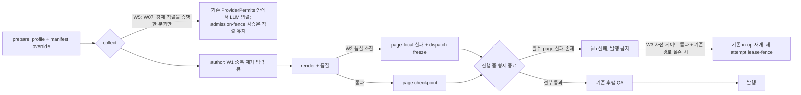

# SVG 생성 성능 수리 설계 (2026-10-22, 개정 2)

상태: 설계 전용입니다. 앱 코드, 테스트, 설정, DB, Git은 바꾸지 않았고, 이번 단계의 조회 실행은 0건입니다.
아래의 효과는 모두 제안이며 측정된 결과가 아닙니다.

통합한 입력:
- 이전 병목 감사 요약과 계획 단계의 안전 보정 2건
- critical path 검토
- 전문 설계 노트 3개(`delivery-backups/claude-generation-performance-design-20261022-01/private/`)
- Codex 독립 검토 2건의 P1/P2 피드백(개정 1)

인용 규칙: file:line은 이번 단계에서 조정자나 전문가가 직접 읽은 줄만 적습니다. 줄 번호는
`perf/first-export-cold-20261021` 워킹트리 기준이고, 이 트리에는 미커밋 변경이 있습니다. 구현자는 줄
번호가 아니라 함수 이름으로 다시 찾아야 합니다.

---

## 0. 개정 내역 (개정 1)

| 피드백 | 요지 | 반영 절 |
|---|---|---|
| F1 (P1) | `fail_stage`가 `resume_allowed`와 `last_error`를 덮어써서, 품질 소진 뒤 retryable 전역 오류가 오면 자동 재개가 열린다 | §6.1 사전 게이트(소진이 하나라도 있으면 자동 OFF), §5.5 |
| F2 (P1) | W4(QA 조기 시작)는 미래 author 지연, barrier, ordinal/UNKNOWN 설계 공백이 있다 | §9에서 이번 개발 범위에서 완전히 제외. §3, §10, §11, §12, §13, §14 동기화 |
| F3 (P2) | `trusted_stage_execution` checkpoint가 없다고 stage plan이 없는 것은 아니다 | §7.2 상태 4종 분리. stage plan은 job payload 키로 확인 |
| F4 (P2) | 관측값과 추론값을 섞었다 | §7.3 증거 4종 분리, source_reflow scalar 추가, 현재 env로 과거 env를 대체 금지 |
| F5 (P2) | W2 완료 범위가 과장됐다 | §5.2 정책을 dispatch freeze(진행 중 형제만 완료)로 교체, 임계 2 폐기 |
| F6 (P2) | run 스키마를 증명하지 않았다 | §4.2에서 run 생략을 이번 범위에서 제외(run 전체 유지) |
| F7 (P2) | W5 검증 test가 prepare/collect 경로를 지나지 않는다 | §11 W5 행을 기존 흐름 test 보완으로 교체 |
| F8 (root) | 재시작만으로 기존 실행 보호가 보장되지 않는다 | §13 drain 순서, queued old job, 격리 워크트리, 롤백 |
| F9 (root) | page input digest 경계를 코드로 확정해야 한다 | §4.5 코드 읽기로 확정, 구버전 분기 불필요 근거 |
| F10 (개정 2, P1) | rollout race: "사용 없는 시간대"는 claim 차단이 아니고, 단회 active 0 검사와 정지 사이에 새 claim 경쟁이 있다 | §13 3항을 차단 → drain → 재확인 → 정지 → 교체 → 재시작 → 해제 순서로 교체. 차단 수단이 없으면 활성화 보류 |
| F11 (개정 2, P2) | freeze가 첫 await 뒤에 서면 그 사이 새 dispatch가 승인될 수 있다 | §5.2, §5.3, §5.4, §11, §14.1: 첫 await 전 동기 설정, 승인 지점에서 확인, 보장 범위는 "동결 뒤 새 dispatch 승인 0" |
| F12 (개정 2, P2) | 계측 선택성과 완료 기준이 충돌한다 | §10, §14.1: 구조적 개발 완료와 성능 효과 검증 완료를 분리하고 missing과 0을 구분 |

---

## 1. 목적, 범위, 사실과 미확인

### 1.1 목적

큰 자유 페이지 SVG 덱의 wall time을 품질 저하 없이 줄이는 것이 목적입니다. 다음은 바꾸지 않습니다.

- 페이지 수, 원문, rich run, 숫자, merge, 관계, 폰트
- 자유 SVG 구성 원칙. DeckIR, 고정 카드, 슬롯, 레이아웃 enum은 도입하지 않습니다.
- 모델. 다운그레이드하지 않고 API 모델 값은 영어로 유지합니다.
- 품질 게이트. 완화하거나 검사를 일괄 OFF하지 않습니다.

### 1.2 이번 범위

| ID | 내용 | 성격 |
|---|---|---|
| W0 | 기준 사례의 실제 병렬 수와 단계 시간 확인(읽기 전용 scalar, 다음 단계에서 실행) | W5의 선행 조건일 뿐이며 W1/W2를 막지 않음 |
| W1 | author LLM 입력에서 증명된 중복만 제거(표 텍스트 사본, JSON 이중 escape) | 확정 |
| W2 | 품질 소진 페이지를 page-local로 격리. 진행 중인 형제는 완료·checkpoint하고 덱은 fail-closed | 확정 |
| W3 | 사전 게이트를 통과할 때만 기존 in-op 재개 경로 사용 | 조건부 보류(기존 경로가 실존해야 함) |
| W5 | W0가 증명한 강제 직렬화만 해제. 기존 permit 안에서 LLM 호출만 병렬 | 조건부(W0 결과) |

### 1.3 범위 밖

- **이번 개발에서 제외(§9):** W4 QA 조기 시작, `ProviderPermits` waiter 수 노출.
- **이미 해결:**
  - export: 124.5초는 이전 실패에서 준비된 자산을 사용한 수치라 생성 속도 근거로 쓰지 않습니다.
  - provider 원장 교착: 락 순서 circuit → budget.
  - metrics 외부화, task-owner ProviderPermits, checkpoint projection
  - source-input snapshot 이력 재검증
- **제외:** 원본 이미지 축소(품질 위험), prompt cache prefix 정리(실측 후 단계).
- **금지:** 새 scheduler, 병렬 framework, DB 테이블, 마이그레이션, 상태 머신 재설계, 대시보드, 관측 체계.

### 1.4 기준 사례와 중첩 없는 시간표

- presentation `a8effa9a-88fc-4518-b3b9-b68ff669833a`
- 생성 operation `16ba649f-d13a-4eca-ba04-77b142709117`
- job `a700bf16-b6f4-48cf-953d-3e86a13a99ab`
- 100페이지, 최초 accept부터 published까지 11096초

| 구간 | 초 | 비중 | 근거와 제약 |
|---|---|---|---|
| 큐 대기 | 122.4 | 1.1% | 측정 |
| 실행 사이 공백 | 1709.2 | 15.4% | 측정. 진단, UNKNOWN 판단, 교착 수정, 재개 준비. 사용자 승인 대기가 아님 |
| 실행 1~4 합 | 6875.6 | 62.0% | 파생(9264.4 − 2388.8). author, render, QA, DB, 발행이 섞여 있음. provider 대기만이 아님. 내부 미분해 |
| 실행 5 페이지 루프(상속 80 + 신규 20) | 1493.8 | 13.5% | 파생(2388.8 − 895) |
| 실행 5 루프 후 검사, 2페이지 디자인 수정, 발행 | 895.0 | 8.1% | 측정. VQA만이 아님. 2페이지 수정은 실제 작업 시간 |
| 합계 | 11096.0 | 100% | |

이 표를 읽을 때의 제약:

- 교착으로 실패한 1336초 실행은 80페이지를 이어받아 보존했으므로, 전부 잃은 시간이 아닙니다.
- 전체 검사가 두 번 돌았다는 증거는 없고, 완료 페이지를 모두 다시 쓴 것도 아닙니다.
- 자동 VQA는 24회이며 분할(20+4 또는 21+3)은 미확인입니다.
- author 표본은 n=8입니다(평균 155.7초, 입력 70,308 토큰, 출력 8,296, 최대 316.5초). 덱 전체로 외삽하지 않습니다.
- 입력 중복이 지연의 주원인이라는 증거는 없습니다. prefill, decode, 추론, permit 대기, render, VQA의 비중은 모두 미확인입니다.

### 1.5 사실과 미확인

| 항목 | 상태 |
|---|---|
| whole-page fact가 payload 전체와 `cells[].text`를 함께 싣는다 | 사실(`author_source_svg_layout.py:35-46`) |
| `source_content`는 이미 `json.dumps(..., ensure_ascii=False)`로 만든 문자열인데 다시 감싼다 | 사실(`author_source_svg_layout.py:168-170` → `author_slide_svg.py:856`) |
| partial recovery의 page input digest는 outline content, style snapshot, index, count, instructions, language, preset, writing_policy, common header digest, assets로 구성된다 | 사실(`svg_partial_recovery.py:2064-2073`, `svg_generation_inputs.py:7-26`) |
| `author_prompt_digest`는 `services/` 안에서 author receipt 생산자 외의 소비자가 없다 | 사실(`author_slide_svg.py:737-740`, services 범위 grep) |
| `fail_stage`는 호출할 때마다 job의 `resume_allowed`와 `last_error`를 덮어쓴다 | 사실(`authored_checkpoint_state.py:388-396`) |
| 페이지 단계 오류는 종류와 무관하게 job fatal을 세운다 | 사실(`collect.py:448-464`) |
| stage plan은 인자나 request의 메모리 속성에서 오고, job payload `_internal_svg_stage_plan`에 영속된다 | 사실(`collect.py:29`, `:345-350`; `svg_timeout_repurchase.py:1851`, `:2042`, `:2105`) |
| source_reflow 여부는 request 메모리 속성 `_source_content_svg_reflow`에서 결정된다 | 사실(`svg_presentation_prepare.py:539`) |
| 기본값은 author 3, render 3이고 source_reflow는 author 2, render 1. env 명시값이 우선 | 사실(`profile.py:47-50`, `:66-108`). 실효값의 증거는 아님 |
| recovery manifest는 author 1, render 1을 강제한다. cached-first가 있으면 permit 없이 단일 게이트 | 사실(`svg_timeout_repurchase.py:1055-1071`, `svg_presentation_prepare.py:786-791`) |
| job의 `_svg_recovery_lineage`는 stage partition 안의 페이지를 순차 await하게 만든다 | 사실(`collect.py:187-193`) |
| 사례의 실행별 실효 동시 수, source_reflow 여부, 각 manifest와 lineage 키, stage plan 유무 | 미확인(W0) |
| 입력 중 중복 비율, latency의 prefill/decode 지배 | 미확인 |
| `resume_allowed`를 소비하는 기존 in-op 자동 재개 dispatcher의 실존 | 미확인(W3 보류 조건) |

---

## 2. 호출 흐름과 접점

### 2.1 현재 흐름 (관련 부분만)

1. prepare: profile 해석 → `sample_completion_runtime_profile`이 operation manifest로 덮어씀 →
   cached-first 유무로 pipelined를 판정하고 WIP 세마포어와 `ProviderPermits`를 만듦
   (`svg_presentation_prepare.py:775-791`).
2. collect:
   - stage plan이 없으면 모든 page task를 만들고 screen recovery로 감(`collect.py:466-479`).
   - stage plan이 있으면 `_collect_stages`로 가고, `_svg_recovery_lineage`가 있으면 partition 안의 페이지를
     순차 await함(`collect.py:187-193`).
3. 페이지마다: author(`author_slide_svg`) → render와 품질(source_reflow 미통과는
   `render.py:806-809`에서 raise) → page checkpoint.
4. 실패:
   - `tracked_page`가 job fatal을 세움(`collect.py:448-464`).
   - drain이 켜져 있으면(stage plan 없음 + recovery 정책이나 manifest) 이미 발송한 호출만 수집하고 그 결과는
     거부함(`collect.py:288-300`, `:482-489`, `author.py:212-219`).
   - drain이 꺼져 있으면 `_collect_pages_or_fail`이 형제를 즉시 cancel함(`svg_presentation_checkpoint.py:272-283`).
   - 예외 경로는 quality-recovery 보류나 `rescue_terminal_page`를 거치고, source_reflow의 FAIL 정책에서는 None이라 re-raise함(`collect.py:1003-1021`, `terminal.py:62-64`).
5. 루프 후 QA: 기존 후행 순서 그대로입니다(§9).
6. 수동 재개: partial recovery가 known/new/unknown으로 분류합니다. 실제 비용에 None이 있으면 unbounded로
   보고 `proven_remaining_budget`이 None이 됩니다. `verify_action`은 CAS, manifest hash, nonce,
   unknown ack, unbounded일 때의 추가 예산 명시를 요구합니다(`svg_partial_recovery.py:4131-4133`,
   `:4165-4166`, `:4241-4264`).

### 2.2 변경 후 흐름

새 모듈이나 새 추상화는 없고, 기존 함수 안의 지역 변경만 합니다.

| 작업 | 접점 |
|---|---|
| W1 | `_whole_page_facts`를 소비하는 쪽, `author_slide_svg`의 프롬프트 조립 |
| W2 | `_RunState`, `tracked_page`, `author.py`의 `before_dispatch`, `collect.py:473` 이후 결과 처리, `_collect_stages`의 partition 결과 처리 |
| W3 | `svg_partial_recovery`의 읽기 전용 게이트 평가 |
| W5 | W0가 증명한 분기 하나(`sample_completion_runtime_profile`, prepare의 pipelined 판정, `_collect_stages`의 순차 루프 중 하나) |

---

## 3. 순서와 critical path

| 트랙 | 담당 | 시작 | 막는 대상 | 비고 |
|---|---|---|---|---|
| W0 읽기 전용 scalar 조회 | 조정자 | 즉시 | W5만 | W1/W2를 막지 않음 |
| W1 입력 중복 제거 | Sonnet 입력 담당 | 즉시 | 없음 | §4.5 경계는 이미 확정됨 |
| W2 page-local 격리 | Opus 복구 담당 | 즉시 | W3, W5(`collect.py` 공유) | |
| W3 사전 게이트와 재개 | Opus 복구 담당 | W2 이후 | | 기존 dispatcher 실존을 확인하지 못하면 자동 경로 보류, 게이트 요약만 |
| W5 직렬 해제 | Opus 복구 담당 | W2와 W0 이후 | | W0가 증명한 분기만 |

우선순위의 근거:

- **W0:** 실효 author가 1이었다면 그것이 실행 9264초를 좌우했을 가능성이 가장 큰 원인 후보입니다. 확인 비용은 scalar 몇 개입니다.
- **W1:** 가장 싸고 존재가 확정된 문제입니다. 다만 속도 효과는 미증명이라 바이트 절감으로만 보고합니다.
- **W2:** 페이지 하나가 job 전체를 끝내는 가장 큰 실패 전파를 줄입니다.
- **W3:** 공백과 재작업을 줄이는 일이지 생성 속도 개선이 아닙니다.

---

## 4. W1 입력 동등성 계약

### 4.1 불변식

1. 원본 manifest, payload, source hash, `block.payload`는 바꾸지 않습니다. 직렬화 직전에 별도 LLM 입력 뷰만 만듭니다.
2. 검증 경로는 축소하기 전의 fact를 그대로 씁니다. 대상은 binding correction hint
   (`author_source_svg_layout.py:82`), 기대 텍스트(`:88`), 셀 기대값(`:98-101`)입니다.
3. 생략만 합니다. 이름 변경, 재배치, 요약, 새 IR은 없습니다.
4. 판정할 수 없거나 예외가 나면 원형을 유지합니다(fail-open to full).
5. legacy 필터(`author_source_svg_layout.py:278-293`)는 키 허용 목록 방식이라 rich run 서식까지 버리므로 재사용하지 않습니다.

### 4.2 필드 규칙

| 필드 | 기본 | 생략 허용 조건(모두 충족) | 기준 사본 |
|---|---|---|---|
| fact 식별자(`source_id`, `kind`, `element_id`, `slot_id`, `semantic_role`) | 유지 | 불가 | — |
| `cells[]`의 row, column, span, element_id, text | 유지 | 불가. 프롬프트 규칙이 셀별 element_id와 정확한 텍스트를 요구함(`author_source_svg_layout.py:174`) | `cells[]` |
| `data.rows[r][c].text` | 유지 | (r,c) anchor가 `cells[]` 항목 정확히 하나와 대응하고, 텍스트가 바이트 동일하며(strip, 정규화, 줄바꿈 변경 금지), 표의 모든 셀이 대응할 것. 하나라도 어긋나면 표 전체 원형 | `cells[].text` |
| `data.rows`의 `sourceCellId`, span, `mergeCovered`, `mergeOrigin`, h/v merge | 유지 | 불가. merge로 덮인 셀은 `cells[]`에 없음 | `data.rows` |
| `data.rows` 셀의 text 외 모든 키(서식, 채움, 정렬, 테두리, 숫자 서식, 폰트, run, 문단, 하이퍼링크, 필드, 자식 구조) | 유지 | 불가(이번 범위) | `data.rows` |
| run 배열(텍스트와 표 공통) | 유지 | 이번 범위에서 생략 불가 | — |
| `data.text`, geometry, preset, `dominantSizePt`, 위치 | 유지 | 불가 | `data` |
| connector `shapeId`, 양 끝, `stCxn`, `endCxn`, 해석된 `connections` | 유지 | 불가. 관계 해석이 `shapeId`를 씀(`author_source_svg_layout.py:50-65`) | `data` |
| chart, image data | 유지 | 불가 | `data` |

run 생략을 제외한 근거는 다음과 같습니다.

- 지원 원본 형식의 run 스키마(키 이름, 문단 경계, 필드, 하이퍼링크, 자식 구조)를 코드에서 증명하지 못했습니다.
  `svg_source_layout.py`에서 run 키를 찾지 못했고, PPTX run 경계는 언어나 맞춤법 분할로 오염됩니다.
- 스타일 키가 비어 있다는 것만으로는 비스타일 의미가 같다고 볼 수 없습니다.

run 생략은 후속 조건부 항목입니다. 착수 조건은 두 가지입니다.

1. 원본 manifest 생산자를 읽어서, 원본 형식마다 지원 키 집합을 열거해 증명합니다.
2. 그 집합에서 run이 "텍스트 조각 외 의미 없음"으로 증명된 경우에만 허용 목록 방식으로 생략합니다. 알 수 없는 키, 문단, 구조가 하나라도 있으면 run 전체를 유지합니다.

임의 페이지 수와 여러 원본 형식에 같은 규칙이 적용되도록 범용으로 정의합니다.

### 4.3 typed-JSON 이중 escape 제거

- **위치:** `author_slide_svg` 프롬프트 조립부의 지역 값입니다. `content` 인자는 그대로 둡니다. 헤더 binding, visual intent, native data 형식화가 같은 값을 읽기 때문입니다.
- **조건(모두 충족해야 객체로 내장):**
  1. 값이 문자열이다.
  2. JSON으로 파싱된다.
  3. 결과가 `source_authoring_contract`, `source_page_id`, `source_facts`(list)를 가진 객체다.
  4. 생산자와 같은 옵션(`ensure_ascii=False`, 기본 separators, `author_source_svg_layout.py:169-170`)으로 다시 직렬화하면 원본 문자열과 바이트가 같다.
- 조건을 하나라도 못 채우면 문자열을 유지하고 receipt에 `json_unwrap=false`를 기록합니다.
- 원문 텍스트는 `source_content` 키 아래에만 두고, 지시문 레벨 키와 합치지 않습니다.

### 4.4 receipt와 버전 계약

- digest payload 라벨 `svg-author-input/v1`(`author_slide_svg.py:737`)은 유지합니다. `author_prompt_digest`(`:740`)는 값이 바뀌며, 이는 의도된 1회 캐시 미스입니다.
- 중복 제거를 적용했으면 기존 author receipt(`author_slide_svg.py:1118-1133`)에 `input_assembly_version = "svg-author-input-dedup/v1"`을 기록합니다. 필드가 없으면 변경 전 조립이라는 뜻입니다.
- `input_dedup`에는 `table_text_dup_bytes`, `json_double_escape_bytes`, `total_omitted_bytes`를 둡니다.
  - 단계별 UTF-8 바이트 차이로 계산하고, 겹치는 바이트는 먼저 적용한 원인에 귀속합니다.
  - 관측할 수 없으면 null로 두고 0으로 채우지 않습니다.
  - 토큰 추정은 기록하지 않습니다.
- provenance 필드(source hash, manifest digest, `source_digest`)는 프롬프트 뷰 hash로 덮어쓰지 않습니다.

### 4.5 page input digest 경계 (코드로 확정)

| 해시 | 입력 | W1 영향 |
|---|---|---|
| partial recovery의 known page 판정용 page input digest | outline slide content, style snapshot, index, count, instructions, language, preset, writing_policy, common header digest, assets(`svg_partial_recovery.py:2064-2073`, `svg_generation_inputs.py:7-26`) | 없음. W1은 이 입력 중 어느 것도 바꾸지 않음 |
| `author_prompt_digest` | 조립된 messages와 provider 설정(`author_slide_svg.py:737-740`) | 바뀜. services 안 소비자는 receipt 생산자뿐 |
| source hash, manifest digest | 원본 | 없음 |

결론:

- 이미 완료된 known page는 W1 전후에 같은 page input digest를 갖습니다. 그래서 재사용 시 신규 author 호출 0이 유지되고, 구버전 조립을 재현하는 분기는 필요 없습니다.
- 버전 범위는 페이지 단위입니다.
  - W1 이후 새로 쓴 페이지는 receipt에 새 `input_assembly_version`을 기록합니다.
  - 이전 페이지 receipt에는 필드가 없으며, 소급해서 라벨을 붙이지 않습니다.
- 가드는 완화하지 않습니다. page input digest 계산식과 known page 검증은 바뀌지 않습니다.
- 이 경계를 고정하는 기존 test는 `test_svg_generation_admission.py::test_partial_recovery_page_input_digest_matches_new_and_legacy_svg_inputs`(1357줄)입니다.

### 4.6 기대 효과

입력 바이트 감소만 보고합니다. 다음 정상 생성에서 입력 지배 latency가 관측될 때만 속도와 연결합니다.

---

## 5. W2 page-local 실패 격리

### 5.1 분류 (단일 판정 지점)

판정은 기존 `terminal.is_exhausted_page`(`terminal.py:33-35`, `:54-56`) 하나로만 합니다. 조건은 소진 코드 3종,
`retryable=False`, slide index 일치입니다. 새 코드 목록이나 경로별 분기는 만들지 않습니다.

| 분류 | 조건 | 처리 |
|---|---|---|
| page-local | `is_exhausted_page`가 참이고 `rescue_terminal_page`가 None | 해당 page만 기존 `fail_stage`로 기록하고 dispatch freeze |
| job-global | 그 밖의 모든 단계 오류와 예외(attempt 불확실, attempt 상실, 입력 불일치, stage, provider, checkpoint 충돌, 소유권, deadline) | 기존 동작(drain 또는 cancel) |
| 취소 | `BaseException` | 기존 즉시 cancel(`collect.py:486-489`) |

`render.py:787-801`의 occluded, unproven, classification, timeline 코드는 소진 코드가 아니므로 global에 남습니다.

### 5.2 dispatch freeze 정책 (개정 1에서 확정)

page-local 실패가 처음 발생하면 그 실행은 freeze 상태가 됩니다. freeze 상태의 규칙은 다음과 같습니다.

0. **동결 시점:** page-local 오류로 분류되는 즉시, 첫 await 이전에 동기로 `page_failures`를 기록하고
   `dispatch_frozen=True`를 설정합니다. 그 뒤에 `fail_stage`를 await합니다. 동결 기록 자체가 실패하면 그 오류는 global
   안전 경로(기존 fatal + drain/cancel)로 처리합니다.
1. **동결 뒤에는 새 dispatch를 승인하지 않습니다.** 승인 지점은 `before_dispatch`입니다. permit 대기가 끝난 뒤, 실제
   dispatch를 승인하기 직전에 freeze를 확인합니다. 이 실행에서 아직 dispatch를 승인받지 않은 페이지는 여기서 멈추고
   "미시작"으로 남습니다. inflight 기록이나 `fail_stage` 기록은 하지 않고, checkpoint는 미완 상태입니다.
2. **동결 전에 이미 승인된 대상은 끝까지 진행합니다.** 대상은 현재 partition(또는 비stage 실행)에서 동결 전에 dispatch
   승인을 받은 형제 페이지입니다. 이미 승인·발송된 요청은 취소하지 않습니다. 취소하면 UNKNOWN이 생기기 때문입니다.
   그 결과는 정상 결과로 받아 checkpoint하며, 기존 global drain과 달리 거부하지 않습니다.
   - 같은 페이지의 후속 repair 시도도 원래 per-page attempt 한도와 기존 유효 lease·예산 범위 안에서만 진행합니다.
   - 이 시도들도 `before_dispatch` 승인을 거칩니다. 그 페이지가 동결 전에 이미 승인을 받은 페이지일 때만 통과합니다.
3. **provider 호출이 없는 작업은 진행합니다.** cached/known page 검증 같은 것입니다.
4. **형제에서 page-local 실패가 더 나면** 페이지별로 기록만 합니다. 이미 freeze 상태이므로 더 확대하지 않습니다.
   기존 안전 정책(실패 페이지가 하나라도 있으면 덱 발행 금지)만 적용합니다.
5. **freeze 중에 global 오류가 나면** 기존 global 경로로 넘어갑니다. drain이면 발송분을 회계에 반영하고 결과는 거부,
   아니면 cancel입니다. 이미 checkpoint된 형제는 유지됩니다.
6. **stage plan 경로:** 같은 규칙을 현재 partition 안에서만 적용합니다. 다음 partition은 시작하지 않습니다.

보장하는 것과 보장하지 않는 것:

- **보장:**
  - 동결 뒤에 새로 승인되는 dispatch는 0입니다.
  - 동결 전에 승인된 현재 partition의 형제는, 새 global 안전 오류가 없고 drain 가능한 범위에서 완료·보존됩니다.
- **보장하지 않음:**
  - 동결 뒤 미승인 페이지나 다른 partition의 완료. 이들은 다음 partial recovery에서 new나 known으로 분류됩니다.
  - "실패 뒤 물리적 SDK 발송 0". 동결 전에 승인된 요청은 발송될 수 있고, 이는 기존 회계로 처리됩니다.
- 이 정책은 개정 전의 "두 번째 실패 시 global 승격" 임계 2를 대체하며, 임계 상수는 없습니다.

### 5.3 변경 접점

모두 복구 담당 소유 파일 안의 변경입니다.

1. **`collect.py` `_RunState`(`:280-285`):** 메모리 필드 두 개를 추가합니다. 영속 근거는 기존 `fail_stage` checkpoint이고 DB 변경은 없습니다.
   - `page_failures`: page index → 오류
   - `dispatch_frozen`: bool
2. **`collect.py` `tracked_page`(`:451-461`):** page-local 판정이면 다음 순서로 처리합니다.
   1. 첫 await 전에 동기로 `page_failures[index]`를 기록하고 `dispatch_frozen=True`를 설정합니다. job fatal은 세우지 않습니다.
   2. 그 뒤에 `fail_stage`를 await합니다.
   3. 내부 실패 표식을 반환합니다. 미시작 페이지는 미시작 표식을 반환합니다.

   동결 기록이 실패하면 global 안전 경로로 raise합니다. `fail_stage` 기록이 실패해도 마찬가지로 global 경로입니다.
3. **`author.py` `before_dispatch`(`:208-223`):**
   - freeze 확인은 permit 대기가 끝난 뒤, inflight 기록과 실제 dispatch 승인 직전에 기존 drain 검사보다 먼저 둡니다.
   - 동결 상태에서 이 페이지가 동결 전 승인 이력이 없으면 미시작 신호로 멈추고 inflight는 기록하지 않습니다.
   - 동결 전 승인 이력이 있으면, 원래 attempt 한도 안에서 진행합니다.
   - 승인 이력은 실행 메모리의 page별 표식이며, 동결 설정과 같은 동기 구간에서 비교합니다.
4. **`collect.py:473` 이후 두 분기:** 표식을 즉시 검사하고 `recover_screen_pages`(`:474-477`)보다 먼저 raise합니다. 표식이 섞인 page
   목록은 어떤 덱 단계로도 넘기지 않습니다. raise하는 오류는 index가 가장 작은 page-local 오류이고, 실패 전체는 `page_failures`에 남습니다.
5. **`_collect_stages`(`collect.py:178-183`, `:201-207`):** 표식은 `stopped`를 세우지 않습니다. partition gather가 끝난 뒤, partition 판정 전에 검사합니다.

`terminal.py`, `render.py`, `svg_presentation_checkpoint._collect_pages_or_fail`은 바꾸지 않습니다. 마지막 함수는 global 오류에서 형제를 cancel하는 의미를 유지합니다.

### 5.4 지출 상한

- 동결 뒤 새 dispatch 승인은 0입니다. 동결 전에 승인되지 않은 페이지의 지출은 생기지 않습니다.
- 동결 전에 승인된 형제의 inflight와 후속 시도는 이미 admission을 통과했고, 기존 유효 lease·예산과 원래 attempt 한도 안에서만 삽니다.
- 실패한 page에는 추가 호출이 없습니다.
- attempt 카운터나 예산은 리셋하지 않습니다.

### 5.5 fail_stage 이후 상태와 검증 지점

- `fail_stage`(`authored_checkpoint_state.py:368-401`)가 바꾸는 것:
  - 해당 slide checkpoint: failed, `failed_stage`, `error`, `attempt_token`
  - job: `current_stage`, `resume_allowed`, `last_error`, `completed_slides`
- 바꾸지 않는 것: job 상태, lease, fencing token. 그래서 형제의 이후 checkpoint는 같은 `_owned_job` 소유 검사(attempt_token, fencing_token)로 쓸 수 있는 구조입니다.
- `completed_slides`는 이후 checkpoint 때마다 다시 계산됩니다.
- **위험 1:** 여러 page가 실패하면 `last_error`와 `resume_allowed`는 마지막 기록으로 덮입니다. 그래서 job의 단일 필드는 요약일 뿐 권위가 아닙니다. 오류 집합의 권위는 slide별 failed checkpoint이고, W3 게이트가 이것을 읽습니다(§6.1).
- **위험 2:** 형제가 실행 중인데 진행 표시가 terminal 실패로 보일 수 있습니다. UI 동작은 바꾸지 않고 미해결로 둡니다.
- **검증 지점:**
  - 단위 test의 fixture는 `fail_stage`를 mock으로 바꿉니다(`test_svg_source_generation_flow.py:105`). 그래서 DB 수준의 "fail_stage 뒤 형제 commit"은 test로 증명되지 않습니다.
  - 구현자는 `_owned_job`이 `last_error`나 `resume_allowed`를 commit 거부 조건으로 쓰지 않는지 코드로 확인합니다. 거부 조건이면 W2를 멈추고 원인을 보고합니다.
  - 단위 test는 호출 순서와 결과 수용을 단언합니다(§11).

### 5.6 drain, cancel, 늦은 결과

- page-local 실패 page는 마지막 시도가 반환된 뒤 실패하므로 자기 inflight가 없습니다. inflight가 남아 있으면 global이고, 기존 attempt-uncertain 경로로 가며 재구매하지 않습니다(`collect.py:997-999`).
- **freeze 중 형제 결과:** 정상적으로 받아 checkpoint합니다.
- **global + drain:** 새 발송은 금지합니다(`author.py:212-219`). 이미 발송한 응답은 회계용으로 checkpoint하고 결과는 거부합니다(`author.py:442-444`).
- **global + 비drain:** 즉시 cancel합니다. cancel된 provider 요청은 UNKNOWN 회계를 유지하며, 무과금이나 성공으로 바꾸지 않습니다(`provider_durable_runtime.py:266-324`).
- 옛 fence로 오는 늦은 쓰기는 `_owned_job` 검사로 거부합니다. 모든 늦은 쓰기 경로가 덮이는지는 미해결입니다(§14.2).

### 5.7 checkpoint와 발행의 구분

- page checkpoint는 page 증거일 뿐 덱 성공이 아닙니다.
- 덱 발행 조건은 모든 필수 page가 통과했거나 기존 FALLBACK/FLAG_ONLY로 구제됐고, `page_failures`가 0이며, 미시작 page도 0인 것입니다.
- "부분 덱 성공" 상태는 만들지 않습니다. page 생략, 삭제, 감축은 금지입니다.
- 실패한 덱의 정상 checkpoint는 다음 partial recovery에서 known으로 재사용됩니다(`svg_partial_recovery.py:4162-4164`). 재작업 절감의 실제 경로가 이것입니다.

---

## 6. W3 자동 재개

### 6.1 사전 게이트 (개정 1에서 신설, P1)

job의 `last_error`와 `resume_allowed`는 마지막 기록일 뿐이라 유일한 권위가 아닙니다. 자동 재개를 검토하기 전에 게이트를 읽기 전용으로 평가합니다.

- **범위:** 현재 실행의 lease와 context로 다음 작은 metadata만 읽습니다. 내용이나 SVG는 읽지 않습니다.
  - job의 모든 slide checkpoint: status, `failed_stage`, `error.code`, `error.retryable`, `attempt_token`
  - page별 원래 attempt 한도 대비 사용 횟수: 기존 checkpoint payload나 provider receipt의 시도 ordinal에서 읽을 수 있을 때만
  - job의 provider reservation 중 uncertain/UNKNOWN 건수
  - partial recovery의 `historical_actual_cost_unbounded`와 `proven_remaining_budget`
  - 현재 lease가 유효한지
- **판정:** 아래 중 하나라도 있으면 자동 재개 OFF이고 수동으로 둡니다.
  - 어떤 page라도 품질 소진(`is_exhausted_page` 코드 3종)
  - UNKNOWN, uncertain, inflight가 남은 page
  - 권한 폐기, 사용자 취소, deadline 초과
  - 원래 attempt 한도를 다 쓴 page, 또는 사용 횟수를 읽을 수 없는 page
  - 예산이 불확실함(unbounded이거나 잔여를 증명하지 못함)
  - lease가 유효하지 않음
- **선택 근거:** 기존 manifest가 소진 page를 제외하고 나머지만 재개하는 방식이 안전하다는 것은 입증되지 않았습니다. 그래서 가장 작은 정책인 "소진이 하나라도 있으면 자동 OFF"를 택합니다.
- **불변:** attempt 횟수, 실패한 op, UNKNOWN 원장, fence는 바꾸지 않습니다. 새 attempt는 기존 규칙의 append-only 경로로만 만듭니다.

### 6.2 게이트를 통과한 뒤의 분류

| 실패 | 자동 | 조건 |
|---|---|---|
| 발송 전 known 실패(admission 일시 거절, circuit open, 발송 전 DB 일시 오류) | 허용 | 게이트 통과. provider 호출이 없었으므로 재구매가 아님 |
| 429, 발송 후 명시적 미처리 응답 | page 안에서만 기존 정책 | 기존 2회와 cooldown(`author.py:379-382`). job 단위 추가 재시도 없음 |
| HTTP 500 등 발송 후 영수증이 불명확함 | 수동 | 기존 분류기가 known-not-processed로 확정할 때만 위 행으로 이동 |
| 품질 소진, UNKNOWN, 비용 상한 불명 | 수동(게이트에서 이미 차단) | 새 attempt 정책과 예산을 명시해야 함(`svg_partial_recovery.py:4163`, `:4254-4263`) |
| inflight 없이 lease 상실 | 기존 재획득 경로가 있을 때만 | 새 attempt, lease, fence |
| 사용자 취소, 권한 폐기, deadline 초과 | 금지 | |

### 6.3 범위와 보류 조건

- **자동 경로:** 기존 in-op 재개 경로만 씁니다. 새 partial recovery operation을 자동으로 만드는 것은 금지입니다. `verify_action`이 명시적 결정을 요구하기 때문입니다(`svg_partial_recovery.py:4246-4248`).
- **보류:** `resume_allowed`를 소비하는 기존 dispatcher와 lease 재획득 경로의 실존을 코드로 확인하지 못하면, 자동 경로는 조건부 보류입니다. 새 dispatcher는 만들지 않습니다.
- **보류 시 대체:** 실패 시점에 §6.1 게이트 결과와 partial recovery manifest를 읽기 전용(`lock=False`, `svg_timeout_repurchase.py:1074-1078` 계열 용법)으로 미리 계산해, 결정 요약만 준비합니다. 상태 변경과 지출은 0입니다. 1709초 공백 중 진단과 판단 시간을 줄이는 것이 목표입니다.

### 6.4 lease, attempt, fence lineage

- 현재 실행의 유효한 live lease, fence, CAS만 따릅니다.
- 종료된 op와 job, 옛 fence, terminal failed row, 원장, 산출물은 불변입니다. 옛 fence를 재사용하거나 실패 op를 되살리는 것은 금지입니다.
- 새 실행은 기존 durable 규칙으로 새 attempt token, lease, fencing token을 받습니다.
- 기존 의무(partial recovery manifest, append-only lineage, `verify_append_only_child_lineage`)가 요구하면 append-only 대체 후속 op 하나만 만듭니다. 덱 전체 재생성과 op 남발은 금지입니다.
- 재시작으로 만료된 reservation은 uncertain으로 회계하고, UNKNOWN으로 수동 처리합니다.

### 6.5 금지 행동

| 금지 | 이유 |
|---|---|
| 시도 횟수나 예산 리셋, page별 한도 재계산 | 지출 상한이 무너짐 |
| UNKNOWN 자동 재구매, cancel을 무과금으로 해석 | 이중 과금 |
| 품질 소진 뒤 자동 provider 호출 | 정책과 권한이 없음 |
| `last_error`나 `resume_allowed` 하나만 보고 자동 재개 | 오류가 덮여 있음(F1) |
| 실패나 미시작 page가 있는 덱의 발행, 부분 성공 표시 | fail-closed 위반 |
| page 생략, 감축, 내용 삭제 | 보존 위반 |
| 옛 fence나 op 재사용, terminal row 수정 | lineage 위반 |
| 게이트 완화, rescue 범위 확대 | 품질 저하 |
| 원장 락 순서나 export 수정 | 이미 해결됨 |

---

## 7. W5 profile 우선순위와 숨은 직렬화

### 7.1 우선순위 (읽은 코드 기준)

1. `resolve_svg_runtime_profile`(`profile.py:66-108`): env 명시값이 있으면 그것, 없으면 기본값입니다.
   - source_reflow 여부는 prepare가 request 메모리 속성 `_source_content_svg_reflow`에서 결정합니다(`svg_presentation_prepare.py:539`).
   - request preset은 이 함수의 입력이 아닙니다.
2. `sample_completion_runtime_profile`(`svg_timeout_repurchase.py:1055-1071`)이 operation의 `svg_timeout_repurchase_manifest`로 덮어씁니다.
   - `append_only_recovery`: author 1, render 1, illustration 0
   - `bounded_completion_recovery`: author 1, render 1, cached-first 목록
3. prepare(`svg_presentation_prepare.py:786-791`):
   - cached-first 없음: pipelined, WIP는 author + render, permit은 author
   - cached-first 있음: 단일 게이트, permit 없음
4. 별도 축 `collect.py:187-193`: stage plan이 있고 job payload에 `_svg_recovery_lineage`가 있으면 partition 안에서 순차 await합니다. 세마포어 크기와 무관합니다.
5. `svg_partial_recovery_manifest` 안에도 `append_only_recovery`가 있습니다(`svg_partial_recovery.py:4151`). 두 manifest가 같은 op에 함께 쓰였는지는 미확인입니다.

그러므로 "source_reflow 기본 2"는 실효 2의 증거가 아닙니다.

### 7.2 stage plan 존재의 상태 4종 (F3)

stage plan은 두 경로로 들어옵니다. 하나는 실행 인자나 request 메모리 속성이고(`collect.py:345-350`), 다른 하나는 job payload
`_internal_svg_stage_plan`입니다(`svg_timeout_repurchase.py:1851`, `:2042`, `:2105`). 반면 slide 0의 `trusted_stage_execution`은
partition을 처리한 뒤에 기록됩니다. 그래서 첫 partition에서 실패하면 이 값이 없습니다. 이 값은 진척 증거일 뿐 plan 존재의 증거가 아닙니다.

| 상태 | 판정 근거 | 결론 |
|---|---|---|
| present | job payload에 `_internal_svg_stage_plan` 키가 있고 partition 수를 읽을 수 있음 | stage 경로 |
| absent-persisted | 행은 보이는데 키가 없음 | 영속 plan은 없음. 메모리 주입 가능성이 남으므로 단정하지 않음 |
| not-visible | 0행(RLS 등) | 판정 불가 |
| unknown | 위로 판정할 수 없음 | W5 stage/lineage 분기(C)는 보류 |

### 7.3 W0 조회 (다음 단계; 이번 단계 실행 0)

**실행 규칙:**

- 다음 조정자가 관리 stack의 기존 비밀 저장 경로(DPAPI secret store)로 연결 정보를 읽습니다. 값은 출력하거나 기록하지 않습니다.
- 사용자에게 비밀번호를 다시 묻거나 새 권한을 요청하지 않습니다. 이전 shell에 `DATABASE_URL`이 없었던 것은 권한이 없었다는 뜻이 아닙니다.
- 기존 접근이 실제로 없으면 중단하고 보고합니다.
- read-only 세션, 짧은 statement timeout, key 존재와 scalar만 조회합니다.
  - payload 본문, 프롬프트, SVG, secret은 조회하지 않습니다.
  - 전체 lineage 순회, SVG hash 재계산, 대용량 metrics 조회는 하지 않습니다.

**증거 4종 분리(F4):**

| 종류 | 의미 | 기록 규칙 |
|---|---|---|
| 기록된 configured 값 | 당시 receipt나 payload에 저장된 설정값 | 저장돼 있지 않으면 null. 현재 env로 대체하지 않음 |
| 추론 상한 | manifest 값 + 코드 규칙(§7.1)으로 계산한 상한 | "추론"으로 표시. 실효값으로 쓰지 않음 |
| 관측 overlap | provider 시작/종료 구간을 sweep해 얻은 최대 동시 수 | 관측값. overlap 1을 capacity 1로 추론하지 않음(부하가 없었을 수 있음) |
| 관측되지 않은 시간 | prefill/decode 분해, first token, permit 대기처럼 필드가 없는 값 | null/unknown. 전체 duration과 토큰 수만으로 prefill이나 decode가 지배한다고 판정하지 않음 |

**조회 항목:**

| 대상 | 읽을 scalar |
|---|---|
| job | `_svg_recovery_lineage` 키 존재와 replacement 개수, `_internal_svg_stage_plan` 키 존재와 partition 수, `_source_content_svg_reflow` 키 존재와 값(없으면 unknown), total_slides, attempt_number, `resume_allowed` |
| 실행별 operation | kind, state, version, recovery revision; `svg_timeout_repurchase_manifest`의 존재와 `append_only_recovery`, `bounded_completion_recovery`, cached-first 개수; `svg_partial_recovery_manifest`의 존재와 `append_only_recovery`, known/new/unknown 개수, `historical_actual_cost_unbounded` |
| slide 0 checkpoint | `trusted_stage_execution` 존재(진척 증거로만) |
| author receipt(이 genop) | 시작/종료 시각, input/cached/output/reasoning 토큰, receipt에 있는 경우만 provider 응답 시간과 permit 대기, repair 시도 수와 종류(전체 SVG 재생성인지 국소인지) |
| provider receipt | 실행별 429 수 |
| 당시 설정 | 기존 timing receipt에 기록된 profile 값이 있으면 그 값. 없으면 null. 현재 프로세스 env는 "현재 값"으로만 따로 적음 |

### 7.4 분기 결정

| W0 결과 | 조치 |
|---|---|
| A. 마지막 실행 op에 `append_only_recovery` 기록이 있고 관측 overlap이 1 | 선행 조건으로 author 1을 강제하는 이유를 읽습니다. 회계 불변식(reservation을 한 번에 한 시도로 산정)이면 바꾸지 않습니다. 아니면 author만 profile 값으로 복원하고 render 1, illustration 0, lineage 검증 직렬은 유지합니다 |
| B. `bounded_completion_recovery` | cached-first 순서를 유지합니다. cached 검증(구매 없음)을 먼저 끝낸 뒤 새 page만 기존 permit에 엽니다(`svg_presentation_prepare.py:787-791`, `collect.py:466-469`). cached-first가 "검증 전 지출 금지" 계약이면 2단계로 하고, 계약을 읽기 전에는 착수하지 않습니다 |
| C. stage plan이 present이고 lineage 키 때문에 순차 await | `collect.py:191-192` 순차 루프를 replacement 우선 task 생성 + 기존 stage admission 세마포어 아래 gather로 바꿉니다. lineage가 page 간 가변 상태를 공유하면 직렬을 유지합니다. stage plan이 unknown이면 보류합니다 |
| D. 당시 기록된 configured 값이 1 | 코드 변경 없음. 운영 설정으로 보고만 합니다 |
| E. 관측 overlap이 이미 2 이상이고 강제 경로가 없음 | W5 변경 없음. 병렬도는 원인이 아니라고 보고합니다 |
| F. 조회 불가 또는 not-visible | 변경 없음. 추론만으로 착수하지 않습니다 |

모든 분기에서 admission, provider reservation, circuit/budget 원장, fence/CAS, 원천 검증은 직렬로 유지합니다. LLM await만 `ProviderPermits.slot` 용량 안에서 풉니다.

### 7.5 직렬과 병렬의 경계

| 구간 | 직렬 여부 | 규칙 |
|---|---|---|
| public admission, reservation, circuit/budget 원장 | 직렬(DB lock) | 유지 |
| lineage와 manifest 검증 | prepare에서 1회; cached page 검증은 page별(`collect.py:422-437`) | 유지 |
| page WIP | `ctx.semaphore` | 유지 |
| author permit | `ProviderPermits.slot`, repair 우선 후 도착 순(`profile.py:111-179`) | 유일한 LLM 동시 한도 |
| LLM await | permit 안에서 병렬 | W5가 강제 1을 증명했을 때만 복원 |
| render | render 세마포어 | 유지 |
| page checkpoint commit | page별 독립 트랜잭션(`svg_presentation_prepare.py:773-774`) | 직렬화 불필요 |
| partition 사이 stage review | 직렬 | 유지 |
| 발행 | 마지막 1회, 원자적 | 유지 |

---

## 8. provider 한도, 공정성, repair 우선

- **복원:** 복구나 stage 경로에서 강제된 1을 기존 profile 값으로 되돌리는 것입니다. W0 분기 A/B/C에서만 합니다.
- **상향(현재 설정값 초과):** 별도 결정입니다. 다음이 모두 기존 receipt나 설정으로 증명될 때만, 기존 env knob으로 합니다.
  1. 최근 실행에 429가 없고 permit 대기가 측정됨
  2. 기존 전역 provider permit/governor와 `owner_active_generation` 정책이 다중 사용자 공정성을 유지함
  3. author와 VQA가 같은 한도를 공유한다는 점을 반영함

  코드 상수 변경, 새 scheduler, 일괄 4는 금지입니다.
- **repair 우선:** `ProviderPermits`의 기존 repair 우선 순서를 유지합니다.
- **전체 SVG 재생성 repair 감축:** W0가 반복을 보여주고, 그 결함 종류에 기존 국소 수리 경로가 있을 때만 후속으로 검토합니다. 새 patch protocol이나 IR은 금지입니다.

---

## 9. W4 QA 조기 시작: 이번 개발 제외

**결정:** 기존 후행 QA 순서를 그대로 유지합니다. W4는 이번 개발에서 제외하며, 후속 별도 설계가 필요합니다.
`ProviderPermits`의 waiter 수 노출도 제외합니다. QA를 끄지 않으며, 범위와 조건도 바꾸지 않습니다.

제외 근거:

1. **미래 지연을 막지 못합니다.** 지금 idle이고 `repair=False`라도, 조기 자문이 permit을 잡은 직후 도착하는 author나
   repair를 막을 수 없습니다(`profile.py:145-153`, `:161-179`; `collect.py:1060-1066`; `quality.py:457-461`).
2. **기존 구조가 일괄 barrier입니다.** 모든 local 그룹이 `reservations_ready` barrier를 지난 뒤에 dispatch하고
   (`quality.py:397-403`, `:440-454`), 모든 task를 gather합니다(`quality.py:485-487`). 부분 조기 시작을 하려면 API 분리,
   ordinal 체계, checkpoint namespace, UNKNOWN 예산이 필요한데 설계되지 않았습니다.
3. **증거 충돌이 있습니다.** 같은 ordinal에서 input digest가 바뀌면 conflict이고, 미완료 자문은 UNKNOWN입니다(`quality.py:421-440`).
   "조기 결과를 폐기하고 재검사"하면 기존 증거를 덮어쓰거나 충돌합니다.
4. **필요한 것이 이번 금지 범위에 있습니다.** 새 protocol과 scheduler가 필요합니다.

자동 VQA(그룹 자문)와 사용자의 수동 `vision_qa=false` 설정은 계속 구분합니다. 이번 설계는 둘 다 바꾸지 않습니다.

---

## 10. 계측 (기존 receipt에 필드 몇 개만)

기존 JSON receipt에 키만 추가합니다. 새 테이블, 컬럼, 대시보드, 시스템은 없습니다. 관측할 수 없는 값은 null이고 0으로 채우지 않습니다.

| 필드 | 위치 | 의미 |
|---|---|---|
| `input_assembly_version`, `input_dedup.{table_text_dup_bytes, json_double_escape_bytes, total_omitted_bytes}` | 기존 author receipt(W1 담당) | 원인별 생략 바이트 |
| `runtime_concurrency.{resolved_author, resolved_render, pipelined, recovery_mode, source_reflow}` | 기존 실행 단위 timing receipt(`presentation_generation_attempt_timing._persist_terminal_attempt_timing` 계열, 복구 담당) | 그 실행이 prepare override 뒤 실제로 쓴 값. 다음 실행부터 "기록된 configured 값"이 됨 |
| `author_permit_wait_ms` | 기존 시도별 timing 기록. `ProviderPermits.slot` 진입부에서 지역적으로 잴 수 있을 때만 | permit 대기와 provider 시간 분리 |
| `recovery_invariants.{extra_provider_calls_outside_failed_pages, auto_calls_after_quality_exhausted, unknown_auto_repurchase, known_page_new_author_calls, unstarted_pages}` | 기존 생성 또는 복구 receipt | 앞의 4개는 기대값 0. 미시작 page는 개수만 |

규칙:

- **필수와 선택의 구분:**
  - 다음 신규 정상 실행에서 관측할 수 있는 값은 기록을 시도합니다. 대상은 resolved author/render/WIP, 관측 overlap, permit 대기, 단계 구간입니다.
  - 과거 env, TTFT, 추론/prefill/decode 분할처럼 선택적이거나 관측되지 않는 값은 null/unknown을 허용합니다.
- **missing과 0의 구분:**
  - 관측해서 0이면 0을 기록합니다.
  - 관측하지 못했거나 writer 계약이 미확인이면 키를 두지 않거나 null로 둡니다.
  - 저장에 실패했을 때 0으로 거짓 기록하지 않습니다.
- **생성을 실패시키지 않습니다.** 계측 필드 기록이 실패하거나 writer가 받지 않아도 생성 기능 자체는 실패로 만들지 않습니다. 그 실행은 "성능 효과 미확인"으로 남습니다.
- **writer 계약:** timing receipt는 sealing 검증을 합니다(`test_svg_generation_timing_receipt.py` docstring의 `rc_invalid`).
  - 구현 시작 때 writer와 validator를 읽어 추가 키를 허용하는지 확인합니다.
  - 허용하지 않으면 그 receipt의 기존 버전 규칙으로만 갱신합니다. 그것이 어려우면 그 필드는 기록하지 않습니다.
  - 기존 writer를 비호환 필드로 억지 호출하지 않고, 새 관측 플랫폼도 만들지 않습니다.
- 단계 시간(author, render, QA, 발행)은 기존 timing receipt의 [start, end] 구간입니다. 구간은 서로 겹치므로 더해서 wall time으로 쓰지 않습니다.
- first token과 decode 분해는 기존 stream 관측이 이미 있을 때만 기록합니다. 옛 receipt는 null/unknown입니다.
- 별도의 옛 덱과 직접 비교해 개선을 증명하지 않습니다. 124.5초 export도 인용하지 않습니다.

---

## 11. 최소 검증 계획

- **원칙:**
  - 구현 묶음마다 직접 관련된 기존 test 중 가장 작은 것 1개만 실행합니다. 이번 설계 단계의 실행은 0입니다.
  - 실제 실패 동작을 고정하는 경우에만 기존 test를 보완합니다.
- **금지:** 새 test 파일, 전체 suite, build, lint, E2E, 새 100페이지 생성, benchmark, 100페이지 전체 재검사.
- **재실행:** 코드 수정에 근거가 있을 때만 합니다.

아래 이름은 모두 실존을 확인했습니다.

| 묶음 | 기존 test | 보완 내용 |
|---|---|---|
| W1 | `test_svg_source_layout.py::test_merged_table_cells_keep_values_structure_and_reading_order`(89줄) | 같은 test 안에서 축소 뷰를 만들고 단언: merge로 덮인 셀 플래그, anchor span, sourceCellId 유지; 셀 텍스트 목록 불변; payload 불변(deepcopy 비교); run 배열 원형 유지; typed unwrap 결과를 다시 파싱하면 원본 fact와 deep-equal |
| W1 경계 회귀(변경 없이 통과해야 함) | `test_svg_generation_admission.py::test_partial_recovery_page_input_digest_matches_new_and_legacy_svg_inputs`(1357줄) | 보완 없음. W1이 page input digest를 건드리지 않음을 고정 |
| W2 | `test_svg_source_generation_flow.py::test_terminal_page_failure_cancels_waiters_without_accepting_late_results`(834줄) | 의도적으로 재정의. 기존 global 코드 사례는 waiter cancel과 늦은 결과 거부를 유지. page-local 사례(`svg_source_quality_failed`) 추가: 동결 전 승인된 형제는 완료되어 checkpoint 결과가 수용됨, 동결 뒤 새 dispatch 승인 0(미승인 page는 미시작), 실패 page의 추가 호출 0, `fail_stage` 호출 뒤 형제 checkpoint 호출 순서, 발행 없음, 마지막에 page 오류 raise. 이름을 의미에 맞게 변경 |
| W3(회계 안전 확대 허용) | `test_svg_generation_admission.py::test_partial_recovery_descendant_manifest_uses_current_episode_author_calls`(3903줄) | 품질 소진 page가 하나 섞이고 마지막 오류가 retryable global인 사례에서 게이트가 자동 OFF로 판정함; unknown ack와 추가 예산 거절 코드 불변 |
| W5 | `test_svg_source_generation_flow.py::test_source_generation_verifies_before_publish_and_bounds_repair`(33줄) | 이 test는 실제 prepare/collect 흐름을 지나고, fixture가 `sample_completion_runtime_profile`을 stub으로 바꿉니다(110줄). W0가 증명한 분기에 해당하는 parametrize 사례만 추가: stub이 그 분기의 override 결과(profile, cached-first)를 돌려주게 하고, author mock 호출의 관측 최대 동시 수와 pipelined 여부를 단언. 분기 C이면 job payload에 lineage 키와 stage plan을 넣어 `_collect_stages` 경로를 지나게 함. override 함수 자체를 바꾸는 분기 A라면 같은 test의 stub 대신 실제 함수를 fake operation으로 호출할 수 있을 때만 하고, 불가능하면 멈추고 보고 |

- 다음 test는 수정하지 않고 통과해야 하며, 변경이 그 경로를 지날 때만 실행합니다.
  - `test_svg_terminal_policy_flow.py` 111, 142, 169줄
  - `test_svg_page_quality.py` 116-163줄(source_reflow 기본 fail)
- `test_provider_permits_bound_author_attempts_prefer_repairs_and_hand_off_on_cancel`(1127줄)은 `ProviderPermits(2)`를 직접 만들기 때문에 W5 검증으로 쓰지 않습니다.
- W4는 제외했으므로 test 계획이 없습니다.
- **효과 확인:** 사용자가 다음에 정상 웹 생성을 할 때 남는 자연 receipt와 §10 필드로만 1회 확인합니다. 구조 결과와 wall time 결과는 따로 보고합니다.

---

## 12. 역할, 파일 소유, 의존

개발 단계의 Claude 프로세스는 최대 3개입니다. Codex는 완성된 변경분을 읽기 전용으로 독립 검토하고 점수만 매기며, 쓰기는 하지 않습니다.

| 역할 | 모델 | 소유 파일(`servers/fastapi/` 기준) | 순서 |
|---|---|---|---|
| 조정자 | Opus | W0 조회와 결과 기록(private 상태), 통합, 커밋 | W0를 첫 묶음과 병행 |
| 입력 담당 | Sonnet | `services/generation_core/authoring/author_source_svg_layout.py`, `services/generation_core/authoring/author_slide_svg.py`, `tests/unit/test_svg_source_layout.py` | W1 |
| 복구 담당 | Opus | `services/generation_core/drivers/svg/collect.py`, `services/generation_core/drivers/svg/author.py`, `services/svg_partial_recovery.py`, `services/svg_timeout_repurchase.py`, `services/svg_presentation_prepare.py`, `services/generation_core/runtime/profile.py`, `services/presentation_generation_attempt_timing.py`(계측 필드만), `tests/unit/test_svg_source_generation_flow.py`, `tests/unit/test_svg_generation_admission.py` | W2 → W3(조건부) → W5(W0 이후) |

`terminal.py`, `render.py`, `quality.py`, `quality_recovery.py`는 읽기만 하고 바꾸지 않습니다.

| 확정(즉시 착수) | 조건부 |
|---|---|
| W1(run 생략 제외) | W3 자동 경로(기존 dispatcher 실존 확인 시. 아니면 읽기 전용 게이트 요약만) |
| W2(dispatch freeze) | W5 분기 A/B/C(W0 값과 분기별 선행 조건) |
| W0 조회 | 현재 설정 초과 상향(§8의 증거) |
| | run 생략(§4.2의 스키마 증명) |
| | 국소 repair 재사용(W0 반복 증거와 기존 경로) |
| 이번 개발 제외 | W4 QA 조기 시작, waiter 수 노출(§9) |

---

## 13. rollout과 호환 (F8)

1. **격리 개발:** 개발은 별도 워크트리에서 합니다. live worker가 읽는 공유 트리는 개발 중에 바꾸지 않습니다. 이 포크는 지연 import가 공유 트리를 읽으므로, 실행 중인 worker 밑에서 소스가 바뀌면 코드가 섞입니다.
2. **새 공개 flag와 마이그레이션은 없습니다.** 동작은 실행마다 prepare와 collect에서 결정됩니다.
3. **활성화 순서(관리 stack, 기존 supervisor `start-local-stack.ps1` 사용):**
   1. 기존 수단으로 새 admission과 worker claim을 확실히 차단하고, 차단이 적용됐는지 확인합니다.
   2. 이미 발송된 실행이 자연 drain되기를 기다립니다. 진행 중인 실행을 kill해서 UNKNOWN을 만드는 것은 금지입니다.
   3. active 실행과 lease가 0인지 다시 확인합니다.
   4. supervisor로 대상 worker를 정지하고, 정지됐는지 확인합니다.
   5. live tree를 커밋된 트리로 교체합니다.
   6. 영향받는 runtime을 재시작하고 정상 동작을 확인합니다.
   7. 차단을 해제합니다.

   **활성화 보류 조건:**
   - 기존 수단으로 admission이나 claim 차단을 보장할 수 없으면 활성화를 보류합니다.
   - "사용이 없는 시간대"나 active 0 단회 검사는 차단이 아닙니다. 검사와 정지 사이에 새 claim이 경쟁할 수 있으므로, 그 방식만으로는 안전을 보장하지 않습니다.
   - 이번 설계에서 새 drain framework나 DB pause flag는 개발하지 않습니다.
   - 격리 워크트리 개발은 진행할 수 있지만, 운영 차단 수단을 확인하기 전에는 "활성화 준비 완료"라고 하지 않습니다.
4. **queued old job과 재개되는 old job:** 재시작 뒤에는 새 코드로 실행됩니다. 호환 근거는 다음 세 가지입니다.
   - known page 판정 digest가 W1과 무관함(§4.5)
   - W2는 영속 스키마를 바꾸지 않음
   - receipt는 키 추가만 함

   진행 중인 recovery op처럼 UNKNOWN이 있는 old job은 §6.1 게이트에서 자동 경로가 열리지 않습니다. 호환을 증명할 수 없는 상태의 job이 큐에 있으면 활성화(재시작)를 보류합니다.
5. **old receipt:** 새 키가 없으면 변경 전 버전으로 해석합니다. 소급해서 라벨을 붙이지 않습니다.
6. **롤백:** 묶음 커밋을 되돌리고 3항과 같은 차단 → drain → 정지 → 교체 → 재시작 → 해제 순서로 진행합니다. 이미 기록된 새 receipt 키는 남지만, 옛 코드가 읽지 않는 추가 키라 무해합니다. 다시 적용할 때 그 키를 그대로 읽습니다. 되돌릴 스키마나 데이터 마이그레이션은 없습니다.
7. **기본값 불변:** profile 기본값, terminal 정책, 품질 게이트, 수동 `vision_qa`의 의미, FALLBACK/FLAG_ONLY 동작은 그대로입니다.

---

## 14. 완료 기준, 미해결 값, 위험과 결정

### 14.1 완료 기준 (구조적, 묶음별, 속도 수치 약속 없음)

완료는 두 가지로 나눕니다.

- **구조적 개발 완료:** 아래 묶음별 기준과 §11 검증이 통과한 상태입니다.
- **성능 효과 검증 완료:** 다음 정상 실행에서 필요한 관측값이 기록된 경우에만 판정합니다. 관측이 없으면 구조적 완료여도 "성능 효과 미확인"으로 남습니다. 근거 없이 성능 개선 완료나 배수를 주장할 수 없습니다.

- **품질:** 게이트 불변. 페이지 수, 원문, rich run, 숫자, merge, 관계, 폰트 보존. 자유 SVG 유지. 모델 저하 없음.
- **W1:** §11 단언 통과. page input digest 경계 test가 변경 없이 통과. receipt에 `input_assembly_version`과 `input_dedup` 기록.
- **W2:**
  - 동결은 첫 await 전에 동기로 설정됨
  - 동결 전 승인된 현재 partition 형제는 완료·checkpoint됨
  - 동결 뒤 새 dispatch 승인 0
  - 실패 page의 추가 호출 0
  - attempt와 예산 총량 불변
  - 덱 fail-closed
- **W3:**
  - 소진이나 UNKNOWN이 섞인 job은 자동 OFF
  - 자동 새 operation 0
  - UNKNOWN 자동 재구매 0
  - 품질 소진 뒤 자동 호출 0
- **W5:** 증명된 분기에만 적용. resolved 동시 수 기록. admission, fence, 검증은 직렬 유지.
- **성능 효과 검증(다음 정상 생성 1회):** 관측 overlap, permit 대기, resolved author/render/WIP, 단계 구간, 원인별 중복 바이트, recovery 불변식 카운터를 기존 receipt에서 읽습니다. 기록되지 않은 값은 missing으로 두고 0으로 해석하지 않습니다. 필요한 값이 missing이면 성능 효과는 미확인입니다.

### 14.2 미해결 값

1. 실행별 실효 author/render 동시 수, manifest·lineage·stage plan(§7.2 상태)과 source_reflow 기록 여부
2. 입력 중 중복 비율, prefill과 decode 중 어느 쪽이 지배하는지
3. provider 여유(429, permit 대기), 전역 governor와 `owner_active_generation` 값
4. 자동 VQA 분할(20+4 또는 21+3)
5. `resume_allowed`를 소비하는 기존 in-op 재개 dispatcher의 실존
6. 옛 fencing token으로 오는 늦은 쓰기가 모든 경로에서 거부되는지, `_owned_job`의 commit 거부 조건
7. append-only가 author 1을 강제하는 이유, bounded cached-first의 지출 계약
8. lineage 직렬화가 page 간 공유 상태 때문인지
9. 지원 원본 형식별 run 스키마(run 생략 후속 조건)
10. HTTP 500을 known-not-processed로 확정하는 기존 분류기
11. timing receipt validator가 추가 키를 허용하는지
12. page별 사용 attempt 수를 기존 metadata에서 읽을 수 있는지(못 읽으면 게이트 OFF)

### 14.3 위험과 결정

| ID | 위험 또는 결정 | 대응 |
|---|---|---|
| R1 | W1 프롬프트 모양 변화로 출력(표 충실도, 원문 정확도)이 달라짐 | `input_assembly_version`으로 다음 정상 생성을 추적. 교정 힌트나 검증 실패가 늘면 커밋 되돌림. 출력 측면의 무손실은 주장하지 않음 |
| R2 | `fail_stage` 뒤 형제 commit이 막힘 | §5.5 코드 확인. 막히면 W2 중단하고 보고 |
| R3 | 단일 `last_error`가 오류 집합을 가림 | §6.1 게이트가 slide별 checkpoint를 권위로 읽음 |
| R4 | W5가 author 1 뒤에 숨은 회계 불변식을 제거함 | §7.4 분기별 선행 조건. 이유를 읽기 전에는 변경 금지 |
| R5 | 속도 과장 | W1은 바이트, W2/W3는 공백·재작업 감소로 보고. 처리량 변화 후보는 W5뿐이며 W0 증명이 있을 때만. 895초를 절감 시간으로 계산하지 않음 |
| R6 | freeze로 미발송 page가 남아 수동 재개가 필요함 | 의도된 보수 정책. known 재사용으로 재작업을 최소화 |
| D1 | W4 제외 | 품질을 유지하면서 불확실한 최적화 범위를 줄이는 결정(§9) |
| D2 | Codex 범위 | 완성 변경분의 독립 읽기 전용 검토와 점수화 |

품질 100점, 속도 배수, 새 100페이지 완료 시간은 보장하지 않습니다.
