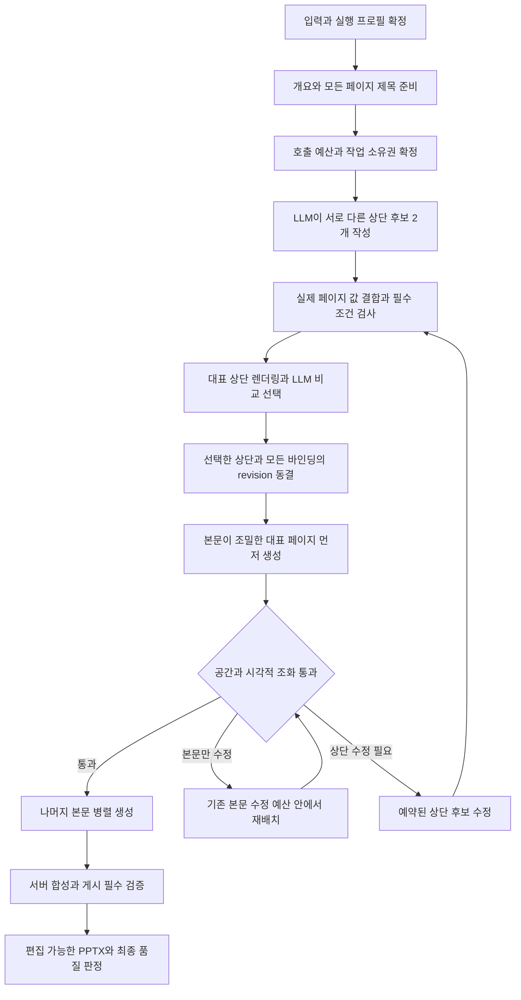

# 문서별 LLM 상단 디자인 설계

작성일: 2026-10-15  
상태: 설계안. 아래 사용자 합의와 현재 코드 관찰 외의 API, 저장 필드, 호출 한도, 도입 순서는 구현 제안이다. 구현 또는 새 기능의 품질 검증 완료를 뜻하지 않는다.  
기반: [기존 공통 상단 설계와 검증 기록](ppt-common-header-design-20261014.md)

2026-10-16 검토 반영: 디자인 후보는 LLM이 실제 렌더를 비교해 선택한다. 후보 2개 생성과 LLM 선택, 대표 본문 우선 검증, 수정 operation별 복구 및 품질·속도 완료 조건을 추가했다.

## 1. 사용자와 합의한 방향

- LLM이 문서의 목적과 내용에 맞춰 실제 상단 SVG를 자유롭게 디자인한다. 참고 이미지는 사용자가 일치를 요구한 경우를 제외하면 방향을 전달하는 자료다.
- 디자인 후보의 비교와 최종 선택은 LLM이 담당한다. 시스템은 원문, 영역, 가독성과 편집성의 필수 조건을 검사하며 미적 판단으로 후보를 자동 선택하지 않는다.
- 한 문서 안에서는 선택한 디자인을 공유하고 제목, 번호 등 실제 페이지 정보만 바꾼다. 문서가 달라지면 구성과 시각적 성격도 달라질 수 있다.
- 본문은 기존 페이지 전체 SVG 작성 경로에서 내용에 맞게 자유롭게 구성한다. 본문을 Deck-IR, 고정 카드, 슬롯 또는 레이아웃 enum으로 바꾸지 않는다.
- 품질을 우선하고 그다음 속도를 최적화한다. 후보 비교, 글자 결합, 본문 적합성, 수정 작업의 복구와 실제 편집 가능한 PPTX 검증을 함께 설계한다.
- 같은 revision의 재개에서는 후보, 선택과 확정 결과를 재사용한다. 사용자 확인을 자동 생성의 필수 단계로 추가하지 않는다.

구성 요소 개수나 장식의 존재를 품질 조건으로 삼지 않는다. 문서에 맞는 간결한 디자인도 허용하되, 실패를 숨기기 위해 기존 제목 하나짜리 상단으로 교체하지 않는다.

## 2. 현재 코드와 확장 경계

| 확인한 연결 지점 | 현재 역할 | 확장 방향 |
| --- | --- | --- |
| `services/svg_common_header.py` | 제목의 글꼴, 줄바꿈, 영역을 측정하고 공통 상단을 합성 | 버전별 렌더러를 분리하고 자유 SVG 상단의 바인딩과 영역 검증 추가 |
| `services/svg_common_header_titles.py` | 누락 제목을 문서 단위로 준비하고 결과 재사용 | 기존 제목 준비를 유지하고 상단 설계의 확정 입력으로 전달 |
| `services/svg_common_header_title_budget.py` | 제목 준비 호출의 입장 한도와 결과 식별 | 제목 슬롯을 차용하지 않는 별도 상단 설계 호출 계획 추가 |
| `services/svg_presentation_prepare.py` | 개요, 스타일, 페이지별 헤더를 원자적으로 확정한 뒤 본문 준비 | 모든 제목이 확정된 뒤 상단 설계와 전 페이지 적합성 검사를 수행 |
| `services/svg_contract.py` | 최종 SVG에 서버 소유 공통 헤더 합성 | 검증한 템플릿에 실제 페이지 값을 결합하고 한 번만 합성 |
| `services/svg_document_mutations.py` | 게시와 번호 갱신에서 저장된 개요 바인딩 검증 | 제목의 출처와 표시 순서를 분리해 수정, 재정렬, 번호 갱신에 동일 계약 적용 |
| `services/generation_core/drivers/svg/quality.py` | 공통 헤더와 본문 맥락을 품질 검토에 전달 | 상단의 전체 구성, 역할, 실제 영역과 선택한 시각 의도를 전달 |
| `workers/svg_common_header_export.py`, `services/svg_export_page_evidence.py` | 제목 중심 상단의 실제 값과 내보내기 증거 연결 | 제목 외 글자와 장식까지 포함하는 상단 증거로 확장 |
| `services/svg_export_quality.py`, `services/svg_export_identity.py` | 품질 영역, 원본 증거, 현재 검증자와 캐시 연결 | 새 상단 계약과 검증자 변경을 반영하고 과거 증거의 재라벨 방지 |

후보 생성·선택은 문서 공통 준비 단계로 연결하고, 기존 페이지 품질 검토는 대표 본문과 개별 페이지 검증에 재사용한다. 수정 operation의 체크포인트와 공유 스타일 의존성은 기존 workspace 저장·게시 계약을 확장한다.

기존 `svg-common-header/v1`과 `svg-common-header-page/v1`은 이미 확정된 입력의 재생 경로로 유지한다. 제안하는 새 계약은 `svg-common-header/v2`와 `svg-common-header-page/v2`이다. v2는 상단 SVG와 그 안의 의미 있는 글자 노드만 기술하며, 본문을 새 IR, 고정 카드, 슬롯 목록 또는 레이아웃 enum으로 바꾸지 않는다.

## 3. 생성 흐름

후보별 원시 응답, 필수 검사와 선택 근거를 먼저 저장한다. LLM이 선택한 후보라도 필수 검사를 실패하면 확정할 수 없다. 통과 후보가 하나뿐인 경우에도 LLM이 적합성을 판단하며, 코드가 남은 후보를 자동 채택하지 않는다. 적합한 후보가 없으면 알려진 실패로 제한 수정 또는 종료한다.

선택 이후의 동결은 해당 revision에서 불변이다. 대표 페이지는 같은 본문 작성 경로로 실제 생성하며, 통과하면 최종 문서에 그대로 사용한다. 별도의 버리는 시안 페이지나 본문 IR을 만들지 않는다. 상단을 바꿔야 하면 새 revision과 바인딩을 만들고 이전 결과와 계보를 보존한다.

대표 페이지는 원문의 필수 표, 차트, 이미지와 텍스트 밀도를 근거로 결정한다. 한 페이지의 통과가 모든 본문의 적합성을 보증하지 않으며, 나머지 페이지도 기존 개별 검증을 수행한다. 대량 생성 시작 후에는 상단 수정으로 모든 페이지를 조용히 다시 생성하지 않는다.

## 4. LLM의 설계 입력과 출력

### 후보 생성 입력

- 문서의 목적, 독자, 주제, 언어, 브랜드 규칙과 `writing_policy`.
- 실제 캔버스 크기, 물리적 글꼴 하한, 사용할 글꼴과 자산, 로고와 원본 고정 영역.
- 모든 페이지의 확정 제목, 근거가 있는 장 이름, 실제 번호와 전체 페이지 수.
- 본문 내용의 짧은 요약, 필수 표와 차트 등 공간 제약, 상단 최대 점유 범위와 공통 스타일 정보. 본문 원문 전체를 후보마다 반복 전달하지 않는다.
- 선택적인 디자인 설명과 참고 자산, 허용된 이전 디자인 요약, 동결한 seed와 프로필.
- 현재 편집 가능한 내보내기가 지원하는 SVG 태그, 속성, 효과와 글꼴의 버전 고정 capability snapshot.

제목 준비와 상단 디자인의 책임을 분리한다. 후보 생성 LLM이 확정 제목을 줄이거나 문서명, 번호, 장 이름과 로고를 지어내지 못하게 한다. 공식 명칭과 사용자 고정 문구는 보존한다.

### 후보 출력과 글자 결합 계약

기본 품질 프로필은 한 번의 생성 호출에서 구조가 다른 후보 2개를 작성한다. 각 후보는 실제 SVG, 후보 ID, 짧은 디자인 의도와 필드 결합 정보를 가진다. 시스템이 정한 배치 목록 중 하나를 선택하는 형식으로 제한하지 않는다.

SVG의 동적 글자 그룹에는 제목, 번호 등 값의 출처를 연결하는 의미 표식을 둔다. 제목은 필수이며 나머지는 실제 데이터와 디자인에 따라 선택한다. 위치와 크기는 LLM이 정한다. 정적인 장식은 일반 SVG로 유지한다.

| 결합 정보 | 필요한 규칙 |
| --- | --- |
| 값과 출처 | 필드 ID, 원본 값 참조, 사용자 고정 여부, 안정적인 페이지 ID |
| 텍스트 영역 | LLM이 정한 좌표와 허용 경계, 기준선, 정렬, 글꼴과 크기, 행간, 최대 줄 수 |
| 줄바꿈 | 서버가 실제 글꼴로 결정하고 명시적인 text/tspan으로 합성. 원문과 읽기 순서를 유지 |
| 선택 정보 부재 | 실제 값이 없으면 생략할 글자와 종속 장식 그룹, 남는 공간 처리와 정렬 규칙 |
| 번호와 긴 값 | 실제 모든 표시 문자열의 폭 검사. 임의 축약, 작은 글씨나 가짜 번호로 통과 금지 |
| 편집성 | 지원되는 native text와 도형을 사용하고 글자를 path나 이미지로 바꾸어 우회하지 않음 |

선택 필드의 유무가 달라도 한 문서의 상단 영역과 본문 시작선은 유지한다. 자동 정렬은 후보가 명시한 관계 안에서만 수행하고 임의의 새 배치를 만들지 않는다. 이 계약은 상단의 값 결합 규칙이며 본문 구조를 제한하지 않는다.

### 선택 LLM의 입력과 출력

필수 검사를 통과한 후보의 실제 렌더, 디자인 의도, 측정 요약, 문서 목적과 본문 스타일 맥락을 한 번에 전달한다. 가장 긴 제목, 가장 넓은 번호, 선택 정보가 많은 경우를 대표하는 실제 페이지를 최대 3개 고르고 중복은 제거한다. 모든 값의 영역 검사는 대표 이미지 검사와 별도로 수행한다.

선택 LLM은 목적 적합성, 타이포그래피와 가독성, 정보 위계와 균형, 본문과의 조화, 후보 간 구조 차이를 비교하고 선택 ID 또는 전체 부적합, 이유와 알려진 결함을 반환한다. 장식 수, 단순 색상 변경이나 긴 설명을 좋은 디자인의 근거로 삼지 않는다. 우열이 비슷한 경우의 최종 판단도 LLM이 한다.

응답은 저장된 후보 ID와 digest에 결합한다. 없는 후보, 변경된 후보 또는 필수 검사 탈락 후보의 선택은 알려진 실패다. 선택 LLM은 SVG나 확정 제목을 직접 다시 쓰지 않으며, 재설계가 필요하면 예약된 수정 단계로 보낸다. 참고 이미지 속 숫자와 문구는 새 문서의 사실로 복사하지 않는다.

## 5. 확정 데이터와 저장

| 구분 | 저장 제안 |
| --- | --- |
| 디자인 요구 | 선택 필드 `common_header_design`: 자유 설명, 참고 자산 ID와 사용자 변경 대상 |
| 실행 계획 | 프로필과 capability 버전, 모델, seed, 입력 digest, 단계별 ordinal과 비용 및 시간 한도 |
| 후보 묶음 | 후보별 원시 응답 참조, SVG와 결합 규칙, font/asset pin, 필수 검사, 렌더 증거와 digest |
| 선택 근거 | 선택 호출의 입력과 출력 참조, 후보 묶음 digest, 선택 ID 또는 전체 부적합, 판단 근거 |
| 문서 상단 | `svg_style_snapshot.common_header`: v2, 선택 SVG 참조, header digest, 영역과 body_box, 결합 계약과 디자인 의도 |
| 페이지 바인딩 | `authored_outline.slides[].common_header`: v2, 안정적인 페이지 ID, 실제 값과 출처, 순서, 측정 결과와 page header digest |
| 최초 생성 상태 | `PresentationGenerationJob.svg_header_design_checkpoint` nullable JSON 필드 제안. 후보 생성부터 대표 본문 결과까지 문서 단위 단계 저장 |
| 생성 후 수정 상태 | 해당 `design.apply` operation 소유의 내구성 있는 체크포인트와 immutable attempt 결과. 최초 생성 job의 완료 상태를 덮어쓰지 않음 |

새 필드와 수정 작업 저장 위치의 이름 및 타입은 구현 전 기존 operation 저장 계약과 대조해 확정한다. 문서 상태를 음수 페이지나 첫 페이지의 체크포인트로 위장하지 않고, 기존 요청 본문과 `request_sha256`을 중간 저장소로 바꾸지 않는다.

최초 생성과 상단 수정은 각각 자신의 작업 ID, 입력 digest, `expected_revision`, idempotency key, attempt token, fence와 lease를 가진다. 같은 요청의 재전송은 같은 결과와 예산을 재사용한다. 새로 승인된 수정 작업만 독립적인 새 예산을 가질 수 있고 취소와 재개로 한도가 초기화되지 않는다.

`header_digest`는 SVG, 결합 규칙, 글꼴과 자산, 캔버스, capability 및 배치 정책 버전을 포함한다. `page_header_digest`는 실제 값과 출처, 페이지 ID, 순서, 줄바꿈과 측정 결과를 추가한다. 선택 receipt는 후보 묶음과 렌더 digest, 검토 모델 및 정책 버전에 결합한다. 후보나 렌더가 달라지면 이전 선택을 재사용하지 않는다.

검증된 상단만 최종 스타일에 기록한다. 수정 operation은 기준 revision에서 새 결과를 준비하고 모든 영향 페이지의 검증 후 CAS로 한 번에 게시한다. 동시 본문 편집, 순서 변경과 충돌하면 충돌을 보존하고 낡은 revision으로 덮어쓰지 않는다.

## 6. 공간, 줄바꿈과 브랜드

상단 높이는 문서마다 달라질 수 있다. 같은 문서에서는 상단 영역과 본문 시작선을 공유한다. 본문 생성 전에 필수 표, 차트, 이미지와 물리적 가독성을 근거로 보수적인 최대 상단 점유 범위와 최소 본문 영역을 정한다. 내용 밀도 추정은 실제 적합성의 보증으로 취급하지 않는다.

1. 후보마다 실제 모든 제목, 번호와 선택 정보를 결합한다.
2. 실제 글꼴의 줄바꿈과 glyph ink, 선 두께, 도형과 이미지의 paint extent를 측정한다. 잘못된 단위와 글꼴 대체를 실패로 처리한다.
3. 기존 제목 최대 2줄 정책과 물리적 가독성 계약을 기본으로 유지한다. 원문 삭제, 임의 축약이나 글자 축소로 통과시키지 않는다.
4. 상단 장식과 여백, 로고 및 기존 furniture의 소유권을 포함해 body_box를 계산한다. 기존 페이지 번호와 중복하지 않고 원본 고정 요소를 자동 삭제하지 않는다.
5. LLM이 선택한 결과와 전체 바인딩의 revision을 동결한 뒤 본문이 조밀한 대표 페이지를 먼저 생성한다.
6. 대표 페이지에서 공간, 글자 가독성과 상단·본문의 조화를 확인한다. 기존 페이지 QA를 사용하며 추가 유료 검토가 필요하면 입장 예산에 별도로 포함한다.
7. 본문 배치 문제는 기존 페이지 수정 경로에서 해결한다. 상단 자체가 본문을 과도하게 밀어낸 경우에만 예약된 상단 수정과 LLM 재선택을 사용한다.

상단 변경으로 대표 페이지를 다시 생성해야 하면 기존 본문 수정 예산과 시간 한도를 별도로 확인한다. 이 비용은 상단 호출 수에 숨기지 않는다. 수정 슬롯이 없으면 실패 원인과 이미 받은 결과를 보존한다. 대량 생성 후에는 각 페이지의 정상 수정 경로를 사용하며 전 문서 재생성을 암묵적으로 예약하지 않는다.

모든 좌표와 물리적 크기는 CanvasContract를 따른다. 특정 1280x720 또는 16:9 좌표를 고정하지 않으며 4:3, 세로형, A4와 원본 캔버스에서도 같은 기준으로 검사한다.

## 7. 문서 간 다양성과 문서 안의 일관성

후보 생성 LLM에는 단순 색상 차이가 아니라 정보의 위치 관계, 여백, 타이포그래피의 비중과 그래픽 구성이 다른 후보를 요구한다. 자유 문장으로 차이를 설명하게 하며 고정 레이아웃 분류표를 만들지 않는다. 선택 LLM은 두 후보의 구조적 차이와 문서 적합성을 함께 판단한다.

시스템은 동적 문구와 색상을 제외한 상대 위치, 정렬 관계, 글자 크기 비율, 여백과 도형 분포를 진단 특징으로 추출할 수 있다. 동일 구조의 색상만 바꾼 후보를 검출하되, 특징값으로 최종 미적 선택을 대신하지 않는다. 유사도 임계값은 신규 v2 반복 생성 자료로 보정하고 검증 전 임의 숫자를 합격 기준으로 발표하지 않는다.

- 새 문서는 새 seed를 사용한다. 재개에서는 같은 seed와 선택 결과를 재사용한다.
- seed는 디자인 입력과 식별자이며 다양성 보증이 아니다. SDK가 지원하지 않는 seed 인자를 전달하지 않는다.
- 초기 구현은 다른 사용자의 문서나 전역 스타일 이력을 조회하지 않는다. 사용자가 이번 요청에 허용한 이전 디자인 요약이나 참고 자료가 있으면 선택 LLM에 전달해 유사성과 차이를 판단하게 한다.
- 이전 디자인 자료가 없는 문서에 대해서는 문서 간 중복 회피를 보장한다고 주장하지 않는다. 여러 주제와 반복 seed로 생성한 검증 집합에서 구조적 다양성을 별도로 평가한다.
- 브랜드, 지정 템플릿과 사용자 고정 디자인의 의도적인 반복은 허용한다. 새로움 때문에 브랜드 규칙이나 가독성을 훼손하지 않는다.
- 표지 예외는 기존 설정을 유지한다. 첫 범위에는 장마다 서로 다른 상단 패밀리를 추가하지 않는다.

후보가 사실상 중복되거나 모두 부적합하면 하나의 예약된 상단 수정 한도 안에서 차이를 보강한다. 후보 수를 늘리거나 숨은 호출을 반복하지 않는다.

## 8. 호출 수, 재개와 시간

기본 품질 프로필은 후보 2개를 만드는 생성 1회와 실제 렌더를 비교하는 LLM 선택 1회로 정상 상단 호출 2회다. 기존의 설계 1회 제안은 이 흐름으로 대체한다. 후보 수 2개는 상단 디자인 대안의 수이며 한 페이지에 쓸 이미지 수를 제한하는 정책이 아니다.

| 단계 | 문서 또는 명시적인 상단 수정 operation당 상한 |
| --- | --- |
| 후보 생성 | 1회. 한 응답에 후보 2개 |
| 최초 LLM 비교 선택 | 1회. 대표 렌더들을 묶어 전달 |
| 알려진 후보 결함의 수정 | 사전 예약한 경우 최대 1회 |
| LLM 재선택 또는 알려진 선택 응답 결함의 교정 | 사전 예약한 경우 합계 최대 1회 |
| 페이지별 상단 합성, 로컬 재측정 | 추가 provider 호출 0회 |
| 성공 결과의 재개 | 이미 완료한 단계의 추가 호출 0회 |
| 실행 여부 또는 결과가 UNKNOWN | 자동 재호출 0회 |

상단 provider 호출은 정상 2회, 예약한 모든 수정 단계를 사용해도 최대 4회다. 수정으로 후보가 바뀌면 새 렌더에 대한 LLM 선택이 필요하며 수정 및 재선택 예산을 함께 확보해야 한다. 재선택을 이미 소비했다면 새 후보 수정을 추가로 시작하지 않는다. 알려진 부적합과 UNKNOWN을 구분한다.

수정 후보도 실제 모든 값을 다시 결합·검사하고 새 렌더를 만든 뒤 LLM이 재선택한다. 대표 본문에서 결함이 발견된 경우 해당 실제 렌더와 알려진 실패 사유도 선택 입력에 포함하며, 같은 결함이 남은 후보는 다시 확정하지 않는다.

선택 응답의 형식 오류가 로컬 파싱으로 복구되지 않으면 예약한 재선택 슬롯을 사용할 수 있다. 원래 응답과 오류를 보존한다. 후보 생성 응답이 미수신인 UNKNOWN 상태를 알려진 형식 오류로 바꾸거나 숨은 SDK 재시도를 허용하지 않는다.

기존 누락 제목 준비 최대 1회는 별도다. 대표 본문 페이지는 최종 문서에 포함되는 정상 페이지 생성 호출이며, 재작성과 페이지 QA의 유료 호출은 기존 본문 예산에 기록한다. 후보 생성·선택 비용과 서로 차용하지 않는다.

입장 시 기존 provider stage/purpose/ordinal 및 가격·실비 예산 계약에 모든 단계를 예약하고 지원 모델과 capability를 SDK 실행 전에 검사한다. selector와 repair도 유료 실행 소유권, 취소, reconciliation과 실제 사용량 영수증을 동일하게 적용한다.

속도 최적화는 글꼴 및 브라우저 프로세스 재사용, 같은 글꼴·문구·폭·정책의 측정 중복 제거, 대표 렌더 중복 제거, compact 본문 맥락 전달, 선택 후 문서 전체 재사용을 우선한다. 다만 바인딩 값과 출처, 페이지 순서 검사는 모든 실제 페이지를 대상으로 수행한다.

시간은 제목 준비, 후보 생성, 바인딩·렌더, LLM 선택, 대표 본문, 나머지 본문, 게시 검증과 export로 분리한다. 상단 확정 시간, 첫 유효 페이지 표시 시간, 전체 완료 시간의 p50/p95와 재생성 페이지 수를 기록한다. 첫 화면에 임시 제목만 표시한 시간을 첫 유효 페이지로 세지 않는다.

프로필에는 후보 생성·선택·로컬 검사와 문서 전체의 시간 예산, 본문 수정 한도를 고정한다. 단계별 p95가 해당 예산 안에 드는지와 같은 조건의 기존 경로 대비 증가량을 완료 조건으로 삼는다. 실제 수치와 허용 증가량은 0단계 시제품에서 측정해 출시 프로필에 확정하며, 미측정 상태를 속도 합격으로 처리하지 않는다. 대기와 provider 실행, 로컬 처리 시간을 구분한다.

## 9. 실패와 결과 확정

후보 생성, 선택, 수정, 재선택과 대표 본문을 각기 내구성 있는 단계로 기록한다. 단계별 미시작, 실행 중, 응답 수신, 검증 완료, 알려진 실패와 결과 미확정을 구분한다. 응답 수신은 디자인 성공이나 게시 성공이 아니다.

- 원시 응답을 먼저 보존한 뒤 파싱·바인딩·측정한다. 응답을 받은 뒤 로컬 검증만 실패했다면 provider를 다시 부르지 않고 저장한 응답으로 재개한다.
- 후보 렌더가 같고 선택 receipt가 유효하면 선택 LLM을 다시 부르지 않는다. 같은 디자인의 재개에서 후보 seed를 바꾸지 않는다.
- 알려진 결함만 예약된 수정·재선택 슬롯으로 처리한다. 단계의 입력과 결과 계보, 비용 및 한도를 유지한다.
- 실행 시작 또는 응답이 불명확하면 UNKNOWN을 보존하고 재조정한다. 타임아웃이나 취소를 새 호출의 근거로 삼지 않는다.
- 선택 모델이 지목하지 않은 후보를 코드가 임의로 채택하지 않는다. 모든 후보의 부적합이나 유효하지 않은 선택은 정확한 실패로 남긴다.
- 기존 문서의 수정 실패와 취소에서는 마지막 게시본을 유지한다. 실패한 후보를 일부 페이지에만 적용하거나 제목형 상단으로 바꾸지 않는다.

문서 상단과 영향 페이지의 바인딩은 원자적으로 게시한다. 서로 다른 후보나 v1/v2를 섞어 완성본으로 게시하지 않는다. 수정 operation의 완료와 provider 영수증, 게시 revision의 연결이 검증되어야 한다.

## 10. 상단 합성, 수정과 페이지 순서

시스템 소유의 최상위 `svg-system-common-header` 그룹은 하나만 둔다. 본문 LLM이 이 ID나 시스템 바인딩을 만들어 넣으면 거부한다. 기존 헤더 교체는 바인딩, 실제 SVG와 기준 revision이 일치할 때만 수행한다.

| 변경 | 처리와 본문 재사용 조건 |
| --- | --- |
| 상단 내부 장식·색상만 변경 | 원문, body_box와 body fingerprint가 같고 공유 스타일 의존성이 바뀌지 않은 경우 본문 재사용. 새 합성과 검증 수행 |
| 공통 글꼴·팔레트·시각적 비중 변경 | 크기가 같아도 무조건 재사용하지 않음. 공유 스타일 의존성과 대표 페이지의 실제 조화 확인 후 필요한 페이지만 수정 |
| 상단 높이 변경 | 새 body_box에서 모든 페이지의 적합성을 확인하고 영향 페이지만 기존 본문 경로로 재배치 |
| 제목 또는 문서 정보 변경 | 출처와 사용자 고정 여부 확인 후 영향 필드와 줄바꿈, 종속 장식을 재측정 |
| 페이지 재정렬 | 안정적인 페이지 ID로 내용 연결, 실제 순서와 번호 및 선택 필드를 다시 결합 |
| 취소·재개·충돌 | operation과 기준 revision, 입력 및 출력 digest를 확인하고 남은 단계만 수행 |

공유 스타일 의존성은 본문이 실제 참조한 글꼴, 색상과 스타일 snapshot을 기준으로 기록한다. 크기와 body fingerprint만으로 조화를 증명하지 않는다. 대표 페이지의 LLM 검토가 필요하면 작업 예산에 포함하고 기존 receipt의 입력과 같을 때만 재사용한다.

재사용한 본문에도 새 전체 페이지 측정과 export 증거를 생성한다. 표와 차트가 움직이면 원문과 관계를 보존하면서 위치·서명과 native 증거를 갱신한다. 이전 전체 페이지 quality receipt의 재라벨, 임의의 전체 축소와 내용 삭제로 통과시키지 않는다.

수정 요청은 기존 workspace `design.apply`에 `target=common_header`, 자유 설명, 참고 자산, `expected_revision`과 idempotency key를 연결하는 형태를 제안한다. 상단 요구 digest와 작업 소유권을 고정하고 후보 생성부터 선택까지 같은 계약을 사용한다. target 없는 기존 동작은 유지한다. 문장에 '상단'이 있다는 이유로 전체 본문 재생성을 예약하거나 Authored 전용 헤더 계약에 SVG 수정을 전달하지 않는다.

자동으로 상단만 변경하는 작업에서는 공통 본문 스타일을 조용히 바꾸지 않는다. 공유 스타일 변경이나 본문 재배치가 필요한 요구라면 실제 영향 범위와 필요한 예산을 해당 수정 작업에 명시한다.

## 11. 품질과 편집 가능한 내보내기

후보 생성 전에 현재 exporter가 지원하는 SVG capability를 전달한다. 편집 가능한 글자와 지원 도형, pin된 글꼴과 원본 이미지 자산을 우선한다. 지원되지 않는 효과나 글자 path 변환으로 화면만 맞추지 않는다.

검증의 역할과 실행 시점을 구분한다.

| 시점 | 확인 내용 |
| --- | --- |
| 후보 선택 전 | 모든 실제 필드의 원문·출처, 글자와 paint extent, 자산, 글꼴, capability, 영역과 구조 검사 |
| 상단 확정 전 | 실제 대표 렌더를 입력으로 LLM이 디자인을 비교·선택. 잘림과 미적 품질의 판정을 구분 |
| 대표 본문 생성 후 | 실제 한 페이지에서 공간, 위계와 시각적 조화, native 원문 보존 확인 |
| 나머지 생성과 게시 | 각 페이지의 필수 검증, 상단 일관성, 현재 revision 및 최종 digest에 결합한 품질 판정 |
| 내보내기 | 전체 상단의 text/shape/asset OOXML 대응, 편집성, 본문 native 보존과 최신 export 증거 |
| 개발·출시 승인 | 신규 v2 산출물의 실제 PowerPoint 편집, 저장·재열기와 시각 확인. 정적 검사만으로 대체하지 않음 |

생성 중 검사, 게시·export의 필수 gate와 개발·출시 검증을 구분해 지연을 측정한다. 매 생성마다 대화형 Office 확인이나 사용자 승인을 새 필수 단계로 넣지 않는다. 기존 release 정책이 실제 Office 증거를 요구하는 경우 해당 산출물의 요구를 그대로 충족하며 개발 검증 결과로 우회하지 않는다.

기존 v1 제목만의 readback은 자유 SVG v2의 증거가 아니다. 상단 전체의 text, 도형, 장식과 자산을 검증하고 본문 native digest와 분리한다. 입력, font/asset, 바인딩, 렌더, 선택 receipt 및 검증기 버전이 달라지면 관련 증거와 캐시를 무효화한다. producer/consumer와 CAS 검증을 유지한다.

QA에는 동결된 상단과 실제 역할, 선택 의도, 페이지 값 및 body_box를 전달한다. 크기만 보고 위계를 판단하거나 장식을 강요하지 않는다. 사람 확인용 `vision_qa`의 기본값과 승인 흐름은 유지하며 자동 후보 선택과 분리한다. 최종 release readiness는 해당 산출물의 필수 증거로 결정한다.

## 12. 웹 입력과 원본 보존

기존 `common_header_mode=uniform/free`, `common_header_cover_exception` 값은 유지한다. 새 자동 상단은 지원하는 fresh uniform 프로필에 적용하고, 이전에 동결한 v1 입력을 요청 없이 v2로 바꾸지 않는다.

자동 후보 선택은 LLM이 수행하며 사용자가 후보를 고를 필요가 없다. 선택적인 미리보기나 사용자 직접 변경은 자동 선택을 대체하거나 품질 gate를 우회하지 않는다.

사용자 화면에는 자동 상단과 선택적인 디자인 설명, 참고 자료, 미리보기 및 상단 수정 기능을 둔다. 번호 배지형, 띠형 등 몇 개의 유형을 반드시 고르게 하는 UI를 기본 흐름으로 만들지 않는다. 내부 계약, 체크포인트, digest와 provider 상태를 제품 디자인 설정에 노출하지 않는다.

선택적인 미리보기는 가장 긴 제목, 번호 폭이 큰 페이지, 실제 정보가 가장 많은 페이지를 중심으로 보여준다. 기본 자동 생성에 추가 승인 단계를 만들지 않는다. 생성 도중 요구가 바뀌면 해당 입력의 새 revision과 예산을 먼저 확정한다.

원본이 PPT가 아니어도 확정 개요와 제목, 출처가 있으면 같은 경로를 사용한다. PDF나 이미지에서 상단을 참고할 때도 스타일 자산과 본문 원문을 분리한다. 반면 전체 페이지를 그대로 유지하는 source-preserve 입력에는 임의로 새 헤더를 덮지 않는다. 현재의 원본 보존 충돌 검증과 명시적 재배치 선택을 유지한다. 이미지 중심 Authored 파이프라인과 SVG 파이프라인도 합치지 않는다.

## 13. 구현 순서와 영향 파일

DB와 UI부터 확장하기 전에 디자인 선택, 본문 공간과 편집 가능한 export가 성립하는지 좁은 시제품으로 먼저 확인한다. 별도의 운영 파이프라인을 만들지 않고 기존 SVG 작성·합성·내보내기 경계를 사용한다.

| 순서 | 구현 내용 | 주된 경계 |
| --- | --- | --- |
| 0 | 서로 다른 후보, LLM 선택, 긴 제목·번호·선택 정보 결합, 대표 본문과 실제 PPTX 검증. 시간 예산과 다양성 기준 보정 | 기존 common header, authorer와 export 경로의 좁은 시제품 |
| 1 | capability와 결합 계약, 후보·선택 receipt, 최초 생성 및 수정 operation 소유권과 입장 예산 확정 | `models/sql/presentation_generation_job.py`, 기존 workspace operation 저장 및 request serializer |
| 2 | 후보 생성·렌더·선택과 제한 수정, 실제 모든 값 측정과 글꼴 캐시 | `services/svg_common_header.py`, `services/svg_common_header_titles.py`, 기존 LLM 호출 유틸리티 |
| 3 | 선택 revision 동결, 대표 페이지 우선 생성, 나머지 병렬화와 재개 | `services/svg_presentation_prepare.py`, `services/svg_presentation_checkpoint.py`, `services/generation_core/authoring/author_slide_svg.py`, `services/svg_contract.py` |
| 4 | 수정 작업별 checkpoint, 공유 스타일 의존성과 영향 범위, CAS 게시·재정렬 | `services/svg_document_mutations.py`, 기존 workspace design handler 및 게시 서비스 |
| 5 | 상단 전체 readback, 선택·품질 캐시와 최종 readiness | `workers/svg_common_header_export.py`, `services/svg_export_page_evidence.py`, `services/svg_export_quality.py`, `services/svg_export_identity.py` |
| 6 | 선택적인 요구·참고 자료·미리보기·상단 수정 UI와 출시 프로필 적용 | 기존 생성 입력 및 presentation 편집 화면 |

0단계의 렌더가 좋아 보이는 것만으로 DB 복구, 웹 경로와 출시가 완료됐다고 하지 않는다. 반대로 저장과 복구 구현만으로 디자인 품질 개선을 완료했다고 하지 않는다. 단계별 증거를 구분한다.

제목 checkpoint를 새 후보 schema로 재해석하지 않는다. provider 설정은 기존 `utils/llm_provider.py`와 `utils/llm_config.py` 책임을 유지한다. 새 job 필드가 확정되면 PostgreSQL 마이그레이션, API와 두 controller의 schema-head 계약 및 기존 행 보존을 함께 준비한다. 이 문서 변경 자체는 DB, 서버나 provider를 변경하지 않는다.

## 14. 구현 후 완료 조건

| 범주 | 완료 조건 |
| --- | --- |
| 후보와 선택 | 기본 후보 2개가 구조적으로 다르고, 실제 렌더를 본 LLM의 유효한 선택 receipt가 확정 결과와 연결됨 |
| 선택 실패 | 모두 부적합, 없는 ID, 탈락 후보 선택과 변경된 렌더의 낡은 선택을 거부. 코드가 임의 후보로 통과시키지 않음 |
| 다양성 | 여러 주제와 반복 seed에서 색상·문구를 제외한 구조를 평가. 브랜드 고정과 자유 생성 결과를 구분 |
| 글자 결합 | 긴 제목, 넓은 실제 번호, 선택 정보 부재·최다 정보와 실제 글꼴을 처리. 원문과 읽기 순서를 보존 |
| 문서 일관성 | 모든 페이지가 같은 상단 구조와 본문 시작선을 공유하고 실제 값과 페이지 연결이 정확함 |
| 본문 적합성 | 조밀한 대표 페이지를 먼저 생성·검증해 최종 문서에 재사용. 이후 모든 페이지도 자체 검증 |
| 수정과 재사용 | 같은 크기의 스타일 변경도 공유 의존성과 조화를 확인. 필요한 페이지만 수정하고 native 원문과 관계를 보존 |
| 복구와 소유권 | 최초 생성과 각 수정 operation의 상태·예산이 분리되고 재개·취소로 초기화되지 않음. UNKNOWN 자동 재호출 없음 |
| 게시 충돌 | 동시 수정과 재정렬은 revision/CAS로 보호. 실패 시 마지막 게시본과 이전 시도를 보존 |
| 캔버스와 원본 | 여러 비율과 브랜드 예약 영역을 검증. source-preserve에 임의 상단을 덮지 않음 |
| PPTX | 상단 전체 readback과 본문 native 보존, 실제 PowerPoint 편집·저장·재열기 검증. 신규 v2 산출물의 증거 사용 |
| 호출과 비용 | 정상 상단 호출 2회, 예약된 수정·재선택 포함 최대 4회. 제목·본문·QA 비용을 분리하고 모든 실제 사용량 반영 |
| 속도 | 상단 확정·첫 유효 페이지·전체 완료의 p50/p95, 대기·provider·로컬 시간과 재생성 페이지 수를 프로필 예산 및 동일 조건의 기준 경로와 비교 |

대표 입력은 짧고 긴 한국어 제목, 선택 정보가 없는 문서, 번호 폭이 커지는 문서, 표·차트·화면 캡처 중심 본문, 브랜드 고정과 자유 디자인을 포함한다. 수용 검증에서 작은 문서와 큰 문서를 구분하되 특정 페이지 수나 템플릿에 맞춘 운영 특례는 만들지 않는다.

유사도 기준, selector 판단 기준과 단계별 지연·허용 증가량은 0단계의 실제 신규 v2 결과로 보정해 버전 고정한다. 기준이 없는 상태에서 출시 합격이나 임의의 품질·성능 향상 수치를 선언하지 않는다. 이전 v1의 5페이지 READY나 오래된 Office 증거는 v2 완료의 근거로 사용하지 않는다.

구현 후 검증은 바뀐 층을 직접 다루는 기존 좁은 검사를 우선한다. 준비·게시의 `test_svg_source_publication.py` 및 `test_svg_page_publication.py`, export의 `test_svg_export_quality.py`, 캐시의 `test_svg_export_identity_join.py`와 실제 연결 범위를 확인해 선택한다. 문서 변경 단계에서는 테스트, 빌드, provider 호출과 성능 측정을 실행하지 않는다.

## 15. 결정 상태와 후속 검토

2026-10-16 사용자 요청으로 디자인 후보 선택의 LLM 책임과 직전 설계 검토의 개선 방향을 반영했다. 사용자 직접 결정은 문서별 자유 상단, 문서 안의 재사용, 본문 자유 작성, 상단 독립 수정, 품질 우선 및 LLM의 후보 비교·선택이다. 글자 결합, 본문 적합성, 수정 작업 소유권, 스타일 의존성, 속도 지표와 시제품 우선 구현은 사용자가 반영을 요청한 설계 요구다.

후보 2개, 정상 2회·최대 4회 호출, v2 schema와 필드명, 저장 위치, 세부 알고리즘과 UI는 이 문서의 구체적인 구현 제안이다. 사용자 합의와 구현 검증으로 확정된 계약을 구분하고, 아직 측정하지 않은 수치와 에이전트 추론을 검증 완료로 기록하지 않는다.

`compiled-spec-memory` 스킬은 현재 제공된 스킬 목록과 알려진 로컬 경로에서 확인되지 않았다. 자동 결정 기록은 수행하지 않았으며 완료 문구를 표시하지 않는다. 필요한 결정과 미확정 구현 제안은 이 설계 문서에 구분해 보존한다.
