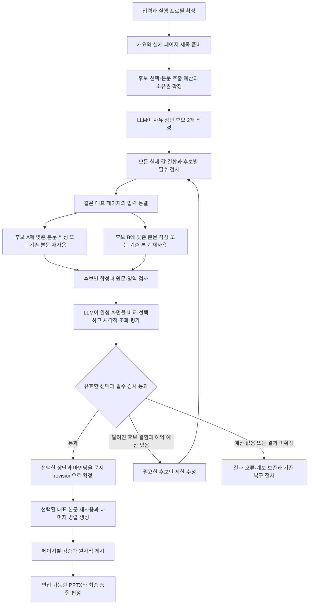

# 문서별 LLM 상단 디자인 설계

작성일: 2026-10-15  
상태: 설계안. 아래 사용자 합의와 현재 코드 관찰 외의 API, 저장 필드, 호출 한도, 도입 순서는 구현 제안이다. 구현 또는 새 기능의 품질 검증 완료를 뜻하지 않는다.  
기반: [기존 공통 상단 설계와 검증 기록](ppt-common-header-design-20261014.md)

2026-10-16 후속 검토 반영: LLM이 같은 원문의 대표 완성 페이지 두 안을 비교해 선택한다. 정상 본문 N+1회와 후보별 저장·실비, 평가 편향 방지, 전체 입력 기반 재사용, 기존 본문 합성 수정과 품질·성능 비교 기준을 반영했다.

## 1. 사용자와 합의한 방향

- LLM이 문서의 목적과 내용에 맞춰 실제 상단 SVG를 자유롭게 디자인하고 후보를 비교·선택한다. 시스템은 필수 조건을 검사하며 미적 판단으로 후보를 자동 선택하지 않는다.
- 기본 품질 흐름은 같은 대표 페이지를 후보 2개의 상단과 본문으로 완성해 비교한다. 상단 조각을 먼저 선택하고 본문을 뒤늦게 맞추는 이전 흐름은 이 흐름으로 대체한다.
- 같은 원문을 사용하되 후보별 상단 높이와 스타일에 맞춰 본문도 자유롭게 작성한다. 두 후보를 맞추기 위해 같은 상단 높이나 더 좁은 공통 body_box를 강제하지 않는다.
- 선택한 상단과 공통 스타일을 문서 안에서 공유한다. 나머지 본문은 페이지별 내용에 맞춰 자유롭게 구성하고 대표 페이지의 본문 배치를 복제하지 않는다.
- 품질 다음으로 속도를 중시한다. 두 대표 페이지는 입장 시 허용한 동시 실행 범위에서 병렬 생성하고 선택된 페이지를 최종 문서에 재사용한다.
- 상단 수정에서 본문 영역과 공통 스타일을 그대로 유지할 수 있으면 기존 본문에 후보 상단을 합성해 비교한다. 불필요한 본문 생성은 하지 않는다.
- 재개에서는 같은 입력과 이미 완료한 결과를 재사용한다. 원문, 수치, 관계와 페이지 수를 보존하고 사람 확인을 자동 생성의 필수 단계로 추가하지 않는다.

문서별 구성은 달라질 수 있으며 장식의 개수나 특정 유형을 품질 조건으로 삼지 않는다. 본문을 Deck-IR, 고정 카드, 슬롯 또는 레이아웃 enum으로 바꾸지 않고, 실패를 숨기는 제목형 상단 대체도 사용하지 않는다. 참고 자료는 사용자 요구에 따라 해석하며 사용자 고정 문구·브랜드·디자인 조건을 우선한다.

## 2. 현재 코드와 확장 경계

| 확인한 연결 지점 | 현재 역할 | 확장 방향 |
| --- | --- | --- |
| `services/svg_common_header.py` | 제목의 글꼴, 줄바꿈, 영역을 측정하고 공통 상단을 합성 | 버전별 렌더러를 분리하고 자유 SVG 상단의 바인딩과 영역 검증 추가 |
| `services/svg_common_header_titles.py` | 누락 제목을 문서 단위로 준비하고 결과 재사용 | 기존 제목 준비를 유지하고 상단 설계의 확정 입력으로 전달 |
| `services/svg_common_header_title_budget.py` | 제목 준비 호출의 입장 한도와 결과 식별 | 제목·상단·대표 본문·QA 비용을 분리한 입장 계획 연결 |
| `services/svg_presentation_prepare.py` | 개요, 스타일, 페이지별 헤더를 원자적으로 확정한 뒤 본문 준비 | 후보별 불변 입력으로 대표 본문 두 안을 작성하고 전체 화면 선택 후 최종 상단과 페이지 바인딩 확정 |
| `services/svg_contract.py` | 최종 SVG에 서버 소유 공통 헤더 합성 | 검증한 템플릿에 실제 페이지 값을 결합하고 한 번만 합성 |
| `services/svg_document_mutations.py` | 게시와 번호 갱신에서 저장된 개요 바인딩 검증 | 제목의 출처와 표시 순서를 분리해 수정, 재정렬, 번호 갱신에 동일 계약 적용 |
| `services/generation_core/drivers/svg/quality.py` | 공통 헤더와 본문 맥락을 품질 검토에 전달 | 전체 화면 선택과 대표 시각 검토를 연결하되 원문·native 및 개별 페이지 필수 검증 유지 |
| `workers/svg_common_header_export.py`, `services/svg_export_page_evidence.py` | 제목 중심 상단의 실제 값과 내보내기 증거 연결 | 제목 외 글자와 장식까지 포함하는 상단 증거로 확장 |
| `services/svg_export_quality.py`, `services/svg_export_identity.py` | 품질 영역, 원본 증거, 현재 검증자와 캐시 연결 | 새 상단 계약과 검증자 변경을 반영하고 과거 증거의 재라벨 방지 |

후보별 대표 본문도 기존 authorer를 사용하지만 같은 페이지 체크포인트를 공유하지 않는다. 문서 공통 준비 단계에 후보 attempt의 저장·선택·최종 페이지 연결을 추가하고 기존 페이지 검증과 workspace 게시 계약을 확장한다.

기존 `svg-common-header/v1`과 `svg-common-header-page/v1`은 이미 확정된 입력의 재생 경로로 유지한다. 제안하는 새 계약은 `svg-common-header/v2`와 `svg-common-header-page/v2`이다. v2는 상단 SVG와 그 안의 의미 있는 글자 노드만 기술하며, 본문을 새 IR, 고정 카드, 슬롯 목록 또는 레이아웃 enum으로 바꾸지 않는다.

## 3. 생성 흐름

최종 선택 전에 각 후보의 SVG, 스타일, body_box와 실제 바인딩을 불변의 후보 revision으로 저장한다. 대표 본문은 각각 그 입력으로 작성한다. 선택 이후 문서 공통 revision으로 승격할 때 후보 내용을 다시 바꾸지 않는다. body_box가 다른 두 후보도 각자의 영역에서 비교하므로 최대 높이를 공통으로 예약해 본문 공간을 낭비하지 않는다.

대표 페이지 두 안은 동일한 원문과 안정적인 페이지 ID를 사용한다. 두 장의 원문이나 두 개의 게시 페이지로 취급하지 않는다. 후보별 결과와 호출 소유권은 분리하고 최종 문서에는 선택된 한 안만 연결한다. 미선택 결과도 삭제하지 않는다.

필수 검사 통과 후보를 대상으로 LLM이 선택한다. 하나만 유효하더라도 LLM이 적합성을 판단하며 코드가 자동 채택하지 않는다. 적합한 후보가 없으면 예약된 수정·재선택을 사용하거나 정확한 실패를 보존한다. UNKNOWN을 후보 탈락으로 바꾸지 않는다.

대표 페이지는 공간 위험을 검증할 입력으로 고른다. 가장 조밀한 페이지 하나가 문서 전체의 미적 기준을 대표한다고 가정하지 않는다. 문서 목적과 공통 스타일을 선택의 기준으로 유지하고 다른 성격의 페이지도 완성되는 대로 기존 QA에서 상단과의 조화를 확인한다.

## 4. LLM의 설계 입력과 출력

### 후보 생성 입력

- 목적, 독자, 주제, 언어, 사용자 요구와 브랜드 규칙, `writing_policy`.
- 실제 캔버스, 물리적 가독성 하한, 사용 가능한 글꼴과 자산, 로고·원본 고정 영역.
- 실제 모든 제목과 번호, 근거가 있는 장 이름과 문서 정보, 선택 필드의 유무.
- 대표 페이지 원문을 찾을 수 있는 참조, 문서 내용 요약과 필수 표·차트·이미지의 공간 제약. 본문 전체를 모든 후보 호출에 중복 전달하지 않는다.
- 선택적인 디자인 참고 자료와 허용된 이전 디자인 요약, 동결한 seed와 프로필.
- 현재 exporter가 지원하는 SVG 태그·속성·효과·글꼴의 capability snapshot과 후보당 출력·렌더 예산.

상단 LLM은 확정 제목을 줄이거나 번호·장 이름·문서명·로고를 지어내지 못한다. 두 후보의 시각적 방향은 자유롭게 달라질 수 있지만 사용자 고정 문구, 출처와 브랜드 제약은 동일하다.

### 상단 후보와 글자 결합

한 번의 생성 호출로 서로 다른 실제 SVG 후보 2개와 후보 ID, 디자인 의도 및 결합 계약을 받는다. 위치·비중·여백과 타이포그래피의 차이를 요구하되 준비된 배치 목록에서 고르게 하지 않는다. 디자인 의도는 원시 결과와 함께 보존한다.

| 결합 정보 | 필요한 규칙 |
| --- | --- |
| 값과 출처 | 의미 표식, 원본 값 참조, 사용자 고정 여부와 안정적인 페이지 ID |
| 텍스트 영역 | LLM이 정한 좌표와 경계, 기준선·정렬·글꼴·크기·행간·최대 줄 수 |
| 줄바꿈 | 실제 글꼴로 측정해 명시적인 text/tspan으로 합성하고 원문과 읽기 순서를 보존 |
| 선택 정보 부재 | 생략할 글자·종속 장식, 남는 공간과 정렬의 처리 규칙 |
| 번호·긴 값 | 모든 실제 표시 값 검사. 가짜 번호, 축약이나 작은 글씨로 우회하지 않음 |
| 편집성 | 지원되는 native text·도형과 원본 자산 사용. 글자의 path·이미지 변환으로 우회하지 않음 |

상단의 의미 표식은 값의 출처를 연결하며 본문 구조를 제한하지 않는다. 같은 후보 안에서는 선택 정보의 유무가 달라도 공통 상단 영역과 본문 시작선을 유지한다.

### 대표 본문 작성

원문과 필수 데이터가 같은 대표 페이지를 기존 본문 authorer로 두 번 작성한다. 각 호출에는 해당 후보의 상단, 공통 스타일과 body_box를 전달하며 후보마다 본문 배치를 자유롭게 결정한다. 작성 경로와 원문·native 보존 검증은 기존 경로를 사용한다.

두 결과의 글꼴·자산·캔버스와 원문 검증은 실제 입력에 결합한다. 내용 누락이나 지원하지 않는 SVG로 이득을 얻은 후보는 미적 비교 전에 제외한다. 후보 두 개는 디자인 대안 수이며 한 페이지의 이미지 수 제한이 아니다.

### 완성 화면의 LLM 선택

선택 입력은 같은 원문으로 만든 전체 페이지 두 안, 사용자 요구·문서 목적·브랜드, 필수 검사 요약과 필요한 원문 맥락이다. 상단 조각만으로 선택하지 않는다. 가장 불리한 실제 제목·번호·선택 정보 조합은 로컬에서 전부 검사하며, 시각적 위험을 보여줄 필요가 있을 때만 이미지 예산 안에서 후보별 경계 사례 상단을 최대 1개씩 보조 자료로 넣는다.

후보는 같은 배율과 실제 비율로 렌더하고 한국어 글자의 가독성을 평가할 수 있는 해상도를 확보한다. 생성 LLM의 자기평가·우열 주장과 원래 후보 순서는 선택 입력에서 제외한다. 별도 평가 맥락을 사용하고 후보 표시 순서·익명 ID의 매핑을 seed로 정해 저장하며 재개에서도 유지한다. 사용자 지시와 출처 정보는 숨기지 않는다.

선택 LLM은 목적 적합성, 정보 위계·여백·정렬·타이포그래피, 상단·본문 조화와 가독성, 구조적 차이를 비교한다. 사용자·브랜드 조건과 가독성을 새로움보다 우선한다. 장식 수나 그럴듯한 설명을 점수로 대신하지 않고 화면 요소를 근거로 이유를 반환한다. 우열이 비슷한 경우의 판단도 LLM이 담당한다.

한 호출에서 `candidate_selection`과 `representative_visual_review`를 별도 결과로 반환한다. 전자는 선택 ID 또는 전체 부적합, 후자는 대표 페이지의 시각적 조화와 알려진 결함이다. 두 결과는 같은 유료 호출 영수증에 연결하되 검증 계약은 구분한다. 이것으로 원문·native·내보내기 필수 검증을 대체하지 않는다.

선택 응답의 ID·revision·전체 평가 입력 digest와 실제 선택 페이지를 검증한다. 없는 ID, 변경된 후보, 필수 검사 탈락 후보는 확정하지 않는다. 선택 LLM은 SVG나 제목을 다시 쓰지 않고 재설계가 필요하면 예약된 수정 단계로 보낸다.

## 5. 확정 데이터와 저장

| 구분 | 저장 제안 |
| --- | --- |
| 디자인 요구 | `common_header_design`: 자유 설명, 참고 자료, 사용자 고정 조건과 변경 대상 |
| 실행 계획 | 프로필·capability·모델 버전, seed, 입력 digest, 호출 ordinal, 비용·시간·출력 및 수정 한도 |
| 후보 묶음 | 후보별 원시 응답, SVG·결합 규칙·스타일·body_box, 실제 값 검사와 렌더 참조 |
| 대표 본문 후보 | 동일 페이지 ID별 후보 입력 digest, 별도 author attempt와 원시 body SVG·자산·native 증거·유료 실행 참조 |
| 선택 결과 | 전체 선택 입력 digest, 표시 순서 매핑, 원시 출력, 선택 ID와 선택·대표 시각 검토 결과 |
| 최종 상단 | `svg_style_snapshot.common_header`: v2, 선택 SVG·스타일·결합 계약·영역·header digest |
| 페이지 바인딩 | `authored_outline.slides[].common_header`: v2, 페이지 ID·실제 값·출처·순서·측정·page header digest |
| 최초 생성 상태 | `PresentationGenerationJob.svg_header_design_checkpoint` nullable JSON 필드 제안. 후보와 대표 본문·선택 상태를 문서 단위로 저장 |
| 생성 후 수정 상태 | 해당 `design.apply` operation의 내구성 있는 체크포인트와 불변 attempt 결과. 최초 생성 job의 완료 상태를 덮어쓰지 않음 |

저장 필드명·타입은 기존 operation 및 authorer 계약과 대조해 확정한다. 대표 본문 후보는 `operation/job + candidate_revision + candidate_id + page_id + stage/ordinal`로 구분한다. 같은 페이지 index의 기존 체크포인트를 두 후보가 덮어쓰거나 임의의 음수 페이지로 위장하지 않는다. 기존 authorer를 재사용하되 후보 결과의 저장 소유권과 최종 페이지 연결을 명시한다.

최초 생성과 각 상단 수정은 자신의 요청 digest, `expected_revision`, idempotency key, attempt token·fence·lease를 가진다. 후보 ID는 새 작업이나 예산 초기화의 근거가 아니다. 같은 요청의 재전송·취소·재개에서는 기존 한도와 결과를 재사용한다.

`header_digest`는 SVG, 결합 규칙, 스타일·글꼴·자산, 캔버스, capability와 배치 정책을 포함한다. `page_header_digest`는 실제 값·출처·페이지 ID·순서·줄바꿈과 측정을 추가한다. 후보 본문은 원문·native 입력과 body SVG·style·body_box에 별도 digest를 둔다.

`selection_input_digest`는 실제 평가 입력 전체를 포함한다. 문서 목적·사용자 지시·브랜드·원문 맥락·공유 스타일·허용 참고 자료, 후보와 대표 본문·렌더, 필수 검사 결과와 알려진 실패 사유, 이미지 해상도·표시 순서, 평가 프롬프트·모델·정책·렌더러 및 검증기 버전을 연결한다. 헤더 이미지가 같다는 이유만으로 다른 맥락의 선택을 재사용하지 않는다.

선택된 대표 본문은 최종 입력의 원문·style·body_box·canvas·font/assets·native 입력이 일치할 때 원시 SVG를 그대로 연결한다. 후보 시도와 유료 영수증의 계보를 유지하고 최종 합성·측정·게시 증거는 다시 생성한다. 낡은 품질 receipt의 이름만 바꿔 최종 증거로 쓰지 않는다. 입력 불일치는 정상적인 제한 수정으로 처리하고 재호출 비용을 기록한다.

미선택 결과와 원시 응답은 보존한다. 디자인의 미선택 상태를 provider 실행 실패나 취소로 바꾸지 않고 실제 사용량을 그대로 반영한다. 최종 상단·모든 바인딩·선택된 대표 페이지는 기준 revision에서 준비해 CAS로 원자적으로 게시한다. 동시 편집·재정렬과 충돌하면 낡은 결과로 덮어쓰지 않는다.

## 6. 공간, 줄바꿈과 대표 페이지

상단 높이는 문서와 후보마다 다를 수 있다. 각 후보는 실제 캔버스·브랜드 예약 영역, 원문의 필수 표·차트·이미지와 물리적 가독성을 근거로 최대 점유 범위와 최소 본문 영역을 지킨다. 내용 밀도 추정만으로 본문 적합성을 보증하지 않는다.

1. 각 후보에 모든 실제 제목·번호·선택 정보를 결합한다.
2. 실제 글꼴의 줄바꿈·glyph ink, 선 두께와 모든 paint extent를 측정한다. 글꼴 대체와 잘못된 단위를 실패로 처리한다.
3. 기존 제목 최대 2줄과 물리적 가독성 계약을 기본으로 유지한다. 원문 삭제·임의 축약·글자 축소로 통과시키지 않는다.
4. 로고·장식·여백과 furniture 소유권을 반영해 후보별 body_box를 계산한다. 원본 고정 요소를 삭제하거나 페이지 번호를 중복하지 않는다.
5. 같은 대표 페이지 원문을 각 후보의 영역과 스타일로 작성하고 실제 전체 페이지로 합성한다.
6. 원문·native 보존, 글자와 영역 적합성을 검사한 뒤 LLM이 전체 화면의 조화를 비교한다.
7. 선택한 후보의 상단과 본문 시작선을 문서 전체에 적용하고 다른 성격의 페이지도 완성되는 대로 기존 QA에서 검증한다.

대표 페이지는 필수 객체와 내용 밀도를 근거로 공간 위험을 확인할 수 있는 페이지로 선정한다. 대표 페이지의 본문 배치가 문서 전체의 정답이라고 가정하지 않는다. 문서 목적·브랜드·사용자 요구를 시각적 기준으로 유지하고 이후 페이지의 내용에 맞는 구성을 허용한다.

본문 배치만 실패하면 기존 본문 수정 예산으로 해당 후보만 수정한다. 상단 수정으로 body_box나 공유 스타일이 바뀌면 영향 후보 본문도 다시 작성해야 하므로 상단 수정·본문 수정·재선택 한도를 함께 확인한다. 대량 생성 후 전 문서를 암묵적으로 다시 만들지 않는다.

모든 비율·물리적 크기는 CanvasContract를 따른다. 16:9나 1280x720 좌표를 고정하지 않고 세로형·A4·원본 캔버스에도 같은 계약을 적용한다.

## 7. 다양성, 문서 일관성과 평가 편향

후보의 차이는 단순 색상이 아니라 정보의 위치 관계, 여백, 타이포그래피 비중과 그래픽 구성에서 드러나야 한다. 같은 원문을 각 후보에 맞게 구성한 전체 페이지를 비교하되, 새로움 때문에 브랜드·가독성·내용 보존을 훼손하지 않는다. 고정 레이아웃 분류표를 만들지 않는다.

동적 문구와 색상을 제외한 상대 위치·정렬·글자 크기 비율·여백·도형 분포를 진단 특징으로 추출할 수 있다. 색만 바꾼 동일 구조의 후보를 검출하되 특징값이 최종 미적 선택을 대신하지 않는다. 유사도 기준은 신규 v2 산출물로 보정한다.

- 새 문서는 새 seed를 사용하고 같은 작업의 재개에서는 후보·표시 순서와 선택 결과를 유지한다. seed 자체가 다양성을 보장하지 않으며 지원하지 않는 SDK 인자를 전달하지 않는다.
- 선택은 후보 생성과 별도 평가 맥락에서 수행한다. 생성 설명의 설득력과 고정된 후보 순서가 판단을 좌우하지 않도록 하고, 이를 위해 매번 추가 역순 비교 호출을 만들지는 않는다.
- 초기 범위에서는 다른 사용자의 문서나 전역 스타일 이력을 조회하지 않는다. 이번 요청에 허용된 이전 디자인 요약·참고 자료만 활용한다.
- 이전 디자인 자료가 없으면 문서 간 중복 회피를 보장한다고 주장하지 않는다. 여러 주제·반복 seed의 검증 집합에서 구조적 다양성을 평가한다.
- 의도적인 브랜드·지정 디자인의 반복은 허용한다. 한 문서에서는 선택된 상단과 공통 스타일을 공유하되 본문 레이아웃을 반복 강제하지 않는다.
- 표지 예외는 기존 설정을 유지하고 첫 범위에 장별 상단 패밀리를 추가하지 않는다.

구조적 중복이나 부적합을 고칠 때에도 예약된 수정 한도를 공유한다. 무제한 후보 추가나 숨은 평가 호출로 해결하지 않는다.

## 8. 호출 수, 비용과 성능

정상 상단 호출은 후보 2개 생성 1회와 완성 화면을 비교하는 LLM 선택 1회로 합계 2회다. 대표 본문은 별도의 실제 author 호출이며 상단 호출 수에 숨기지 않는다.

| 구간 | 정상 및 제한 |
| --- | --- |
| 상단 후보 생성 | 1회에 후보 2개 |
| LLM 비교·선택과 대표 시각 검토 | 같은 호출 1회, 두 결과 계약은 구분 |
| 알려진 상단 후보 결함 수정 | 사전 예약한 경우 최대 1회 |
| LLM 재선택 또는 알려진 선택 응답 교정 | 사전 예약한 경우 합계 최대 1회 |
| 대표 본문 두 안 작성 | 최초 생성에서 2회, 허용된 동시 실행 범위에서 병렬 |
| 나머지 본문 작성 | 선택된 대표 1개를 제외한 N-1회 |
| 상단만 수정하고 본문 재사용 가능 | 대표 본문 추가 작성 0회, 기존 본문에 후보별 합성 |
| 완료 결과의 합성·로컬 재검증·재개 | 완료된 단계에 대한 추가 provider 호출 0회 |
| 실행 여부나 결과가 UNKNOWN | 자동 재호출 0회 |

최초 생성에서 정상 본문 작성은 `2 + (N-1) = N+1`회다. 선택된 대표 페이지를 다시 생성하지 않는 조건이며 최종 페이지 수는 N이다. 상단 정상 2회와 합치면 이 두 종류의 호출은 N+3회지만 제목 준비·QA·수정·export 관련 호출은 별도다. 작은 문서는 추가 본문 1회의 비중이 크므로 규모별로 평가한다. 병렬 실행이 실제 비용을 줄인다고 주장하지 않는다.

상단 호출은 수정·재선택까지 최대 4회다. 후보 수정 후 새 렌더를 LLM이 다시 선택해야 하므로 재선택 슬롯이 남아 있어야 한다. body_box·공유 스타일 변경이면 후보 본문 수정 슬롯도 필요하다. 같은 후보 입력에 대한 로컬 재검증은 재호출 없이 수행하고, 입력이 달라지는 본문 수정은 기존 본문 입장 계획에 별도로 계상한다. 대표 본문 두 안이 동일한 페이지 index의 한도를 공유해 서로 덮어쓰지 않게 하되 문서 총예산도 넘어서는 안 된다.

기존 누락 제목 준비 최대 1회와 본문·QA의 수정 계약은 유지한다. 후보별 실행의 실제 가격·사용량과 입장 ordinal을 기록하고 미선택 결과의 비용도 합산한다. 후보 또는 operation revision을 바꿔 한도를 초기화하지 않는다. SDK 숨은 재시도는 0이고 지원 모델·이미지 입력 capability를 실행 전에 확인한다.

호출 수와 함께 후보당 출력 토큰·SVG 크기 및 노드 수·렌더 시간·메모리, 선택 이미지의 개수·해상도·픽셀 예산을 프로필에 고정한다. 숫자는 시제품에서 실제 지원 범위와 가독성을 확인해 확정한다. 한도를 맞추려고 원문이나 필수 요소를 삭제하거나 글자를 읽을 수 없게 줄이지 않는다. 범위 초과는 알려진 결함과 정확한 원인으로 보존하고 예약된 수정 안에서만 처리한다.

### 대기시간을 줄이는 실행

후보 생성 중 이미 확정된 글꼴·브라우저 준비와 독립적인 로컬 준비를 겹친다. 후보별 본문은 같은 원문의 파싱·자산 준비를 재사용하되 불변 입력과 결과 소유권을 분리한다. 렌더·측정은 글꼴·문구·폭·정책이 같은 경우만 중복 제거한다. 실제 모든 페이지의 값·출처·순서 검사는 생략하지 않는다.

선택 호출에서 대표 페이지의 시각적 조화를 함께 평가해 같은 화면의 같은 목적 검토를 중복 호출하지 않는다. 필요한 원문·native 검사는 별도로 충족한다. 선택과 대표 적합성의 필수 판정이 끝나면 나머지 본문을 시작하고, 이후 단계용 검증을 전부 앞에 직렬로 몰아넣지 않는다. 각 페이지와 게시·release의 필수 gate는 그대로 유지한다.

시간은 제목 준비, 후보 생성, 대표 본문·로컬 검사, 선택, 나머지 본문, 게시 검증과 export로 나눈다. 첫 유효 페이지는 선택과 필수 검증을 마친 실제 페이지이며 임시 제목이나 미선택 초안을 첫 결과로 세지 않는다.

### 성능 완료 기준

최초 생성·동일 작업 재개·본문 재사용 상단 수정·본문 영향이 있는 수정을 구분한다. 문서 규모·내용·모델·동시 처리 수·실행 환경·비교 시점을 맞춰 상단 확정, 첫 유효 페이지와 전체 완료 시간, 대기·provider·로컬 시간, 실제 비용과 재생성 페이지 수를 기록한다.

표본 수와 분포를 함께 보고 충분한 자료가 있을 때 p50/p95를 사용한다. 소수 시제품 실행은 개별 시간과 범위로 보고 p95 합격이라고 선언하지 않는다. 단계별 시간·출력 예산과 기존 경로 대비 허용 증가량은 시제품에서 측정해 출시 프로필에 확정한다. 추가 본문 1회와 병렬화의 이득·손실을 실측 전 확정하지 않는다.

## 9. 실패, 선택과 재개

후보 생성, 후보별 대표 본문·로컬 검사, 선택·수정·재선택을 별도 단계로 저장한다. 단계별 미시작·실행 중·응답 수신·검증 완료·알려진 실패·결과 미확정을 구분한다. 응답 수신이나 미선택 상태를 실행 실패로 바꾸지 않는다.

- 원시 응답을 먼저 보존한 뒤 파싱·합성·측정한다. 로컬 검사만 실패했다면 저장한 결과로 재개한다.
- 한 후보의 완료 결과를 다른 후보의 재시도로 덮어쓰지 않는다. 완료한 대표 본문을 작업 재개 때 다시 생성하지 않는다.
- 전체 `selection_input_digest`와 검토 계약이 일치할 때만 선택·대표 시각 검토 결과를 재사용한다.
- 하나만 유효하면 LLM이 그 안의 적합성을 판단한다. 모두 부적합하거나 유효한 선택이 없으면 예약한 수정·재선택만 사용한다.
- 수정한 후보는 실제 값과 원문·native 검사를 다시 수행한다. 본문 입력이 그대로인 경우만 기존 body SVG를 재사용하고 새 전체 렌더를 평가한다.
- UNKNOWN은 미선택이나 알려진 형식 오류로 바꾸지 않고 기존 reconciliation과 예산·완료 계약에 따른다. 완료된 다른 후보의 로컬 준비는 가능하지만 선택 완료로 미확정 실행·비용을 숨기지 않는다.
- 기존 문서의 수정 실패·취소에서는 마지막 게시본을 유지한다. 실패 후보를 일부 페이지에 게시하거나 제목형 상단으로 대체하지 않는다.

상단·바인딩·선택된 대표 페이지와 이후 결과의 계보를 검증하고 원자적으로 게시한다. 다른 후보나 v1/v2가 섞인 문서를 완성본으로 처리하지 않는다. 대량 생성 후의 결함은 영향 페이지와 기존 제한 수정 경로로 처리하고 전 문서 재생성을 암묵적으로 예약하지 않는다.

## 10. 상단 수정, 본문 재사용과 페이지 순서

시스템 소유의 최상위 `svg-system-common-header` 그룹은 하나다. 본문 LLM이 이 ID나 시스템 바인딩을 만들면 거부한다. 교체 전 실제 SVG·바인딩·기준 revision이 일치해야 한다.

| 변경 | 후보 비교와 본문 처리 |
| --- | --- |
| 상단 내부 장식·색상 변경 | 원문·기존 body_box·공유 스타일·native 입력이 유지되면 같은 기존 본문에 후보 상단들을 합성해 전체 페이지로 비교. 본문 작성 0회 |
| 공통 글꼴·팔레트·시각적 비중 변경 | 크기가 같아도 자동 재사용하지 않음. 실제 의존성과 조화를 확인하고 영향 범위에 필요한 대표 본문을 작성 |
| 상단 높이 변경 | 원래 본문 영역을 그대로 쓸 수 있는지 검사. 불가능한 후보만 정상적인 본문 재배치와 비용 계획 적용 |
| 제목·문서 정보 변경 | 사용자 고정 여부·출처를 보존하고 영향 필드·줄바꿈·종속 장식을 재측정 |
| 페이지 재정렬 | 안정적인 페이지 ID로 원문 연결, 실제 순서와 번호·선택 필드 재결합 |
| 취소·재개·동시 편집 | operation·기준 revision·입력 및 출력 digest를 확인하고 CAS로 보호 |

재사용 후보에도 새 전체 페이지 측정과 export 증거를 만든다. 색·서체·시각적 비중의 변화가 기존 본문과 어울리는지는 합성된 실제 화면을 LLM이 평가한다. body_box나 fingerprint만으로 미적 조화를 증명하지 않는다.

공유 스타일 의존성은 본문이 실제 참조한 style snapshot·글꼴·색상에 연결한다. 표·차트가 움직이면 원문·관계는 보존하고 위치·서명·native 증거를 갱신한다. 전체 축소·내용 삭제·낡은 receipt 재라벨로 통과시키지 않는다.

기존 workspace `design.apply`에 `target=common_header`, 설명·참고 자료·`expected_revision`·idempotency key를 연결하는 요청을 제안한다. 각 수정 operation이 후보·대표 본문·선택 상태와 예산을 소유한다. 상단만 바꾸는 요청에서 공유 스타일과 본문을 조용히 바꾸지 않고, 필요한 영향 범위를 해당 작업에 명시한다. target 없는 기존 동작은 유지하고 Authored 전용 계약에 SVG 수정을 넘기지 않는다.

## 11. 품질 기준과 편집 가능한 내보내기

후보 생성 전 현재 exporter의 SVG capability와 글꼴·자산 계약을 전달한다. 편집 가능한 글자와 도형을 우선하고 지원하지 않는 효과·글자 path·래스터화로 화면만 맞추지 않는다.

| 시점 | 필수 확인 |
| --- | --- |
| 후보 본문 작성 전 | 모든 실제 상단 값·출처, glyph/paint extent·글꼴·자산·SVG 지원 범위와 후보 영역 |
| 완성 화면 선택 전 | 같은 대표 원문과 필수 값·관계의 보존, candidate별 body_box·본문 가독성·native 대응과 실제 전체 렌더 |
| LLM 선택 | 익명화한 두 완성 화면의 목적 적합성·정보 위계·여백·정렬·타이포그래피·상단과 본문 조화. 선택과 대표 시각 검토를 구분해 저장 |
| 선택 결과 연결 | 후보·본문·전체 평가 입력 digest와 최종 입력의 동일성, 선택된 원시 본문의 재사용과 최신 합성 증거 |
| 나머지 생성·게시 | 각 페이지의 필수 검증, 다양한 본문과 상단의 조화·문서 일관성, 현재 revision과 최종 digest |
| export | 상단 전체 text·shape·asset의 OOXML 대응, 편집성, 본문 native 보존과 최신 증거 |
| 개발·출시 승인 | 신규 v2의 실제 PowerPoint 편집·저장·재열기 및 시각 확인. 정적 검사나 이전 v1 증거로 대체하지 않음 |

### 이전 품질을 넘어섰는지 판정

사용자가 품질 기준으로 지정한 PPT를 기준 자료로 고정하고 출처와 자산 digest를 기록한다. 같은 원문·필수 데이터·캔버스로 생성해 정보 위계, 읽기 쉬움, 여백, 상단과 본문의 조화 및 문서 일관성을 비교한다. 기준본과 신규 결과는 순서를 가리고 동일 조건으로 평가하며 브랜드 지정과 자유 생성 사례를 구분한다. 시각 선호 결과와 원문 보존·편집성의 필수 합격은 별개로 기록한다.

상단 설계의 점수를 PPT 전체 품질 점수로 발표하지 않는다. 실제 비교에서 좋아진 항목과 나빠진 항목, 평가자·평가 기준과 표본을 남기고 측정하지 않은 품질 향상 수치를 만들지 않는다. 시제품으로 비교법과 실행 가능성을 확인한 뒤 실제 신규 산출물로 출시 기준을 확정한다.

생성 중 검사와 게시·export gate, 개발·출시 검증을 분리한다. 매 생성마다 대화형 Office 확인이나 사용자 승인을 새 필수 단계로 넣지 않는다. 기존 release 정책이 요구하는 실제 산출물의 Office·품질 증거를 시제품 결과나 후보 선택으로 우회하지 않는다.

기존 v1 제목 readback은 자유 SVG v2 전체의 증거가 아니다. 상단 전체의 글자·장식·도형·자산을 검증하고 본문 native 증거와 분리한다. 관련 입력과 font/assets, 렌더·선택 맥락·검증기 버전이 바뀌면 캐시와 receipt를 무효화하고 producer/consumer 및 CAS 검증을 유지한다.

QA에 실제 상단의 역할·값·선택 의도와 body_box를 전달하고 크기나 장식 수만으로 판단하지 않는다. 사람 확인용 `vision_qa`의 기본값·승인 흐름은 유지한다. 자동 선택·시각 검토·필수 검증을 구분해 최종 readiness를 판정한다.

## 12. 웹 입력, 사용자 지시와 원본 보존

기존 `common_header_mode=uniform/free`와 `common_header_cover_exception` 값을 유지한다. 새 자동 상단은 지원하는 fresh uniform 프로필에 적용하고 동결된 v1 입력을 요청 없이 바꾸지 않는다.

기본 흐름은 LLM 자동 선택이며 후보를 사용자가 반드시 고를 필요가 없다. 자유 설명·참고 자료·선택적인 완성 화면 미리보기와 상단 수정 기능을 제공한다. 고정 배치 메뉴를 강제하거나 내부 체크포인트·digest·provider 상태를 제품 디자인 설정에 노출하지 않는다.

사용자가 명시한 디자인·브랜드·수정 요구를 이전 LLM 선택보다 우선한다. 자동 선택은 그 조건 안에서 수행하고 구조·원문·가독성의 필수 검증은 유지한다. 요구 변경은 새 revision과 영향 범위·예산을 가진 수정 작업에 연결한다. 미리보기 제공 자체는 추가 승인 gate가 아니다.

원본이 PPT가 아니어도 확정 원문·개요·제목·출처로 같은 경로를 사용한다. PDF·이미지의 디자인 참고 자료는 본문 원문과 구분하고 자료 속 숫자·문구를 새 사실로 복사하지 않는다. source-preserve 입력에는 새 헤더를 임의로 덮지 않고 원본 보존 검증과 명시적 재배치 선택을 유지한다. Authored와 SVG 파이프라인도 합치지 않는다.

## 13. 구현 순서와 영향 파일

기존 SVG authorer·합성·내보내기 경계를 확장한다. 먼저 후보 두 완성 페이지의 품질과 실제 비용을 좁은 시제품에서 확인하고 저장·UI 통합을 진행한다. 별도 운영 파이프라인이나 본문 IR을 만들지 않는다.

| 순서 | 구현 내용 | 주된 경계 |
| --- | --- | --- |
| 0 | 같은 원문의 대표 완성 페이지 두 안, LLM 선택과 실제 편집 가능한 PPTX, 기준 PPT 비교법·시간·출력 예산의 실행 가능성 확인 | 기존 common header·authorer·export 경로의 좁은 시제품 |
| 1 | 후보 revision·본문 attempt의 저장 소유권, 전체 선택 입력 digest·공동 호출의 별도 검토 결과, 입장 예산과 최종 페이지 연결 계약 | `models/sql/presentation_generation_job.py`, 기존 workspace 저장·요청 serializer·checkpoint 계약 |
| 2 | 후보 생성·모든 실제 값 측정, 후보별 독립 body_box와 렌더 준비 | `services/svg_common_header.py`, `services/svg_common_header_titles.py`, 기존 LLM 유틸리티 |
| 3 | 같은 대표 페이지의 두 author attempt 병렬 실행·재사용·재개, 익명화한 전체 화면 선택과 최종 대표 본문 연결 | `services/svg_presentation_prepare.py`, `services/svg_presentation_checkpoint.py`, `services/generation_core/authoring/author_slide_svg.py`, `services/svg_contract.py` |
| 4 | 상단만 수정할 때 기존 본문 재사용, 공유 스타일 의존성과 영향 범위, CAS 게시·재정렬 | `services/svg_document_mutations.py`, 기존 workspace design handler와 게시 서비스 |
| 5 | 전체 상단 readback·native 보존, 선택·품질 캐시와 readiness | `workers/svg_common_header_export.py`, `services/svg_export_page_evidence.py`, `services/svg_export_quality.py`, `services/svg_export_identity.py` |
| 6 | 자유 요구·참고 자료·선택적 완성 화면 미리보기·수정 UI, 실제 비교에 기반한 출시 프로필 | 기존 생성 입력과 presentation 편집 화면 |

시제품의 성공, 실제 웹 경로·복구의 성공, 실제 PPTX와 출시 승인 증거를 구분한다. 저장·복구 완료를 디자인 품질 개선 완료로 발표하지 않는다. 추가 본문 1회와 시각 비교 비용이 합의한 시간·가격 범위에 드는지도 확인한다.

제목 checkpoint를 후보 schema로 재해석하지 않는다. provider 설정은 `utils/llm_provider.py`와 `utils/llm_config.py` 책임을 유지한다. job 필드가 확정되면 PostgreSQL 마이그레이션·API와 두 controller의 schema-head 및 기존 행 보존을 함께 준비한다. 이번 문서 변경은 DB·서버·provider를 변경하지 않는다.

## 14. 구현 후 완료 조건

| 범주 | 완료 조건 |
| --- | --- |
| 완성 화면 비교 | 동일 원문·페이지 ID의 두 안을 후보별 영역과 자유 본문으로 작성·합성해 LLM이 선택. 상단 조각만으로 확정하지 않음 |
| 선택의 근거 | 같은 배율·충분한 해상도, 생성자 자기평가 제외·저장한 표시 순서, 화면 요소에 근거한 판단과 전체 평가 입력 digest |
| 선택의 유효성 | 없는 ID·탈락 후보·변경된 입력의 낡은 선택을 거부. 코드가 임의 후보를 채택하지 않음 |
| 후보 격리 | 동일 페이지 index의 체크포인트 충돌 없음. 후보별 입력·결과·실제 사용량을 분리하고 미선택 결과도 보존 |
| 최종 본문 재사용 | 선택된 원시 본문과 최종 입력의 동일성을 검증해 추가 author 호출 없이 연결. 최종 증거는 정상 생성 |
| 글자·공간 | 긴 제목·넓은 실제 번호·선택 정보 부재·최다 정보, 물리적 가독성과 실제 font/paint 영역·원본 예약 영역 검증 |
| 다양성과 일관성 | 색·문구를 제외한 구조적 차이를 평가. 한 문서의 상단은 통일하고 본문은 내용별 구성. 의도적인 브랜드 반복은 허용 |
| 문서 전체 조화 | 대표 페이지는 공간 검사용임을 구분. 다른 성격의 페이지도 기존 QA에서 조화와 일관성 확인 |
| 상단 수정 | 원문·body_box·공유 스타일이 유지되는 경우 기존 본문에 후보 합성해 비교하며 본문 작성 0회. 영향 변경만 제한 재배치 |
| 복구·충돌 | 후보·선택·각 수정 operation의 상태와 예산을 보존. UNKNOWN 자동 재호출·한도 초기화·낡은 revision 덮어쓰기 없음 |
| 호출과 실비 | 정상 상단 2회·예약 수정 포함 최대 4회, 정상 최초 본문 N+1회와 최종 N페이지. 제목·QA·수정 비용 별도·미선택 사용량 포함 |
| 처리량 | 출력 토큰·SVG 복잡도·렌더 자원·평가 이미지 해상도 예산을 가독성과 함께 검증. 호출 수만으로 성능 합격 처리하지 않음 |
| 품질 비교 | 사용자 기준 PPT와 같은 내용의 비교에서 정보 위계·가독성·여백·조화·일관성의 실제 평가와 원문·편집성 합격 기록 |
| 속도 | 동일 조건에서 최초 생성·재개·상단 수정별 상단 확정·첫 유효 페이지·전체 시간, 비용·재생성 수를 기록. 표본 수와 p50/p95의 사용 근거 제시 |
| 캔버스·원본·PPTX | 여러 캔버스와 source-preserve 경계 유지. 신규 v2 전체 상단 readback·native 보존·실제 PowerPoint 편집·저장·재열기 증거 |

검증 입력에는 짧고 긴 한국어 제목, 선택 정보가 없는 문서, 번호 폭이 커지는 문서, 표·차트·화면 캡처 중심 본문, 브랜드 고정·자유 디자인, 작은 문서·큰 문서를 포함한다. 특정 페이지 수·템플릿·값에 맞춘 운영 특례를 만들지 않는다.

기준 자료·평가 항목·유사도·출력 및 지연 예산은 시제품과 실제 신규 v2 자료로 보정해 버전 고정한다. 적은 표본은 개별 시간과 범위로 보고 실제 성능 향상이나 p95 합격을 꾸며내지 않는다. 이전 v1의 5페이지 READY·오래된 Office 증거를 v2 완료로 사용하지 않는다.

구현 후에는 바뀐 층을 직접 다루는 기존 좁은 검사를 우선한다. 준비·게시의 `test_svg_source_publication.py`·`test_svg_page_publication.py`, export의 `test_svg_export_quality.py`, 캐시의 `test_svg_export_identity_join.py` 중 실제 연결 범위를 확인해 선택한다. 문서 변경 단계에서는 테스트·빌드·provider 실행·성능 측정을 하지 않는다.

## 15. 결정 상태와 후속 검토

2026-10-16 후속 피드백을 반영했다. 사용자 합의는 자유 상단과 본문, 문서 내 상단 재사용, LLM의 최종 후보 선택, 품질 다음 속도 우선 및 상단 독립 수정이다. 이번 반영은 같은 대표 페이지의 완성된 두 안을 비교하고 선택된 본문을 재사용하는 흐름, 추가 본문 비용의 명시, 기존 본문 재사용 수정과 앞선 검토의 평가 편향·입력 해시·처리량·품질 및 속도 비교 개선을 포함한다.

정상 최초 본문 N+1회는 대표 두 안 중 선택된 한 안을 최종 페이지로 재사용하는 설계의 호출 계산이며 실측 성능 수치가 아니다. schema·필드명·저장 위치·자원 한도·세부 알고리즘과 UI는 구현 제안이다. 새 후보 본문 격리와 최종 페이지 연결 계약을 코드로 확인하기 전 구현 완료로 기록하지 않는다. 품질·성능 점수도 실제 산출물 평가와 구분한다.

`compiled-spec-memory` 스킬은 제공된 목록·도구와 알려진 로컬 경로에서 확인되지 않았다. 자동 결정 기록은 수행하지 않았으며 완료 문구를 표시하지 않는다. 사용자 결정과 미확정 구현 제안은 이 문서에 구분해 보존한다.

2026-10-17 구현과 실행 확인 범위는 [LLM 상단 디자인 구현 기록](ppt-llm-header-implementation-20261017.md)에 구분해 기록한다. 이 설계의 전체 완료 조건과 개별 검사의 통과를 혼동하지 않는다.
