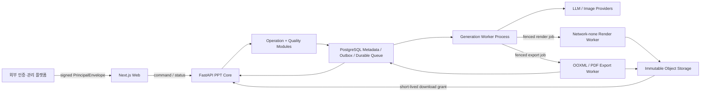

# 외부 공개용 PPT 생성·익스포트 서비스 목표 아키텍처

- 상태: Accepted target architecture (운영 튜닝값은 Proposed)
- 작성일: 2026-08-30
- 적용 대상: 외부 인증·관리 플랫폼 뒤에서 동작하는 PPT 생성, 렌더링, 검증, PPTX/PDF 익스포트 서비스
- 기준 코드: `C:\project\PPT-agent\ppt-agent`
- 목표: 현재 다중 사용자 준비도 66점 수준을 85점 이상으로 올리는 최소 재작성 아키텍처

## 1. 확정된 서비스 경계

이 서비스는 다음 기능을 소유하지 않는다.

- 로그인, 로그아웃, 사용자 가입, 계정 복구
- 관리자 UI와 운영자 계정 관리
- 초기 setup 화면과 provider 설정 UI
- 운영 DB 제품 선택, 전환, migration 실행 체계

외부 플랫폼은 검증된 세션에서 불변 principal을 만들고, PPT 서비스는 그 principal을 신뢰 경계의 유일한 사용자 입력으로 받는다. PPT 서비스가 소유하는 기능은 다음으로 제한한다.

- 프레젠테이션 생성 command admission
- outline, authored slide, illustration과 품질 판정
- 비신뢰 HTML의 격리 렌더링
- checkpoint, 실패 복구, immutable publication
- PPTX/PDF export와 다운로드 artifact 생성
- 해당 경로의 비용, 성능, 보안, 감사 지표

## 2. 최종 결정 요약

현재 FastAPI와 Next.js를 통째로 폐기하지 않는다. 이미 구현된 durable operation, owner scope, lease/fencing, authored checkpoint, renderer preflight, OOXML digest/readback을 유지한다.

기본 구조는 완전한 마이크로서비스가 아니라 **모듈러 PPT Core + 위험 작업 격리 worker**다. 배포 단위는 다음 네 개로 제한한다.

1. UI와 상태 표시만 담당하는 Next.js Web
2. API, operation control, 생성 orchestration과 품질 정책을 함께 소유하는 FastAPI PPT Core
3. 같은 코드베이스에서 역할별 process/container로 실행하는 generation, network-none render, OOXML/PDF export worker
4. PostgreSQL metadata/outbox와 content-addressed object storage

Operation Control Plane과 Quality Gate는 독립 네트워크 서비스가 아니라 PPT Core 내부 모듈이다. generation worker도 별도 제품이나 저장소로 분리하지 않고 동일 코드베이스를 별도 worker process로 실행한다. render와 export만 비신뢰 입력, Chromium, subprocess, 대용량 메모리 때문에 강한 OS/container 경계를 가진다.

산출물은 로컬 경로가 아니라 content-addressed object storage에 저장하고, DB에는 경로 대신 `ArtifactRef`만 기록한다. 초기 durable queue는 현재 PostgreSQL operation/outbox/lease를 사용한다. Redis, Kafka, SQS 같은 별도 broker는 DB claim 지연과 queue 규모가 정해진 확장 기준을 넘을 때만 도입한다. 작업 실행은 at-least-once로 허용하되, 외부 호출 예약, checkpoint, CAS publication, export unique key로 사용자에게 보이는 결과와 중복 과금을 억제한다.



### 2.1 배포와 코드 소유 원칙

- PPT Core와 세 worker는 하나의 repository, domain model, contract package를 공유한다.
- worker 분리는 코드 복제가 아니라 실행 profile 분리다.
- Next.js는 browser UI/BFF 역할만 수행하고 export route에서 Chrome이나 converter를 실행하지 않는다.
- PPT Core는 provider 호출을 직접 오래 점유하지 않고 generation worker에 durable operation을 배정한다.
- render/export worker는 canonical DB 전체 접근권한 없이 허용된 job과 ArtifactRef만 처리한다.
- 별도 서비스는 보안·자원 격리가 필요한 render/export에만 적용하고, control/quality 모듈은 분산하지 않는다.

## 3. 설계 원칙

1. 외부 세션은 service worker까지 전달하지 않는다.
2. owner와 tenant는 client request field가 아니라 외부 principal에서만 결정한다.
3. provider, render, export 작업은 모두 durable operation과 immutable input digest에 결속한다.
4. AI 출력, HTML, 이미지, PPTX package는 모두 비신뢰 입력으로 취급한다.
5. worker는 canonical DB row를 직접 임의 수정하지 않고 fenced result만 제출한다.
6. active presentation은 모든 품질 gate를 통과한 candidate로 한 번의 CAS publication을 수행할 때만 바뀐다.
7. local filesystem과 process memory는 cache일 뿐 durable authority가 아니다.
8. 처리량보다 비용·메모리·격리 상한을 먼저 보장한다.
9. 성공률과 p95가 검증되기 전에는 동시성 설정만 올리지 않는다.
10. fixture PASS, package smoke, 실제 provider product path 증거를 분리한다.

## 4. 외부 세션 인계 계약

브라우저 cookie 전체를 FastAPI, Next.js, exporter subprocess에 연쇄 전달하지 않는다. 외부 플랫폼이 다음 형태의 짧은 assertion을 발급한다.

```json
{
  "schemaVersion": "ppt-principal/v1",
  "issuer": "external-platform",
  "subject": "opaque-user-id",
  "ownerId": "uuid",
  "tenantId": "opaque-tenant-id",
  "sessionIdHash": "sha256",
  "issuedAt": "RFC3339",
  "expiresAt": "RFC3339",
  "audience": "ppt-service",
  "traceId": "opaque-id"
}
```

검증 규칙:

- gateway 또는 PPT API에서 signature, issuer, audience, expiry를 검증한다.
- 내부 코드에는 검증 후의 `PrincipalContext(owner_id, tenant_id, trace_id)`만 전달한다.
- `ownerId`, `tenantId`, role을 request body/query에서 받지 않는다.
- durable operation, provider budget, artifact key, event/outbox에 동일 principal identity를 복사한다.
- worker에는 사용자 session 대신 `jobId`, `attemptToken`, `fencingToken`, `inputDigest`, 허용된 artifact capability만 전달한다.
- 내부 capability는 특정 operation과 digest에 묶고 짧게 만료되며 재사용을 거절한다.

## 5. 컴포넌트 책임

| 컴포넌트 | 책임 | 금지되는 책임 |
|---|---|---|
| Next.js Web | 사용자 UI, command 제출, 상태·progress 표시 | Chrome/converter 실행, durable scheduling, 파일 authority |
| FastAPI PPT Core | principal 검증 결과 수용, command validation, owner-fair scheduling, lease/fencing, idempotency, quality policy, 상태 조회, download grant | Chrome 실행, OOXML 변환, 사용자 로그인 구현 |
| Generation Worker | PPT Core와 같은 코드베이스의 별도 process로 outline, slide authoring, illustration plan, deterministic repair, checkpoint 수행 | 사용자 session 보유, public download 제공, 별도 domain model 정의 |
| Render Worker | self-contained HTML preflight, CSP, CDP capture, DOM metric, PNG | network 접근, provider credential, canonical DB write |
| Quality Module | PPT Core/generation 내부에서 capacity, semantic, visual, source, deck consistency 판정 | 독립 서비스 DB, candidate의 조용한 수정이나 gate 우회 |
| Export Worker | immutable scene/artifact 입력에서 PPTX/PDF 생성, package readback | 외부 사용자 session 사용, 임의 presentation 조회 |
| Artifact Store | digest-addressed input/output, encryption, retention, lifecycle | active revision 선택 |
| PostgreSQL | operation, durable queue/outbox, revision, receipt, budget, artifact ref, publication pointer | 대용량 PNG/PPTX blob 저장 |

## 6. 주요 데이터 계약

### 6.1 OperationCommand

```json
{
  "schemaVersion": "ppt-operation-command/v1",
  "operationId": "uuid",
  "kind": "presentation.generate",
  "ownerId": "uuid",
  "tenantId": "opaque",
  "presentationId": "uuid",
  "idempotencyKeyHash": "sha256",
  "payloadHash": "sha256",
  "expectedRevision": 0,
  "requestedAt": "RFC3339",
  "policyVersion": "public-default/v1"
}
```

같은 owner namespace에서 idempotency key와 payload hash가 같으면 기존 operation을 반환한다. key는 같고 payload가 다르면 409로 거절한다.

### 6.2 ArtifactRef

```json
{
  "schemaVersion": "artifact-ref/v1",
  "artifactId": "uuid",
  "ownerId": "uuid",
  "tenantId": "opaque",
  "kind": "slide-png",
  "sha256": "hex-64",
  "sizeBytes": 1234,
  "mediaType": "image/png",
  "storageKey": "tenant/owner/sha256-prefix/digest",
  "createdByOperationId": "uuid",
  "retentionClass": "published"
}
```

worker와 API는 원시 절대 경로를 교환하지 않는다. `storageKey`도 public URL이 아니며 다운로드는 owner 확인 후 별도 단기 grant로 제공한다.

### 6.3 ProviderCallReservation

모든 outline, author, repair, VQA, image 호출은 외부 I/O 전에 하나의 durable reservation을 가져야 한다.

```text
unique(job_id, stage, slide_index, logical_call_ordinal)
```

reservation에는 estimated cost, actual usage, retry class, provider idempotency capability, result digest만 저장한다. prompt, response body, cookie, API key는 저장하지 않는다.

### 6.4 ExportIdentity

```text
unique(owner_id, presentation_id, revision, canonical_digest,
       export_mode, font_manifest_digest, exporter_version)
```

같은 identity의 export는 cluster 전체에서 하나만 실행한다. 결과 artifact digest가 확인되면 다른 요청은 동일 artifact를 반환한다.

## 7. 생성 상태 전이

```text
accepted
  → queued
  → outlining
  → authoring
  → rendering
  → quality_gate
  → staging
  → published
  → export_queued
  → exporting
  → completed
```

별도 terminal/대기 상태:

- `capacity_waiting`: cluster 또는 owner quota 대기
- `retry_waiting`: retryable provider/worker 오류와 bounded backoff
- `cancelled`: 사용자 취소, 재개 불가
- `failed`: 결정적 validation 또는 retry budget 소진
- `dead_letter`: 자동 복구 한도를 넘긴 운영 조사 대상

상태 변경은 현재 operation version, attempt token, fencing token을 모두 확인하는 CAS로만 수행한다. stale worker의 checkpoint와 publication은 거절한다.

## 8. 실패 복구와 중복 방지

- operation 실행 자체는 at-least-once다.
- provider 호출은 reservation을 먼저 commit하고, 지원 provider에는 동일 logical call idempotency key를 전달한다.
- 외부 응답 후 checkpoint commit 전 process kill은 provider가 idempotency를 지원하지 않으면 중복 과금 가능성이 남는다. 이 provider는 별도 위험 등급과 더 낮은 retry 정책을 사용한다.
- slide checkpoint는 author, illustration, render, quality, persist 단계별 input/output digest를 가진다.
- 완료 checkpoint는 digest와 artifact 존재를 재검증한 뒤 재사용한다.
- publication은 immutable deck revision을 만든 뒤 active pointer를 CAS로 교체한다.
- export는 temporary object로 생성하고 package readback과 digest가 통과한 후 최종 object key를 commit한다.
- worker crash, lease expiry, API 재시작 시 DB/outbox가 유일한 복구 authority다.

## 9. 성능과 backpressure 정책

### 9.1 초기 public profile

아래 값은 코드 상수가 아니라 운영 policy의 초기 권장값이다. 부하 증거가 쌓이면 policy version을 올려 변경한다.

| 항목 | 초기 권장값 |
|---|---:|
| 일반 사용자 deck 최대 슬라이드 | 30 |
| owner당 실행 중 generation | 1 |
| owner당 queued generation | 3 |
| tenant당 실행 중 generation | 5 |
| owner당 실행 중 export | 1 |
| generation worker당 deck | 1 |
| deck 내부 author 동시성 | 2 |
| render container당 Chrome | 1 |
| export container당 작업 | 1 |
| provider 총 요청 상한 | 계획식으로 계산 후 hard cap |
| generation 전체 deadline | 슬라이드 수 기반, 최대 15분 |
| export deadline | 최대 10분 |

provider 요청 상한은 대략 다음 계획식으로 admission 전에 계산한다.

```text
1 outline
+ 2 × slide_count author ceiling
+ min(image_budget, slide_count)
+ repair_budget
+ optional VQA budget
```

요청 상한과 예상 비용 상한 중 하나라도 없으면 public policy로 admission하지 않는다.

### 9.2 Queue 정책

- owner-fair weighted scheduling을 유지한다.
- 한 owner의 깊은 queue가 cluster slot을 독점할 수 없게 한다.
- queued 한도 초과는 작업을 만든 뒤 무한 대기시키지 않고 429와 `Retry-After`로 거절한다.
- generation, render, export는 PostgreSQL operation kind와 별도 worker claim 조건으로 논리적으로 분리해 Chrome 정체가 provider slot을 점유하지 않게 한다.
- queue depth, oldest age, owner wait, tenant wait를 지표로 제공한다.

별도 broker는 초기 필수 구성요소가 아니다. 다음 중 하나가 같은 RC의 부하 시험에서 반복될 때 도입을 검토한다.

- operation claim p95가 100ms를 초과
- ready queue가 지속적으로 10,000건을 초과
- DB queue polling이 metadata transaction 성능을 유의미하게 저하
- 여러 지역 또는 서로 다른 DB 장애 영역에 worker를 배치해야 함

도입하더라도 PostgreSQL operation row와 outbox가 durable authority이고 broker message는 delivery hint다.

### 9.3 Worker 자원 정책

- render/export worker는 API/DB credential을 갖지 않는다.
- read-only root filesystem, non-root UID, tmpfs scratch, network none, seccomp/AppArmor 또는 동등 정책을 요구한다.
- container memory, CPU, PID, open-file, output-byte, wall-clock limit을 모두 강제한다.
- 작업 종료 후 browser process, handle, tmpfs 사용량이 기준선으로 돌아오지 않으면 worker를 recycle한다.
- process-local cache는 byte budget과 TTL을 가지며 정답 authority로 사용하지 않는다.

## 10. 보안 설계

### 10.1 신뢰 경계

1. 외부 인증 플랫폼이 principal을 보증한다.
2. PPT API가 principal과 command를 결속한다.
3. worker는 operation capability만 신뢰한다.
4. LLM 출력은 절대 신뢰하지 않는다.
5. artifact는 digest와 owner binding을 모두 검증한다.

### 10.2 금지 사항

- 사용자 cookie를 queue payload, checkpoint, temp JSON, subprocess argv/env에 저장
- `...process.env` 전체를 render/export child process에 전달
- worker가 presentation id만으로 canonical payload를 임의 조회
- client가 owner, tenant, artifact path, output path를 지정
- generated HTML에서 network, file, blob, external font/script 허용
- 검증 전 PPTX를 published/downloadable 상태로 노출

### 10.3 허용 방식

- internal mTLS 또는 workload identity
- operation/digest에 제한된 짧은 capability token
- environment allowlist
- content-addressed object key와 server-side encryption
- owner-scoped download authorization 후 짧은 signed URL 또는 API stream
- archive entry count, decompressed bytes, compression ratio, XML entity 제한

## 11. 관측성 계약

모든 operation은 다음 값을 실제 숫자로 제공해야 하며, 실행했는데 `null`이면 release gate 실패다.

- queue wait와 queue position
- outline, author, illustration, render, quality, checkpoint, publication, export 시간
- provider initial/retry 호출 수와 stage/slide별 logical ordinal
- estimated/actual token 및 비용, unavailable 상태
- retry reason, recovery reason, attempt number, fencing outcome
- Chrome launch/reuse/restart, blocked request, timeout, crash
- worker peak RSS/private bytes, PID/handle/file descriptor
- artifact bytes, cache hit/miss/eviction, object store latency
- 최종 success/failure code와 실패 stage

로그에는 prompt, HTML, provider response, cookie, token, 로컬 절대 경로를 남기지 않는다. 상세 원인 상관 분석은 allowlisted error code와 content-free fingerprint를 사용한다.

## 12. 현재 코드의 재사용과 변경 경계

| 현재 자산 | 목표 구조에서의 처리 |
|---|---|
| `WorkspaceOperation` owner-fair claim | FastAPI PPT Core 내부 scheduler와 PostgreSQL durable queue로 유지 |
| lease, heartbeat, attempt/fencing token | 그대로 유지하고 worker capability에 포함 |
| authored slide checkpoint | 로컬 파일 ref를 `ArtifactRef`로 교체 |
| provider usage reservation | outline 포함 모든 provider call에 확대 |
| authored HTML security preflight/CSP/CDP block | Render Worker의 필수 admission으로 유지 |
| Next process-local export admission | Next에서 제거하고 PPT Core의 cluster-wide export lease로 교체 |
| Next in-memory export dedupe/cache | DB unique export identity + object store로 교체 |
| bundled exporter cookie/temp task | sessionless capability job으로 교체 |
| OOXML worker bearer/body/deadline/readback | workload identity와 ArtifactRef를 추가해 유지 |
| local `app_data/exports` | 개발 cache로만 유지, 운영 authority에서 제거 |

## 13. 단계별 구현 순서

### Phase 0 — 생성 신뢰성 회복

- 5장 실제 generation 실패인 owner capacity 초과를 안전한 content allocation 단계에서 해결한다.
- workspace runner 테스트 fixture를 현재 presentation profile 계약에 맞춘다.
- 5/10/20장 고정 corpus에서 generation → publication → export 성공 증거를 만든다.
- provider attempt와 단계별 latency가 `null`이 되지 않게 한다.

완료 조건:

- 20개 고정 deck 중 최소 19개 end-to-end 성공
- 실패 deck은 publish/export artifact가 없음
- duplicate publication과 duplicate export 0건

### Phase 1 — Admission과 비용 통제

- public policy profile과 owner/tenant active·queued cap을 추가한다.
- outline을 provider reservation/receipt 경계 안으로 이동한다.
- 모든 public job에 request, retry, estimated cost, actual cost 상한을 필수화한다.
- owner-fair queue와 quota 관측 지표를 완성한다.

### Phase 2 — Render/Export 격리

- Next.js export 실행 책임을 제거하고 export 요청을 PPT Core operation으로 통합한다.
- Chromium 실행을 API/Next process에서 network-none render worker로 이동한다.
- bundled exporter의 session cookie와 전체 환경변수 전달을 제거한다.
- OOXML export를 immutable ArtifactRef 입력으로 실행한다.
- worker resource limit과 recycle 정책을 적용한다.

### Phase 3 — Durable artifact와 수평 확장

- checkpoint, PNG, PPTX/PDF를 object storage로 이동한다.
- export unique identity와 cluster-wide single-flight를 적용한다.
- 같은 코드베이스의 PPT Core, generation, render, export 실행 profile을 독립적으로 scale-out한다.
- replica 재시작과 worker crash injection으로 수렴을 검증한다.

### Phase 3.5 — 조건부 broker 도입

- 9.2의 확장 기준을 실제 부하에서 충족한 경우에만 outbox relay와 broker adapter를 추가한다.
- broker가 없어도 PostgreSQL durable queue로 모든 기능과 복구가 동작해야 한다.
- broker 장애 시 신규 delivery가 지연될 수는 있지만 operation authority와 완료 결과는 손상되지 않아야 한다.

### Phase 4 — 공개 승인

- C1/C2/C5/C10 동시 사용자 부하를 같은 RC에서 실행한다.
- 악성 HTML/PPTX corpus와 cross-owner artifact 접근을 검증한다.
- PowerPoint reopen/readback과 지원 renderer matrix를 통과한다.
- 24시간 soak에서 worker memory/handle 회수와 queue starvation 부재를 검증한다.

## 14. 85점 승인 게이트

| 영역 | 승인 기준 | 목표 점수 |
|---|---|---:|
| 아키텍처 | 모듈러 PPT Core, 역할별 격리 worker, object storage, cluster single-flight | 88 |
| 비즈니스 신뢰성 | 20개 고정 deck 95% 이상 E2E, CAS publish, crash resume | 87 |
| 성능 | C5에서 starvation 없음, SLA 충족, 자원 상한 강제 | 85 |
| 보안 | sessionless worker, network-none render, capability/digest/owner binding | 90 |
| 관측성 | 모든 stage/cost/retry/resource 지표가 실제 값으로 수집 | 85 |

최종 종합 85점은 아래 조건을 모두 만족해야 한다.

- 5장 generation→PPTX p95 180초 이하
- 10장 generation→PPTX p95 360초 이하
- E2E 성공률 95% 이상
- cross-owner read/write 0건
- duplicate provider logical call, publication, export 0건
- worker crash 후 자동 수렴 성공률 100%
- malicious HTML의 network/file/metadata 접근 0건
- 작업 종료 후 worker memory/handle이 정책 기준선 이내로 회수
- provider 비용 상한 없는 public job 0건
- 결과·비용·retry 핵심 지표의 `null` 0건

## 15. 하지 않을 설계

- FastAPI/Next 전체 greenfield 재작성
- Operation Control Plane과 Quality Gate를 별도 마이크로서비스로 먼저 분리하는 방식
- 초기 공개부터 Redis/Kafka/SQS를 필수 dependency로 두는 방식
- API process 안에서 Chrome 동시성만 크게 올리는 방식
- local shared disk를 영구 운영 authority로 사용하는 방식
- Redis semaphore 하나만 추가하고 durable DB lease를 제거하는 방식
- 사용자 session cookie를 내부 서비스 인증 수단으로 재사용하는 방식
- provider 오류를 무제한 자동 재시도하는 방식
- 품질 gate 실패 deck을 부분 PPTX로 공개하는 방식
- fixture 또는 package smoke만으로 외부 공개 준비 완료를 선언하는 방식

## 16. 현재 판정

목표 구조로의 방향은 적합하지만 Phase 0 이전에는 외부 공개 승인 상태가 아니다. 현재 실제 5장 product path가 author capacity gate에서 실패했고 PPTX가 생성되지 않았으므로, 첫 구현 작업은 인프라 scale-out이 아니라 생성 성공률과 관측 계약 복구여야 한다.

최종 기본안은 FastAPI PPT Core와 동일 코드베이스의 역할별 worker 구조다. 완전한 마이크로서비스 분리는 목표가 아니며, render/export 격리와 durable artifact가 필요한 부분만 process/container 경계를 둔다.

Phase 0과 Phase 1은 현재 코드 경계를 유지하면서 수행할 수 있다. Phase 2부터 render/export worker deployment와 object storage interface가 필요하지만, 로그인·관리자·setup·DB 전환 프로젝트와는 독립적으로 진행할 수 있다. 별도 broker는 Phase 3.5의 계측 기준을 만족하기 전에는 도입하지 않는다.
