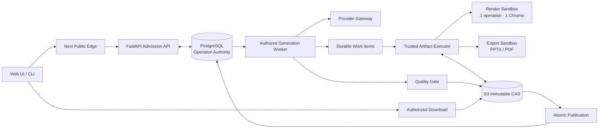

# 공개용 PPT 생성·Export Target Design — 개발 Handoff

> 새 Codex 세션에서 구현을 시작하기 위한 설계·검증 기준 문서

## 0. 문서 상태

| 항목 | 내용 |
|---|---|
| 작성일 | 2026-08-30 |
| 상태 | **Candidate implementation handoff** — 아래 5개 승인 항목은 구현 전 사용자 확인 필요 |
| 범위 | PPT 생성, 렌더링, PPTX/PDF Export, 품질 판정, 산출물 저장·다운로드 |
| 제외 | 배포, 운영 전환, 데이터 삭제, Git commit/push/merge, PPT 이외 제품 영역 |
| 기준 저장소 | `C:\project\PPT-agent\ppt-agent` |
| 조사 당시 Git | `fix/authored-release-score-20260829` / `3a9690152aaad1ad7d14a0fcdb046ba2c196a74b` |
| 관련 문서 | [외부 공개용 PPT 생성·익스포트 서비스 목표 아키텍처](./public-generation-export-service-architecture-20260830.md) |

조사 당시 Git 정보는 스냅샷일 뿐이다. 새 세션에서는 실제 checkout의 Git root, branch, HEAD, upstream, dirty/untracked 상태를 다시 확인해야 한다. 이 문서는 설계와 개발 순서를 정리하며, 작성 시점에는 제품 코드를 변경하거나 배포하지 않았다.

---

## 1. 목표와 결론

### 1.1 목표

- 다수 사용자의 동시 생성·Export 요청이 서로 영향을 주지 않도록 격리한다.
- 요청 수락, 실행, 품질 판정, 산출물 공개의 책임과 권위를 하나로 정리한다.
- 재시도·중단·서버 장애가 발생해도 중복 생성, 잘못된 결과 공개, 산출물 유실을 막는다.
- PPT 생성 품질을 결정론적 검사와 선택적 시각 검사로 증명한다.
- 기본 Export는 시각 충실도를 보장하고, 편집 가능 Export는 명시적 기능으로 제한한다.
- 중복·레거시 코드는 실제 호출 증거와 마이그레이션 게이트를 통과한 뒤 제거한다.

### 1.2 권장 목표 아키텍처

**Stateless Web/API + PostgreSQL Control Plane + Authored Generation Worker + Trusted Artifact Executor + operation-scoped isolated Sandbox + S3 Artifact Authority**

핵심은 서비스를 잘게 나누는 것보다 아래 권위를 단일화하는 것이다.

- PostgreSQL: 작업 상태, 입장 제어, quota, lease, deadline, fence의 유일한 권위
- S3 호환 Object Storage: 운영 산출물과 checkpoint의 유일한 바이트 권위
- Authored engine: 사용자에게 노출되는 유일한 생성·디자인 엔진
- Trusted Artifact Executor: 외부 산출물 바이트를 읽고 쓰는 유일한 실행 경계
- Quality Receipt: 성공, 품질, 릴리스 가능 여부를 분리해 증명하는 불변 영수증



### 1.3 현재 판단

현재 구조를 곧바로 “대규모 웹 사용자에게 문제없다”고 판정할 수는 없다. 목표 구조와 아래 부하·장애·격리 검증을 통과해야 운영 준비 상태를 주장할 수 있다. 설계상 가장 큰 위험은 다음과 같다.

1. 공개 요청 스레드에서 장시간 생성·렌더·Export가 실행될 가능성
2. 프로세스 메모리·로컬 파일·브라우저가 작업 권위처럼 사용될 가능성
3. 생성 성공과 품질 통과, 산출물 공개가 한 상태로 뭉쳐 있는 문제
4. 멀티 노드에서 중복 작업·stale 결과 공개를 막는 fence와 singleflight 부족
5. Fidelity와 Hybrid의 사용자 계약 및 실패 정책이 모호한 문제
6. 품질 검사가 플래그 기반 PASS 또는 증거 없는 PASS로 퇴행할 위험
7. 코드 중복을 호출 증거 없이 제거할 경우 실제 제품 경로가 끊길 위험

---

## 2. 변경 불가 설계 원칙

1. `Authored`만 사용자 노출 생성·디자인 엔진으로 사용한다.
2. 운영의 generate/export는 항상 비동기 `202 Accepted`로 수락한다.
3. 공개 HTTP request thread에서 provider 호출, 브라우저 렌더, PPTX/PDF 조립을 실행하지 않는다.
4. PostgreSQL을 operation, quota, lease, deadline, fence의 유일한 상태 권위로 사용한다.
5. 운영 산출물은 S3 호환 Object Storage를 유일한 바이트 권위로 사용한다.
6. 결과는 `owner + tenant + operation + revision + digest + fence`에 결합한다.
7. 기본 Export는 **Fidelity raster**로 하여 시각 결과를 보존한다.
8. **Editable Hybrid**는 사용자가 명시적으로 요청할 때만 bounded native promotion으로 제공한다.
9. Hybrid 실패를 알리지 않고 Fidelity로 바꾸지 않는다.
10. `generation success`, `quality status`, `release readiness`를 서로 다른 상태로 관리한다.
11. DB, admission, cost, deadline 권위를 확인할 수 없으면 fail closed 한다.
12. 개발 acceptance와 production activation을 분리한다. 테스트 통과가 곧 배포 승인은 아니다.

---

## 3. 외부 API 계약

### 3.1 Canonical v2 API

| 목적 | API |
|---|---|
| 생성 제출 | `POST /api/v2/presentations/generations` |
| Export 제출 | `POST /api/v2/presentations/{presentationId}/exports` |
| 작업 조회 | `GET /api/v2/operations/{operationId}` |
| 이벤트 조회 | `GET /api/v2/operations/{operationId}/events` |
| 취소 | `POST /api/v2/operations/{operationId}/cancel` |
| 산출물 다운로드 | `GET /api/v2/artifacts/{artifactId}/download` |

기존 `/generate/async`와 workspace command는 v2 contract를 호출하는 얇은 adapter로 둔다. 운영의 동기 `/generate`는 명시적 deprecation 오류를 반환하고, local development 호환 경로에서만 제한적으로 허용한다. CLI도 submit → poll/events → download 흐름으로 바꾼다.

### 3.2 Export 요청 예시

기본 Fidelity 요청:

```json
{
  "schemaVersion": "presentation-export-request/v2",
  "sourceRevision": 42,
  "output": {
    "format": "pptx",
    "mode": "fidelity-raster",
    "fallbackPolicy": null,
    "fontEmbedding": "none",
    "requiredCapabilities": []
  },
  "qualityPolicy": "interactive-v1"
}
```

Editable Hybrid 요청:

```json
{
  "schemaVersion": "presentation-export-request/v2",
  "sourceRevision": 42,
  "output": {
    "format": "pptx",
    "mode": "editable-hybrid",
    "fallbackPolicy": "per-slide-raster",
    "fontEmbedding": "subset",
    "requiredCapabilities": ["native-text", "native-shape"]
  },
  "qualityPolicy": "release-v1"
}
```

규칙:

- `editable-hybrid`의 `fallbackPolicy`는 필수이며 `reject`, `per-slide-raster`, `whole-deck-fidelity` 중 하나다.
- `pdf`는 Fidelity만 지원한다.
- 지원하지 않는 조합은 `422 capability_not_supported`를 반환한다.
- 요청 revision이 최신이 아니면 `409 stale_revision`을 반환한다.
- 같은 idempotency key에 다른 payload hash가 들어오면 `409 idempotency_key_conflict`를 반환한다.

### 3.3 공통 202 Receipt

```json
{
  "schemaVersion": "operation-receipt/v2",
  "operationId": "op_...",
  "receiptId": "rcpt_...",
  "presentationId": "prs_...",
  "status": "queued",
  "duplicate": false,
  "joinedExistingWork": false,
  "acceptedAt": "2026-08-30T00:00:00Z",
  "absoluteDeadlineAt": "2026-08-30T00:05:00Z",
  "links": {
    "self": "/api/v2/operations/op_...",
    "events": "/api/v2/operations/op_.../events",
    "cancel": "/api/v2/operations/op_.../cancel"
  }
}
```

외부 receipt와 event에는 로컬 경로, raw S3 key, provider secret, session identifier를 넣지 않는다.

### 3.4 상태와 실패 표현

외부 상태는 다음 5개만 사용한다.

```text
queued → running → succeeded | failed | cancelled
```

세부 단계는 `phase`로 분리한다.

```text
admission / authoring / validating / rendering / packaging / publishing
```

실패 이유는 최종 상태를 늘리는 대신 `error.reasonCode`로 표현한다. 예:

- `deadline_exceeded`
- `budget_exhausted`
- `provider_unavailable`
- `quality_gate_failed`
- `capability_not_supported`
- `artifact_commit_failed`
- `cancelled_by_user`

산출물 생성 성공과 품질 저하가 공존할 수 있고, 산출물은 있어도 `releaseReadiness=blocked`일 수 있다.

---

## 4. 영속 데이터와 상태 모델

기존 모델을 확장하고, 같은 역할의 두 번째 generic operation store는 만들지 않는다.

| 모델 | 역할 및 필수 필드 |
|---|---|
| `WorkspaceOperation` | `contract_version`, `execution_profile_version`, `phase`, immutable `deadline_at` 추가 |
| `PublicOperationAdmission` | global quota, weighted resource units, policy digest, actual-cost reconciliation |
| `OperationWorkItem` 신규 | generation/render/package의 durable child job |
| `PublicResourceLease` 신규 | cluster-wide weighted resource lease와 fence |
| `CheckpointPointer` 신규 | operation/revision/slide별 불변 `ArtifactRef` |
| `PublicExportIdentity` 확장 | mode, adapter, Scene/semantic/quality/exporter digest |
| `PublicArtifact` 확장 | provisional/committed/tombstoned/deleted, expiry, refcount, cleanup 상태 |
| `QualityReceiptV3` | append-only 품질 증거와 결과 binding |

### 4.1 Work item 상태

```text
queued → leased → running → validated
                    ├→ retry_waiting → queued
                    ├→ failed
                    ├→ cancelled
                    └→ deadline_exceeded
```

Work item identity:

```text
(operation_id, stage, slide_index, input_digest, stage_version)
```

모든 claim은 `attempt`와 단조 증가 `fence`를 가진다. lease 만료 후 도착한 stale attempt의 결과는 blob 업로드 여부와 관계없이 pointer, operation 또는 public artifact를 갱신할 수 없다.

### 4.2 Admission 단일 트랜잭션

1. principal, tenant, capability를 확인한다.
2. 정규화 payload hash와 idempotency key를 계산한다.
3. global → tenant → owner 순서로 고정된 lock을 획득한다.
4. quota, weighted resource, provider budget, absolute deadline을 예약한다.
5. operation, admission, initial event, outbox를 생성한다.
6. queued counter를 갱신한다.
7. commit 이후에만 `202` receipt를 반환한다.

DB 또는 정책 권위를 확인할 수 없으면 요청을 수락하지 않는다. “나중에 맞추기” 방식으로 작업부터 시작해서는 안 된다.

---

## 5. 실행 경계와 멀티테넌트 격리

### 5.1 Authored Generation Worker

- DB와 허용된 provider gateway로만 제한된 egress를 가진다.
- 한 active deck에서 authoring 동시성은 1로 제한한다.
- 브라우저, raw S3 credential, 사용자 session, 임의 로컬 경로에 접근하지 않는다.
- provider I/O 전에 예산을 reserve한다.
- 슬라이드별 provider 호출은 최초 1회와 recovery 최대 1회로 제한한다.
- 결과는 직접 공개하지 않고 digest가 결합된 durable work item과 checkpoint candidate를 만든다.

### 5.2 Trusted Artifact Executor

- work item을 fence와 함께 claim한다.
- S3 identity와 object namespace를 소유한다.
- 정확한 `ArtifactRef`만 sandbox에 staging한다.
- sandbox output의 byte length, MIME, digest, 구조 검사를 통과한 후 streaming upload한다.
- provisional object를 만든 뒤 DB commit과 publication pointer 갱신을 원자적으로 결합한다.

### 5.3 Render/Export Sandbox

보안과 성능의 절충 기준:

- 브라우저 재사용 단위는 **operation/deck 1개**로 제한한다.
- 같은 operation 안에서만 Chrome process를 재사용한다.
- slide마다 disposable page/context를 만든다.
- 서로 다른 owner 또는 tenant 사이에서 process/context를 재사용하지 않는다.
- operation 종료 즉시 sandbox와 모든 descendant process를 제거한다.
- prewarm은 사용자 데이터가 없는 빈 worker image까지만 허용한다.

Sandbox 최소 정책:

- read-only root filesystem
- bounded tmpfs와 file count
- outbound network 없음
- credential과 사용자 session 없음
- CPU, memory, PID, wall-clock hard limit
- Linux cgroup 또는 Windows Job Object로 descendant까지 소유

Recycle 조건 후보:

- operation 종료
- 100 slides 처리
- 30분 경과
- RSS 700 MiB 초과
- browser crash 또는 protocol corruption

### 5.4 Global weighted scheduler

단순 job 수가 아니라 다음 비용을 resource unit으로 환산한다.

- pixel count와 DPR
- DOM node 수
- font 수와 subset 비용
- SVG/chart 복잡도
- 예상 memory
- Fidelity/Hybrid mode

제한 축은 `global`, `node`, `tenant`, `owner`, `presentation`, `assembler`다. 특정 사용자의 대형 deck이 전체 queue를 독점하지 않도록 weighted fair scheduling을 적용한다.

---

## 6. Deadline, 비용, 재시도, 취소

### 6.1 Absolute deadline

```text
deadline_at = min(policy maximum, auth expiry, server hard limit)
```

- queue 대기 시간을 포함한다.
- heartbeat나 retry로 연장하지 않는다.
- publish/commit 전용으로 최소 10초 reserve를 남긴다.
- 각 stage 시작 전에 남은 시간과 stage worst-case를 비교한다.

### 6.2 비용 정산

- provider 호출 전에 worst-case 비용을 reserve한다.
- 완료 시 actual usage로 reconcile한다.
- actual usage를 얻지 못하면 보수적 비용을 부과하거나 작업을 block한다.
- 비용을 알 수 없다는 이유로 0원 처리하지 않는다.
- recovery 호출도 별도 budget과 동일 deadline 안에서 수행한다.

### 6.3 취소 순서

1. operation에 cancellation intent와 새 fence를 기록한다.
2. scheduler resource와 provider reservation을 회수한다.
3. provider request와 structured task group을 취소한다.
4. 짧은 graceful shutdown을 시도한다.
5. cgroup/Job Object로 descendant process를 강제 종료한다.
6. stale fence 결과를 거부한다.
7. terminal event를 기록하고 `descendant_count=0`을 확인한다.

---

## 7. Artifact 저장, 공개, 다운로드, GC

### 7.1 Object store 계약

```text
put_stream
open_read_stream
head
copy
delete
create_signed_download
```

production code는 local path를 durable payload에 저장하지 않는다. 경계 간 전달은 immutable artifact/reference identity로 한다.

### 7.2 Lifecycle

```text
provisional → committed → tombstoned → deleted
```

- sandbox output은 먼저 provisional namespace에 업로드한다.
- digest와 구조를 검증한 뒤 committed CAS object로 승격한다.
- publication pointer는 DB transaction에서 한 번만 교체한다.
- 삭제 요청은 DB tombstone을 권위로 사용한다.
- S3 lifecycle은 최후의 보조 수단이며 DB 상태를 대신하지 않는다.
- 같은 digest를 공유하는 object는 `refcount=0`일 때만 실제 삭제한다.

Retention 후보:

| 종류 | TTL 후보 |
|---|---:|
| provisional/ephemeral | 1시간 |
| checkpoint | 24시간 |
| published artifact | 7일 |
| idempotency/export identity | 연결 artifact 만료 시점까지 |

### 7.3 다운로드

- 다운로드 시 owner/tenant 권한을 다시 확인한다.
- 성공 시 2~5분 유효한 signed GET으로 `303` redirect한다.
- `Range`, `Content-Length`, `ETag`를 지원한다.
- API process는 전체 PPTX/PDF를 메모리에 올리지 않는다.
- local development만 `FileResponse` 호환 경로를 허용한다.

---

## 8. PPT 생성 품질 설계

### 8.1 Quality Receipt v3

품질 결과는 append-only이며 artifact digest, source revision, Scene digest, capability registry digest, exporter version과 결합한다.

| Domain | 허용 상태 |
|---|---|
| `contentBrief` | passed / degraded / failed / not_required |
| `authoring` | passed / failed |
| `geometryFont` | passed / failed |
| `imageContentIntegrity` | passed / failed / not_required |
| `visualReview` | passed / failed / unavailable / not_required |
| `performance` | passed / failed / not_assessed |
| `nativeCoverageOoxml` | pending / passed / failed / not_required |

규칙:

- 플래그가 켜졌다는 이유로 `passed`를 기록하지 않는다.
- `passed`에는 검사기 버전, input/output digest, 측정값, threshold가 필요하다.
- 검사 실패와 검사 불가능을 구분한다.
- `unavailable`을 `not_required`로 바꾸지 않는다.
- 새 평가 결과는 과거 receipt를 덮어쓰지 않는다.

### 8.2 Visual QA tier

| Tier | 용도 |
|---|---|
| T0 | 개발 중 deterministic geometry/font/content 검사 |
| T1 | 기본 interactive 경로의 risk-based visual review |
| T2 | release/high-quality/source-restyle의 전체 deck review |
| T3 | PowerPoint/LibreOffice parity 및 desktop readback |

T1 강제 조건:

- 표지·마지막 슬라이드
- dense data/table/chart
- layout capacity 80% 이상
- 두 번째 author/provider 호출 발생
- CJK/font 경고
- repair가 적용된 슬라이드
- overlap/overflow threshold 근접
- 큰 raster island 또는 Hybrid native 전환 경계

### 8.3 Capability registry

다음 소비자가 동일한 registry digest를 사용해야 한다.

- prompt schema
- authoring validator
- font/layout engine
- Chromium renderer
- Scene IR
- OOXML adapter
- raster fallback reason
- PowerPoint/LibreOffice readback

지원하지 않는 속성은 암묵적으로 무시하지 않고 `unsupported`, `rasterized`, `rejected` 중 하나로 명시한다.

Font floor 후보:

| 용도 | 최소 크기 후보 |
|---|---:|
| 제목 | 32 pt |
| 본문 | 16 pt |
| 표·차트 | 14 pt |
| 보조 문구 | 12 pt |

### 8.4 Fidelity와 Editable Hybrid

**Fidelity raster**

- authored render를 slide image로 봉인한다.
- 기본 Export이며 시각 일치가 우선이다.
- 편집 가능하다고 주장하지 않는다.
- PowerPoint 재열기만으로 줄바꿈·overflow parity가 보장된다고 주장하지 않는다.

**Editable Hybrid**

- 텍스트·단순 shape·검증된 image만 native로 승격한다.
- 검증되지 않은 영역은 명시적 raster island로 남긴다.
- slide별 native/raster ownership map을 저장한다.
- OOXML 구조 검사와 PowerPoint readback을 통과해야 공개한다.
- release native coverage 기준은 기존 계약의 70%를 유지하되 canary 결과로 재검토한다.

### 8.5 Source-content restyle

현재 확정된 `text-image` 모드는 원본의 텍스트와 이미지 occurrence를 보존하는 모드다. 표, 차트, 원본 배치까지 보존했다고 주장해서는 안 된다.

필수 결과 메타데이터:

```json
{
  "sourceMode": "text-image",
  "sourceCompleteClaim": false,
  "preserved": ["text", "image-occurrences"],
  "excluded": ["tables", "charts", "original-layout"]
}
```

구조 보존 모드는 별도 capability와 검증 계약으로 추가해야 한다.

---

## 9. 성능 목표 후보

아래 수치는 운영 보장이 아니라 Phase 0에서 실제 product path로 보정할 초기 SLO 후보이다. 측정값 없이 PASS 처리하지 않는다.

| 지표 | 후보 목표 |
|---|---:|
| Admission latency p95 / p99 | 300 ms / 1 s |
| Queue wait p95 | 10 s 이하 |
| First preview | 45 s 이하 |
| 10-slide warm, no external images, T1 | 150 s 이하 |
| 20-slide warm, no external images, T1 | 240 s 이하 |
| Fidelity Export 10 / 30 slides | 30 s / 90 s 이하 |
| Hybrid Export 10 / 30 slides | 60 s / 180 s 이하 |
| API download RSS 증가 | stream당 8 MiB 이하 |
| Sandbox steady / hard memory | 700 MiB / 1 GiB |
| Cancel 후 descendant 0 | 5초 이하 |
| validated slide 재렌더 | 0 |
| 동일 export identity 중복 실행 | 0 |
| GC 완료 | TTL + 1시간 내 99.9% |

성능 측정은 deck size `5/10/20`, concurrency `C1/C2/C5/C10`, cold/warm을 분리한다. provider time, authoring, validation, render, package, upload, publish를 각각 계측한다.

---

## 10. 권장 개발 순서와 Gate

### Phase 0 — 계약·관측 기준선 고정

작업:

- 실제 UI → Next → FastAPI → worker → provider → renderer → exporter → download 경로를 추적한다.
- operation/export/quality/capability schema version을 고정한다.
- stage별 duration, queue wait, retry, memory, provider usage를 계측한다.
- 5/10/20-slide 기준 fixture와 제품 경로 benchmark를 구분한다.

Gate:

- 한 operation을 receipt부터 artifact까지 correlation ID로 추적 가능
- 미계측 stage 없음
- 기존 기능의 baseline latency와 품질 receipt 확보

### Phase 1 — Async 계약과 Receipt 진실성

작업:

- v2 generate/export/status/events/cancel/download API를 추가한다.
- 기존 API와 CLI를 v2 adapter로 전환한다.
- `QualityReceiptV3`에서 evidence 없는 PASS를 차단한다.

Gate:

- 같은 idempotency 요청 100회 → operation 1개
- 같은 key, 다른 hash → `409`
- 운영 sync request thread의 heavy compute → 0
- VQA unavailable이 passed로 기록되는 경우 → 0

### Phase 2 — Admission, Deadline, Cost, Fence

작업:

- DB 단일 트랜잭션 admission을 구현한다.
- global/tenant/owner weighted quota와 provider reserve/reconcile을 구현한다.
- immutable absolute deadline과 monotonic fence를 추가한다.

Gate:

- 설정 cap 초과 → 0
- DB authority unavailable일 때 새 work 시작 → 0
- counter drift → 0
- stale attempt publish → 0

### Phase 3 — S3 CAS, Cross-node Checkpoint, Streaming

작업:

- local path payload를 `ArtifactRef`로 바꾼다.
- provisional/commit/publication pointer를 구현한다.
- slide checkpoint와 signed download를 구현한다.

Gate:

- Node A 생성 → B 렌더 → C export → D download 성공
- 각 node 장애 후 다른 node가 checkpoint부터 resume
- API full-file buffering → 0
- digest mismatch 공개 → 0

### Phase 4 — Trusted Executor, Sandbox, Global Scheduler

작업:

- artifact I/O와 sandbox launch를 trusted executor로 모은다.
- operation-scoped browser reuse와 cgroup/Job Object를 구현한다.
- weighted fair scheduler를 연결한다.

Gate:

- 악성 payload의 network/host path 접근 → 0
- owner 간 browser/context 재사용 → 0
- cancel/timeout 후 orphan descendant → 0
- global/node/tenant/owner cap 초과 → 0

### Phase 5 — Export Checkpoint, Singleflight, GC

작업:

- export identity를 Scene/semantic/quality/exporter digest에 결합한다.
- 동일 export 요청을 singleflight로 합친다.
- lifecycle/refcount/tombstone 기반 GC를 구현한다.

Gate:

- 동일 export 100회 → 실제 render/export 1회
- validated slide 재렌더 → 0
- stale fence commit → 실패
- crash로 남은 provisional object → GC 회수

### Phase 6 — 생성 품질 개선

작업:

- capability registry를 prompt/validator/renderer/exporter가 공유한다.
- geometry/font/content deterministic gate를 강화한다.
- risk-based T1과 full-deck T2를 구분한다.
- source-restyle preservation inventory를 receipt에 기록한다.

Gate:

- registry digest 불일치 → 0
- terminal success에서 overflow/illegal overlap residual → 0
- resume 시 동일 slide provider 중복 호출 → 0
- source text/image inventory 불일치 → 0

### Phase 7 — Editable Hybrid Canary

작업:

- native 지원 subset과 raster reason을 명시한다.
- slide별 native/raster ownership, OOXML 검사, desktop readback을 구현한다.
- canary를 1% → 10% → 50% → 100%로 올린다.

Gate:

- 모든 element ownership이 native 또는 raster로 판정됨
- OOXML과 PowerPoint readback 통과
- fallback 정책과 실제 결과가 일치
- rollback 시 silent downgrade → 0

### Phase 8 — Legacy·중복·불필요 코드 정리

삭제 후보는 아래 분류와 Gate를 먼저 적용한다.

#### 바로 제거 가능한 후보

- `_chat_first_generation_enabled`
- 동일 의미의 alias 2개
- 적용되지 않는 stale Ruff 설정
- `PATH_ONLY` alias

#### 통합 후 제거

- 흩어진 `PublicExportIdentity` helper: canonical builder로 통합 후 호출부 전환
- legacy Next export path: v2 cutover와 access log 0 확인 후 제거
- `claim_next_public_operation`: runner claim contract 통합 후 제거
- vendor mirror: runtime access log와 build dependency 확인 후 제거

#### 보존해야 하는 구분

- `source-content`와 `source-locked`는 계약이 다르므로 중복으로 간주하지 않는다.
- 내부 alternate pipeline은 실제 call census 전까지 보존한다.
- `index.js`/`index.cjs` mirror는 readiness/checksum 계약을 바꾸기 전까지 보존한다.

#### 운영 파일 정리

약 16.7 GiB로 조사된 cache/output/evidence 후보는 코드 정리와 분리한다. PID와 listener ownership 확인, 보존 manifest와 checksum 생성, quarantine 또는 휴지통 TTL을 거친 뒤에만 제거한다. 새 세션에서 임의 삭제하지 않는다.

Gate:

- 제거 대상별 zero-call 또는 adapter migration 증거
- 제품 경로 smoke에서 unresolved import/route 0
- 기존 사용자 산출물과 증거 파일 손실 0

### Phase 9 — Public RC 검증

필수 검증 매트릭스:

- deck: 5/10/20 slides
- concurrency: C1/C2/C5/C10
- cold/warm 분리
- 30-slide stress
- 3개 이상 replica에서 cross-node 실행
- provider timeout, worker crash, S3 지연, DB failover, cancel race 주입
- malicious payload와 cross-owner 격리
- 100 MiB 이상 다운로드의 streaming/RSS 확인
- 24시간 soak
- PowerPoint와 LibreOffice 결과 확인

이 단계 통과는 **development acceptance**다. production activation, traffic cutover, legacy shutdown, 배포 승인은 별도 증거와 사용자 승인이 필요하다.

---

## 11. 구현 순서를 바꾸면 안 되는 이유

1. Phase 0 없이 성능 개선을 시작하면 병목과 개선량을 증명할 수 없다.
2. Phase 1~3 없이 worker를 늘리면 중복 실행과 잘못된 산출물 공개가 확대된다.
3. Phase 4 없이 Chrome pool만 늘리면 메모리 폭주와 tenant 간 오염 위험이 커진다.
4. Phase 5 없이 retry를 늘리면 비용과 중복 export가 증가한다.
5. Phase 6 이전의 Hybrid 확대는 예쁜 결과와 편집 가능 결과의 계약을 혼동시킨다.
6. Phase 8을 앞당기면 호출 증거 없이 실제 제품 경로를 삭제할 수 있다.

따라서 새 세션은 **Phase 0 → Phase 1**부터 시작한다. Hybrid 또는 대규모 cleanup부터 착수하지 않는다.

---

## 12. 비목표

- Template V2/adaptive pipeline을 사용자 생성 엔진으로 복원하지 않는다.
- HTML/CSS를 100% native OOXML로 변환할 수 있다고 주장하지 않는다.
- `text-image` restyle에서 표·차트·원본 배치를 보존했다고 주장하지 않는다.
- Hybrid 실패를 숨기고 Fidelity로 바꾸지 않는다.
- provider retry를 무제한 허용하지 않는다.
- 모든 일반 deck에 T2 full-deck VQA를 강제하지 않는다.
- 각 개발 Phase에 배포·cutover·activation 권한이 포함된 것으로 해석하지 않는다.
- PID ownership, 보존 manifest, checksum 없이 cache/evidence/output을 삭제하지 않는다.

---

## 13. 구현 전 사용자 승인 필요 항목

아래 항목은 이 문서에서 **candidate**이며 아직 최종 확정으로 간주하지 않는다.

1. 운영 public sync generate를 비활성화하고 CLI까지 async로 통일할지
2. 기본 Export를 Fidelity로 하고 Editable Hybrid를 명시적 선택으로 둘지
3. Chrome 재사용을 동일 operation/owner 내부로만 제한할지
4. retention을 provisional 1시간, checkpoint 24시간, published 7일로 시작할지
5. 성능 수치를 Phase 0에서 보정하는 후보 SLO로 사용할지

승인 전에는 이 항목에 의존하는 비가역 migration, legacy 삭제, production behavior 변경을 하지 않는다.

---

## 14. 새 세션 시작 체크리스트

```text
1. 실제 checkout CWD에서 전역 및 가장 가까운 AGENTS.md를 읽는다.
2. Git root, branch, HEAD, upstream, dirty/untracked를 다시 확인한다.
3. listener PID와 command line ownership을 확인한다.
4. 실제 checkout CWD에서 Compiled Spec Memory를 복원한다.
5. reset/clean/checkout/delete로 기존 사용자 변경을 정리하지 않는다.
6. 이 문서의 5개 승인 항목 상태를 사용자에게 확인한다.
7. Phase 0과 Phase 1의 파일 경계와 담당을 먼저 정한다.
8. 병렬 작업은 서로 겹치지 않는 bounded ownership으로 나눈다.
9. 각 변경 경계마다 가장 좁은 검증 하나만 수행한다.
10. 별도 지시 없이는 commit/push/merge/deploy하지 않는다.
11. 결과 보고에 변경 파일, 계약/상태 전이, 실제 검증, 미확인 범위, 잔여 위험을 적는다.
```

### 새 세션 첫 요청용 프롬프트

```text
C:\project\PPT-agent\ppt-agent에서
docs/public-generation-export-target-design-handoff-20260830.md를 기준으로 개발을 시작해줘.

먼저 AGENTS.md와 Compiled Spec Memory를 복원하고, Git/dirty 상태 및 현재 실행 중인
listener ownership을 확인해. 기존 변경은 보존하고 reset/clean/delete하지 마.

코드 작업은 Phase 0(제품 경로·계약·관측 기준선)과 Phase 1(async v2 계약 및
QualityReceipt 진실성)만 범위로 잡아. 구현 전에 13절의 미확정 5개 항목을 나에게
확인하고, 승인되지 않은 production cutover·legacy 삭제·배포·commit/push/merge는 하지 마.

병렬 작업은 파일 소유권이 겹치지 않게 제한하고, 각 변경 경계마다 가장 좁은 검증
하나만 수행해. 최종 보고에는 변경 파일, API/상태 계약, 검증 증거, 미확인 범위,
잔여 위험을 구분해 적어줘.
```

---

## 15. 완료 정의

이 설계의 완료는 단순히 PPTX 파일 하나가 생성되는 것이 아니다. 다음이 모두 증명되어야 한다.

- 공개 요청은 빠르게 수락되고 heavy compute는 worker 경계 밖으로 나오지 않는다.
- 동일 요청은 한 번만 실행되며 retry·failover 후에도 잘못된 결과가 공개되지 않는다.
- 작업과 브라우저는 tenant/owner 경계에서 격리되고 취소 후 orphan이 남지 않는다.
- 산출물은 불변 digest와 revision에 결합되고 streaming으로 저장·다운로드된다.
- 품질 PASS에는 실제 검사 증거가 있으며 unavailable과 not-required가 구분된다.
- Fidelity와 Hybrid의 시각 충실도·편집 가능성·fallback 계약이 사용자에게 정확히 노출된다.
- 코드 정리는 호출 증거와 migration gate를 통과해 기능 손실 없이 완료된다.
- 부하·장애·cross-node·보안·desktop parity 검증이 각각 독립적으로 기록된다.
- development acceptance와 production activation이 분리되어 있다.
