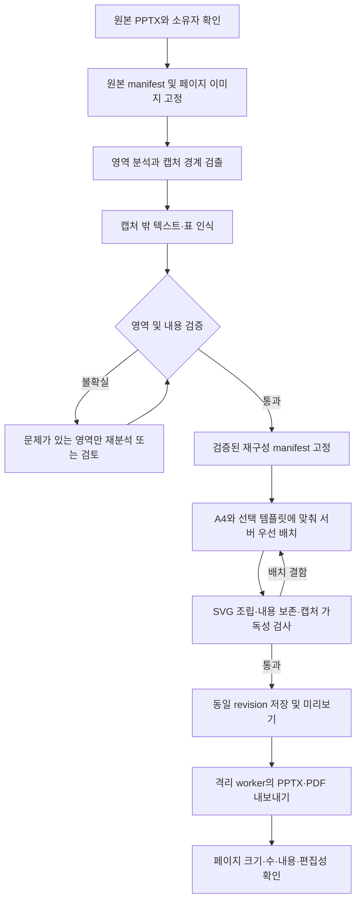

# 화면 캡처를 보존하는 A4 SVG 재구성 설계

- 작성일: 2026-09-24
- 상태: 구현 전 설계. 사용자 승인 방향과 구현 제안을 구분한다.
- 사용자 승인 방향: 화면 캡처는 보존하고 주변 제목·설명·표·디자인을 재구성한다. 이미지형 입력도 A4 SVG 생성에 사용한다.
- 초기 적용 스타일: `screenshot-blue` / 화면 캡처 블루.
- 실제 입력: `Samsung_Display_AX_Proposal_28p_Aligned_Final.pptx`.
- 현재 확인한 입력 특성: 28페이지, 406.4 × 228.6mm의 16:9, 페이지마다 이미지 1개, 편집 가능한 텍스트 객체 없음.
- 이 문서 작성으로 생성 코드, 공급자 설정, 실행 중인 작업, 제품 검증 상태를 변경하지 않는다.

## 1. 목표와 결과물

원본 페이지를 제목, 설명, 표, 화면 캡처, 관계를 설명하는 도형으로 분석한다. 화면 캡처는 원본 픽셀을 이용하고, 캡처 바깥의 의미 있는 내용을 편집 가능한 SVG 요소로 배치한다. 선택한 템플릿을 A4 출력 크기에 맞게 적용한다.

이번 파일의 완료 결과는 원본과 대응하는 A4 SVG 28페이지와 같은 페이지 수의 PPTX·PDF다. 페이지의 내용과 순서를 유지한다. 제목 페이지나 목차를 새로 끼워 넣거나, 부족한 공간을 해결하려고 페이지를 추가하지 않는다.

| 요소 | 처리 | 편집 범위 |
|---|---|---|
| 실제 화면 캡처 영역 | 원본 페이지 이미지에서 경계를 검증하고 무손실로 추출 | 이미지 위치·크기; 이미지 내부 UI는 유지 |
| 캡처 바깥의 제목·본문·주석 | OCR 및 원본 대조 후 승인된 텍스트로 구성 | SVG text/tspan, PPTX 텍스트 변환 대상 |
| 캡처 바깥의 표 | 셀 내용·행열·병합 관계를 함께 인식 | SVG 도형·텍스트; PPTX 표/도형 편집성은 별도 확인 |
| 캡처 내부의 표·차트·텍스트 | 캡처 이미지에 포함하여 보존 | 별도 텍스트로 중복 생성하지 않음 |
| 원본 로고·사진·복잡한 시각 자료 | 해당 자산 또는 검증된 영역 이미지로 보존 | 위치·크기 |
| 단계 번호·설명용 연결선 | 실제 의미와 연결 대상을 확인한 후 벡터화 | SVG 도형·텍스트 |
| 순수 장식 배경·패널 | 역할 확인 후 선택 템플릿의 시각 규칙 적용 | 템플릿이 정의한 벡터 표현 |

원본의 글꼴 이름과 편집 구조를 이미지에서 정확히 복구했다고 주장하지 않는다. 글꼴은 선택 템플릿의 검증된 한글 글꼴을 사용한다. SVG 파일이라는 사실만으로 이미지 내부까지 편집 가능하다고 표시하지 않는다.

## 2. 현재 구현과 차이

| 현재 연결 지점 | 확인한 동작 | 필요한 변경 |
|---|---|---|
| `services/document_canvas.py` | 원본 보존 SVG는 A4 가로 원본 크기만 수용 | 원본 크기와 출력 A4를 독립적으로 표현하는 재구성 정책 추가 |
| `services/authored_canvas.py` | 원본 보존 SVG의 원본 캔버스가 출력 캔버스를 결정 | 새 정책에서는 요청의 A4 캔버스를 출력 권위로 사용 |
| `services/svg_generation_admission.py` | 원본 보존 SVG 요청의 page_size/orientation 재지정 거부 | 재구성 기능이 준비된 경우에 한해 A4 출력 지정 허용 |
| `services/source_content/pipeline.py` | 원본 manifest와 크기, SVG 입력을 결합 | 원본 pin과 검증된 분석 결과 pin을 함께 결합 |
| `services/svg_source_layout.py` | 텍스트·표가 없는 페이지 거부 | 검증된 재구성 결과가 있는 이미지 페이지를 별도 계약으로 허용 |
| `services/svg_source_template_layout.py` | 템플릿 기반 서버 배치와 제한된 복구 | 캡처·설명 그룹, 원본 관계, 가독성을 이용하는 배치 추가 |
| `services/svg_generation_assets.py` 및 자산 resolver | 원본 occurrence 기반 이미지 slot 연결 | 원본 이미지와 파생 crop의 계보·등장 위치를 검증 |
| `services/svg_presentation_service.py` | 페이지별 생성·검증·저장 | 분석/검토 완료 후 확정된 내용을 기존 SVG 생성 단계로 전달 |
| 업로드 분석·생성 UI | 원본 크기를 표시하고 원본 보존 요청을 전송 | A4 출력 크기와 인식 검토 상태를 구분하여 표시 |

이미지 페이지 거부 조건만 삭제하거나, 가짜 텍스트 블록을 추가해 기존 검증을 통과시키지 않는다. 기존 원본 추출과 새 인식 결과는 증거의 종류가 다르므로 승인 조건도 구분한다.

`authored_quality_ocr.py`는 생성 결과의 OCR 품질 검사와 안전한 진단에 관한 모듈이다. 그 출력을 원본 텍스트 권위로 사용하지 않는다. `slidespec_ocr_inventory.py` 역시 이미 존재하는 의미 텍스트로부터 비교 기준을 만드는 모듈이며, 이미지에서 원문을 복원하는 기능이 아니다. `liteparse_service.py`의 로컬 한국어 OCR 준비와 실행 관리는 재사용 가능성을 검토하되, 영역·셀 단위 인식이 준비됐다고 가정하지 않는다.

## 3. 처리 흐름

기존 작업·취소·재시도·사용량 관리 경로를 확장한다. 별도 생성 서버나 독립된 작업 큐를 만들지 않는다. 이미지 분석은 생성 이전의 준비 단계이고, 배치는 확정된 텍스트와 자산만 사용한다.

## 4. 원본 크기와 출력 크기

- 원본 PPTX의 EMU 크기와 원본 이미지의 실제 픽셀 크기를 그대로 기록한다.
- 출력은 기존 `document-canvas/v1`을 사용한다. A4 가로는 1188 × 840, 세로는 840 × 1188 논리 단위다.
- 물리적 크기와 `9000 EMU/unit`을 같은 출력 계약으로 전달한다. 기존 문서의 `9525 EMU/px` 의미를 바꾸지 않는다.
- 원본 slide 좌표, 페이지 분석 이미지 좌표, crop 내부 좌표, 출력 좌표 사이의 변환을 명시한다. 서로 다른 좌표를 이름만 같은 bbox로 섞지 않는다.
- 원본 비율 때문에 새 재구성 경로를 거부하지 않는다. 지원하지 않는 이미지 변환, 해상도 부족 등은 구체적인 별도 사유로 보고한다.
- 선택한 출력 캔버스와 원본 pin은 각각 작업 접수 시 고정한다. 재시도·서버 재시작·다운로드에서도 동일하게 적용한다.
- 이미 시작된 이전 원본 보존 작업은 기존 크기 계약을 그대로 재생한다. 새 정책을 과거 작업에 소급 적용하지 않는다.

## 5. 영역 분석과 내용 추출

### 5.1 페이지 준비

단일 이미지가 페이지를 채우는 경우에는 가능하면 내장 원본 이미지 바이트를 직접 사용한다. 해상도를 낮춘 미리보기 이미지를 인식 입력으로 사용하지 않는다. 복합 이미지·회전·crop이 있는 페이지는 표시 변환을 기록한 정규화 페이지 이미지를 만든다. 지원되지 않는 변환은 원인을 알리고 멈춘다.

원본 이미지와 정규화 이미지는 다른 자산이다. 정규화 또는 재인코딩이 있었다면 원본 바이트와 동일하다고 보고하지 않는다.

### 5.2 역할 구분

영역 후보는 `screenshot`, `text`, `table`, `diagram`, `logo`, `photo`, `decoration`, `unknown`으로 분류한다. 페이지의 포함 관계와 읽기 순서를 함께 보관한다.

- 캡처의 실제 경계와 캡처 밖 패널 테두리를 구분한다.
- 캡처와 해당 제목·설명·번호를 하나의 의미 그룹으로 연결한다.
- 캡처 안의 OCR 결과는 검색·분류 보조로만 사용하며 편집 텍스트로 중복 배치하지 않는다.
- 주요 버튼, 메뉴, 차트 축, 상태 표시, 주석이 crop 밖으로 빠지면 캡처 경계 검증을 통과하지 못한다.
- 장식으로 분류됐다는 이유만으로 숫자·로고·각주를 삭제하지 않는다. 내용이 있는 불명 영역은 검토 대상으로 남긴다.
- 원본 쪽번호는 출처 메타데이터로 분리하고, 출력 쪽번호는 기존 시스템 렌더링이 담당한다. 본문의 숫자를 쪽번호로 오인하여 제거하지 않는다.

초기 영역 후보와 OCR은 가능한 범위에서 로컬 처리한다. 시각 모델은 경계·역할·표 구조가 불확실한 경우에만 기존 공급자 정책과 호출 예산 안에서 사용한다. 모델이 제안한 영역·문자열은 검증 전까지 후보다.

### 5.3 OCR 및 표 검증

한국어·영어를 함께 인식하되, 외부 제목·설명과 캡처 내부 텍스트의 역할을 먼저 구분한다. 각 텍스트와 셀은 페이지 및 영역 좌표에 연결한다. 후보 문자열, 인식 방식, 원본 대조 결과, 사용자 수정 이력을 별도로 남긴다.

숫자, 단위, 고유명사, 기호, 부정 표현은 중요 항목으로 검사한다. 표는 셀 값만 맞아도 통과하지 않으며 행·열·병합·머리글 관계까지 확인한다. 화면 캡처 내부의 표는 이미지 그대로 유지한다.

OCR 점수를 정답 확률로 취급하지 않는다. 초기 임계값은 대표 페이지의 사람이 확인한 기준 자료로 보정한다. 높은 점수 하나 또는 동일 OCR 엔진의 반복 일치만으로 원문 일치를 보증하지 않는다. 불일치한 중요 항목과 불명 영역은 검토가 끝나기 전까지 통과시키지 않는다.

인식 문자열을 요약하거나 자연스러운 문장으로 고쳐 내용 오류를 숨기지 않는다. 불확실한 셀·주석을 작은 이미지로 남기는 대안은 부분 이미지 보존으로 명시하고, 편집 가능한 표 재구성 완료와 구분한다.

## 6. 데이터 계약과 자산 계보

다음 이름과 필드는 구현 제안이며 아직 공개 API가 아니다.

| 객체 | 주요 내용 | 권위 |
|---|---|---|
| 기존 `SourceContentManifest` | 원본 snapshot, 원본 객체·이미지, 페이지 수·순서·크기, digest | 변경하지 않는 업로드 원본 |
| `RasterReconstructionManifest` | 원본 manifest pin, 페이지별 영역, 텍스트·표 후보, 관계, crop, 검토 상태, 분석 버전 | 검증된 파생 분석 결과 |
| `RasterRegion` | 페이지 ID, region ID, 영역 종류, 원본 픽셀 bbox, 부모 영역·읽기 순서, source/crop digest | 특정 원본 영역과의 연결 |
| `RecognizedText` / `RecognizedTable` | 영역 ID, 후보·확정 값, 셀 구조, 중요 항목, 검토 근거 | 확인된 인식 내용; native 원문과 별도 |
| `ReconstructionPin` | 원본 pin, 파생 manifest ID/revision/digest, 분석 정책 버전 | 작업 접수 후 불변 입력 |
| 재구성 검증 결과 | 누락·중복·불확실 항목, crop 연결, 텍스트·표 대조, 배치·출력 확인 | 검증한 범위와 한계 |

원본 `SourceContentManifest`의 textBlocks 값을 OCR 결과로 덮어쓰지 않는다. 원본은 이미지로 존재했고 텍스트는 인식으로 얻었다는 사실을 유지한다. 승인된 파생 manifest를 기존 배치용 블록으로 변환하되, 모든 블록에 원본 영역 및 검토 결과를 연결한다.

기존 이미지 occurrence는 파생 crop들과의 관계로 보존을 설명한다. 원본 전체 이미지 1개를 삭제하고 crop 4개를 넣었다는 사실을 단순한 이미지 개수 비교로 통과시키지 않는다. 원본의 내용 영역마다 재구성 텍스트, 표, 보존 이미지 중 어디로 옮겼는지 대응을 기록한다. 의도적으로 교체한 장식 영역도 구분한다.

crop 자산은 원본 digest, 정규화 변환, 정수 픽셀 bbox, 파생 자산 digest에 묶는다. 같은 페이지의 같은 그림이 여러 번 등장하면 occurrence를 별도로 유지한다. 무손실 crop의 픽셀 일치는 정규화된 원본 영역과 비교하고, 압축된 파일 바이트 비교와 혼동하지 않는다.

원본과 파생 자산은 기존 소유자 범위 및 committed 자산 저장 규칙을 따른다. 고객의 화면과 OCR 원문을 공용 템플릿 카탈로그, 로그, 대시보드 목록 응답에 포함하지 않는다. UI에서 검토할 원문은 권한이 확인된 상세 경로로만 제공한다.

## 7. A4 배치와 화면 캡처 블루

배치 입력은 확정된 내용과 검증된 crop만 받는다. 배치 모델은 문구·수치·이미지 내용을 변경하거나 새로운 UI를 만들 수 없다.

서버가 원본 역할·화면 수·비율·설명 길이·목표 방향을 기준으로 후보를 선택한다. 해결하지 못한 페이지만 기존 제한된 모델 배치 경로로 보낸다. 템플릿별 분기 코드를 여러 서비스에 복제하지 않고 템플릿 데이터와 공통 배치 규칙으로 표현한다.

| 형태 | A4 가로 | A4 세로 |
|---|---|---|
| 단일 화면 | 큰 캡처와 좁은 설명 영역 | 상단 캡처와 하단 설명, 세로 캡처는 옆 설명 가능 |
| 전후 비교 | 같은 배율의 좌우 화면과 짧은 차이 설명 | 위아래 비교, 동일한 기준과 설명 대응 유지 |
| 3~4단계 화면 | 화면 비율에 따라 2열·2행 또는 읽기 가능한 단계 배열 | 위아래 흐름 또는 2열·2행; 가로 페이지 전체 축소 금지 |
| 효과 표 | 셀 값과 단위가 읽히는 넓은 표 | 열 폭·줄바꿈·여백 조절; 관계나 수치 생략 금지 |

캡처 내부 텍스트의 읽기 크기를 별도로 평가한다. 캡처 밖 글자가 최소 크기를 만족해도 화면 내부 글자가 판독 불가능하면 통과시키지 않는다. 캡처 내부 보조 OCR과 실제 출력 배율, 최종 화면 검토를 함께 사용한다.

밀도가 높으면 템플릿의 장식·패딩·헤더를 먼저 줄이고 배열을 변경한다. 승인된 요청별 글자 크기 정책을 따른다. 원본 재구성 v2의 7 CSS px 허용 정책을 전체 문서의 기본 크기로 적용하거나, 다른 경로의 글자 크기 계약을 바꾸지 않는다. 최소 크기는 목표 크기가 아니다.

원본 페이지 전체를 작게 넣는 것으로 재구성을 완료하지 않는다. 전체 페이지 이미지는 대조·검토용으로 항상 보관하되, 결과 페이지의 성공 대체물로 자동 채택하지 않는다. 내용·페이지 수·가독성을 동시에 충족하지 못하면 해당 페이지를 미해결로 표시한다.

## 8. 요청, 상태, 복구

### 요청과 기능 지원

기존 생성 요청에 선택적인 이미지 재구성 정책과 `ReconstructionPin`을 추가하는 방안을 사용한다. 기존 native 원본 보존 요청은 그대로 처리한다. 구버전 클라이언트가 새 정책을 이해하지 못하면 자동 활성화하지 않는다.

기능 지원 응답은 native 원본 보존 SVG와 이미지 분석 재구성을 구분한다. 새 기능은 분석기·영역 검증·소유 자산·템플릿·출력 방향이 모두 준비된 경우에만 활성화한다. 기존 A4 전체 제품 검증 플래그를 이 기능의 단위 테스트만으로 올리지 않는다.

분석 API 응답에는 원본 크기, 선택한 출력 크기, 페이지별 인식 상태와 검토 사유를 제공한다. OCR 원문과 큰 진단 정보는 별도 상세 조회로 둔다.

### 상태

기존 operation의 단계 이벤트로 준비·진행·취소를 표현하고, 파생 manifest에는 다음 인식 상태를 저장한다.

| 상태 | 의미 | 다음 동작 |
|---|---|---|
| 분석 중 | 페이지 정규화·영역 분류·인식 진행 | 페이지 단위 진행 표시 |
| 검토 필요 | 불확실한 경계·문자·셀·관계 존재 | 해당 영역만 원본과 나란히 확인 |
| 배치 준비 | 필요한 영역과 내용이 검증됨 | 확정 pin으로 배치 |
| 배치 검토 필요 | 누락 없이 읽기 가능한 배치를 아직 찾지 못함 | 해당 페이지의 배치만 수정 |
| 출력 확인 중 | 저장된 SVG revision에서 내보내기 및 확인 | 같은 revision에 검증 결과 연결 |
| 완료 | 필요한 모든 페이지와 출력 검증 통과 | 결과 제공 |

검토를 기다리는 상태를 실패나 완료로 표시하지 않는다. “설정을 확인하세요”라는 공통 문구로 사유를 덮지 않고, 페이지·영역·이유·다음 행동을 결과 영역에 유지한다.

수정은 새 파생 revision으로 기록한다. 영향받은 페이지와 종속 결과만 무효화한다. 일부 페이지가 통과해도 전체 문서를 완료로 표시하지 않는다. 취소 이후 진행 중 응답은 publish할 수 없으며, 이미 검증된 중간 결과는 권한 범위 내에서 재사용한다.

### 예산

- 분석 캐시 키에는 원본 이미지 digest, 페이지 표시 변환, 분석기 버전, 언어, 정책을 포함한다.
- 템플릿 변경은 인식 내용을 변경하지 않으므로 분석 결과를 재사용하고 배치만 갱신한다.
- 출력 방향 변경도 분석을 재사용하고 배치·출력 검증만 다시 한다.
- 페이지별 최초 시각 분석과 불확실 영역에 대한 제한된 보완 횟수를 작업에 고정한다. 구체적인 횟수·시간·동시성은 대표 3장 실측으로 결정한다.
- OCR·모델·배치에 대한 timeout, 취소, 사용량 기록은 기존 작업 정책을 따른다. 호출 수나 시간을 관측 없이 추정하여 성공 보고에 사용하지 않는다.
- 예산이 끝나면 해당 영역의 검토 필요 상태로 전환하고 전체 페이지를 반복 재생성하지 않는다.

## 9. 검증 계약

검증은 단계를 구분한다. 하나가 통과했다고 다른 단계까지 완료로 표시하지 않는다.

1. **입력 및 계보:** 원본 digest, 소유자, 28페이지 및 순서, 파생 영역의 원본 귀속 확인.
2. **영역 누락:** 내용이 있는 모든 영역이 텍스트·표·이미지 또는 미해결 항목에 대응. unknown 영역을 조용히 버리지 않음.
3. **인식:** 캡처 바깥 텍스트와 표를 원본 영역에 대조. 중요 값의 불일치와 미확인 항목이 있으면 완료 금지.
4. **캡처 보존:** 경계, crop 픽셀, 등장 위치, 비율, 해상도 확인. AI 재생성 화면으로 교체하지 않음.
5. **배치:** 내용·의미 그룹의 누락·중복·잘림·겹침·읽기 순서와 캡처 내부 가독성 확인.
6. **SVG:** 기존 정적 요소·좌표·폰트·이미지 slot 정책 통과. SVG 저장 이후 별도 숨은 수정 금지.
7. **저장:** 미리보기·다운로드가 동일한 확정 revision과 A4 캔버스를 참조.
8. **내보내기:** 격리 worker에서 PPTX·PDF 생성 후 페이지 수·물리 크기·폰트·이미지·텍스트를 확인. 실제 편집 가능 범위를 확인한 요소에 대해서만 보고.

OCR에서 인식한 값과 그 값을 출력한 SVG가 서로 같다는 사실만으로 원본 충실성을 입증하지 않는다. 원본 영상과 인식 결과를 비교하는 근거가 별도로 필요하다. native 원문 보존 receipt를 인식 결과에 그대로 재사용하지 않고, 인식 기반임을 표시하는 새 버전의 검증 결과를 정의한다.

## 10. 전체 위험 분류와 대표 출력 파일럿

구현 순서는 28장 전체 위험 분류 → 대표 페이지 실제 출력 → 보존·가독성 기준 확정 → 데이터 계약·검토 UI → 전체 28장 적용으로 한다. 저장소의 `artifacts/raster-reconstruction-pilot-20260924/page-risk-audit.json`은 페이지별 수동 시각 분류이며, 자동 검출이나 OCR 정확도의 증명이 아니다.

첫 대표 페이지는 물리적 페이지 번호 3, 8, 11, 22, 24를 원본 순서로 사용한다. 각각 4열 화면 흐름, 겹친 화면과 말풍선, 큰 화면과 주변 설명, 사진이 있는 구분장, 7열 수치 표를 확인한다. 7·8·14장의 겹침 위험은 전체 적용 전 별도로 확인한다. 대표 페이지가 통과하더라도 나머지 23장이나 전체 세로 출력이 통과한 것으로 간주하지 않는다.

파일럿은 실제 원본의 digest와 이미지 픽셀 크기를 고정하고, 로컬 OCR과 명시적인 영역 주석으로 A4 SVG를 만든다. 수동 영역 주석을 사용한 결과는 자동 영역 검출 성능으로 보고하지 않는다. 원문 이미지·전사·출력물은 로컬 비공개 작업 폴더에 두고 저장소 보고서에는 원문 없는 판정·개수·증거 경로만 기록한다.

- 원본 픽셀에서 추출한 캡처와 복합 영역은 crop digest와 좌표를 기록한다.
- 영역 OCR과 전체 페이지 OCR을 교차 확인한다. 같은 OCR 엔진의 두 결과가 일치해도 독립적인 원문 정확도 증명은 아니다.
- 에이전트 시각 전사는 `agent_visual` 근거이며 사용자 승인으로 승격하지 않는다. 불확실한 글자·숫자·단위는 검토 대상으로 남긴다.
- SVG 원문과 PPTX readback의 텍스트, 임베디드 이미지, 장수, A4 실제 크기를 비교한다.
- PPTX의 개별 편집 가능한 셀 텍스트·사각형과 OOXML native table을 구분한다. PDF는 기존 출력 방식에 따라 시각·페이지 크기 증거로 보고한다.
- 캡처 미리보기와 최종 내보내기는 동일한 저장 SVG revision에서 생성한다.

## 11. 단계별 구현과 진입 조건

| 단계 | 작업 | 다음 단계의 진입 조건 |
|---|---|---|
| 1 | 28장 위험 분류와 입력 digest 고정 | 누락 없는 페이지 목록과 대표 유형 선정 |
| 2 | 대표 5장의 영역·OCR·A4 SVG·PPTX·PDF 파일럿 | 실제 exporter 연결, 편집성·원본 crop 계보 확인, 실패 및 검토 항목 공개 |
| 3 | 보존·가독성 및 영역 데이터 계약 확정 | 파일럿에서 드러난 중첩·누락·수용 불가 사례를 계약으로 표현 |
| 4 | 분석 저장·revision·승인 pin·검토 UI | owner 검증, 원본 대조, CAS 승인, 오래된 결과 폐기 |
| 5 | 승인 pin으로 실제 생성·내보내기 연결 | native 경로의 기존 보존 계약 유지, 동일 revision의 결과 사용 |
| 6 | 원본 순서로 28장 전체 적용 | 페이지별 내용·가독성·출력 검증 및 미해결 검토 항목 처리 |

파일럿에서 확인하지 못한 동작을 제품 완료로 표시하지 않는다. 분석 저장 및 검토 UI를 먼저 완성한 뒤 처음으로 exporter를 확인하는 순서로 되돌아가지 않는다. 파일럿 스크립트는 제품 API, owner 권한 확인, 작업 영속화, 자동 영역 분리를 대체하지 않는다.

## 12. 완료로 인정하지 않는 상태

- 원본 전체 이미지를 A4에 줄여 넣었지만 주변 텍스트·표 재구성이 이뤄지지 않은 결과.
- OCR가 읽지 못한 글자나 셀을 모델이 추정하여 채운 결과.
- 캡처를 다시 그리거나 실제로 없던 개선 화면을 만든 결과.
- 검토할 페이지·영역이 남았는데 전체 작업을 완료 처리한 결과.
- SVG 내부 편집성만 확인하고 PPTX의 실제 편집 가능성을 보장한 결과.
- 일부 페이지·방향만 확인하고 A4 전체 경로의 제품 검증 완료를 선언한 결과.

이 설계의 구현 방향은 사용자 선택에 따른다. 세부 API 이름, 분석 임계값, 모델 예산, 배치 후보는 아직 구현 제안이며 현재 동작이나 승인된 성능 수치가 아니다.

## 13. 검토에서 보완한 계약

### 누락 탐지

탐지된 영역의 출력 여부만으로 원문 전체 보존을 판정하지 않는다. 전체 페이지 텍스트 위치 목록, 영역별 내용 목록, 제외 영역의 근거를 함께 유지한다. 검출하지 못한 그림·문자도 존재할 수 있으므로 OCR 교차 비교는 진단이고 완전성 증명이 아니다. 알려진 미매핑 내용은 완료를 막는다.

### 중첩과 복합 영역

캡처에 화살표·번호·말풍선·다른 화면이 겹치면 포함 관계와 보이는 영역을 기록한다. 분리하면 손상되는 묶음은 복합 이미지로 보존한다. 원본에서 가려진 부분을 모델로 생성하거나 설명을 중복 배치하지 않는다. 같은 이미지라도 페이지별 occurrence를 제거하지 않는다.

### 가독성과 수용 가능성

영역마다 전체 화면 개요인지 세부 글자 판독이 필요한 증거인지 구분한다. 원본 해상도, 출력상의 유효 크기, 핵심 글자의 원본 높이로 사전 판단하고 불확실한 영역은 검토 대상으로 둔다. 주변 텍스트의 7 CSS px 정책을 캡처 내부 글자 가독성의 통과 기준으로 사용하지 않는다. 28장·A4·전체 내용·핵심 영역 가독성이 동시에 불가능하면 원인을 표시하고 조건을 자동 완화하지 않는다.

### 기존 경로와 신규 경로의 경계

기존 native source-preserving 경로의 원본 캔버스·1페이지 1장·geometry fallback 계약은 유지한다. raster reconstruction은 다른 내용 근거와 target canvas를 갖는 명시적인 별도 정책이다. 기존 이미지 전용 페이지 거부를 삭제하거나 OCR을 native 원문으로 위장하지 않는다. 이번 입력 범위는 이미지 기반 PPTX이며 PDF 입력 어댑터는 별도 범위다. PDF 출력은 기존 exporter 연결과 실제 결과로 확인한다.

### 검토 대기와 승인

분석 완료 후 검토를 기다리는 동안 generation worker lease를 점유하지 않는다. 분석 revision을 영속화한 뒤 작업을 종료하고 승인 시 expected_revision과 analysis_digest를 CAS로 확인한다. 생성은 승인 pin을 사용하며 attempt/fencing token으로 과거 worker의 완료 통지를 거부한다. 캐시와 crop 재사용 여부와 무관하게 모든 읽기·수정·승인·생성에서 owner와 원본 접근 권한을 다시 확인한다. 기존 WorkspaceOperation의 awaiting_approval 상태와 version CAS를 우선 검토한다. 분석 본문을 기존 PublicArtifact에 저장할 때에는 WorkspaceArtifact의 live pointer도 연결하여 GC가 유효한 분석을 지우지 않게 한다. ArtifactRef를 JSON에 넣는 것만으로 영속화가 완료되었다고 보지 않는다. native manifest 레코드나 native 자산 목록에 raster draft를 섞지 않는다.

## 14. 실제 파일럿에서 확인한 구현 조건

- OCR 준비 상태가 ready여도 TSV 출력이 정상이라는 뜻은 아니다. 로컬 tessdata에 TSV config 파일이 없는 경우를 위해 TSV 생성 옵션을 명시하고 필수 열을 검증한다. 텍스트가 있는 파일럿 페이지에서 0개 토큰은 통과로 처리하지 않는다.
- 3장 원본에는 약 0.444 원본 픽셀의 좌우 여백이 있다. 파일럿은 단일 이미지·무 crop·무 회전을 확인하고, 각 가장자리의 1 원본 픽셀 이내 오차만 근거와 함께 기록한다. 이 조건은 임의 복합 PPTX의 일반 지원이 아니다.
- 이미지 픽셀 digest 일치는 표시 종횡비 보존을 증명하지 않는다. 정수 크기 image 슬롯과 preserveAspectRatio meet를 사용하고 실제 contain 영역을 별도로 기록한다. 기존 SVG admission은 image width/height의 정수 표현을 요구한다.
- 표는 셀 배경 → 이미지 → 텍스트 순서로 배치한다. 밝은 글자와 셀 채움색의 조합, 아이콘과 셀 글자의 영역 분리를 확인한다. 문자 readback 통과만으로 실제 가시성을 보장하지 않는다.
- 화면 캡처를 base64로 전부 넣은 SVG는 canonical 2MiB 제한에 걸릴 수 있다. 제한을 올리는 대신 기존 svg-asset-manifest/v1의 SourceManifest, PlacementManifest, source-slot 참조와 승인된 자산 결합 경로를 사용한다. 이것은 native SourceContentManifest와 다른 계약이다.
- 파일럿의 로컬 content-addressed store는 바이트·배치·식별자 일관성 검증용이다. 실제 DB owner 권한, committed lifecycle, generation fencing과 publication 검증을 대체하지 않는다.
- 제품 연결의 핵심은 승인된 raster 분석 pin → crop ArtifactRef → SourceSlot 변환이다. 원본 native source manifest를 OCR 전사로 위조하지 않는다.
- 검출 토큰이 영역과 일부만 겹치면 partial_overlap으로 남기고, 여러 영역에 걸치면 ambiguous로 남긴다. 선·테두리 OCR 오탐은 시각 확인 근거를 가진 제외 영역으로 기록한다. uncovered 0만으로 전체 원문 검증 완료를 선언하지 않는다.
