# SlideSpec-first 고품질 검수·자동 수정 아키텍처

- 상태: 구현·회귀·로컬 기본 활성화 완료(설계 기준선과 구현 결과 병기)
- 작성일: 2026-08-04
- 범위: PPT-agent의 authored HTML 검수·수정 경로를 canonical SlideSpec-first 경로와 legacy HTML 호환 경로로 재구성
- 기준 사고: 20페이지 “OSB저축은행 인터넷뱅킹 DevAX 기반 5개월 조기완료 전략”의 11페이지 상단 콘텐츠 잘림
- 문서 역할: 앞부분은 구현 전 설계 기준선을 보존하고, 부록 C에 실제 구현·운영 증거를 기록한다.

## 0. 결론

권고안은 **슬라이드 단위 이중 경로**다. 신규·고신뢰 슬라이드는 versioned `SlideSpec`을 진실의 원장으로 삼고, DOM 원인이 명확한 결함은 deterministic repair cascade로 먼저 해결한다. 미해결 건에만 LLM이 HTML/CSS가 아니라 닫힌 연산 집합의 `RepairPlan`을 최대 두 개 제안한다. deterministic renderer가 HTML을 만들고, 결함 유형별 DOM/OCR/VQA 검증을 통과한 후보 중 변경량이 가장 작은 것만 CAS 트랜잭션으로 publish한다. 기존 HTML은 importer confidence가 충분하고 치명적 unresolved 항목이 없을 때만 신규 경로로 승격하며, 그 외에는 원본 HTML을 authoritative하게 유지한다.

가장 중요한 불변조건은 다음과 같다.

1. 콘텐츠, 중요 토큰, 의미 계층의 canonical digest는 자동 수정 전후 동일해야 한다.
2. 자동 수정은 layout subtree와 허용된 style token만 바꿀 수 있다.
3. DOM은 잘림·겹침·화면 이탈의 truth, OCR은 실제 픽셀에 표시된 텍스트의 독립 센서, VQA는 시각 품질 센서다. 어느 하나도 다른 센서의 hard failure를 덮을 수 없다.
4. `applied=true`는 후보 생성이나 렌더 성공이 아니라 CAS commit, active-revision 전환, post-commit read-back 검증이 끝났을 때만 기록한다.
5. 신규 경로의 모든 불확실성, timeout, sensor unavailable, revision conflict는 원본 유지로 끝난다. 강제 적용은 제공하지 않는다.

## 1. 현재 파이프라인과 결함의 코드 근거

### 1.1 현재 실행 흐름

현재 authored quality review는 대략 다음 순서로 동작한다.

```text
POST quality-review
  → 원본 HTML 렌더 + browser metrics
  → DOM quality inspect + montage/detail VQA routing
  → VQA `needs_fix`로 repair 대상 구성
  → 대상에 한해 LLM local patch 생성·적용·후보 렌더
  → local acceptance + VQA/OCR
  → 필요 시 full HTML fallback 생성·후보 렌더
  → 같은 계열의 local acceptance + VQA/OCR
  → accepted candidate를 slide row에 CAS 저장
  → 기존 slide snapshot version 저장
```

코드 경계는 다음과 같다.

| 책임 | 현재 위치 | 관찰 |
|---|---|---|
| API 요청 | `servers/fastapi/api/v1/ppt/endpoints/presentation.py`의 `quality_review_presentation` | 비동기 task를 시작하지만 결과 단계 계약은 얇다. |
| 요청 model | `servers/fastapi/models/presentation_from_template.py`의 `AuthoredQualityReviewRequest` | 범위와 slide index는 있으나 proposal/validation/apply phase 모델은 없다. |
| orchestration | `servers/fastapi/services/authored_quality_review_service.py`의 `run_authored_quality_review` | 후보 생성, 승인, 적용, metric 집계를 한 서비스가 조정한다. |
| LLM patch/fallback | `servers/fastapi/utils/llm_calls/author_vision_qa.py`의 `revise_authored_deck` | `patch_succeeded`와 `fallback_succeeded`가 후보 생성·렌더 성공에 가깝다. |
| patch schema/apply | `servers/fastapi/utils/authored_patch_engine.py` | QID 기반 HTML mutation과 CSS allowlist를 수행한다. |
| DOM 검사 | `servers/fastapi/utils/authored_dom_quality.py`의 `inspect_authored_dom` | overflow/off-canvas/clipping/content/overlap을 QID 기준으로 보고한다. |
| acceptance | `servers/fastapi/services/authored_quality_acceptance.py` | VQA, style, local DOM 결정을 각각 제공한다. |
| OCR | `servers/fastapi/services/authored_quality_ocr.py`, `servers/fastapi/utils/authored_ocr_quality.py` | exact와 style mode의 expected-source가 다르다. |
| version | `servers/fastapi/services/presentation_version_service.py` | 현재는 slide dump snapshot/restore이며 spec-render 번들이 아니다. |
| frontend 계약 | `servers/nextjs/app/(presentation-generator)/services/api/authored.ts` | legacy metric alias와 repair path를 normalize한다. |
| frontend 표시 | `servers/nextjs/app/(presentation-generator)/presentation/components/AuthoredQualityReview.tsx` | generation success를 “성공”으로 읽을 여지가 있다. |

사건 분석에서 가장 먼저 수정해야 할 진입 게이트도 확인됐다. `authored_quality_review_service.py`의 `initial_issues`는 DOM report가 아니라 VQA critic의 `needs_fix`에서만 만들어진다. DOM이 `clipping`, `overflow`, `content`를 검출해도 VQA가 clean이면 repair 후보는 0개로 종료될 수 있다. OSB 11페이지 원본 artifact가 저장소에 없어 이 경로가 실제 원인이었다고 단정할 수는 없지만, “상단 clipping을 deterministic DOM이 보았는데도 자동 수정이 시작되지 않는” 재현 가능한 구조적 가능성이다. 신규 router는 required DOM defect를 repair 진입의 독립 trigger로 사용하고 VQA가 이를 veto하지 못하게 해야 한다.

### 1.2 재검증된 여섯 결함

#### D1. `local_patch`와 `full_fallback`이 같은 QID 회귀 모델을 공유한다

`authored_quality_acceptance.py`의 `local_acceptance_decision`은 baseline과 candidate `DomQualityReport`를 `(category, qids)` 및 severity profile로 비교한다. `authored_dom_quality.py`의 `has_dom_quality_regression`도 issue bucket을 `(category, qids)`로 만든다. `authored_quality_review_service.py`는 local candidate와 full re-author candidate 모두에 이 local decision을 호출한다.

따라서 HTML 전체 재작성으로 의미가 보존되어도 QID가 바뀌면 기존 issue의 해소와 신규 issue의 출현을 안정적으로 동일 객체로 추적할 수 없다. full fallback이 local patch와 같은 identity 가정을 쓰는 것이 구조적 결함이다.

#### D2. void tag가 텍스트·품질 대상이 된다

`authored_patch_engine.py`에는 `_VOID_TAGS`가 있지만, `authored_dom_quality.py`의 `_NON_RENDERED_TAGS`와 `_is_edit_target`은 `<br>`, `` 같은 void element를 제외하지 않는다. `ensure_authored_qids`는 이들에 QID를 줄 수 있고, `_TextByQidParser.handle_starttag`는 모든 start tag를 stack에 push한다. `<br>`에는 matching end tag가 없으므로 뒤 텍스트가 `<br>` QID에 귀속될 수 있다.

그 결과 telemetry exact-set과 expected-text 계산에 가짜 edit target이 생겨 `content_missing` 또는 QID 불완전 오탐이 가능하다. 신규 경로에서는 HTML tag가 아니라 SlideSpec의 semantic text inventory를 expected source로 사용해야 한다.

#### D3. CSS key casing 계약이 서로 다르다

`authored_patch_engine.py`의 `_STYLE_PROPERTIES`는 `font-size`, `margin-top` 같은 kebab-case만 허용한다. 반면 `author_slide_patch.py`의 `_STYLE_KEYS`와 compact DOM `computedStyle`은 `fontSize`, `marginTop` 같은 camelCase다. validator는 key를 `.lower()`만 하므로 `fontSize`는 `fontsize`가 되어 allowlist와 일치하지 않는다.

이는 prompt 문제가 아니라 producer/schema/validator 계약 불일치다. SlideSpec-first 경로는 raw CSS property를 모델에 노출하지 않고 `setSpacing`, `setFontScale`, `setTrackSize`처럼 typed operation으로 제거한다. legacy 경로에 남는 tactical fix는 별도 normalization이 필요하지만 본 설계의 canonical 연산은 CSS 문자열을 허용하지 않는다.

#### D4. style OCR이 원문이 아니라 후보나 baseline을 기준으로 삼는다

`authored_quality_ocr.py`의 style mode는 baseline expected를 baseline browser metrics에서, candidate expected를 candidate browser metrics에서 만들고 마지막에 baseline OCR과 candidate OCR을 직접 비교한다. `authored_ocr_quality.py`의 `expected_text_from_browser_metrics`도 rendered browser text만을 expected로 삼는다고 명시한다.

후보 DOM에서 이미 사라진 텍스트는 expected에서도 사라질 수 있고, baseline이 잘린 상태라면 실제 원문 대비 개선이 baseline-vs-candidate 비교에서 불리해질 수 있다. 신규 경로에서 expected는 immutable SlideSpec text inventory와 important token set이어야 하며, browser DOM text는 센서 입력이지 정답 원장이 아니다.

#### D5. `patch_successes`/`fallback_successes`가 실제 적용 성공을 뜻하지 않는다

`author_vision_qa.py`는 patch 적용과 후보 렌더가 되면 `patch_succeeded=True`, full HTML과 PNG 후보가 만들어지면 `fallback_succeeded=True`로 기록한다. 이후 `authored_quality_review_service.py`가 VQA/local/OCR acceptance를 수행하고, 훨씬 뒤에서 slide row를 CAS 저장한다. 그런데 metric 집계는 `repair_details[*].patch.succeeded`와 `fallback.succeeded`를 합산해 frontend의 `patch_succeeded`, `fallback_succeeded`로 전달한다.

`AuthoredQualityReview.tsx`는 이를 patch/전체 재작성 “성공”으로 표시한다. candidate generation/render, accepted decision, persisted apply를 분리하지 않아 운영자와 사용자가 결과를 오해할 수 있다.

#### D6. 후보 생성→검증→적용 단계와 실패 코드가 분리되지 않는다

현재 `AuthoredPatchResult.path`는 `local_patch|full_fallback|none`을 표현하지만 route, generation outcome, acceptance outcome, publish outcome이 하나의 결과 객체와 자유 형식 reason에 섞인다. `authored_quality_review_service.py`는 candidate decision에 persistence 전부터 `applied: accepted`를 넣고, 실제 CAS 충돌·rollback은 뒤에서 처리한다.

신규 계약은 proposal, schema validation, render, sensor validation, acceptance, apply, publish를 각각 독립 enum과 stable reason code로 기록해야 한다.

추가로 확인된 진단 혼선은 다음과 같다.

- style acceptance는 최초 standalone critique와 candidate comparison critique의 score를 같은 척도처럼 비교한다. prompt/rubric가 다른 결과의 직접 비교를 없애고 동일 pairwise rubric/version으로 평가해야 한다.
- 완료 payload의 `local_checks`는 final report가 아니라 초기 `local_reports`여서 적용 성공 결과 옆에 pre-fix clipping이 보일 수 있다. evidence에는 `baseline`과 `candidate` phase를 반드시 표시한다.
- workspace 완료 payload는 현재 DOM/OCR/routing/candidate decision을 축약한다. 신규 contract는 원문을 노출하지 않으면서 reason code, stage, evidence reference는 보존해야 한다.
- `<br>`가 들어 있는 element에 legacy `setText`를 적용하면 child 전체를 plain text node로 바꾸어 hard line break가 사라질 수 있다. void-tag expected-text 오탐과 별개로, legacy stabilization test가 필요한 content-structure 위험이다.

### 1.3 현재 자산 중 재사용할 것

- `servers/fastapi/models/slide_spec_model.py`에는 adaptive composer용 `SlideSpecUnion`/`PresentationComposition`이 이미 있고 `PresentationModel.deck_plan`에 저장된다. 다만 이는 archetype별 생성 schema이므로 canonical ledger의 content/layout/provenance/semantic identity를 모두 충족하지 않는다. `adaptive-composition/v1 → slidespec/1.x` adapter를 두고 이름 충돌을 해소한다.
- workspace command의 `expected_revision`, idempotency key, source/result revision과 transaction CAS 패턴은 재사용한다.
- HTML hash render cache, inflight coalescing, process-wide render semaphore, OCR success cache, montage/detail routing은 신규 scheduler의 기반으로 재사용한다.
- 현재 presentation version restore와 rollout cohort/shadow 정책은 개념을 재사용하되, version payload와 success metric은 새 계약으로 교체한다.

### 1.4 사건 자료의 현재 상태

저장소 검색으로는 문제의 OSB 20페이지 원본 또는 11페이지 golden fixture를 식별하지 못했다. 따라서 “11페이지에서 실제로 재현·통과했다”고 주장하지 않는다. 구현 Phase 0에서 사용자 제공 원본을 비식별화한 fixture, 원본 HTML hash, screenshot, browser metrics, canonical text inventory로 고정해야 한다.

## 2. 목표 아키텍처, 경계와 책임

```mermaid
flowchart LR
    A["Authoring / Legacy HTML"] --> R{"Slide route"}
    R -->|"native or high-confidence import"| S["Versioned SlideSpec ledger"]
    R -->|"low confidence / critical unresolved"| L["Legacy HTML authority"]
    S --> B["Baseline render + DOM diagnosis"]
    B --> F["Deterministic repair cascade"]
    F -->|"candidate found"| V["Plan schema + invariant validator"]
    F -->|"not solved"| P["LLM proposer: max 2 variants"]
    P --> V
    V --> E["Pure operation engine"]
    E --> H["Deterministic renderer"]
    H --> D["DOM geometry sensor"]
    D --> O["OCR sensor"]
    D --> Q["VQA sensor"]
    O --> C["Acceptance engine"]
    Q --> C
    D --> C
    C -->|"gate pass"| M["Minimum-change selector"]
    M --> T["CAS publish + version bundle"]
    C -->|"reject / unavailable"| K["Keep original"]
    L --> X["Existing renderer / review path"]
```



### 2.1 컴포넌트 책임

| 컴포넌트 | 입력/출력 | 책임 | 하지 않는 일 |
|---|---|---|---|
| Slide router | slide provenance, flags | `slidespec_native`, `import_shadow`, `slidespec_active`, `legacy` 선택 | confidence를 임의 보정하지 않음 |
| HTML importer | canonical HTML | SlideSpec candidate, confidence, unresolved | 저신뢰 spec을 active로 만들지 않음 |
| SlideSpec ledger | canonical JSON | immutable revision, digest, lineage | rendered HTML을 진실로 취급하지 않음 |
| Repair router | DOM diagnostics + spec | deterministic repair cascade 우선, 미해결 시 LLM으로 route | 반복적인 model retry 금지 |
| Repair proposer | diagnostics + redacted spec view | 한 호출에서 최대 2개의 RepairPlan/LayoutPlan JSON | HTML/CSS/텍스트 재작성 금지 |
| Plan validator | plan + base revision | schema/invariant/precondition result | browser 품질 판정 금지 |
| Operation engine | valid plan + spec | new in-memory spec revision | side effect/DB write 금지 |
| Renderer | spec + pinned dependencies | HTML, DOM identity map, hashes | LLM 호출 금지 |
| Sensors | baseline/candidate artifacts | typed evidence | 최종 적용 결정 금지 |
| Acceptance engine | policy + evidence | AcceptanceDecision | DB write 금지 |
| Candidate selector | DOM hard gate를 통과한 candidate | `repairCost` 순으로 후속 검증하고 첫 합격 후보 선택 | hard failure 후보 간 상대 비교 금지 |
| Publisher | accepted decision | append revision, CAS active pointer, receipt | acceptance 재판정 금지 |
| Legacy adapter | original HTML | existing render/review result | silent spec promotion 금지 |

### 2.2 핵심 경계

- **Content plane**: text, values, important tokens, asset semantic reference, block type, parent-child order. 자동 수정 불가.
- **Layout plane**: container primitive, track, gap, padding, alignment, bounded geometry, font scale token, overflow strategy. 허용 operation으로만 변경.
- **Render plane**: renderer version, font/asset versions, generated HTML and DOM bindings. 파생물이며 재생성 가능.
- **Evidence plane**: DOM/OCR/VQA result와 artifact hash. 원장에 포함하지 않고 revision에 참조한다.
- **Publication plane**: acceptance와 persistence를 연결하는 유일한 side-effect 경계. `expected_revision` CAS가 필수다.

## 3. 도메인 계약 초안

### 3.1 SlideSpec 1.x

현재 adaptive `SlideSpecUnion`과 구분하기 위해 wire schema id를 `urn:ppt-agent:slidespec:1.0`으로 둔다. JSON canonicalization은 object key sort, 명시 단위, finite number, default materialization 규칙을 versioning한다.

```json
{
  "$schema": "urn:ppt-agent:slidespec:1.0",
  "specRevision": 17,
  "deckId": "deck_123",
  "slideId": "slide_11",
  "canvas": {"width": 1280, "height": 720, "unit": "px"},
  "content": {
    "root": "sem:slide-11",
    "readingOrder": ["sem:slide-11/title"],
    "nodes": [
      {
        "semanticId": "sem:slide-11/title",
        "type": "text",
        "role": "title",
        "parent": "sem:slide-11",
        "order": 0,
        "text": "5개월 조기완료 전략",
        "importantTokens": ["5개월", "조기완료"],
        "language": "ko-KR"
      }
    ]
  },
  "layout": {
    "root": {
      "kind": "stack",
      "axis": "vertical",
      "gap": 16,
      "padding": {"top": 28, "right": 32, "bottom": 28, "left": 32},
      "children": [
        {"kind": "contentRef", "semanticId": "sem:slide-11/title"}
      ]
    }
  },
  "constraints": {
    "safeArea": {"top": 24, "right": 24, "bottom": 24, "left": 24},
    "minFontPx": 12,
    "allowContentOverflow": false
  },
  "relationships": [],
  "assets": [],
  "provenance": {
    "origin": "legacy_import",
    "sourceHtmlHash": "sha256:...",
    "importerVersion": "1.0.0",
    "importConfidence": 0.97
  },
  "digests": {
    "content": "sha256:...",
    "hierarchy": "sha256:...",
    "importantTokens": "sha256:...",
    "spec": "sha256:..."
  }
}
```

#### 불변조건

- `semanticId`는 slide 안에서 유일하며 revision 간 의미가 유지되는 동안 변하지 않는다. DOM QID나 array index에서 파생하지 않는다.
- content node의 `text`, data value, important token, asset meaning, parent, sibling order, reading order, semantic relationship은 automated repair가 바꿀 수 없다.
- 모든 content node는 정확히 한 layout binding을 갖는다. 장식 node만 semantic content 없이 존재할 수 있다.
- content/hierarchy/important-token digest는 RepairPlan 전후 byte-for-byte 동일해야 한다.
- 모든 길이는 단위가 명시되며 NaN/Infinity, arbitrary expression, script, raw HTML/CSS는 금지한다.
- renderer input은 spec, renderer version, font manifest, asset manifest로 완전히 결정된다.

### 3.2 RepairPlan / LayoutPlan 1.x

`LayoutPlan`은 local operation으로 해결되지 않을 때 layout subtree 전체를 다시 제안하는 RepairPlan의 한 형태다. 둘 다 content plane에는 쓰기 권한이 없다.

```json
{
  "$schema": "urn:ppt-agent:repair-plan:1.0",
  "planId": "rp_01",
  "slideId": "slide_11",
  "baseSpecRevision": 17,
  "baseSpecHash": "sha256:...",
  "expectedContentDigest": "sha256:...",
  "scope": ["sem:slide-11/header"],
  "diagnosticRefs": ["dom:clipping:sem-slide-11-header"],
  "strategy": "minimal_change",
  "operations": [
    {
      "op": "setSpacing",
      "target": "sem:slide-11/header",
      "gap": 12,
      "precondition": {"currentGap": 20}
    },
    {
      "op": "setFontScale",
      "target": "sem:slide-11/title",
      "scale": 0.94,
      "bounds": {"minPx": 18, "maxPx": 34}
    }
  ],
  "limits": {"maxOperations": 8, "maxAffectedBlocks": 4},
  "proposedBy": {"kind": "rule_engine", "policyVersion": "repair-cascade/1.0"}
}
```

닫힌 operation enum의 초기안은 다음과 같다.

- `setSpacing`, `setPadding`, `setAlignment`, `setJustification`
- `setTrackSize`, `setColumnRatio`, `setGridPlacement`
- `setBounds`, `translateWithinParent`, `resizeWithinBounds`
- `setFontScale`, `setLineHeightToken`, `setTextFitPolicy`
- `setImageFit`, `setCropFocalPoint`
- `rerouteConnector`
- `replaceLayoutSubtree` — 허용 layout schema만 받고 contentRef 집합과 순서를 보존

금지 operation은 `setText`, `removeContent`, `insertContent`, `setInnerHtml`, `setCss`, `runScript`, semantic parent/order 변경이다. 자동 수정에서 “전체 fallback”은 전체 HTML 재작성 대신 `replaceLayoutSubtree`로 정의한다.

#### Repair planning 순서

DOM telemetry로 원인과 영향 block이 식별되면 LLM보다 아래 deterministic cascade를 먼저 실행한다. 각 단계는 같은 typed operation을 사용하므로 별도의 예외 적용 경로를 만들지 않는다.

```text
spacing·padding 조정
  → container 크기·track 비율 조정
  → 허용 범위 내 font scale 조정
  → 미해결 시 LLM RepairPlan
```

deterministic 후보가 해당 trigger의 전체 acceptance를 통과하면 LLM을 호출하지 않는다. 후보 자체의 결함으로 reject되면 다음 cascade 단계로 진행하고, 규칙으로 해결되지 않을 때만 LLM을 호출한다. sensor unavailable/timeout 같은 inconclusive에서는 LLM으로 우회하지 않고 원본을 유지한다. LLM은 한 번만 호출하고 최대 두 후보를 반환한다.

- A: `minimal_change` — 현재 primitive와 구조를 유지하는 최소 수정
- B: `layout_reflow` — 동일 contentRef 집합을 보존하는 layout subtree 재배치

각 후보는 독립된 RepairPlan이며 schema/invariant/DOM hard gate를 개별 통과해야 한다. 통과 후보가 여러 개면 `layout primitive 변경 여부 → 영향 block 수 → font 축소율 → 정규화 이동·크기 변경량 → operation 수` 순의 versioned `repairCost`로 정렬한다. 가장 작은 후보부터 OCR/VQA를 검증하고 첫 합격 후보를 선택하며, 후보 자체의 실패일 때만 두 번째 후보를 검증한다. 이 순서는 보통 한 후보만 비싼 센서에 보내면서도 기존 디자인 보존과 대안 성공 가능성을 함께 확보한다.

### 3.3 AcceptanceDecision 1.x

```json
{
  "$schema": "urn:ppt-agent:acceptance-decision:1.0",
  "decisionId": "ad_01",
  "planId": "rp_01",
  "baseSpecRevision": 17,
  "candidateSpecHash": "sha256:...",
  "triggerType": "geometry",
  "gatePolicy": "geometry-repair/1.0",
  "requiredGates": ["schema", "invariant", "render", "dom", "ocr", "vqa"],
  "stages": {
    "proposal": {"status": "generated"},
    "schema": {"status": "passed"},
    "invariant": {"status": "passed"},
    "render": {"status": "passed", "htmlHash": "sha256:..."},
    "dom": {"status": "passed", "evidenceRef": "ev_dom_01"},
    "ocr": {"status": "passed", "evidenceRef": "ev_ocr_01"},
    "vqa": {"status": "passed", "evidenceRef": "ev_vqa_01"}
  },
  "outcome": "accepted",
  "reasonCodes": ["acceptance.all_required_gates_passed"],
  "apply": {"status": "not_started"},
  "publish": {"status": "not_started"},
  "postVerify": {"status": "not_started"},
  "policyVersion": "slidespec-acceptance/1.0"
}
```

`outcome`은 `accepted|rejected|inconclusive`; `apply.status`는 `not_started|prepared|committed|rolled_back|failed`; `publish.status`는 `not_started|active|failed`; `postVerify.status`는 `not_started|passed|failed`다. acceptance 당시에는 절대로 `applied=true`를 쓰지 않는다.

### 3.4 stable reason code

code는 API/metric에 쓰는 낮은 cardinality enum이고, slide id, QID, 메시지, stack trace는 `details`에 둔다.

| namespace | 예시 |
|---|---|
| `proposal.*` | `proposal.model_timeout`, `proposal.invalid_json`, `proposal.operation_not_allowed` |
| `schema.*` | `schema.unsupported_version`, `schema.invalid_value` |
| `invariant.*` | `invariant.content_digest_changed`, `invariant.hierarchy_changed`, `invariant.token_set_changed` |
| `render.*` | `render.timeout`, `render.dependency_unpinned`, `render.nondeterministic`, `render.failed` |
| `dom.*` | `dom.clipping`, `dom.off_canvas`, `dom.overflow`, `dom.unintended_overlap`, `dom.telemetry_incomplete` |
| `ocr.*` | `ocr.important_token_missing`, `ocr.recall_regressed`, `ocr.unavailable`, `ocr.timeout` |
| `vqa.*` | `vqa.visual_regression`, `vqa.not_improved`, `vqa.unavailable`, `vqa.timeout` |
| `acceptance.*` | `acceptance.all_required_gates_passed`, `acceptance.required_gate_failed`, `acceptance.inconclusive` |
| `apply.*` | `apply.revision_conflict`, `apply.transaction_failed`, `apply.rolled_back` |
| `publish.*` | `publish.active_revision_failed`, `publish.receipt_failed` |
| `postverify.*` | `postverify.readback_mismatch`, `postverify.render_mismatch`, `postverify.active_revision_changed` |
| `import.*` | `import.low_confidence`, `import.critical_unresolved`, `import.render_parity_failed` |
| `system.*` | `system.cancelled`, `system.budget_exceeded`, `system.internal_error` |

### 3.5 저장 계약

새 저장은 additive하게 구성한다.

- `slide_spec_revisions`: immutable canonical spec JSON, spec/content/hierarchy/token hash, parent revision, provenance.
- `slide_render_artifacts`: spec revision, renderer/font/asset manifest version, HTML/blob ref, HTML hash, screenshot hash, DOM-map hash.
- `slide_repair_attempts`: plan, stage statuses, acceptance policy/version, reason codes, timings; rejected attempt도 저장하되 raw 민감 텍스트는 제외한다.
- `slide_sensor_evidence`: DOM/OCR/VQA typed summary와 artifact reference, retention policy.
- `presentations.active_slide_spec_revision_id` 또는 slide별 active pointer: nullable로 추가한다.

publish transaction은 `expected_revision`과 idempotency key를 요구한다.

```text
1. immutable spec revision insert
2. deterministic render artifact insert/reuse
3. accepted decision 및 apply receipt insert
4. live HTML projection update
5. presentation revision CAS + active pointer switch
6. outbox/timeline event
COMMIT
7. commit receipt read-back + active revision/spec/render hash 검증
```

commit 전 어느 단계든 실패하면 transaction을 rollback하고 기존 active revision/HTML을 유지한다. commit 후 post-verify가 실패하면 candidate revision이 여전히 active인지 CAS로 확인한 뒤에만 known-good bundle을 가리키는 restore revision을 append한다. 그 사이 사용자 또는 다른 worker가 새 revision을 활성화했다면 자동 rollback하지 않고 `postverify.active_revision_changed`로 격리·경보한다. rollback은 과거 row를 덮어쓰거나 revision을 되감지 않는다.

현재 `presentation_versions`는 slide model dump를 저장하고 restore 시 live slide rows를 교체한다. 신규 bundle은 SlideSpec + renderer dependency manifest + rendered HTML/hash를 함께 보존하여 “spec은 과거인데 HTML은 새 renderer 산출물”인 혼합 rollback을 막는다.

### 3.6 API/UI 결과 계약

기존 `/workspace` v1은 optional capability와 field를 additive하게 확장한다. capability는 `slide_spec_read`, `slide_spec_write`, `legacy_html_import`, `import_shadow`, `legacy_fallback_render`로 분리하고, mutation command는 `slidespec.import_legacy`, `slidespec.apply_repair`, `slidespec.restore_revision`으로 명시한다. 모든 mutation은 `expectedRevision`과 idempotency key를 요구한다.

```json
{
  "operationId": "op_01",
  "schemaVersion": 1,
  "slideIndex": 10,
  "route": "slidespec_active",
  "proposalStatus": "generated",
  "renderStatus": "succeeded",
  "validationStatus": "accepted",
  "applyStatus": "committed",
  "publishStatus": "active",
  "postVerifyStatus": "passed",
  "applied": true,
  "activeRevision": 18,
  "reasonCodes": ["acceptance.all_required_gates_passed"],
  "slideSpec": {
    "revisionId": "ssr_18",
    "hash": "sha256:...",
    "status": "structured",
    "confidence": 0.97,
    "fallbackRequired": false
  }
}
```

`applied`는 `applyStatus=committed AND publishStatus=active AND postVerifyStatus=passed`이며 응답 시점에도 해당 revision이 active인 경우에만 true인 파생값이다. UI count도 아래를 따로 표시한다.

- `candidate_proposed`, `candidate_generated`, `candidate_rendered`
- `candidate_validated`, `candidate_accepted`, `candidate_rejected`, `candidate_inconclusive`
- `apply_committed`, `publish_active`, `postverify_passed`, `apply_rolled_back`, `legacy_preserved`

기존 `patch_successes`와 `fallback_successes`는 deprecated alias로만 읽고 신규 UI 문구에는 쓰지 않는다. transition 기간에는 “후보 렌더 성공”으로 명시한다.

## 4. 레이아웃 표현력과 escape hatch

### 4.1 primitive

| primitive | 표현 대상 | 주요 제약 |
|---|---|---|
| `stack` | 수직/수평 흐름, 제목+본문 | axis, gap, padding, wrap, alignment |
| `grid` | 카드, 매트릭스, 대시보드 | explicit tracks, span, min/max; implicit 무한 track 금지 |
| `columns` | 2~N열 본문/비교 | ratio, gutter, collapse policy |
| `absolute` | 제한된 좌표 기반 배치 | parent bounds 내부, explicit z-order, safe area |
| `freeform` | 복잡한 편집형 slide | 각 node bounded geometry; repair 범위 제한 |
| `table` | header/body/cell 구조 | row/column identity, merge, fit policy, 최소 글자 크기 |
| `timeline` | ordered event/phase | axis, milestone anchors, label lanes |
| `connector` | 의미 node 간 edge | source/target semanticId, port, routing, arrow style |
| `chart` | data series 시각화 | data immutable, chart type/theme/layout만 mutable |
| `image` | raster/vector asset | asset identity/alt immutable, fit/crop/focal point mutable |

`contentRef`는 위 primitive에 semantic node를 연결한다. `decoration`은 의미 없는 선/면만 표현하며 OCR/text inventory에 들어가지 않는다.

### 4.2 escape hatch 정책

1. `freeform`은 공식 primitive다. arbitrary CSS가 아니라 typed bounds/rotation/z-index/anchor만 허용한다.
2. `legacyHtmlIsland`는 importer 격리용 escape hatch다. 원본 hash와 sandbox policy를 보존하고 **자동 수정 대상에서 제외**한다.
3. unsupported pseudo-element, canvas, script, iframe, animation, 계산 불가 CSS, 외부 font/asset, 의미 추적 불가능 SVG text, 치명적 absolute overlap은 typed unresolved로 남긴다.
4. critical content/hierarchy mapping unresolved 또는 parity failure면 slide 전체가 legacy authoritative다. 한 slide 안에서 spec과 legacy island를 섞어 자동 publish하지 않는다.
5. manual adoption을 거친 island만 다음 spec revision에서 구조화할 수 있다. LLM이 escape hatch를 새로 만들 수 없다.

## 5. HTML importer와 legacy fallback

### 5.1 importer pipeline

```text
sanitize + canonicalize + source hash
  → DOM/CSS/font/asset inventory
  → rendered box tree + accessibility/text inventory
  → deterministic semantic grouping
  → content/layout mapping
  → per-node confidence + typed unresolved
  → slide confidence aggregation
  → spec render parity check
  → route decision
```

confidence는 ML의 불투명 단일 score가 아니라 설명 가능한 signal의 calibrated 결합이다.

- content mapping completeness
- text order/hierarchy confidence
- DOM role/accessibility agreement
- layout primitive coverage
- asset/font resolution
- source ↔ spec render geometry parity
- source canonical text ↔ spec text inventory parity
- unsupported feature penalty

```json
{
  "status": "partial",
  "slideConfidence": 0.86,
  "nodeConfidence": {"sem:slide-11/title": 0.99},
  "unresolved": [
    {
      "code": "import.unsupported_pseudo_element",
      "severity": "critical",
      "sourceRef": "dom-path-hash:...",
      "affects": ["visual_parity"]
    }
  ],
  "recommendedRoute": "legacy"
}
```

### 5.2 초기 routing threshold

아래 값은 calibration 전 **설계 기본값**이다.

- `confidence >= 0.95`, critical unresolved 0, content/hierarchy parity 100%, render parity 통과: `slidespec_active` 후보.
- `0.80 <= confidence < 0.95`, 또는 non-critical unresolved 존재: `import_shadow`; spec candidate만 비교하고 원본 HTML 유지.
- `< 0.80`, critical unresolved, sanitizer/render parity 실패: `legacy`.

평균 score가 높은데 title 한 개가 unresolved인 상황을 막기 위해 critical veto가 평균 score보다 우선한다. routing은 slide 단위 원자적이며 한 deck 안에 active spec slide와 legacy slide가 공존할 수 있다.

### 5.3 legacy 정책

- legacy route의 원본 HTML/hash가 authority다.
- legacy quality review는 기존 경로를 유지하되 metric과 UI에서 `legacy_candidate_generated`, `legacy_candidate_accepted`, `legacy_apply_committed`를 분리한다.
- 신규 renderer/importer 실패를 기존 full fallback 자동 적용으로 연결하지 않는다.
- kill switch가 켜지면 active spec revision은 읽기/rollback 가능하게 유지하되 신규 writes와 activation만 중지하고 legacy projection을 사용한다.

## 6. DOM/OCR/VQA 승인 행렬

### 6.1 sensor authority

| 질문 | authoritative evidence | 보조 evidence |
|---|---|---|
| 실제 box가 canvas/safe area 밖인가? | browser DOM geometry | screenshot/VQA |
| 실제 content가 container에서 잘리는가? | scroll/client/bounding box DOM telemetry | OCR, screenshot |
| 의도치 않은 overlap인가? | semanticId box + overlap policy | VQA |
| canonical text/token이 픽셀에 보이는가? | SlideSpec inventory 대비 OCR | DOM innerText |
| 균형, 위계, 가독성이 좋아졌는가? | baseline/candidate VQA | style metrics |
| 내용과 계층이 보존됐는가? | spec digest/invariant validator | OCR |

### 6.2 결함 유형별 승인 행렬

schema, invariant, render는 모든 후보의 공통 hard gate다. 그 이후에는 repair trigger에 따라 “반드시 개선할 센서”와 “악화만 막는 센서”를 구분한다.

| repair trigger | 반드시 개선 | 비회귀 조건 | 결과 |
|---|---|---|---|
| `geometry` — clipping/off-canvas/overlap | targeted DOM defect 해소 | OCR·VQA 비회귀 | 모두 충족 시 accept |
| `content_visibility` — 픽셀 텍스트 누락 | impacted OCR 개선, important token 100% | DOM 정상·VQA 비회귀 | 모두 충족 시 accept |
| `visual_quality` — 균형/위계/가독성 | targeted VQA strict improvement | DOM·OCR 비회귀 | 모두 충족 시 accept |

어떤 trigger에서도 content/hierarchy/token invariant 실패, 신규 high/medium DOM defect, important token 누락은 즉시 reject다. required sensor의 timeout/unavailable 또는 telemetry 불완전은 inconclusive로 원본을 유지한다. 비회귀 정책에서는 동점을 허용하되 악화는 허용하지 않는다.

cheap-first 실행 순서는 `schema/invariant → render → DOM → OCR/VQA`다. DOM hard failure 후보는 OCR/VQA를 호출하지 않는다. DOM을 통과한 후보가 여러 개면 `repairCost` 순으로 후보를 하나씩 검증하되, 같은 후보의 OCR과 VQA는 병렬 실행한다. 첫 합격에서 중단하고 sensor inconclusive에서는 다음 후보로 우회하지 않는다.

repair 진입도 같은 권한 원칙을 따른다. baseline DOM이 clipping/off-canvas/overflow/unintended-overlap을 보고하면 VQA가 `needs_fix=false`여도 독립 repair target이 된다. 반대로 DOM defect 없이 VQA만 시각적 위계·균형 문제를 보고하면 `visual_quality` 정책을 적용한다.

### 6.3 semanticId 검증

- renderer는 각 measurable root에 `data-semantic-id`와 render-node id를 붙인다. void/decoration node는 content inventory에서 제외한다.
- DOM report는 QID set equality가 아니라 semanticId별 `visibleBox`, `clipRect`, `scrollExtent`, `zLayer`, `intentionalOverlapGroup`을 낸다.
- full layout replacement도 semanticId가 유지되므로 baseline/candidate를 같은 의미 block 단위로 비교할 수 있다.
- OCR은 impacted semantic block과 padding crop을 중심으로 수행하고, 전체 slide important-token 검사는 safety net으로 한 번 병행한다. 비영향 block은 crop artifact hash가 동일할 때만 기존 evidence를 재사용한다.
- VQA에는 영향 영역 확대 crop과 전체 slide 축소 이미지를 하나의 comparison 입력으로 제공한다. 작은 결함의 판별력은 높이고 별도 전체/상세 호출은 줄인다.
- expected text는 candidate DOM이 아니라 SlideSpec canonical inventory에서 생성한다.

### 6.4 초기 acceptance threshold

calibration 전 기본 정책은 보수적으로 둔다.

- important token recall: 100%.
- impacted content block normalized recall: candidate가 baseline보다 나쁘지 않고 0.98 이상.
- high/medium clipping, off-canvas, unintended overlap: impacted scope 0건; deck regression에서 신규 0건.
- VQA: `visual_quality` trigger는 targeted score strict improvement, `geometry`와 `content_visibility` trigger는 비회귀. 비대상 category 악화는 모두 0.
- DOM telemetry coverage: expected semantic content node 100%.
- 복수 후보가 통과하면 versioned `repairCost`가 가장 낮은 후보만 accept 대상으로 선택한다.

OCR confusion 사전과 normalization은 language/version별로 고정하고 원문 자체를 metric label에 싣지 않는다. threshold는 page 11 및 corpus precision/recall 측정 후 ADR로 확정한다.

## 7. 성능 예산과 계측

### 7.1 현재 측정 근거

`servers/fastapi/evaluation/hybrid_review/RESULTS_2026-08-02.md`의 Windows 개발 환경 측정은 다음 기준점을 제공한다.

| 항목 | 측정값 |
|---|---:|
| QID migration | 1.750 ms |
| cold 1-slide render+metrics | 460.640 ms |
| local DOM inspect, 51 elements | 25.023 ms |
| patch apply median / p95 | 5.025 / 7.091 ms |
| candidate render | 587.710 ms |
| 8-slide concurrent render | 1,470.696 ms |
| 8-slide inspect | 234.612 ms |
| montage | 129.507 ms |
| warm VQA clean | 5,105 ms |
| warm patch proposal | 5,655 ms |
| warm comparison VQA | 6,507 ms |

`CORPUS_OPS_RESULTS_2026-08-02.md`의 exact OCR corpus는 5건 4.952초, 약 0.990초/slide였다. 반면 cold self-test는 약 26~27초로 편차가 크고, live benchmark에서는 full fallback이 159초 후 실패한 사례도 있어 cold/model fallback을 interactive SLO로 간주할 수 없다.

### 7.2 신규 목표 예산

아래는 현재 측정치를 이용한 **초기 설계 추정 SLO**이며 구현 보장이 아니다.

| 단계 | warm p95 목표 | 정책 |
|---|---:|---|
| spec canonicalize/hash/invariant | slide당 10 ms 이하 | CPU local, cache 전 |
| incremental render | 변경 slide당 0.8 s 이하 | spec/render/font/asset hash cache |
| DOM inspection | slide당 50 ms 이하 | semantic impacted scope 우선 |
| OCR | slide당 1.5 s 이하 | crop/cache, concurrency 2에서 측정 후 조정 |
| batch VQA | call당 8 s 이하 | 영향 crop + 전체 thumbnail을 한 comparison 입력으로 구성 |
| RepairPlan proposal | call당 8 s 이하 | deterministic 미해결 건만, JSON-only 1회·최대 2후보 |
| page 11 local repair E2E | 12 s 이하 | warm, model/sensor 정상 |
| page 11 layout-subtree repair E2E | 20 s 이하 | warm |
| 20-slide shadow regression | 30 s 이하 | incremental/batched; apply 없음 |
| cold worker E2E | 35 s 이하 | 별도 SLO, startup 포함 |

### 7.3 cache와 scheduling

- render cache key: `specHash + rendererVersion + fontManifestHash + assetManifestHash + viewport`.
- evidence cache key: `renderArtifactHash + sensorVersion + policy-relevant config`.
- plan cache는 사용하지 않거나 diagnostics/base hash까지 포함하고 activation 전에 항상 precondition을 재검사한다.
- changed semantic subtree를 계산하되 browser render가 slide 단위라면 최소 changed slide만 렌더한다.
- DOM diagnostics가 명확하면 deterministic cascade를 먼저 실행하고, 전체 acceptance를 통과하지 못한 원인이 candidate-specific일 때만 다음 규칙 또는 LLM으로 진행한다.
- LLM 최대 2개 후보를 schema/invariant/DOM으로 먼저 거르고 `repairCost`가 낮은 후보부터 OCR/VQA를 검증해 첫 합격에서 중단한다.
- OCR은 영향 block crop과 전체 important-token safety check를 결합하고, VQA는 영향 crop과 전체 thumbnail을 한 요청에 넣는다. OCR/VQA는 서로 독립 pool에서 병렬화한다.
- 기존 render concurrency 기본 4와 OCR worker 2를 초기 상한으로 삼고 부하 시험으로 조정한다.

### 7.4 metric

- latency: `repair_stage_duration_ms{stage,route,outcome}`, queue time과 execution time 분리.
- funnel: `candidate_proposed/generated/rendered/validated/accepted`, `apply_committed`, `publish_active`, `rolled_back`.
- quality: reason code별 reject/inconclusive, DOM defect delta, OCR important-token miss, VQA regression.
- importer: confidence bucket, unresolved code, fallback rate, parity mismatch.
- efficiency: deterministic cascade 해결률, LLM 호출률, 후보 수와 선택 `repairCost`, render/spec/evidence cache hit, OCR/VQA calls per slide, token/cost, incremental scope size.
- safety: revision conflict, fail-closed count, legacy preserved count, rollback success, nondeterministic render.

presentation id, semanticId, raw HTML/OCR text, full hash는 metric label에 넣지 않고 trace/evidence storage에 access-controlled reference로 둔다.

## 8. 구현 순서와 테스트 전략

### Phase 0 — 사건 fixture와 관측 계약

- OSB 20페이지 원본을 승인된 비식별 golden corpus로 고정한다.
- 11페이지 원본 HTML, screenshot, DOM metrics, font/asset manifest, canonical text/token inventory, source hash를 저장한다.
- 현 legacy pipeline에서 D1~D6, VQA-only repair 진입, `<br>` 대상 `setText`의 hard line-break 손실을 각각 재현하는 characterization test를 추가한다.
- success funnel과 stable reason-code event schema를 먼저 배포하되 기존 동작은 바꾸지 않는다.

완료 조건: page 11 상단 잘림을 DOM sensor가 deterministic하게 검출하며, 현재 자동 적용 실패를 같은 fixture에서 재현한다.

### Phase 1 — canonical schema, invariant, deterministic renderer

- `slidespec/1.0`, RepairPlan, AcceptanceDecision JSON schema를 확정한다.
- current adaptive composition adapter를 만든다.
- pure operation engine과 immutable digest validator를 만든다.
- renderer/font/asset pinning과 semanticId DOM binding을 구현한다.

테스트: schema fixture, property-based invalid operation, digest mutation, renderer golden, repeated-render hash determinism, font/asset version invalidation.

### Phase 2 — importer shadow

- HTML inventory/mapping/confidence/unresolved를 구현한다.
- active write 없이 source-vs-spec render parity와 route decision만 기록한다.
- high/partial/legacy corpus를 calibration한다.

테스트: unknown CSS, pseudo-element, SVG/canvas, external font/asset, script/iframe, absolute overlap, missing text, table/chart/connector fixtures; source hash 변경과 importer-version cache invalidation.

### Phase 3 — deterministic repair와 RepairPlan dry-run

- spacing/padding → container/track → bounded font scale 순의 deterministic cascade를 먼저 연결한다.
- deterministic 후보가 전체 trigger acceptance를 통과하면 LLM을 호출하지 않는다.
- 미해결인 경우에만 LLM 한 호출에서 `minimal_change`와 `layout_reflow` 최대 2개 후보를 받는다.
- 모든 후보를 schema/invariant/DOM으로 선별하고, 생존 후보를 `repairCost` 순으로 후속 검증해 첫 합격에서 중단한다.
- HTML fallback 생성은 신규 경로에서 금지하며 candidate는 아직 publish하지 않는다.

테스트: cascade 우선순위, LLM bypass, 최대 2후보 제한, prompt contract, raw CSS rejection, stale base revision, semanticId not found, max-scope/max-op budget, deterministic apply와 tie-break.

### Phase 4 — acceptance sensor 통합

- semanticId DOM report, canonical OCR inventory, 영향 crop + 전체 thumbnail comparison VQA를 독립 evidence로 만든다.
- `geometry`, `content_visibility`, `visual_quality`별 개선/비회귀 acceptance 정책을 구현한다.
- failure injection으로 sensor timeout/unavailable 시 원본 유지 확인.

테스트: sensor unit/golden, OCR confusion corpus, intentional vs unintended overlap, crop evidence cache invalidation, candidate DOM expected-text poisoning 방지, VQA가 DOM/OCR hard gate를 override하지 못함.

### Phase 5 — 11페이지 vertical-slice canary

- opt-in + canary flag에서 page 11 단일 slide에만 CAS publish를 허용한다.
- active bundle 저장, exact rollback, audit receipt를 확인한다.

#### 11페이지 합격 기준

1. baseline DOM에서 상단 clipping이 검출된다.
2. accepted candidate의 content/hierarchy/important-token digest가 원본과 동일하다.
3. 영향 semantic block의 high/medium clipping, off-canvas, unintended overlap이 0이다.
4. important token OCR recall 100%, impacted block normalized recall 0.98 이상이고 baseline보다 나쁘지 않다.
5. `geometry` trigger이므로 targeted DOM defect가 해소되고 VQA는 비회귀이며, 비대상 category 회귀가 없다.
6. `applied=true`는 CAS commit, active pointer 전환, post-commit read-back 검증 후에만 나타나며 spec/HTML/render hash bundle과 receipt가 저장된다.
7. sensor/model/CAS 실패를 주입하면 원본 hash와 active revision이 그대로다.
8. rollback 후 spec/HTML/render artifact hash가 known-good bundle과 일치한다.
9. deterministic cascade가 해결 가능한 경우 LLM 호출은 0이며, 복수 후보가 통과하면 `repairCost`가 가장 낮은 후보가 선택된다.

### Phase 6 — 전체 20페이지 회귀

#### 20페이지 합격 기준

- 20/20 slide content/hierarchy/important-token digest 불변.
- 신규 high/medium DOM defect 0, critical OCR omission 0.
- 수정 대상 slide는 trigger별 targeted sensor 개선과 나머지 sensor 비회귀, 비수정 slide는 DOM/OCR/VQA 비회귀.
- low-confidence/unresolved slide는 100% legacy 유지.
- rejected/inconclusive candidate에서 active revision 변경 0.
- accepted slide는 100% commit/publish/post-verify receipt를 가지며 응답의 `applied=true`와 active revision이 일치한다.
- 같은 input/version으로 두 번 실행한 spec/HTML/hash가 동일하다.
- concurrent duplicate, cancellation, worker restart, stale revision, OCR/VQA timeout에서 idempotent resume 및 fail-closed.
- warm performance가 §7 초기 SLO를 충족하거나 근거 있는 새 ADR로 threshold를 조정한다.

### Phase 7 — 점진 배포

- flags: `SLIDESPEC_IMPORT_SHADOW`, `SLIDESPEC_REPAIR_SHADOW`, `SLIDESPEC_REPAIR_CANARY`, `SLIDESPEC_REPAIR_APPLY`, `SLIDESPEC_KILL_SWITCH`.
- 0% schema/read → shadow → page 11 opt-in → 1% → 5% → 25% → 50% → 100%.
- owner+presentation stable hash cohort와 rollout salt를 기존 workspace 정책처럼 사용한다.
- 각 단계는 fallback rate, parity, hard defect, rollback, latency/cost SLO를 연속 관측한 뒤 승격한다.

### 테스트 계층 요약

| 계층 | 핵심 |
|---|---|
| unit | schema, digest, operation, repair cascade, repairCost, reason code, confidence signal |
| property/mutation | content/hierarchy를 바꾸는 모든 우회 차단 |
| contract | backend/frontend enum, legacy optional field, metric semantics |
| golden | renderer HTML/PNG/DOM map determinism, importer mapping |
| sensor | DOM geometry, OCR crop+token, 영향 crop+전체 thumbnail VQA comparison |
| transaction | CAS, idempotency, rollback, outbox, partial failure |
| integration | page 11 vertical slice, 20-page mixed route |
| performance | cold/warm, cache, pool saturation, batch routing, cost |

## 9. 핵심 ADR과 명시적 비목표

### ADR

| ADR | 결정 | 이유 |
|---|---|---|
| ADR-001 | SlideSpec을 canonical ledger로 채택 | HTML mutation과 QID identity 문제를 제거 |
| ADR-002 | content와 layout plane 분리 | 자동 수정의 내용 손실을 schema level에서 차단 |
| ADR-003 | semanticId를 안정 identity로 사용 | full relayout에서도 block-level 비교 가능 |
| ADR-004 | LLM 출력은 closed RepairPlan JSON | raw HTML/CSS 불일치와 공격 면적 축소 |
| ADR-005 | renderer는 deterministic/pinned | rollback, cache, 비교, 감사 가능성 확보 |
| ADR-006 | DOM/OCR/VQA 권한 분리 | 센서 자기참조와 상호 override 방지 |
| ADR-007 | fail closed + no force apply | 불확실성에서 원본 보존 |
| ADR-008 | slide 단위 dual route | 기존 deck을 강제 마이그레이션하지 않고 점진 도입 |
| ADR-009 | append-only version bundle + CAS | spec/render 혼합과 동시 수정 손실 방지 |
| ADR-010 | full fallback은 layout-subtree plan | QID 기반 전체 HTML 재작성 수용을 제거 |
| ADR-011 | deterministic cascade를 LLM보다 우선 | 명확한 geometry 문제를 빠르고 작은 변경으로 해결 |
| ADR-012 | trigger별 개선/비회귀 gate 분리 | DOM 수정에 불필요한 VQA strict-improvement를 요구하지 않음 |
| ADR-013 | 통과 후보 중 minimum-change 선택 | 과도한 reflow·글자 축소를 막고 기존 디자인 보존 |

### 비목표

- 이번 단계에서 운영 코드, DB migration, frontend를 구현하지 않는다.
- arbitrary HTML/CSS의 완전 round-trip importer를 만들지 않는다.
- 모든 legacy slide를 강제 변환하거나 low-confidence spec을 자동 채택하지 않는다.
- PPTX editable semantic model이나 export engine 전체를 재설계하지 않는다.
- OCR 또는 VQA 하나를 content/geometry의 단일 truth로 만들지 않는다.
- visual style 생성, 문구 교정, 내용 요약을 layout repair에 포함하지 않는다.
- 두 후보를 넘는 탐색이나 반복적인 LLM retry를 자동 수정에 포함하지 않는다.
- 모든 browser/font/platform의 pixel-identical screenshot을 보장하지 않는다. 대신 pinned environment의 deterministic artifact와 tolerance policy를 보장한다.

## 10. 리스크·대안과 최종 권고

### 10.1 대안 비교

| 대안 | 장점 | 한계/리스크 | 판단 |
|---|---|---|---|
| 기존 HTML patch 유지 + casing/void fix | 가장 빠르고 저비용 | QID identity, OCR 원장, 단계 의미, rollback 문제는 남음 | 단기 안정화만 가능 |
| full HTML regenerate 강화 | 표현력 높음 | content/hierarchy 불변을 증명하기 어렵고 acceptance가 불안정 | 신규 canonical 경로에서 제외 |
| screenshot/image diff 중심 | 구현 단순 | 텍스트 의미와 DOM clipping 원인을 분리하지 못함 | 보조 evidence만 사용 |
| baseline OCR 비교 강화 | 현재 구조 재사용 | baseline 자체가 손상됐을 때 정답이 없음 | SlideSpec expected로 교체 |
| SlideSpec-only 일괄 전환 | 장기 구조 단순 | importer fidelity와 rollout 위험이 큼 | 거부 |
| SlideSpec-first + legacy dual route | 안전한 점진 도입, 검증 가능 | 이중 운영과 importer calibration 비용 | 권고 |

### 10.2 주요 리스크와 완화

- **schema 표현력 부족**: primitive coverage corpus와 `freeform` typed escape hatch를 제공하되 raw CSS는 금지한다.
- **import confidence 오보정**: critical veto, per-node evidence, shadow calibration, manual adoption을 사용한다.
- **renderer drift**: renderer/font/asset manifest pinning과 artifact bundle, determinism CI로 막는다.
- **dual-path 복잡성**: slide route state machine과 공통 result contract를 두고 path별 의미가 다른 metric을 금지한다.
- **OCR/VQA 비용·지연**: cheap hard gates, impacted scope, cache, montage routing, bounded parallelism을 적용한다.
- **deterministic 규칙의 적용 범위 부족**: 규칙을 무한 확장하지 않고 미해결 건만 최대 2개의 LLM 후보로 넘긴다.
- **semanticId drift**: importer mapping ledger와 identity property test, ambiguous mapping의 legacy fallback으로 막는다.
- **저장 이중화**: spec을 authority, HTML을 projection으로 명시하고 atomic publish/rollback을 강제한다.
- **threshold 과적합**: page 11 한 장으로 threshold를 확정하지 않고 20페이지 및 별도 corpus에서 precision/recall을 측정한다.

### 10.3 최종 권고

1. D1~D6의 tactical fix는 incident 안정화용 별도 change set으로 다루되, 그것을 목표 아키텍처로 간주하지 않는다.
2. 먼저 page 11 golden fixture와 success funnel을 만들고, canonical schema/invariant/renderer를 구현한다.
3. DOM 기반 deterministic cascade와 trigger별 acceptance를 연결해 LLM 없이 page 11을 해결할 수 있는지 먼저 검증한다.
4. deterministic 미해결 건에만 한 번의 LLM 호출로 최대 2후보를 생성하고 minimum-change 후보를 선택한다.
5. importer는 shadow-only로 calibration한 뒤 high-confidence slide만 승격한다.
6. 영향 crop OCR/VQA를 포함한 dry-run을 통과한 다음에만 page 11 CAS apply를 연다.
7. 20페이지 회귀와 rollback rehearsal 후 cohort rollout을 시작한다.
8. legacy 경로는 당분간 유지하며, 실제 fallback rate와 unresolved corpus가 충분히 낮아진 뒤에만 축소 ADR을 작성한다.

## 11. 미결정 사항

구현 전에 다음을 ADR 또는 calibration 결과로 확정해야 한다.

1. canonical `slidespec/1.0`을 기존 `slide_spec_model.py` 안에서 evolution할지 별도 package로 분리할지.
2. semanticId 생성 규칙과 legacy slide 간 copy/duplicate 시 identity 정책.
3. slide별 active pointer와 deck-level atomic revision 중 어느 저장 granularity를 우선할지. 권고는 slide artifact + deck publication revision의 조합이다.
4. importer 0.95/0.80 threshold 및 render parity tolerance의 실제 calibration 값.
5. OCR block recall 0.98과 trigger별 VQA improvement/non-regression 판정 tolerance의 실제 calibration 값.
6. chart/SVG/table/connector를 v1 importer에서 어디까지 구조화하고 언제 legacy veto할지.
7. evidence artifact의 보존 기간, 암호화, 원문/OCR 텍스트 접근 정책.
8. cold start와 model provider outage를 interactive SLO에서 분리할지, background review로 전환할지.

## 부록 A. 코드 근거 색인

- `servers/fastapi/services/authored_quality_acceptance.py`: `acceptance_decision`, `style_acceptance_decision`, `local_acceptance_decision`.
- `servers/fastapi/utils/authored_dom_quality.py`: `_is_edit_target`, `ensure_authored_qids`, `_TextByQidParser`, `has_dom_quality_regression`, `inspect_authored_dom`.
- `servers/fastapi/utils/authored_patch_engine.py`: `_VOID_TAGS`, `_STYLE_PROPERTIES`, `validate_patch_plan`, `apply_authored_patch`.
- `servers/fastapi/utils/llm_calls/author_slide_patch.py`: `_STYLE_KEYS`, compact DOM prompt/schema, model patch validation.
- `servers/fastapi/utils/llm_calls/author_vision_qa.py`: `revise_authored_deck`, patch/fallback generation success details.
- `servers/fastapi/utils/llm_calls/critique_slide.py`: standalone 및 comparison critique prompt/rubric 경계.
- `servers/fastapi/services/authored_quality_review_service.py`: candidate acceptance, fallback acceptance, CAS persistence, metric aggregation.
- `servers/fastapi/services/authored_quality_ocr.py`: style/exact OCR orchestration.
- `servers/fastapi/utils/authored_ocr_quality.py`: browser-metric expected text, baseline/candidate comparison, OCR cache/worker.
- `servers/fastapi/models/slide_spec_model.py`: 현재 adaptive archetype `SlideSpecUnion`과 `PresentationComposition`.
- `servers/fastapi/models/sql/presentation.py`: `deck_plan` 및 presentation revision 기반.
- `servers/fastapi/models/sql/presentation_version.py`, `servers/fastapi/services/presentation_version_service.py`: 현재 slide snapshot/restore.
- `servers/fastapi/models/sql/workspace.py`, `servers/fastapi/services/workspace_chat_operation_handler.py`: idempotency와 revision CAS publication.
- `servers/fastapi/services/workspace_operation_runner.py`: workspace 완료 payload의 quality evidence 축약 경계.
- `servers/fastapi/services/workspace_rollout_policy.py`, `workspace_shadow_parity.py`: cohort rollout/kill switch/shadow 선례.
- `servers/fastapi/utils/slide_capture.py`: HTML-hash render cache, inflight coalescing, render semaphore.
- `servers/nextjs/app/(presentation-generator)/services/api/authored.ts`: 현재 quality-review 결과 normalization.
- `servers/nextjs/app/(presentation-generator)/presentation/components/AuthoredQualityReview.tsx`: 현재 success/path 표시.
- `servers/fastapi/evaluation/hybrid_review/RESULTS_2026-08-02.md`, `CORPUS_OPS_RESULTS_2026-08-02.md`, `LIVE_BENCHMARK_RESULTS_2026-08-02.md`: 성능 기준 자료.

## 부록 B. 현행 경로 characterization 기준선

설계 조사 중 `test_authored_patch_engine`, `test_authored_quality_modularization`, `test_authored_acceptance_fallback`을 함께 실행했으며 28개가 통과했다. 이는 현행 동작을 고정하는 기준선이지, 본 설계의 신규 acceptance 의미나 OSB 11페이지 합격을 증명하지 않는다. 테스트 종료 시 pytest 임시 디렉터리 정리에서 `PermissionError` 경고가 있었으나 test failure는 아니었다. Phase 0에서는 이 기준선 위에 사건 fixture와 D1~D6 characterization을 추가한다.

## 부록 C. 2026-08-04 구현·활성화 결과

설계의 Phase 0~7을 코드로 연결했다. canonical `slidespec/1.1` schema,
relational constraint solver, deterministic renderer/importer, DOM/OCR/VQA
acceptance, CAS artifact publication, dashboard metrics, default-on rollout과
kill switch가 같은 실행 경로를 사용한다.

이번 고도화에서 추가로 완료한 범위는 다음과 같다.

1. deterministic cardinality-minimum UNSAT core와 검증된
   inclusion-minimal bounded fallback.
2. large mixed/nonOverlap best-first branch 탐색과 고정 seed p50/p95/p99
   회귀 임계값.
3. gradient/image/filter/mask/transform을 포함한 paired Chrome 픽셀 대비,
   Range glyph fragment, adaptive 연속 occlusion 측정.
4. mutation envelope와 Chrome proof를 요구하는 connector route,
   glyph-measured fit, image crop/focal, static translation projection.
5. 다국어 표·차트·조직도·복잡 이미지까지 확장한 7종 비식별
   production-shaped golden corpus의 baseline→repair→round-trip→post-render
   회귀.
6. solver 시간/branch/unknown, 후보 proposed/rendered/accepted/rejected,
   rollback과 kill switch의 canonical metrics 및 dashboard 노출.
7. Next standalone production/FastAPI/local proxy 재기동과 protected
   Windows ACL의 exact DACL 진단.

최종 근거는 `slidespec-quality-scorecard-20260804.md`,
`slidespec-solver-core-and-performance-20260804.md`,
`slidespec-operations-evidence-20260804.md`에 고정했다. 전체 FastAPI는
`2332 passed, 16 skipped`, 실제 Chrome 묶음은 `15 passed`, Next
production build/lint, Cypress `5+6`, Node/Chrome CI `277`이 통과했다.
