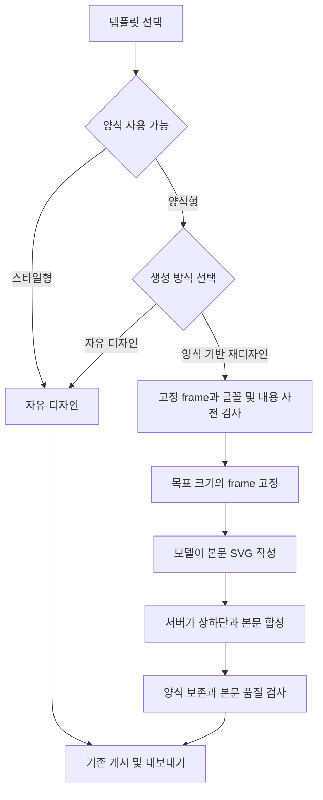

# SVG 사용자 템플릿과 양식 기반 재디자인 설계

작성일 및 개정일: 2026-10-29. 문서 revision: 3. 상태: 구현 전 설계안.

기존 스타일은 자유 생성으로 사용한다. 양식이 등록된 템플릿에는 `양식 기반 재디자인`과 `자유 디자인` 두 옵션을 제공한다. 양식 기반 재디자인은 원본 글꼴과 상단·하단의 서식 및 디자인을 보존하면서 본문을 새 내용에 맞게 더 풍부하고 읽기 좋게 구성한다. 새 내용에도 적합한 원본의 좋은 본문 구성은 계승하고, 개선이 필요한 부분을 조정하거나 재설계한다. 본문의 위치, 단 수와 도형 배치는 모델이 결정한다.

사용자가 확정한 제품 방향과 구현을 위한 제안을 구분한다. 이 개정은 이전 초안의 본문 슬롯 교체 중심 설계를 대체한다. `preserve-layout`이라는 미구현 제안명도 사용하지 않는다. 신규 계약, 초기 수용 수치와 구현 순서는 설계 제안이며 검증된 현재 기능을 뜻하지 않는다.

## 사용자 요구사항과 설계 범위

사용자가 명시한 요구사항은 다음과 같다.

- 기존 템플릿과 새로 등록하는 사용자 PPT 템플릿을 모두 사용한다.
- 새 PPT의 글꼴, 상단과 하단 양식을 유지하면서 본문 레이아웃과 표현 품질을 높인다.
- 원본의 좋은 정보 위계, 비교 방식, 이미지 배치와 여백을 적극적으로 계승하고, 새 내용과 크기에 맞지 않거나 전달력이 부족한 부분은 자유롭게 재설계한다.
- 본문의 풍부함은 메시지·관계·근거의 전달력과 가독성으로 판단한다. 단순한 구성이 적합하면 유지하며 카드·아이콘·도형의 수를 늘리는 것을 목표로 삼지 않는다.
- 생성 방식은 자유 디자인과 양식 기반 재디자인 두 가지로 구분한다.
- 선택한 템플릿에 필요한 옵션만 표시한다. 양식이 없는 스타일에는 불필요한 선택을 노출하지 않는다.
- SVG 생성에서 여러 해상도, 페이지 크기와 화면 비율에 활용한다.

설계 제안은 다음과 같다.

- 양식이 준비된 새 템플릿은 `양식 기반 재디자인`을 기본값으로 한다. 기존 스타일의 기본 동작은 바꾸지 않는다.
- 등록할 때 생성 방식을 하나로 고정하지 않는다. 확보한 자료에 따라 서버가 지원 기능을 계산한다.
- 상단·하단의 요소는 프로그램이 합성하고 모델은 지정된 본문 영역만 작성한다. 제목 내용, 장 번호와 페이지 번호는 바인딩된 값으로 교체한다.
- 원본 비율에서는 고정 양식의 배치를 보존하고, 다른 비율에서는 고정 양식의 기준점과 서체를 유지하는 적응 결과를 사용한다. 본문은 모든 비율에서 재구성할 수 있다.
- 원본 보존을 만족하지 못하면 조정 필요 상태를 알린다. 자유 디자인 전환은 사용자가 선택한다.
- 기존 Authored의 등록 템플릿 실행 계약, 과거 SVG 스냅샷과 일반 자유 생성 경로는 보존한다.

## 현재 코드와 변경 경계

| 현재 구성 | 확인한 동작 | 설계에서 추가할 부분 |
| --- | --- | --- |
| `utils/authored_styles.py`, `authored_styles/*.yaml` | 디자인 지침과 역할별 참고 이미지 등을 제공 | 기존 항목을 스타일형 카탈로그로 노출하는 어댑터 |
| `upload/components/SvgDesignReferenceInput.tsx` | PPTX, PDF, 이미지를 업로드해 참조 snapshot 선택 | 이름과 버전을 가진 영구 템플릿 등록 및 관리 화면 |
| `services/svg_uploaded_design_reference.py` | 색상, 서체 특징과 대표 이미지를 추출하며 원본 위치와 단 수 복사를 금지 | 원본 양식을 위한 별도 추출 자료와 생성 경로 |
| `authored_vnext/design_pack/compiler.py`, `structural_render.py` | PPTX의 구조와 슬롯 도식을 생성하며 도식의 증거 수준은 structural | 고정 양식을 충실하게 변환하는 새 compiler와 실제 원본 렌더 |
| `generation_core/style/design_pack_projection.py` | 팩을 SVG 디자인 참조로 투영 | 기존 immutable 팩을 바꾸지 않는 새 양식 자료 연결 |
| `generation_core/style/master_projection.py` | 새 SVG에서는 회사 디자인 특징을 참조하며 일부 브랜드 요소를 시스템 처리 | 원본 양식과 회사 마스터가 함께 선택될 때 충돌 판정 |
| `generation_core/authoring/author_slide_svg.py` | 모델이 구도를 정하며 참고 배치 복제를 금지 | 본문 작성 범위와 원본 디자인 근거를 전달하는 버전 계약 |
| `models/generate_presentation_request.py`, `models/public_v2_contracts.py` | SVG 참조 pin과 snapshot을 받고, 기존 `registered-template`은 다른 실행 의미를 가짐 | SVG 템플릿 선택과 사용 방식의 별도 필드 |
| `services/svg_trusted_fonts.py`, `svg_renderer.py` | 현재 신뢰 글꼴과 주입 경로가 Pretendard Regular 및 Bold에 연결 | 문서별 글꼴 바이트와 digest를 작성·측정·내보내기까지 전달 |
| SVG render, quality, publish 및 export 경로 | SVG와 PNG 측정, 검토, 게시 및 내보내기를 담당 | 양식 보존 측정과 증거를 기존 게시 조건에 연결 |

백엔드 경로는 `servers/fastapi/` 기준이며, 프런트엔드 경로는 `servers/nextjs/app/(presentation-generator)/` 기준이다. 현재 계약은 [SVG 전체 캔버스 설계](svg-all-canvas-free-composition-design-20261001.md)와 연결된다. 두 모드 모두 본문을 공통 카드 패턴이나 고정 슬롯으로 제한하지 않는다. 양식 기반 경로에만 서버가 소유하는 고정 요소와 본문 사용 영역을 더한다.

로컬에 남은 Design Pack 파일이나 YAML 파일 수를 실제 사용 가능한 사용자 템플릿 수로 취급하지 않는다. 새 카탈로그의 기능 판정과 계정별 접근 확인을 거친 항목만 제공한다.

## 화면과 옵션 표시

### 템플릿 카드

카드에는 이름, 대표 이미지, 제공 주체와 기능을 표시한다. 제공 주체는 `기본 제공` 또는 `내 템플릿`이고, 기능은 `스타일` 또는 `양식 포함`이다. 등록 진행 상태는 기능과 별도로 표시한다.

| 선택 상태 | 생성 방식 영역 | 기본 선택 |
| --- | --- | --- |
| 스타일형이고 자유 생성 가능 | 표시하지 않음 | 자유 디자인 |
| 양식형이며 두 방식 모두 가능 | 두 옵션 표시 | 양식 기반 재디자인 |
| 양식형이지만 현재 크기의 고정 양식이 미준비 | 두 옵션과 준비 필요 상태 표시 | 기존 선택을 보존하며 준비 작업 후 실행 |
| 분석 중 또는 확인 필요 | 상태와 가능한 다음 행동 표시 | 실행 가능한 방식만 허용 |

스타일형으로 선택을 바꾸면 이전 양식 모드와 frame 선택을 요청에서 제거한다. 양식형에서 자유 디자인을 직접 선택한 뒤 페이지 크기를 바꾸더라도 사용자의 선택을 초기화하지 않는다. 새로고침, 재개, 재시도에서는 저장된 템플릿 버전과 방식을 복원한다. 옵션 설명은 각각 `원본 글꼴과 상단·하단을 유지하고 좋은 본문 구성을 살려 내용에 맞게 개선합니다`, `템플릿의 디자인 특징을 참고해 전체 구도를 새롭게 구성합니다`로 한다. 본문의 계승·부분 조정·재설계 판단은 내부 생성 과정으로 처리하며 세 번째 생성 모드나 별도 강도 설정을 추가하지 않는다.

양식 분석 실패를 스타일형으로 자동 분류하지 않는다. 사용자가 `디자인 참조로만 등록`을 명시적으로 선택하면 사용 가능한 추출 결과로 스타일형 버전을 등록할 수 있다. 실패 사유와 원본은 별도로 보존한다.

### 등록 흐름

1. `내 템플릿 추가`에서 PPTX를 업로드한다. 기존 임시 참고자료 업로드도 계속 제공한다.
2. 원본을 보관하고 작업 ID를 반환한다. 분석과 렌더링은 기존 workspace 작업 체계에서 실행한다.
3. 실제 원본 미리보기 위에 상단·하단·보존 배경과 본문 영역을 표시하고 글꼴 준비 상태를 보여준다.
4. 사용자는 이름과 대표 장표를 정한다. 잘못 분류된 고정 영역만 수정하며 본문의 세부 슬롯을 지정하지 않는다. 표지, 구분 장표와 본문 등 서로 다른 양식은 frame 변형으로 묶는다.
5. 고정 영역의 변환·글꼴·원본 비교를 통과한 frame과 디자인 참고 자료를 불변 버전으로 등록한다.

초기 양식 등록 입력은 PPTX로 제한한다. PDF와 이미지는 디자인 참조로 계속 지원하지만, 이미지에서 추정한 배치를 PPTX에서 직접 확인한 양식과 같은 수준으로 표시하지 않는다.

고정 영역은 OOXML의 master/layout 상속, 반복되는 위치와 자산, 사용자 수정 결과를 함께 사용해 판정한다. 화면의 일정 높이를 단순히 잘라 상단·하단으로 간주하지 않는다. 본문 도표가 footer에 걸치거나 반복 로고가 본문에 있으면 확인 필요로 분류한다. 원본의 회사명과 로고는 사용자가 보존 대상으로 확인한 자산만 사용한다.

원본 디자인 근거는 전체 장표 이미지와 본문 디자인 사례로 보관한다. 의미 있는 원본 도형·이미지를 모델에 제공할 때는 사용 가능한 자산과 예시 자료를 구분한다. 예시 장표의 텍스트·수치·고객명은 새 내용의 근거가 아니다.

본문 사례는 기존 원본 페이지 참조와 연결해 정보 위계, 비교 축, 읽기 흐름, 이미지와 설명의 관계, 정렬과 여백을 살펴볼 수 있게 한다. 이를 고정 슬롯이나 레이아웃 종류 목록으로 변환하지 않는다. 사례별 특징 해석은 기존 내용 계획과 본문 작성 과정에서 수행하며, 이를 위해 등록 시 추가 AI 호출이나 사용자 분류 작업을 필수화하지 않는다.

### 생성 흐름

템플릿과 생성 방식, 출력 크기를 선택하면 서버가 그 조합의 사용 가능 여부를 반환한다. 양식 기반에서는 페이지 역할에 맞는 고정 frame을 자동 추천하고, 필요한 경우에만 표지/본문 등의 양식을 바꿀 수 있게 한다. 원본 본문 레이아웃과의 일대일 매칭은 요구하지 않는다.

원본과 같은 종류의 본문 장표가 없어도 새 본문을 설계할 수 있다. 표지에 맞는 고정 frame이 없으면 검증된 기본 frame을 사용하거나 다른 frame을 선택하게 한다. 원본 장표 순서, 본문 카드 수와 출력 장표 수는 연결하지 않는다. 요청된 내용과 페이지 수는 유지하며 변경이 필요하면 생성 전에 알린다.

## 등록 데이터와 저장 책임

### 카탈로그와 버전

기존 파일 기반 스타일과 새 사용자 템플릿을 같은 선택 UI로 모으되 원본 저장소를 합쳐 덮어쓰지 않는다. 기존 스타일에는 읽기 전용 어댑터를 두고, 사용자 등록 항목에는 소유자 범위가 적용되는 메타데이터와 불변 버전을 추가한다.

| 자료 | 핵심 내용 | 저장과 변경 원칙 |
| --- | --- | --- |
| 템플릿 항목 | ID, 이름, 소유 범위, 게시 버전, 보관 상태 | 이름과 게시 head만 권한 및 동시성 확인 후 변경 |
| 템플릿 버전 | revision, manifest digest, 분석기 버전, 원본 및 자산 digest | 게시 후 불변 |
| 디자인 자료 | 색상 역할, 서체 계층, 디자인 지침, 역할별 실제 렌더 참고 이미지 | 목표 캔버스와 독립적으로 저장 |
| 고정 frame 자료 | frame ID, 원본 페이지, 역할, 물리 캔버스, 고정 요소 SVG, 원본 렌더 | 원본 shape와 hash에 연결하며 본문은 포함하지 않음 |
| 영역 계약 | header/footer/background, 본문 영역, 제외 영역, z-order, 변경 권한 | 영역 판정 근거와 사용자 확인 내역 보관 |
| 서식 자료 | 역할별 글꼴 파일 digest, face, 크기·굵기·행간 정책 | 고정 양식의 정확값과 본문에서 선택 가능한 범위 구분 |
| frame 적응 자료 | ID, revision, digest, 목표 canvas, font·정책 digest, 변환 결과 | 불변 파생 자료이며 원본부터 보존 규칙 검증 |
| 생성 사용 기록 | 템플릿·frame 적응 pin, 페이지별 내용 계획, dynamic 값, 본문 및 합성 hash | operation 및 문서 revision과 결합 |

제안하는 영속 메타데이터는 SQL의 소유자 범위와 기존 asset/reference 경로를 사용한다. 원본 PPTX, 이미지, 글꼴, 기준 SVG 등 바이트 자료는 기존 AssetGateway와 작업 artifact 경로로 보관한다. 클라이언트가 서버 경로나 저장소 키를 지정하지 못하게 한다.

ReferenceSnapshot은 분석 입력의 불변 근거로 재사용한다. 템플릿 버전이 이를 참조하면 임시 업로드 정리나 참조 만료가 등록 자산을 지우지 않도록 보관 수명과 참조 관계를 추가해야 한다. 기존 snapshot의 내용을 수정해 새 버전을 표현하지 않는다.

양식 자료는 새 `svg-template-package/v1` 계약으로 정의하며 내부 frame 계약은 `svg-template-frame/v1`로 한다. 기존 Design Pack manifest, 원본 바이트, source-native patch handle의 의미는 유지한다. OOXML 판독 등 공통 기능은 재사용하되 structural 도식을 양식 SVG로 승격하지 않는다.

새 메타데이터는 `svg_templates`, `svg_template_versions`, `svg_template_frame_adaptations` 세 역할로 구분한다. 각각의 owner 및 tenant 범위, version 유일성, 게시 head의 CAS를 DB 제약과 서비스 검증에 함께 둔다. 등록 분석의 mutable draft와 진행 상태는 workspace 작업에 보관하고 게시된 버전을 수정하지 않는다. 보관 처리 후에도 진행 작업과 기존 문서가 참조하는 버전은 유지한다.

자산 보관은 버전에서 AssetBinding으로 향하는 명시적 참조를 사용한다. 게시 transaction 완료 전에 등록 자산을 durable 상태로 전환하고, 실패한 staging 자료만 기존 유지보수 정책으로 정리한다. 물리 삭제는 참조 수가 0이고 보관 정책이 허용할 때 별도 작업으로 수행하며 신규 기능 구현 중 자동 정리 범위를 늘리지 않는다.

### 기능 판정

카탈로그는 template kind인 `style`/`framed`, `supportedModes`, `defaultMode`, `registrationState`, `fontState`, `sourceCanvas`를 반환한다. 기능 확인은 정확한 template pin, mode, 목표 canvas, source mode, 충돌하는 공통 양식 설정을 입력으로 계산한다. UI가 템플릿 종류만 보고 실행 가능 여부를 추정하지 않는다.

조합별 결과는 `available`, `preparation-required`, `blocked`와 `reasonCode`, `nextAction`, 기능 계약 digest를 포함한다. registrationState는 `analyzing`, `review-required`, `ready`, `failed`, `archived`로 구분하고 workspace operation의 queued/running/succeeded 상태와 별개로 둔다. 분석 작업 성공이 곧 템플릿 ready를 뜻하지 않는다.

| 조합 또는 상태 | 결과 | 화면 동작 |
| --- | --- | --- |
| 스타일형 + 자유 디자인 | 기존 SVG admission을 통과하면 available | 생성 방식 선택 숨김 |
| 스타일형 + 양식 기반 | blocked | UI에서 보내지 않으며 직접 API는 거절 |
| 준비된 양식 + 자유 디자인 | 디자인 참조가 유효하면 available | 기존 기능 사용 |
| 준비된 양식 + 양식 기반 + 허용된 입력 + 적응 frame 준비 | available | 생성 허용 |
| 같은 조합에서 목표 canvas frame만 미준비 | preparation-required | 준비 상태와 작업 진행 표시, 준비 전 작성 차단 |
| 글꼴 누락, 미검토 고정 요소, 원본 접근 실패 | blocked | 해결 행동 표시, 자동 자유 디자인 전환 금지 |
| 양식 기반 + source restyle/raster reconstruction | 초기 버전은 blocked | 생성 전에 미지원 조합 표시 |
| 양식 기반 + 별도 회사 마스터/공통 제목 설계 | 초기 버전은 blocked | 중복 양식 선택 해제 안내 |

선택 직후와 실제 admission에서 같은 판정기를 호출한다. 확인 이후 버전·권한·글꼴·canvas가 달라지면 stale 상태로 재확인한다. UI에 숨긴 옵션도 서버 검증을 우회할 수 없다.

분석 결과는 review-required 또는 failed로 끝날 수 있다. 사용자가 확인하고 선택한 frame 집합이 검사를 통과한 경우에만 publish로 ready가 된다. 부분 실패한 frame을 서버가 자동 제외하지 않는다. 스타일로만 저장하는 것은 별도 명시적 선택이다. 대상 canvas 준비 실패는 게시된 원본 frame을 failed로 바꾸지 않는다.

## PPTX 양식 추출과 변환

변환의 범위는 재사용할 상단·하단·배경·로고와 글꼴이다. 본문은 원본 디자인 근거로 분석하고 새로 작성하므로 모든 원본 장표를 완전한 편집 가능 SVG로 변환하는 것을 등록 전제조건으로 삼지 않는다.

선택 경로는 원본 PPTX의 안전한 OOXML 판독 → 상속된 서식과 고정 요소 정규화 → `svg-template-frame/v1` → 제한된 SVG emitter → 기존 validator/render/export이다. 전체 PPTX를 임의 SVG로 바꾸는 외부 converter 결과를 그대로 신뢰하지 않는다. 변환되지 않는 보존 요소는 요소별로 보고한다.

원본 미리보기의 1차 비교 기준은 이 프로젝트의 격리된 PowerPoint 렌더 경로에서 얻는 실제 페이지 이미지로 제안한다. 원본은 passive content 확인 후 worker 소유 프로세스로만 연다. 해당 경로를 사용할 수 없으면 기존 LibreOffice → PDF 렌더는 참고 이미지를 제공할 수 있으나 PPTX 양식 보존의 최종 확인 상태는 review-required로 둔다. renderer 종류·버전·환경·폰트와 원본 hash를 증거에 기록하고 사용자 소유 Office를 사용하지 않는다.

| 원본 요소 | 초기 처리 | 준비 완료 조건 |
| --- | --- | --- |
| master/layout/slide 상속 | theme, 위치, 색상, 텍스트 속성을 명시 값으로 해석 | 근거 XML과 해석 결과를 연결 |
| 사각형·단순 선·단색 배경 | 기존 허용 SVG 요소로 직접 변환 | 기하와 색상 및 export 확인 |
| PNG/JPEG 로고·그림 | 원본 bytes, crop 및 비율 보존 | 자산 hash와 실제 표시 영역 확인 |
| 제목·footer 텍스트와 페이지 번호 | 글꼴과 문단/run을 정규화하고 동적 내용만 바인딩 | 글꼴 준비와 원본/출력 측정 통과 |
| 중첩 그룹·회전·곡선·gradient | 필요한 경우 개별 변환 지원을 추가 | 각 primitive가 SVG·PNG·PPTX에서 검증되기 전에는 review-required |
| EMF/WMF·복잡한 효과·SmartArt | 초기 정확 변환 보장 범위 밖 | 승인된 장식 파생물 또는 지원 기능이 없으면 고정 frame 등록 차단 |
| 본문 표·차트·도형 | 디자인 예시로 분석하고 현재 내용으로 재작성 | 새 표·차트는 기존 의미 데이터와 native export 검증 사용 |
| 활성 콘텐츠·외부 참조 | 기존 입수·분석 보안 경로에서 거절 또는 격리 | 모델이나 Office renderer로 미검증 전달하지 않음 |

기하 자료는 원본 물리 크기, EMU 좌표, 그룹 transform 및 z-order를 유지한다. 고정 영역을 통과하는 곡선이나 그림을 직사각형 잘라내기로 처리하지 않는다. 원본 shape 단위 또는 검증된 분해 단위로 보존한다. 본문까지 포함한 전체 페이지를 배경으로 깔지 않는다.

장식 효과만 래스터로 보존할 경우 해당 자산의 해상도 한계와 편집 가능 범위를 등록 때 확인한다. 텍스트를 통째로 그림으로 바꿔 글꼴 보존 성공으로 표시하지 않는다. SVG 전역 허용 목록을 일괄 확대하지 않고 필요한 표현을 버전별로 추가한다.

### 고정 영역과 본문 변경 권한

| 요소 구분 | 허용 변경 | 적용 주체와 검증 |
| --- | --- | --- |
| 고정 로고·구분선·상하단 장식 | 승인된 canvas 적응 규칙만 | 서버, 원본 frame의 불변 조건과 비교 |
| 제목·장 번호·페이지 번호 | 바인딩한 문자열·숫자만 | 서버, 내용 계획과 범위·서식 일치 |
| 고정 배경 | 등록된 fill 또는 asset만 | 서버, body 출력과 별도 레이어 |
| 본문 글꼴 | 등록한 역할별 family/face 집합에서만 선택 | 모델 제안, 서버 글꼴 검증 |
| 본문 크기·굵기·줄바꿈·행간 | 역할별 가독성 정책 범위에서 선택 | 모델 제안, 실제 glyph와 line box 측정 |
| 본문 위치·단 수·도표·시각화 | 허용 본문 영역과 내용 근거 안에서 자유 구성 | 모델, 의미 정확성과 영역 침범 검사 |

frame에는 배경 레이어, 전경 레이어, 동적 필드, 본문 allowed region과 forbidden regions를 정의한다. 기본 본문 영역은 직사각형이며 로고 등 내부 예약 영역을 뺄 수 있다. shape가 복잡해 신뢰할 수 있는 영역으로 표현되지 않으면 검토한다. 이는 본문 레이아웃 문법이나 고정 카드 슬롯을 정의하지 않는다.

서버는 예약 ID 공간과 각 layer의 권한을 소유한다. 모델이 출력한 SVG는 body namespace만 허용하고 상하단·배경·동적 필드의 재정의, 외부 참조와 임의 font 선언을 거절한다. 최종 합성 순서는 frame background → body → frame foreground 및 동적 필드로 고정한다. foreground로 가렸다는 이유로 본문의 영역 침범을 통과시키지 않는다.

## 글꼴과 텍스트 보존

원본 글꼴 이름과 실제 사용할 글꼴 바이트를 구분한다. 확보 경로는 검증된 서버 글꼴 자산, 사용이 허용된 PPTX 내장 글꼴, 별도로 제공한 검증 글꼴 순으로 검토한다. 이름이 같아도 파일 digest, face, weight 및 glyph coverage가 다르면 같은 자산으로 취급하지 않는다. 기존 공개 요청에 로컬 경로나 임의 font URL을 허용하지 않는다.

문서별 `fontManifestPin`을 등록 시 고정하고 다음 경로에 전달한다.

1. 추출기: theme font와 run font를 해석하고 실제 face 및 대체 여부를 기록한다.
2. frame emitter와 body authoring: 해당 manifest의 역할별 family/weight만 제공한다.
3. `svg_trusted_fonts.py`: 현재 전역 목록과 별도로 owner 검증된 manifest를 해석한다.
4. `svg_renderer.py`: 요청별 글꼴 바이트로 로딩하고 font readiness 후 측정한다. Pretendard 고정 주입과 단일 전역 캐시에 새 문서의 글꼴을 섞지 않는다.
5. 측정 및 합성: 동일 글꼴 digest로 제목과 본문의 실제 glyph, 행간 및 줄바꿈을 확인한다.
6. PPTX/PDF export와 최종 검토: 같은 역할 매핑과 허용된 임베딩을 사용하고, 최종 렌더의 대체 서체와 줄바꿈 변화를 확인한다.

글꼴 캐시 키는 접근 범위, font digest, face, weight와 renderer 버전으로 구성한다. 과거 문서는 기존 글꼴 profile을 그대로 사용한다. 새 manifest가 없다는 이유로 새 양식 요청을 기존 fallback에 통과시키지 않는다.

상단·하단은 등록된 글꼴·크기·굵기·행간을 유지한다. 본문은 등록된 글꼴과 서체 계층을 유지하며 가독성에 맞는 크기와 줄바꿈을 선택한다. 선택할 수 없는 weight를 합성하거나 glyph 누락을 조용히 다른 폰트로 채우지 않는다. 혼합 서체가 필요하면 문자 범위와 대체 정책까지 manifest에 명시한다.

글꼴 미준비 또는 최종 PPTX에서 대체가 발생하면 원본 글꼴 보존으로 통과시키지 않는다. 사용자가 대체 글꼴을 선택하면 등록 frame과 목표 크기의 가독성을 다시 검사한 새 버전을 만든다. 내보내기에서 원본 글꼴이 보장되지 않는 상태와 브라우저 미리보기 성공은 구분한다.

## 생성 방식과 처리 경로

### 자유 디자인

기존 author_slide_svg 경로를 사용한다. 카탈로그 스타일, 업로드 참조 또는 새 템플릿에서 디자인 특징과 승인된 참고 이미지만 전달한다. 고정 frame의 좌표와 본문 영역은 강제하지 않는다. 새 템플릿의 자유 모드에서는 준비된 글꼴 자료를 사용할 수 있으나 기존 스타일 요청에 새 보존 검사를 강제하지 않는다.

새 템플릿을 자유 디자인으로 사용하더라도 원본 회사 정보와 예시 수치를 내용으로 재사용하지 않는다. 새 기능을 쓰지 않는 기존 요청은 현재 스냅샷, digest 및 재개 규칙을 유지한다.

### 양식 기반 재디자인

1. capability 확인 후 owner, template revision, 글꼴, 입력 모드 및 페이지 크기를 admission에서 다시 검증한다.
2. 기존 내용 계획에서 장표별 메시지·필수 사실·표/차트 데이터·이미지·읽기 순서와 동적 제목을 준비한다. 페이지 역할로 고정 frame을 선택하고, 참고할 원본 본문 사례와 계승할 특징 및 개선할 부분을 정한다.
3. 글꼴과 제목 fit, 고정 영역의 목표 canvas 적응, 본문 공간을 사전 확인한다. 검증된 frame 적응 결과를 불변 pin으로 고정한다.
4. 모델에 본문 사용 영역, 글꼴·색상·표현 정책, 내용 근거, 원본 디자인 예시와 고정 영역 미리보기를 전달한다. 모델은 계승할 구성과 개선할 부분을 반영해 body SVG만 작성한다.
5. 서버가 승인된 frame과 동적 필드를 합성하고 실제 glyph와 paint 경계를 측정한다.
6. 보존과 내용 검사를 통과한 페이지에 본문 디자인 검토를 수행한다. 기존 예산 내에서 본문을 수정한 뒤 같은 검사를 적용한다.
7. 동일한 최종 SVG를 기존 publish 및 export 경로에 전달한다.

본문 작성 지침은 원본의 색, 폰트, 선, 도형과 이미지 처리 방식을 발전시키되 원본 본문 좌표를 복제하거나 유지하도록 요구하지 않는다. 새 내용에 적합한 원본의 시각적 위계와 읽기 흐름은 적극적으로 계승한다. 자유 작성 prompt 전체를 복사해 상단 재생성 지침과 충돌시키지 않고, 새 버전의 body scope 계약에서 허용 범위와 금지 범위를 명시한다.

`author.py`는 명시적 mode로 body 작성 입력을 구성하고 `render.py`가 기존 시스템 요소 합성 단계에서 frame을 적용한다. 기존 공통 제목과 master furniture를 중복 합성하지 않도록 단일 frame owner를 기록한다. 새 SVG publisher나 별도 PPTX export 경로는 만들지 않는다.

### 좋은 본문 구성의 계승과 개선

본문 구성은 장표별 메시지, 정보의 관계와 분량, 그림의 비율, 목표 canvas의 가용 공간을 기준으로 판단한다. 원본과 새 내용의 의미가 맞고 가독성이 좋은 구성은 계승한다. 관계와 읽기 흐름은 적합하지만 내용량이나 화면 비율이 달라지면 크기·간격·그룹·배치를 필요한 만큼 조정한다. 원본 구성이 새 내용을 잘 전달하지 못하거나 적합한 사례가 없으면 본문을 새로 설계한다.

이 판단은 기존 내용 계획과 body 작성 지침에 포함하며 별도 사용자 모드나 제한된 레이아웃 enum으로 만들지 않는다. 계승 대상은 정보 위계와 관계 표현 등 디자인 원리이며, 본문 좌표·단 수·카드 수의 고정이나 예시 사실의 복제를 뜻하지 않는다. 원본이 단순하고 명확하면 단순함을 유지할 수 있고, 부분 조정으로 충분하면 본문 전체를 바꿀 필요가 없다.

기존 페이지별 내용 계획에 참고 사례의 페이지 참조와 digest, 계승할 특징, 개선할 부분과 내용상 이유를 간략히 기록한다. 사례가 없으면 그 상태를 기록하고 새 구도를 설계한다. 이는 구성 판단을 확인하기 위한 기록이며 임의 배치의 허가 목록으로 사용하지 않는다. 원본 계승안과 재설계안을 모두 생성하는 다중 후보 호출을 기본 경로에 추가하지 않고 기존 작성·수정 예산 안에서 수행한다.

### 내용 적합성 사전 검사

검사는 작성 비용을 쓰기 전에 두 단계로 수행한다. 첫 단계는 deterministic 검사로, 실제 글꼴의 glyph 유무, 제목 줄바꿈, 고정 영역 침범, 본문 높이와 최소한의 내용 크기를 확인한다. 둘째 단계는 기존 내용 계획의 결과를 사용해 페이지별 내용과 시각적 의도를 구성하고 필요한 공간을 추정한다. 기존 계획 결과가 있으면 같은 내용을 위한 별도 모델 호출을 추가하지 않는다.

표의 최소 열 너비와 행 높이, 그림의 원본 비율과 읽을 수 있는 크기, 필수 문장 및 데이터 수를 사용한다. 단순 글자 수로 본문 슬롯이나 레이아웃을 확정하지 않는다. 추정은 `feasible`, `uncertain`, `infeasible`로 기록한다. 명백한 공간 부족은 작성 전에 안내하고, uncertain은 사용자 설정과 기존 예산 범위에서 작성하되 최종 측정을 통과해야 한다.

공간 부족 시 본문 구도 재설계, 승인된 다른 frame, 더 큰 canvas 또는 명시적인 내용·페이지 수 조정 순으로 해결한다. 텍스트 삭제나 가독성 기준 미만 축소는 해결 방법에 포함하지 않는다. 원본 콘텐츠 보존이 필요한 경우 수치·표·조건·필수 문구를 내용 계약으로 고정한다.

### 본문 품질 목표

풍부함은 핵심 메시지, 정보의 관계와 근거가 얼마나 명확하게 읽히는지로 판단한다. 본문 계획에는 해당 페이지의 핵심 메시지, 근거, 적합한 표현과 참고 원본의 특징을 담는다. 단순한 구성이 명확성과 가독성을 충족하면 그 구성을 선택한다. 구현이 레이아웃 ID나 카드 수를 강제하지 않는다.

| 입력의 성격 | 활용할 표현 | 피할 결과 |
| --- | --- | --- |
| 긴 설명 | 핵심 주장과 근거를 구분한 위계, 의미별 그룹 | 문장을 잘라 동일 카드에 나열 |
| 실제 단계·시간 정보 | 흐름도·타임라인·연결 관계 | 근거 없는 순서나 날짜 추가 |
| 비교 가능한 항목·수치 | 비교 구조, 정확한 차트와 강조 | 비교 기준이나 수치 창작 |
| 표 | 정확한 표와 중요 항목 강조 | 원본 행·열·각주 손실 |
| 그림·스크린샷 | 의미 있는 크기, 근거와 설명의 연결 | 내용 없는 장식 이미지로 대체 |

같은 구도가 내용에 적합한 연속 장표에서는 반복을 허용한다. 인위적으로 모든 장표를 다르게 만들거나, 그림·아이콘을 늘렸다는 이유로 품질 향상으로 판정하지 않는다. 디자인 개선 주장과 사실 정확성은 각각 확인한다.

### 수정과 작업 예산

고정 양식 실패는 서버의 frame·폰트·동적 필드 경로에서 처리하고 본문 모델에게 수정을 맡기지 않는다. 본문 실패는 같은 frame pin과 글꼴 계약 안에서 국소 수정 또는 본문 재구성을 허용한다. 전체 자유 모드 전환이나 고정 영역 변경은 자동 복구에 포함하지 않는다.

편집기와 후속 AI 수정도 기본적으로 같은 frame을 보존하고 본문만 갱신한다. 사용자가 고정 영역을 직접 변경하면 새 문서 revision과 변경 의도를 기록하고 기존 보존 검토를 무효화한다. 변경한 결과를 원본 양식 보존 완료로 계속 표시하지 않는다. 기존 body와 frame은 되돌리기 근거로 남긴다.

새 등록 작업은 원본 100 MB의 기존 입수 한도를 넘기지 않으며 페이지·렌더 픽셀·자산 bytes·font bytes 상한을 정책에 필수로 선언하고 입수 전에 노출한다. 미정·누락 상한은 무제한으로 해석하지 않는다. 등록은 deterministic 분석과 원본 렌더를 기본으로 하며 선택적 AI 보조 분석을 자동 추가하지 않는다.

본문 생성은 기존 승인 operation의 모델 호출·repair·timeout 예산을 공유한다. frame 준비는 별도 식별된 child 작업으로 원본 변환과 deterministic 적응을 수행한다. body 모델 dispatch는 frame 준비 성공 후에만 가능하다. 새 모드를 이유로 retry 수를 늘리거나 전체 덱 재생성을 반복하지 않는다. 단계별 호출 수·소요시간·준비 비용과 재사용 여부를 기록한다.

## 해상도와 캔버스 적응

문서의 물리 크기, SVG 논리 좌표와 PNG 출력 해상도를 구분한다. 기존 `document-canvas/v1`의 물리 EMU, 논리 크기, 안전 영역과 digest를 재사용한다. 현재 사용자 지정 SVG 크기 범위인 각 변 50–1000 mm와 가로세로 비율 1:4–4:1을 유지한다.

| 변경 | 자유 디자인 | 양식 기반 재디자인 |
| --- | --- | --- |
| PNG 해상도만 변경 | 같은 SVG를 다시 렌더 | 같은 SVG를 다시 렌더 |
| 같은 비율의 크기 변경 | 선택한 물리 크기로 가독성 확인 | 고정 frame의 기준점을 적용하고 본문을 해당 크기에 구성 |
| 다른 비율로 변경 | 목표 크기에 새 구도 작성 | 상하단 frame을 적응하고 본문 구도를 새로 구성 |
| 현재 허용 범위 밖의 크기 | 요청 거절 | 요청 거절 |

원본 물리 크기에서는 고정 요소의 기하와 서식을 그대로 사용한다. 다른 크기에서는 frame의 각 요소에 정의된 anchor, margin, 크기 정책과 연결 관계만 적용한다. 초기 정책은 로고·글자·장식 높이의 물리 크기를 유지하고, 긴 구분선·배경 폭과 제목 박스 폭을 안전 영역에 맞추는 것이다. 고정 크기가 들어가지 않으면 다른 크기를 제안하며 서체를 자동 축소하지 않는다.

각 요소의 크기 정책은 `physical-fixed`, `aspect-locked`, `span-between-anchors`로 제한한다. 등록된 정책만 서버가 적용하며 모델이 고정 요소의 위치를 제안하지 않는다. 관계 검사는 로고 원비율, 상하단 순서, 모서리 여백, 제목과 로고 간 거리 및 본문 영역의 유효성을 원본 계약에서 계산한다. 원본 계약 → 적응 결과 검사를 먼저 수행하고, 결과가 자기 자신과 일치하는지만 확인하지 않는다.

본문은 적응된 frame이 허용한 공간에서 자유롭게 재구성한다. 같은 비율에서도 원본 본문 배치와 같을 필요가 없다. 목표 canvas와 내용이 바뀌면 본문 가독성·사실·표·차트 검증을 다시 수행한다. 같은 SVG의 PNG 해상도만 바뀌는 경우에는 모델을 다시 호출하지 않는다.

frame 적응 캐시 키는 template revision, frame source digest, 목표 canvas digest, font manifest digest, 보존·가독성 정책 digest, compiler 및 adaptation 버전이다. 결과에는 고유 ID, revision, 결과 digest를 부여하고 generation snapshot은 이 pin을 반드시 저장한다. 같은 키로 다시 만든 결과라도 기존 pin을 덮어쓰지 않는다.

내용 독립적인 고정 요소만 캐시한다. 제목 fit, 페이지 번호와 실제 본문은 내용 digest에 연결한 생성별 자료다. 재사용 전에 접근 권한과 자산 유효성을 확인한다. 적응 작업 실패·취소·UNKNOWN 시 parent generation은 작성 단계로 진행하지 않으며 다른 적응 결과로 자동 교체하지 않는다.

지원 범위 안의 여러 크기를 요청할 수 있지만 모든 원본 frame이 극단적인 비율까지 적응 가능하다고 보장하지 않는다. 허용 canvas 자체의 제약과 선택 frame의 준비 상태를 UI에서 구분한다. 동일한 양식은 여러 크기로 재사용하되 잘림이나 본문 공간 부족을 숨기지 않는다.

초기 버전에서 양식 기반 모드의 고정 요소 소유자는 template frame 하나다. 기존 공통 제목·회사 마스터를 동시에 명시한 요청은 충돌로 거절한다. UI가 이전 설정을 해제할 때 이를 표시하고, 서버는 이전의 기본값을 명시적 선택으로 오인하지 않도록 fields-set을 확인한다. 기존 자유 모드의 공통 제목과 master 동작은 유지한다.

## API와 요청 계약 제안

### 카탈로그와 등록

새 `/api/v1/ppt/svg-templates/v1` 라우터를 제안한다. 기존 `/authored/styles`와 `/design-packs/v1`은 기존 의미와 응답을 유지한다.

| 요청 | 역할 |
| --- | --- |
| `GET /svg-templates/v1` | 기본 스타일과 현재 소유자의 등록 템플릿 목록 및 기능 조회 |
| `POST /svg-templates/v1/capabilities` | 정확한 pin·mode·canvas·source mode·공통 양식 설정의 실행 가능 여부 조회 |
| `POST /svg-templates/v1/registrations` | 기존 업로드 admission의 snapshot ID로 분석 작업 생성 |
| `GET /svg-templates/v1/registrations/{id}` | 작업 및 frame별 분석·글꼴·준비 상태 조회 |
| `PATCH /svg-templates/v1/registrations/{id}` | draft revision 확인 후 고정 영역·자산·역할 수정, 관련 검증 무효화 |
| `POST /svg-templates/v1/registrations/{id}/publish` | 확인된 draft revision과 검증 결과로 불변 버전 게시 |
| `GET /svg-templates/v1/{id}/versions/{revision}` | 버전, 미리보기, frame 및 디자인 자료 조회 |
| `POST /svg-templates/v1/{id}/adaptations` | 정확한 버전과 목표 캔버스의 고정 frame 적응 작업 생성 |
| `POST /svg-templates/v1/{id}/archive` | 향후 신규 선택에서 보관 처리 |

목록은 페이지 단위로 조회하고, 기본 스타일 어댑터는 사용자 등록 자료가 없는 상태에서도 동작해야 한다. 미리보기 및 원본 다운로드에도 동일한 접근 범위를 적용한다. 보관은 과거 생성이나 진행 중 작업이 사용하는 버전 자산을 삭제하지 않는다. 물리 삭제와 보관 수명 정책은 후속 별도 범위다.

등록과 적응 작업에는 기존 작업 idempotency, lease, timeout, 취소, 재개와 outbox를 재사용한다. 같은 idempotency key의 요청 내용이 다르면 충돌로 거절한다. 잘못된 원본, 확정된 분석 실패와 provider 결과 불명 상태를 구분하고 자동으로 새 유료 작업을 만들지 않는다. draft 수정 후 과거 검토 digest로 publish할 수 없으며 게시 중 동일 revision 경합은 CAS 또는 유일성 제약으로 한 번만 완료되게 한다.

### 생성 요청

새 SVG 선택에 다음 필드를 제안한다. 필드명과 오류 코드는 구현 단계에서 내부 DTO와 public-v2에 함께 고정한다.

| 필드 | 의미 |
| --- | --- |
| `svgTemplatePin` | template ID, revision, 서버 계산 manifest digest |
| `svgTemplateMode` | `free-design` 또는 `template-redesign` |
| `svgTemplateFrameMap` | 선택 사항인 출력 페이지와 고정 frame의 연결, 본문 레이아웃 고정 의미 없음 |

양식 기반에는 정확한 pin과 명시적 mode가 필요하다. 새로운 사용자 템플릿을 자유 디자인으로 선택하는 경우에도 동일 pin을 사용하고 디자인 자료만 투영한다. 스타일형에서 template-redesign을 요청하거나 자유 디자인에 frame map을 보내면 422를 반환한다. frame map의 출력 인덱스와 frame ID를 실제 내용 계획 및 pin으로 확인한다. 클라이언트가 body bounds, font digest, 준비 완료 플래그 또는 서버 적응 결과를 직접 선언하지 못한다.

기존 기본 스타일 UI는 기존 `authored_style` 요청을 유지해도 된다. 카탈로그 어댑터가 기본 스타일의 현재 식별자로 해석한다. 새 pin을 선택한 요청에서는 `authored_style`의 DTO 기본값을 실제 사용자 선택으로 취급하지 않는다. 명시적으로 전달한 기존 스타일 선택과 새 pin이 충돌하면 거절하고, 새 요청에 이전 선택이 남지 않도록 한다. 새 pin의 분석 실패를 기본 스타일로 혼용해 숨기지 않는다.

기존 `generationMode`의 `registered-template`, `fidelity-first`, `designPackPin`을 이 기능의 별칭으로 쓰지 않는다. 기존 제품 라우팅 의도와 SVG 내부 사용 방식을 별개로 검증한다. 새 pin은 SVG의 `auto` 또는 `free-design` 라우팅 의도와 조합하며, 전략은 명시적으로 SVG여야 한다.

새 pin은 기존 `svgDesignReferencePin`, `svgDesignReferenceSnapshotId`, `masterPin`과 상호 배타로 둔다. 회사 마스터 동시 적용은 우선순위 계약을 구현한 후 별도로 개방한다. 분석 입력의 reference snapshot은 새 템플릿 pin 내부의 근거로 포함되며 클라이언트가 두 선택을 동시에 보내지 않는다.

이 필드가 없는 과거 요청은 자유 디자인을 유지한다. UI는 양식형 기본값을 명시적으로 제출하고 서버가 생략된 mode를 템플릿 종류로 추정하지 않는다. pin만 있고 mode가 없으면 불완전한 신규 요청으로 거절한다. 오래된 클라이언트와 저장 요청은 과거 동작을 재현해야 한다.

존재하지 않거나 접근 권한이 없는 버전은 구분되지 않는 404, digest 및 게시 상태 경합은 409, 방식·양식·크기·입력 조합 오류는 422로 처리한다. 타 계정 자산 존재 여부, 파일 경로 또는 글꼴 저장 경로는 응답에 포함하지 않는다.

내용 원본을 보존하는 source restyle 및 raster reconstruction과 템플릿 원본은 서로 다른 입력이다. 신규 template-redesign과 두 source mode의 조합은 초기 버전에서 capability 단계와 admission 단계 모두 거절한다. 이는 업로드 문서에서 새 내용을 추출해 일반 덱을 생성하는 것과 구분한다. 기존 자유 디자인이 이미 지원하는 source mode 조합은 기존 admission을 그대로 적용한다. 신규 조합은 내용의 페이지 수와 원본 대응 계약을 연결한 후 지원표를 갱신하며, UI에 제한이 드러나야 한다.

### 저장과 재현

템플릿 선택과 사용 방식은 direct API, public-v2, 브라우저, outline handoff, workspace 명령, 작업 재개 및 생성 결과 상세에서 동일하게 유지한다. 요청 모델만 추가하고 중간 carrier에서 누락되는 구현을 허용하지 않는다.

서버는 body 작성 전에 다음 정보를 고정한다. 입력 승인 스냅샷과 frame 준비가 끝난 실행 스냅샷은 서로 다른 불변 기록으로 연결하며 준비 전 스냅샷을 덮어쓰지 않는다.

- template ID/revision/manifest digest와 원본 source digest.
- 각 출력 페이지의 frame ID, 원본 근거, adaptation ID/revision/result digest.
- fontManifestPin, asset manifest, 목표 canvas, 고정 요소·본문 영역·보존 정책 digest.
- mode, body 작성 버전, 페이지별 내용 계획과 필수 사실·데이터·이미지 매핑 digest.
- 내용 계획에 포함된 본문 참고 사례의 페이지 참조·digest 또는 사례 없음 상태, 계승할 특징과 개선 이유.
- 제목·페이지 번호 등의 실제 동적 값과 binding digest, 승인된 호출 예산.

본문 생성 후에는 body SVG digest, 합성 SVG digest와 PNG digest 및 단계별 검증 receipt를 append한다. 재개 시 적응 결과, 글꼴 또는 페이지 계획을 최신 상태로 다시 선정하지 않는다. 바뀐 입력으로 실행하려면 새 작업 계보를 만든다. template head가 갱신되거나 보관돼도 고정된 참조로 재현한다. 접근 권한이 취소된 경우에는 명시적인 접근 실패로 처리하며 임의 대체 템플릿을 사용하지 않는다.

기존 스냅샷의 의미와 digest를 소급 수정하지 않는다. 새 mode는 새 분기로 판독하고, 기존 authoring profile 0–8의 의미를 재해석하지 않는다. UNKNOWN 결과를 실패로 단정하거나 자동 재발행하지 않는다.

## 보존 검사와 실패 처리

### 필수 통과 조건

보존 검사와 본문 품질 검사를 분리한다. 원본과 본문의 픽셀 차이가 크다는 것은 실패 사유가 아니다. 상하단과 고정 자산은 원본/적응 계약을 기준으로, 본문은 새 내용과 사용 영역을 기준으로 평가한다.

아래는 구현을 시작할 수 있도록 제안하는 초기 `svg-template-preservation-policy/v1` 기준이다. 경험적으로 검증된 오차 수치라는 뜻은 아니다. 기술 검증 단계에서 대표 원본으로 적합성을 확인하고, 변경하면 새 정책 버전과 기존 결과 재검증을 요구한다. 작업별 자동 완화는 금지한다.

| 항목 | 초기 통과 규칙 |
| --- | --- |
| 원본→frame 추출 | 대상 요소 누락 0, glyph·line wrap·색상·로고·crop 확인. 원본 렌더와의 물리 위치·크기 오차 각 0.5 pt 이하 |
| frame 적응 | 원본에서 선언한 anchor/size 정책과 정확히 일치, 로고 비율 및 요소 순서 유지, 본문 공간 유효 |
| 생성 합성 후 고정 요소 | canonical 속성 및 asset hash가 승인된 frame 결과와 정확 일치. 허용 동적 값 외 변경 0 |
| 글꼴 | 실제 로딩 font digest·face·weight가 manifest와 일치, 누락 glyph 및 미승인 fallback 0 |
| 상하단 서식 | 선언된 크기·색상·굵기·정렬·행간과 일치. 제목 내용만 binding에 따라 변경 |
| 최종 파일 기하 | 페이지 물리 크기 일치, 고정 객체의 위치·크기·baseline 오차 각 0.5 pt 이하. 글꼴 대체·예상하지 않은 줄바꿈 0 |
| 본문 영역 | 측정 완전성 필수. 허용 영역 밖의 의미 있는 paint, 상하단 침범 및 잘린 내용 0. 경계 수치 허용 오차는 최대 0.1 pt |
| 내용 | 필수 사실·수치·표 cell·관계 누락/변조 0, 근거 없는 내용 및 예시 문구 유입 0 |
| 본문 가독성 | 기존 physical readability 정책의 실제 floor/target 적용. 의도하지 않은 텍스트 겹침과 의미 정보 잘림 0 |

도형 내부 label 등 의도된 겹침과 내용 손실을 구분한다. 클리핑으로 침범을 가려 통과시키지 않는다. SVG 속성 검사, 실제 glyph/paint 측정, 원본 렌더 비교는 서로 대체하지 않는다. 원본 screenshot의 antialiasing 차이를 단일 픽셀 동일성으로 검사하지 않으며, 자동 측정이 빠진 장식은 등록 검토 기록을 요구한다.

### 본문 디자인 품질

필수 조건을 통과한 결과에만 디자인 평가를 적용한다. 평가 축은 메시지·위계, 내용에 맞는 시각화, 정렬·여백·균형, 원본 디자인과의 일관성, 덱 전체의 읽기 흐름이다. 각 축은 1–5의 설명 가능한 rubric으로 평가하고 페이지별 근거 위치를 기록한다. 원본의 어떤 좋은 특징이 이어졌고 무엇을 개선했는지, 구조를 바꿨다면 새 내용에 어떤 이점이 있는지를 함께 확인한다. 도형·카드·아이콘 개수, 레이아웃 이름의 개수와 원본과의 시각적 차이 자체는 점수에 포함하지 않는다.

초기 검토 기준은 평균 4 이상, 모든 축 3 이상으로 제안한다. 이 점수는 시각 검토자의 판단이며 사실 보존·폰트·기하 검사를 대신하지 않는다. 한 장의 점수로 전체 템플릿 품질을 보증하지 않는다. 미달 페이지는 기존 예산 안에서 본문을 수정하고 미해결 시 review-required로 남긴다.

품질 향상을 주장할 비교 검증에서는 같은 내용·글꼴·canvas의 원본 본문과 재디자인 결과를 사용한다. 내용이 다른 생성 결과를 원본보다 우수하다고 직접 점수 비교하지 않는다. 초기 기술 검증은 서로 다른 원본 덱 3종의 대표 장표로 시작하고, 내용 정확성과 가독성 비퇴행을 필수로 확인한다. 블라인드 선호 평가와 축별 변화, 실패 페이지를 함께 보고하며 검토 표본을 전체 품질 인증으로 확대하지 않는다.

대표 장표에는 그대로 계승할 만한 좋은 구성, 일부 조정이 필요한 구성, 새 구도가 필요한 구성을 포함한다. 원본 대비 개선·동등·퇴행을 구분하고 동등한 결과를 향상으로 집계하지 않는다. 좋은 구성을 계승해 품질을 유지한 결과도 수용할 수 있으며, 외형 변화가 적다는 이유로 재생성하지 않는다. 다른 내용과 화면 비율에 대한 적응은 별도 사례로 확인하고 동일 조건 비교 결과와 섞지 않는다. 이 비교는 0–1단계 기술 검증에 포함하며 매 생성마다 다중 후보를 만드는 요구로 확대하지 않는다.

| 실패 조건 | 사용자에게 제공할 해결 |
| --- | --- |
| 내용이 본문 공간을 초과함 | 본문 재구성, 다른 frame/크기 또는 명시적 내용·페이지 수 조정 |
| 원본 글꼴 미준비 | 글꼴 준비 또는 대체 글꼴을 확인한 새 버전 |
| 다른 비율의 고정 frame 적응 실패 | 다른 frame/크기 또는 자유 디자인 선택 |
| 고정 요소 변환 손실 | frame 제외, 지원 기능 보강 또는 디자인 참조로만 등록 |
| 필수 내용 누락이나 표·차트 불일치 | 해당 페이지 수정 후 같은 기준으로 재검증 |
| 템플릿 변경이나 권한 상실 | 재선택 및 admission 재실행 |

양식 보존 실패를 본문 디자인 점수로 상쇄하지 않는다. 필수 조건이 실패한 페이지는 양식 기반 완료로 게시하지 않는다. 원인 확인용 preview를 저장할 수 있지만 다운로드 가능한 최종 성공 artifact와 구분한다. 디자인 평가만 미달인 경우 기존 검토 필요 정책과 연결한다. 모드 변경은 새 사용자 선택과 새 작업 계보로 기록한다.

보존 증거는 owner 및 tenant scope, operation ID, 문서 revision, template 및 adaptation pin, 원본 frame 근거, 내용·동적 값 binding, canvas, font·asset·정책 digest, body SVG·합성 SVG·실제 PNG digest에 연결한다. 다른 내용이나 크기로 만든 결과의 검토를 재사용하지 않는다.

SVG와 PNG 검증만으로 최종 PPTX의 글꼴, 네이티브 도형, 표·차트와 페이지 크기 보존을 완료 처리하지 않는다. 내보내기 및 최종 파일 검토에서도 같은 보존 규칙을 적용한다.

## 구현 순서와 파일 책임

| 단계 | 구현 단위 | 완료 조건 |
| --- | --- | --- |
| 0 | 고정 frame 변환·글꼴·합성의 기술 검증 | 원본 3종에서 고정 영역 SVG와 최종 PPTX 비교, 지원표 및 오차 정책 버전 확정 |
| 1 | frame·font·adaptation 계약과 작은 본문 생성 연결 | 상하단은 서버 보존, 본문은 좋은 구성 계승과 필요한 개선, 같은 내용의 대표 장표 비교 및 필수 조건 확인 |
| 2 | 소유자 범위의 버전·자산 수명·등록 작업과 기존 스타일 어댑터 | 분석과 게시 분리, 기존 스타일 유지, 변환 및 글꼴 미준비 상태 확인 |
| 3 | 등록 UI와 조합별 capability, 생성 DTO 및 carrier | 조건부 옵션, source mode 제한 사전 표시, 전환 잔여값 제거 |
| 4 | 다양한 크기의 고정 frame 적응·사전 내용 검사 | 본문 영역과 글꼴 유지, 불변 adaptation pin 재개, 준비 실패 시 작성 차단 |
| 5 | 본문 품질 회복·편집·최종 export 검토와 rollout | 복구의 body scope 유지, 결과 바이트에 연결된 검증과 실제 파일 확인 |

0–1단계에서 가장 불확실한 원본 frame 재현과 본문 고도화가 가능한지 확인한 뒤 UI와 영속 저장을 확장한다. 기술 검증은 임시 로컬 자료로 수행하고 사용자 원본이나 기존 카탈로그를 갱신하지 않는다. 지원 범위가 좁으면 기능 상태와 요소 지원표에 반영하며 지원하지 않는 고정 요소를 근사 변환해 숨기지 않는다.

원본 크기만 지원하는 상태는 내부 이정표다. 여러 크기에서의 활용은 4–5단계까지 포함하며 전체 완료 여부를 분리해서 보고한다. 실제 provider·Office·PPTX 검증은 승인된 범위에서 덱 한 개씩 실행한다.

연결할 기존 파일은 다음과 같다. 새 파일과 테이블 이름은 제안이며 기존 코드의 위치와 책임에 맞춰 구현 시 확정한다.

- API와 요청: `models/generate_presentation_request.py`, `models/public_v2_contracts.py`, `api/v1/ppt/router.py`, 새 SVG 템플릿 endpoint와 모델.
- 자산과 작업: 기존 assets, references, workspace operation handler 및 owner-scope 계층. 새 템플릿 service는 이 계층을 호출한다.
- SVG admission과 스타일: `services/svg_generation_admission.py`, `generation_core/drivers/svg/project_style.py`, 기존 style projection.
- 작성과 검증: `generation_core/drivers/svg/author.py`, `render.py`, `quality.py`, `publish.py`, 새 frame compiler·adapter·compositor 및 body scope 검증 모듈.
- 글꼴 및 export: `services/svg_trusted_fonts.py`, `svg_renderer.py`, 문서별 font resolver, 기존 SVG export 및 최종 파일 검토 경로.
- 프런트엔드: upload type 및 state, `SvgDesignReferenceInput.tsx`, 템플릿 선택 UI, generation API client와 handoff 및 recovery carrier.

새 기능은 별도 gate로 단계적으로 개방한다. gate가 꺼져도 기존 스타일과 과거 문서의 열기·재개·내보내기는 계속 동작해야 한다. gate로 신규 admission을 닫을 때도 이미 승인한 작업과 저장된 새 템플릿 문서를 읽는 코드를 제거하지 않는다. 배포, migration 실행과 실제 유료 생성은 해당 구현 단계에서 별도 승인 범위로 다룬다.

## 수용 기준과 검증 계획

다음은 구현 후 확인할 기준이며 이번 설계 작업에서 실행한 결과가 아니다. 문서 단계에서는 테스트, 빌드, 렌더 또는 실제 생성 작업을 실행하지 않는다.

| 범위 | 수용 기준 |
| --- | --- |
| 기존 스타일 | 새 필드가 없는 요청과 기존 스냅샷의 자유 생성 의미 유지 |
| 화면 | 스타일형 옵션 숨김, 양식형 두 옵션 표시, mode×canvas×source mode 결과 및 재개 일관성 |
| 등록 | 원본과 버전 불변, 고정 영역 검토·publish CAS, font/변환 부분 실패의 명시적 상태 |
| 원본 크기 | 원본 상하단·글꼴을 보존하면서 본문 구도 변경 가능, 내용 정확성 유지 |
| 캔버스 | 16:9, 4:3, 1:1, 9:16, A4 가로·세로 및 경계 내 사용자 지정 크기에서 처리 상태와 결과 확인 |
| 서체 | 한글과 혼합 영문, run 강조, 누락 글꼴, glyph 부족, 대체 동의와 실제 export 일치 |
| 양식 종류 | 서로 다른 원본 PPT의 상하단·표지 frame, 로고·구분선·그룹과 특수 서식 지원표 확인 |
| 본문 품질 | 설명·비교·표·차트·이미지에서 정보 위계와 가독성 확인, 인위적 장식·사실 추가 금지 |
| 구성 계승 | 적합한 원본 구성 계승, 필요한 부분 조정과 새 구도 설계의 이유 확인, 단순하고 명확한 결과 수용, 사용자 옵션과 기본 호출 예산 유지 |
| 사전 적합성 | 제목 glyph·fit과 본문 공간 부족을 작성 전에 탐지, uncertain의 후속 측정 강제 |
| 실패 | 상하단 침범, 글꼴 대체, 내용 초과, frame 적응 실패에서 모드 전환·내용 삭제 금지 |
| 내구성 | template·adaptation pin 및 내용 binding 고정, 중복 등록·게시, 취소·head 경합·UNKNOWN 구분 |
| 접근 | 등록·조회·미리보기·분석·생성·다운로드의 owner 및 tenant 분리와 stale 자산 검증 |
| 최종 파일 | 실제 PPTX·PDF의 페이지 크기, 글꼴과 편집 가능 요소 및 시각적 보존 확인 |

구현 단계마다 변경한 계층을 직접 확인하는 가장 작은 검증 하나를 선택한다. 인증·권한과 DB migration은 영향 범위에 필요한 검증을 추가한다. 전체 표의 통합 수용과 실제 생성·내보내기는 명시적으로 계획한 별도 검증에서 수행하며, 정적 검사나 fixture 통과를 실제 제공 결과로 보고하지 않는다.

## 이전 검토 지적사항 반영

| 지적사항 | 이번 개정의 대응 | 구현 시 확인할 증거 |
| --- | --- | --- |
| 충실한 기준 SVG 변환 경로 미정 | 전체 본문 변환 대신 고정 frame의 OOXML compiler 경로와 요소 지원표 지정 | 원본→frame→최종 PPTX 비교 |
| 양식 유지에서 변경 범위 모호 | 서버 고정 요소, 동적 필드, 자유 본문을 구분한 권한 계약 | body가 frame을 변경하거나 침범하지 못하는 검사 |
| 성공 판정 기준 미정 | 정확 일치 항목·초기 물리 오차·내용 조건과 본문 rubric을 분리 | 버전 정책과 실패 항목별 측정 receipt |
| 적응 배치 결과 고정 누락 | adaptation ID/revision/result digest 및 내용 binding을 실행 snapshot에 추가 | 준비 결과가 바뀌어도 재개 결과를 임의 교체하지 않음 |
| 글꼴 지원 범위 과소평가 | 추출·author·renderer·측정·export 전체의 문서별 font manifest 경로 정의 | 실제 로딩 font hash, glyph, 최종 파일 대체 확인 |
| 내용 초과를 늦게 발견 | 실제 글꼴 및 본문 가용 공간 기반의 두 단계 preflight | 명백한 부족은 body 호출 전 탐지, uncertain 후속 검증 |
| 조합별 기능 판정 누락 | pin×mode×canvas×source mode×고정 양식 설정 판정표 | 같은 판정기의 UI·직접 API·public-v2 일치 |
| 좋은 원본 본문의 계승 기준 부족 | 내용 적합성에 따라 좋은 구성 계승·필요한 조정·재설계를 기존 계획에 반영 | 같은 내용의 대표 장표에서 계승 특징, 개선·동등·퇴행 및 가독성 확인 |

## 기술 검증 후 고정할 항목

핵심 제품 방향은 원본 글꼴과 상하단 보존 및 본문 고도화다. 아래 세부 수치는 초기 제안으로 구현할 수 있으나 실제 품질을 확인한 뒤 출시 정책으로 고정해야 한다.

- 0.5 pt 원본/최종 기하 오차와 0.1 pt 본문 경계 오차가 실제 renderer 차이를 적절히 다루는지.
- 실제 원본 글꼴과 최종 파일의 임베딩·glyph 조합별 지원 범위.
- 원본 3종에서 고정 요소 지원표와 body 디자인 rubric의 판정 일관성.
- 기존 작업 controller에 맞춘 등록·frame 적응 작업의 resource 및 timeout 상한.

기술 검증에서 실패한 경우 해당 primitive·글꼴·조합만 준비 상태를 낮추고 원인을 기록한다. 임계값을 자동 완화하거나 품질이 높아졌다고 선언하지 않는다. 이 문서는 제품 요구와 구현 계획이며 실제 생성·품질·배포 완료 증거가 아니다.
