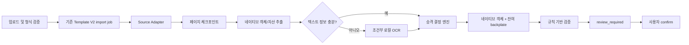

# Template V2 저비용 편집 가능 재구성 설계

- 상태: 구현 전 설계안
- 작성일: 2026-08-02
- 대상: `servers/fastapi` Template V2 구조화 가져오기와 Next.js 검토 UI
- 기본 원칙: LLM·원격 비전 API 없이 동작하고, 확실한 요소만 편집 가능 객체로 승격한다.

## 1. 목적

이미지, PDF, 이미지형 PPTX를 편집 가능한 프레젠테이션으로 가져올 때 다음 효과를 낮은 비용으로 얻는다.

1. 실패한 페이지부터 재개해 전체 재처리를 줄인다.
2. PPTX와 PDF에 이미 들어 있는 원본 텍스트·이미지를 재사용한다.
3. OCR은 필요한 페이지만 로컬에서 실행하고 결과를 캐시한다.
4. 불확실한 영역은 원본 래스터로 남겨 시각적 손상을 막는다.
5. 각 요소가 편집 가능 또는 래스터로 남은 이유를 기록한다.
6. 생성 AI 없이 규칙 기반 검증으로 명백한 오류를 차단한다.

이 설계는 `image-to-editable-ppt-skill`의 페이지별 재개와 계층적 폴백 아이디어를 차용하되, 페이지마다 멀티모달 LLM과 생성형 이미지 분리를 반복하는 구조는 채택하지 않는다.

## 2. 범위와 비범위

### 2.1 포함

- 기존 Template V2 PPTX import job의 페이지별 체크포인트
- PPTX 원본 OOXML 객체와 미디어 직접 추출 강화
- PDF 텍스트 레이어·이미지 자산의 결정론적 추출
- 이미지/PDF 래스터 페이지 정규화
- 로컬 OCR의 조건부 실행과 동일 작업 내 캐시
- 신뢰도와 제거 안전성에 기반한 텍스트·단순 도형 승격
- 안정적인 폴백 사유와 provenance 기록
- 규칙 기반 구조·배치·자산 검증
- 기존 `review_required -> confirm` 흐름 유지

### 2.2 제외

- 기본 경로의 LLM/VLM 호출
- 생성형 인페인팅 또는 전경/배경 분리
- 매 페이지 반복 AI 자기 검수
- 복잡한 차트·SmartArt를 의미 구조로 추론하는 기능
- 폰트가 없는 환경에서의 생성형 글꼴 복원
- Authored Hybrid 실행기와 Template V2 import 파이프라인의 통합

Authored Hybrid에서는 “신원이 확인된 객체만 원본 배경에서 억제하고 네이티브 객체로 승격한다”는 안전 원칙만 재사용한다. HTML DOM이 없는 평면 이미지에는 기존 backplate 억제 구현을 직접 적용하지 않는다.

## 3. 목표 지표

| 항목 | 기본 목표 | 실패 시 동작 |
|---|---:|---|
| 기본 경로 LLM/원격 API 호출 | 0회 | 해당 없음 |
| 네이티브 PPTX의 추가 처리 시간 | 현행 대비 p95 +20% 이내 | 고비용 분석 생략 |
| 업로드 API 응답 | p95 300ms 이내에 enqueue | 작업은 비동기 계속 |
| 로컬 OCR | 페이지당 soft 8초, hard 15초 | 해당 영역/페이지 래스터 유지 |
| worker OCR 동시성 | 프로세스당 1 | 다른 페이지는 대기 |
| 결과 결정성 | 동일 입력·버전에서 동일 manifest | 버전이 바뀌면 새 캐시 키 |
| 데이터 외부 전송 | 기본 0 byte | 원격 provider는 별도 opt-in 없이는 금지 |
| 재시도 범위 | 실패·미완료 페이지만 | 완료 페이지 체크포인트 재사용 |

CPU와 폰트 환경에 따라 OCR 절대 시간은 달라질 수 있으므로 15초는 품질 목표가 아니라 자원 상한이다. 네이티브 PPTX에는 OCR을 실행하지 않는 것이 기본이다.

## 4. 설계 원칙

### 4.1 원본 구조 우선

우선순위는 다음과 같다.

1. PPTX OOXML의 네이티브 텍스트·도형·표·차트·미디어
2. PDF 텍스트 레이어와 직접 추출 가능한 이미지
3. 결정론적 로컬 OCR과 단순 도형 인식
4. 원본 래스터 폴백

낮은 우선순위 결과는 높은 우선순위 원본 정보를 덮어쓰지 않는다.

### 4.2 편집성보다 시각적 안전성 우선

신뢰도가 낮거나 원본 글자를 안전하게 지울 수 없는 텍스트는 편집 객체로 승격하지 않는다. 전체 원본 이미지 위에 같은 텍스트를 다시 얹는 방식은 화면 중복과 편집 후 잔상을 만들기 때문에 금지한다.

### 4.3 실패 폐쇄형 처리

OCR, 자산 추출, 폰트 맞춤, 검증 중 하나라도 안전 조건을 통과하지 못하면 해당 요소를 원본 래스터에 남긴다. 페이지 전체 작업은 가능한 한 계속하며, 처리 결과에 안정적인 폴백 사유를 남긴다.

### 4.4 기존 수명주기 재사용

새로운 큐와 작업 테이블을 별도로 만들지 않는다. 기존 `TemplateV2PptxImport`의 idempotency, lease, heartbeat, stale recovery, source retention, owner scope, revision CAS, 수동 confirm을 그대로 사용한다.

## 5. 전체 구조



### 5.1 컴포넌트 경계

| 컴포넌트 | 책임 | 기존 연결점 |
|---|---|---|
| Import orchestrator | 작업 claim, heartbeat, 취소, 최종 집계 | `template_v2_pptx_ingestion_service.py`, dispatcher/worker |
| Source adapter | 형식별 검증·페이지 열거·원본 자산 추출 | `templates/v2/pptx`를 PPTX 구현으로 사용 |
| Page checkpoint store | 페이지 상태·stage·오류·시간 기록 | 신규 sidecar table |
| OCR provider | 로컬 OCR 실행, 위치와 신뢰도 반환 | 기존 vision policy 원칙 재사용, 별도 OCR v1 계약 |
| Promotion policy | 편집 객체 승격 여부 결정 | Template V2 analyzer/compiler 앞단 |
| Residual backplate builder | 승격하지 않은 시각 정보 보존 | 형식별 결정론적 구현 |
| Validator | 스키마·경계·겹침·클리핑·자산 검사 | 기존 analysis/fidelity 타입 확장 |
| Review API/UI | 페이지 진행률·폴백 이유 표시, 재시도 | 기존 structured import endpoint 확장 |

## 6. 입력 형식별 처리

### 6.1 PPTX

PPTX는 첫 구현 대상이다. 기존 `templates/v2/pptx` 파서와 package reader를 사용한다.

- 텍스트, 도형, 표, 차트, 그룹 관계는 OOXML에서 직접 읽는다.
- `ppt/media` 자산은 변환된 스크린샷보다 원본 relationship을 우선한다.
- 자산은 압축 해제 전후 크기, magic bytes, relationship target, 해시를 검증한다.
- 추출 실패나 미지원 객체만 residual backplate에 남긴다.
- OOXML에 유효한 텍스트가 있으면 OCR을 호출하지 않는다.
- 이미지 한 장이 슬라이드 전체를 덮는 경우에만 해당 이미지 영역을 raster-page 후보로 분류한다.

### 6.2 PDF

- 텍스트 레이어가 있으면 glyph/span과 좌표를 직접 추출한다.
- 내장 이미지는 가능한 경우 원본 stream을 추출한다.
- 텍스트 연산자를 제외하고 안전하게 다시 렌더링할 수 있을 때만 해당 텍스트를 backplate에서 제거한다.
- 폰트 매핑이나 bounds가 불확실하면 그 영역은 페이지 렌더에 남긴다.
- 텍스트가 없거나 스캔 페이지로 판정된 페이지만 OCR 대상으로 보낸다.

PDF 지원은 라이선스·보안·좌표 정확도를 검증한 뒤 2단계에서 활성화한다.

### 6.3 이미지

- MIME 선언이 아니라 magic bytes로 PNG/JPEG/WebP 지원 여부를 확인한다.
- EXIF orientation을 적용하고 ICC profile을 sRGB로 정규화한다.
- 알파 채널과 종횡비를 보존한다.
- 기본 캔버스는 16:9 1280x720이며 원본 종횡비가 다르면 crop하지 않고 letterbox한다.
- OCR 입력은 긴 변 1920px 이하로 제한한다.
- OCR로 찾은 텍스트 영역의 배경 제거가 안전한 경우만 네이티브 텍스트로 승격한다.

## 7. 페이지 상태와 재개

### 7.1 신규 sidecar table

초기 구현에서는 호환성 때문에 기존 `template_v2_pptx_imports` 이름을 바꾸지 않는다. 페이지 상태는 신규 `template_v2_import_pages`에 저장한다.

권장 필드:

| 필드 | 용도 |
|---|---|
| `id` | 내부 PK |
| `import_id` | 기존 import FK, 삭제 시 cascade |
| `page_index` | 0 기반 페이지 번호 |
| `state` | `queued`, `processing`, `completed`, `failed`, `skipped` |
| `current_stage` | 아래 stage enum |
| `attempt_number` | 페이지 시도 횟수 |
| `attempt_token` | 오래된 worker 쓰기 차단 |
| `lease_expires_at` | 페이지 lease |
| `heartbeat_at` | 장시간 OCR 중 생존 확인 |
| `source_page_sha256` | 정규화된 페이지 입력 식별 |
| `checkpoint_manifest` | stage별 private artifact ref와 버전 |
| `decision_summary` | 승격·폴백 수와 사유 |
| `quality_summary` | 결정론적 검사 결과 |
| `error_code` | 안정적인 오류 코드 |
| `error_detail` | 비밀정보가 제거된 진단 |
| `retryable` | 페이지 단위 재시도 가능 여부 |
| `timings_ms` | stage별 소요 시간 |
| `created_at`, `updated_at`, `completed_at` | 감사와 운영 |

제약조건:

- unique: `(import_id, page_index)`
- index: `(import_id, state)`, `(state, lease_expires_at)`
- worker 갱신은 `(id, state, attempt_token)` 조건부 update로 수행한다.
- worker checkpoint 갱신으로 사용자용 import `revision`을 증가시키지 않는다.

### 7.2 stage enum

```text
discover
normalize
extract_native
ocr
promote
build_backplate
validate
complete
```

각 stage 완료 후 다음 stage가 필요로 하는 최소 private artifact와 입력 해시를 원자적으로 기록한다. 재시도 시 `source_page_sha256`, stage version, policy version이 모두 같을 때만 체크포인트를 재사용한다.

### 7.3 job 집계 규칙

- 모든 페이지가 `completed` 또는 의도적으로 `skipped`이면 job을 `finalizing`으로 전환한다.
- 최종 manifest 조립과 반복 레이아웃 분석 후 기존처럼 `review_required`로 전환한다.
- 일부 페이지가 retryable failure이면 job을 `failed`로 전환하되 완료된 체크포인트는 유지한다.
- retry는 실패·미완료 페이지만 다시 `queued`로 만든다.
- 취소는 새 page claim을 막고 실행 중 stage가 heartbeat/cancel check에서 안전하게 종료되도록 한다.
- confirm은 모든 포함 페이지가 terminal이고 최종 manifest가 현재 attempt에서 만들어진 경우에만 허용한다.

## 8. OCR 계약과 캐시

### 8.1 기본 provider

기본 구현은 `LocalTesseractOcrProvider`이며 네트워크를 사용하지 않는다. 기존 LiteParse의 번들 탐색과 `kor+eng` 언어 설정을 재사용하되, 마크다운 문자열이 아니라 TSV/hOCR 기반 위치 정보를 반환한다.

권장 결과 계약:

```text
OcrPageResult
  contract_version: "presenton.ocr/v1"
  provider_id, provider_version, language_set
  image_sha256, width_px, height_px
  regions[]
    id, text, bbox_px, confidence
    line_index, block_index
    orientation, script_hint
  elapsed_ms
```

계약과 로그에는 원격 URL, credential, 원본 파일 경로를 직렬화하지 않는다.

### 8.2 실행 조건

다음 중 하나를 만족할 때만 OCR을 실행한다.

- 이미지 입력
- 텍스트 레이어가 없는 PDF 페이지
- 전체 페이지를 덮는 PPTX 이미지이고 네이티브 텍스트가 없는 경우
- 원본 텍스트 추출이 명시적으로 실패했고 정책이 OCR 폴백을 허용한 경우

이미 네이티브 텍스트가 충분한 PPTX/PDF 페이지에는 OCR을 실행하지 않는다.

### 8.3 캐시 단계

가성비를 위해 두 단계로 도입한다.

1. 1단계: 같은 import의 재시도에서 page checkpoint 재사용
2. 2단계: 같은 owner 범위 내 동일 입력의 OCR 결과 재사용

교차 import 캐시 키:

```text
HMAC(server_secret,
  owner_scope || source_page_sha256 || normalized_image_version ||
  ocr_provider_id || ocr_provider_version || language_set || dpi || policy_version)
```

- 캐시는 private app data 아래에 저장한다.
- owner 간 캐시를 공유하지 않아 존재 여부와 처리 시간 누출을 막는다.
- TTL은 기본적으로 source retention 7일과 맞춘다.
- 캐시 hit/miss는 기록하지만 인식 텍스트 원문은 일반 로그에 남기지 않는다.
- provider·언어·정규화·정책 버전이 하나라도 바뀌면 miss 처리한다.

## 9. 승격 결정 정책

### 9.1 산출물

각 후보는 다음 중 하나가 된다.

- `native`: Template V2 편집 객체
- `raster`: residual backplate에 유지
- `unsupported`: 원본은 보존하되 편집 객체 생성 안 함

결정 레코드에는 다음을 남긴다.

```text
candidate_id
source_kind
source_locator_hash
candidate_type
decision
confidence
policy_version
fallback_reason
checks[]
```

### 9.2 초기 기준값

초기값은 canary corpus로 보정 가능한 설정값이며 코드 곳곳에 하드코딩하지 않는다.

| 후보 | 네이티브 승격 조건 |
|---|---|
| PPTX 원본 텍스트/도형/이미지 | 관계·bounds·자산 검증 통과, confidence 0.98 이상 |
| PDF 텍스트 | span bounds·문자 디코딩·backplate 억제 검증 통과, 0.97 이상 |
| OCR 텍스트 | OCR 0.92 이상 + bbox 0.95 이상 + 배경 제거 안전 + 폰트 fit 통과 |
| 단순 도형 | 타입·bounds·색상 0.95 이상 + 겹침 모호성 없음 |
| 복잡 도형·차트 추론 | 기본 승격 안 함 |

### 9.3 평면 이미지의 텍스트 제거 안전성

OCR 텍스트를 native로 올리려면 원본 이미지에서 같은 글자를 지워야 한다. 생성형 인페인팅을 사용하지 않고 다음 조건을 모두 만족할 때만 결정론적으로 처리한다.

1. bbox 주변 ring의 색 분산이 임계값 이하이다.
2. bbox 내부에 텍스트 외 선·사진 edge가 많지 않다.
3. 인접 OCR bbox나 도형과 겹치지 않는다.
4. 주변 대표색으로 채운 뒤 경계 seam 점수가 임계값 이하이다.
5. 원본과 예상 텍스트 위치 관계가 일관된다.

하나라도 실패하면 원본 텍스트는 래스터에 남긴다. 이는 편집성은 낮추지만 중복 글자와 배경 훼손을 방지한다.

### 9.4 안정적인 폴백 사유

```text
low_confidence
complex_background
unsafe_text_removal
overlap_ambiguous
unsupported_kind
font_fit_risk
source_extraction_error
asset_validation_failed
validation_failed
stage_timeout
cancelled
```

사유 문자열은 UI와 운영 지표에서 사용하므로 임의 오류 메시지 대신 enum으로 관리한다.

## 10. residual backplate

- PPTX: 지원되지 않거나 안전하게 추출되지 않은 원본 요소만 포함한다.
- PDF: 텍스트/이미지를 안전하게 제외할 수 있는 renderer 경로가 있을 때만 부분 backplate를 만든다.
- 이미지: 승격이 승인된 단색/저분산 텍스트 영역만 결정론적으로 채운 복사본을 사용한다.
- backplate 생성 실패 시 원본 전체 페이지 이미지를 사용하고 해당 페이지의 OCR 텍스트 승격을 모두 취소한다.
- backplate는 1280x720 투명 PNG를 기본으로 하되 원본의 알파와 letterbox 정보를 manifest에 기록한다.

backplate는 Template V2 scene의 최하단 요소다. 그 위에는 동일 영역에서 제거가 검증된 native 후보만 올라올 수 있다.

## 11. 규칙 기반 검증

기본 검증은 LLM을 사용하지 않는다.

### 11.1 항상 실행

- manifest와 Template V2 schema validation
- 모든 element의 유한 좌표·양수 크기·slide bounds 검사
- 자산 파일의 magic bytes, 해시, 크기 검사
- 중복 candidate id와 dangling relationship 검사
- native 승격 영역과 backplate 제거 영역의 1:1 대응 검사
- 텍스트 최소 글자 크기, 예상 line count, overflow 휴리스틱
- unsupported와 fallback 요소의 원본 커버리지 검사
- 페이지별 stage/version/provenance 완결성 검사

### 11.2 조건부 실행

다음 경우에만 렌더 비교를 실행한다.

- native 승격 후보가 임계 개수 이상인 페이지
- 배경 제거 seam 점수가 경계값에 가까운 페이지
- bounds/overflow 경고가 있는 페이지
- 표지와 대표 레이아웃 페이지
- 사용자가 고품질 검사를 명시적으로 요청한 경우

렌더 비교도 픽셀·edge·text-box 위치 기반의 결정론적 검사이며 AI 호출을 하지 않는다. 실패 시 의심 후보만 raster로 강등한 뒤 1회 재검증한다. 반복 자동 수정은 하지 않는다.

## 12. API 설계

기존 `/api/v1/ppt/structured-templates/imports`를 유지한다. 첫 단계에서는 기존 PPTX 요청과 응답을 깨지 않는다.

### 12.1 생성 요청 확장

multipart optional fields:

| 필드 | 기본값 | 설명 |
|---|---|---|
| `source_kind` | 서버 추론 | `pptx`, 이후 `pdf`, `image` |
| `conversion_profile` | `cost_effective_v1` | 버전이 있는 정책 이름 |
| `ocr_languages` | `kor+eng` | 설치된 언어만 허용 |

서버는 확장자보다 magic bytes를 우선하며, 요청의 `source_kind`와 실제 형식이 다르면 거부한다. `Idempotency-Key` 의미는 유지하고 정책·입력 해시를 idempotency fingerprint에 포함한다.

### 12.2 조회 응답 확장

기존 필드는 유지하고 다음을 additive하게 추가한다.

```json
{
  "source_kind": "pptx",
  "conversion_profile": "cost_effective_v1",
  "progress": {
    "total_pages": 10,
    "completed_pages": 7,
    "failed_pages": 1,
    "current_stage_counts": {"ocr": 1, "validate": 1}
  },
  "page_summaries": [
    {
      "page_index": 0,
      "state": "completed",
      "native_count": 12,
      "raster_count": 3,
      "fallback_reasons": {"complex_background": 2}
    }
  ]
}
```

큰 checkpoint manifest나 OCR 원문은 조회 응답에 포함하지 않는다.

### 12.3 재시도

- 기존 `POST /{import_id}/retry`는 호환성을 유지하며 실패·미완료 페이지만 재큐잉한다.
- 운영과 UI가 필요할 때 `POST /{import_id}/pages/{page_index}/retry`를 additive하게 제공한다.
- 두 요청 모두 현재 job `expected_revision`을 요구한다.
- page retry는 완료된 다른 페이지의 checkpoint를 무효화하지 않는다.

### 12.4 확인

기존 confirm endpoint와 수동 확인을 유지한다. UI는 다음을 보여준다.

- 페이지별 처리 상태
- 편집 가능 객체 수와 래스터 유지 수
- 주요 폴백 사유
- 낮은 품질 경고
- 원본 삭제 예정일

## 13. 보안과 개인정보

- 모든 source, page image, OCR 결과, backplate는 static directory 밖 private storage에 둔다.
- owner scope를 모든 job/page/cache 조회 조건에 포함한다.
- 압축형 입력은 기존 zip bomb, traversal, relationship 검증을 유지한다.
- 이미지/PDF에도 파일 수, decoded pixel, page count, CPU time 상한을 둔다.
- OCR process에는 네트워크 권한이 필요하지 않으며 임시 파일은 import private directory 아래에 둔다.
- 일반 로그에는 OCR 텍스트, 원본 경로, signed URL, credential을 남기지 않는다.
- 진단에는 hash, byte count, page index, 안정적인 error code만 사용한다.
- 기본 provider는 local-only다. 향후 원격 provider는 별도 feature flag, allowlist, 비용 상한, 명시적 운영 설정 없이는 활성화할 수 없다.

## 14. 성능과 자원 제어

### 14.1 기본값

- import job worker 동시성: 기존 설정 유지
- 한 worker의 page 동시성: 1
- 한 worker의 OCR 동시성: 1
- normalized image 긴 변: 최대 1920px
- 출력 backplate: 1280x720
- OCR hard timeout: 15초/페이지
- 조건부 render validation: 최대 1회/페이지
- 재검증: 강등 후 최대 1회

페이지 동시성을 처음부터 높이지 않는 이유는 Tesseract와 렌더러가 CPU와 메모리를 동시에 크게 사용해 전체 서버 응답성을 떨어뜨릴 수 있기 때문이다. 서버형 배포에서 측정 후 worker 수로 수평 확장한다.

### 14.2 backpressure

- OCR은 전용 semaphore를 사용한다.
- event loop에서 OCR/렌더를 직접 실행하지 않고 thread 또는 external worker 경계를 사용한다.
- heartbeat는 장시간 stage 중에도 별도 주기로 갱신한다.
- 취소와 timeout은 subprocess까지 전파한다.
- decoded pixel, page count, artifact byte budget을 넘으면 명시적 non-retryable 오류로 종료한다.

### 14.3 관측 지표

```text
import_job_duration_ms{source_kind, outcome}
page_stage_duration_ms{source_kind, stage, outcome}
page_retry_total{error_code}
checkpoint_reuse_total{stage}
ocr_invocation_total{reason, outcome}
ocr_cache_total{result=hit|miss}
promotion_total{candidate_type, decision, fallback_reason}
validation_warning_total{rule}
worker_lease_recovery_total{stage}
```

원문 콘텐츠나 고카디널리티 import id는 metric label로 쓰지 않는다.

## 15. 기존 코드 연결 계획

| 변경 영역 | 권장 변경 |
|---|---|
| `models/sql/template_v2_pptx_import.py` | 호환 필드 `source_kind`, `conversion_profile` 추가 검토 |
| 신규 `models/sql/template_v2_import_page.py` | 페이지 sidecar와 enum/제약 정의 |
| `services/template_v2_pptx_ingestion_service.py` | page claim/roll-up/retry 연동 |
| `services/template_v2_pptx_dispatcher.py` | job lease 유지, page scheduling은 job 내부 bounded loop |
| `services/template_v2_pptx_storage.py` | 형식별 private artifact namespace와 retention 연동 |
| 신규 `services/template_v2_source_adapters/` | PPTX/PDF/image adapter interface와 구현 |
| 신규 `services/template_v2_ocr/` | provider contract, local Tesseract, cache |
| 신규 `templates/v2/reconstruction/` | promotion policy, backplate, validation |
| `api/v1/ppt/endpoints/structured_template_imports.py` | additive request/response와 page retry |
| Next.js import UI | 진행률·폴백·페이지 retry 표시 |

`pptx` 이름을 가진 기존 파일과 DB table의 즉시 rename은 migration 위험에 비해 가치가 낮아 하지 않는다. 범용 adapter가 안정화된 뒤 내부 이름 정리를 별도 변경으로 수행한다.

## 16. 단계별 구현 순서

### Phase 1 — 가장 높은 가성비

1. page sidecar migration과 repository/service
2. 현재 PPTX import를 페이지 checkpoint 기반으로 감싸기
3. 원본 media provenance와 직접 추출 성공/실패 사유 기록
4. page progress를 GET 응답에 추가
5. 실패 페이지만 재개

이 단계는 OCR이나 새 입력 형식을 추가하지 않아 성능 위험이 가장 낮다.

### Phase 2 — 로컬 OCR과 이미지 입력

1. image normalization과 decoded-pixel budget
2. local Tesseract 위치형 계약
3. 단순 배경 텍스트 제거 안전성 검사
4. confidence-gated promotion
5. 동일 import checkpoint cache

### Phase 3 — PDF와 선택적 검증

1. PDF text/image extraction adapter
2. 스캔 페이지 판정과 조건부 OCR
3. anomaly-triggered render validation
4. owner-scoped 교차 import OCR cache

### Phase 4 — 운영 보정

1. canary corpus로 threshold 조정
2. source kind별 timeout과 pixel budget 보정
3. 필요 시 page concurrency를 2까지 실험
4. feature flag 점진 확대와 rollback runbook 확정

## 17. 테스트 전략

### 17.1 상태와 복구

- page 상태 전이와 잘못된 전이 거부
- attempt token이 다른 stale worker update 거부
- lease 만료 후 미완료 stage 재개
- 완료 page checkpoint 보존 상태에서 job retry
- cancel/confirm/retry와 revision CAS 경쟁
- finalizing 중 page 결과 변경 거부

### 17.2 입력과 보안

- PPTX traversal, zip bomb, relationship 탈출 회귀 테스트
- 이미지 magic/확장자 불일치와 decoded pixel bomb
- 손상 PDF와 과도한 page count
- owner 간 page/cache 조회 차단
- 로그에 OCR 원문·경로·credential이 없는지 검사

### 17.3 품질

- 네이티브 PPTX에서 OCR 0회
- 원본 media hash 보존
- 단색 배경 OCR 텍스트의 안전한 승격
- 사진·gradient·복잡 배경 텍스트의 raster 유지
- overlap과 작은 글꼴의 보수적 폴백
- backplate 제거 영역과 native 후보 1:1 대응
- 동일 입력·버전의 manifest 결정성

### 17.4 성능

- 기존 PPTX corpus에서 추가 p95 20% budget
- OCR subprocess timeout과 종료 확인
- worker event loop 응답성
- 장문/고해상도 입력의 메모리 상한
- checkpoint hit 시 OCR/렌더 미실행

## 18. 출시와 롤백

- feature flag: `ENABLE_COST_EFFECTIVE_RECONSTRUCTION`
- 초기값: off, 개발·canary scope만 허용
- policy id: `cost_effective_v1`
- 기존 PPTX import 기본 동작을 먼저 유지하고 allowlist에서 page checkpoint를 검증한다.
- Phase 2 이미지 입력은 별도 capability flag로 연다.
- 오류율, p95, lease recovery, raster fallback 비율을 비교한 뒤 확대한다.
- kill switch는 신규 source adapter/OCR/promotion을 끄고 기존 PPTX deterministic 분석으로 돌아간다.
- migration rollback 시 page sidecar는 파생 데이터이므로 기존 import row와 draft template에는 영향을 주지 않아야 한다.

## 19. 의사결정 요약

| 항목 | 결정 | 이유 |
|---|---|---|
| 작업 수명주기 | 기존 Template V2 import 확장 | 새 큐·보안·재시도 구현 비용 방지 |
| 페이지 상태 | 별도 sidecar table | 원자적 재시도와 JSON 경합 방지 |
| LLM/VLM | 기본 미사용 | 속도·비용·결정성 확보 |
| OCR | 필요한 페이지만 로컬 실행 | 네이티브 입력 성능 보호 |
| 캐시 | same-import 우선, owner-scope는 후속 | 빠른 가치 확보와 개인정보 경계 유지 |
| 평면 이미지 텍스트 | 단순 배경에서만 승격 | 생성형 인페인팅 없이 중복 방지 |
| 복잡 시각 요소 | raster 유지 | 시각적 손상보다 제한된 편집성이 낫다 |
| 검증 | 규칙 기반, 이상 페이지만 render 비교 | 반복 AI 검수 비용 제거 |
| Authored Hybrid | 원칙만 차용, 실행기는 분리 | DOM 기반 억제와 flat image 문제는 다름 |
| API | 기존 endpoint additive 확장 | 클라이언트 호환성 유지 |

## 20. 구현 착수 조건

Phase 1 구현 전 다음을 확정한다.

1. 기준 PPTX corpus와 현행 p50/p95 처리 시간
2. page sidecar migration의 지원 DB별 검증 범위
3. `source_kind`를 기존 table 컬럼으로 둘지 manifest에 둘지 최종 결정
4. worker 하나당 허용 메모리와 배포 환경 CPU 기준
5. UI에 노출할 fallback reason의 한국어 문구

이 다섯 항목이 확정되면 Phase 1은 외부 모델이나 신규 유료 서비스 없이 바로 구현할 수 있다.
